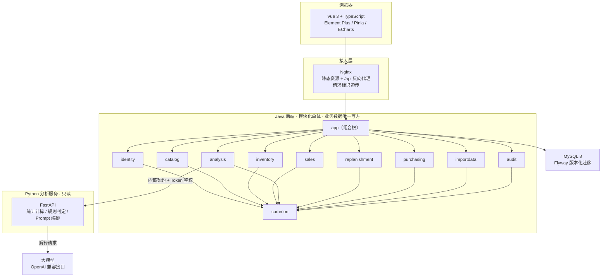

# ShopPilot AI

**面向中小电商团队的库存决策与采购协同平台**

把「库存数据 → 风险识别 → 补货建议 → 人工审核 → 采购执行 → 到货入库 → 复盘」串成一条可追溯的业务闭环，
用确定性规则完成算账，用大模型把结论翻译成运营能直接使用的话。


---

## 1. 解决什么问题

中小电商在多 SKU、多仓、销量波动大的场景下，补货长期依赖个人经验，典型症状有三个：

| 症状 | 后果 |
| --- | --- |
| 补多少凭手感 | 热销品断货丢单，滞销品占压资金，两种损失同时存在 |
| 决策无依据 | 事后无法复盘"当初为什么补这个量"，经验无法沉淀 |
| 数据分散 | 库存、销售、采购各在表格与后台里，靠人工搬运，易错易漏 |

本项目的定位不是报表后台，而是一套**可复现、可解释、可审计**的决策系统：
同一份输入必须算出同一个结果，每个数字都能追到来源，每一次库存变更都能追到人。

## 2. 四条设计原则

1. **确定性逻辑对结果负责**：库存数量、补货量、风险等级全部由 Java 业务逻辑与 Python 规则计算得出，可测试、可复现。
2. **大模型只负责解释**：LLM 把已算好的结论转写成自然语言，不产生业务数字、不改库存、不审批、不创建单据；模型不可用时自动降级，规则结果照常返回。
3. **Java 是业务数据的唯一写入口**：Python 分析服务只读不写，所有库存变更必须经过 Java 的事务与约束。
4. **一切可追溯**：每次分析留存输入快照、计算参数、算法版本、Prompt 版本与模型名；库存变更强制落事务流水。

## 3. 系统架构



**模块依赖方向**（单向，禁止反向与跨域直连数据表）：

```
identity → catalog → {inventory, sales} → analysis → replenishment → purchasing
common / audit 为叶子模块；app 为组合根，不承载业务逻辑
```

跨模块只读数据一律走对方暴露的应用服务接口，禁止注入他域 Mapper —— 这条约束由模块边界与代码评审共同保证。

## 4. 核心业务闭环

```
① 导入主数据（商品 / SKU / 供应商 / 仓库）+ 库存快照 + 历史日销
        ↓
② 库存余额与流水（余额可由流水推导，盘点与冲销均可追溯）
        ↓
③ 创建分析任务 → Java 组装最小数据集 → Python 确定性计算（日均销量 / 风险 / 补货量）
        ↓
④ 生成自然语言解释（失败则标记降级，规则结果照常保留）
        ↓
⑤ 补货建议生成 → 运营修改 → 提交审核 → 审批人通过 / 驳回
        ↓
⑥ 审批通过 → 由建议生成采购单（此时库存不变）→ 确认 → 下单
        ↓
⑦ 登记到货（支持部分到货）→ 确认 → 单事务内写库存流水与余额 → 采购单状态推导
        ↓
⑧ 全程审计留痕；分析结果可回溯到输入快照与算法 / Prompt 版本
```

## 5. 关键设计

### 补货计算

```
SS     = D × ceil(L × ss_ratio)          # 安全库存（CV 超阈值再放大）
IP     = on_hand + in_transit − committed # 库存持仓
Q_base = max(0, D × (L + R) + SS − IP)    # 基础补货量
```

`Q_base` 再按 MOQ / 最小起订倍数 / 步长向上取整，得到建议补货量。
所有数量字段 `decimal(18,3)`、单价 `decimal(18,4)`、金额 `decimal(18,2)`，全链路不做浮点换算。

### 六类库存风险

| 风险类型 | 判定要点 |
| --- | --- |
| `STOCKOUT` | 在库为 0，或可售天数 ≤ 2 |
| `LOW_STOCK` | 库存持仓低于交期 + 补货周期需求 |
| `OVERSTOCK` | 在库可售天数远超阈值（分档定级） |
| `SLOW_MOVING` | 观察窗内销量为 0 且仍有在库 |
| `SALES_ANOMALY` | 销量波动显著偏离历史分布 |
| `DATA_INSUFFICIENT` | 有效数据不足，不出结论并标记原因 |

规则判定前先校验日均销量可算（`D > 0`），不满足时跳过相关规则并写入告警原因，避免用脏数据产出误导性建议。

### 一致性与并发

- **唯一写入口**：库存变动只经一个应用服务，且必须落事务流水；`available_qty` 为库表生成列，不可写。
- **幂等**：以「交易类型 : 业务类型 : 业务单号 : SKU : 可选后缀」分段构造幂等键，网络重试与重复点击不产生重复入库。
- **乐观锁**：单据流转统一携带版本号，并发审批不再互相覆盖；冲突返回可识别的业务错误码。
- **冲销回退**：库存冲销在同一事务单元内联动回退上游单据状态，保证账实与单据状态双向一致。

### 单据状态机

```
补货建议：SUGGESTED → PENDING_REVIEW → APPROVED → CONVERTED
          可撤回 / 驳回 / 作废 / 被新批次取代

采购单：  DRAFT → PENDING → ORDERED → PARTIALLY_RECEIVED → RECEIVED
到货单：  DRAFT → CONFIRMED
```

状态迁移在服务层集中校验，非法迁移直接拒绝；重复确认按幂等处理，不产生二次入库。

## 6. 技术栈

| 层 | 技术选型 |
| --- | --- |
| 前端 | Vue 3 + TypeScript + Vite + Element Plus + Pinia + Vue Router + Axios + ECharts |
| Java 后端 | Java 21 + Spring Boot 3.5 + Spring Security 6 + MyBatis-Plus + Flyway + Maven |
| 数据层 | MySQL 8（`utf8mb4`，时间统一 UTC `DATETIME(3)`） |
| 分析服务 | Python 3.11 + FastAPI + Pydantic v2 + pandas + httpx |
| 测试 | JUnit 5 + MockMvc + Testcontainers（真实 MySQL）、Vitest + Vue Test Utils、pytest |
| 交付 | Docker Compose（mysql / backend-java / service-ai / frontend-web / nginx）、多阶段镜像构建 |

选型刻意保持克制：不引入 Redis、消息队列、服务网格与容器编排平台，单库事务即可满足一致性需求，
降低部署与运维成本。理由记录在 `docs/decisions/`。

## 7. 快速开始

### 前置条件

- Docker Desktop（Compose v2）
- 可用端口：默认 `NGINX_PORT=80`，被占用时以环境变量覆盖（示例用 `8081`）

### 启动开发栈

```bash
cp deploy/.env.example deploy/.env      # 按需修改口令；.env 已被 gitignore
NGINX_PORT=8081 docker compose -f deploy/docker-compose.dev.yml up -d --build
```

启动后：

| 入口 | 地址 |
| --- | --- |
| 前端 | http://localhost:8081/ |
| API 健康检查 | http://localhost:8081/api/v1/health |

后端 Actuator 与 Python 分析服务的健康端点仅在容器网络内可达，不对外暴露。

### 初始化首个团队与账号

Flyway 只建结构不建业务数据，全新库无用户时登录返回 `AUTH-1002` 属预期行为。开发环境可导入种子数据：

```bash
docker exec -i shoppilot-dev-mysql-1 mysql -ushoppilot -pchangeme_app_password shoppilot \
  --default-character-set=utf8mb4 < backend-java/tools/evi/seed-b7.sql
```

种子包含演示团队与不同角色的账号，可用于走通审批链路。
生产环境请自行准备首个团队与 OWNER 的初始化脚本，口令不入仓、由运维注入。

### 常用运维命令

```bash
docker compose -f deploy/docker-compose.dev.yml logs -f backend-java   # 跟踪后端日志
docker compose -f deploy/docker-compose.dev.yml down                   # 停栈，保留数据
docker compose -f deploy/docker-compose.dev.yml down -v                # 停栈并清库
```

## 8. 测试与验证

| 层次 | 说明 |
| --- | --- |
| 单元测试 | 计算口径、状态机迁移、错误码映射等纯逻辑，不依赖外部环境 |
| 集成测试 | 基于 Testcontainers 拉起真实 MySQL，验证事务、约束、幂等与并发 |
| 前端测试 | Vitest + Vue Test Utils，覆盖表单校验、状态渲染、权限显隐 |
| 真实栈验证 | Docker Compose 起全栈后，经 Nginx 走完整 HTTP 链路做端到端断言 |

```bash
# 后端（全量）
cd backend-java && ./mvnw -B clean verify

# 前端
cd frontend-web && npm ci && npx vue-tsc --noEmit && npx vitest run

# 分析服务
cd service-ai && pytest
```

验证强调**证据可复核**：结论必须来自实际执行，不采信未运行的自述。

## 9. 目录结构

```
ShopPilot-AI/
├── backend-java/          # 模块化单体，按业务域拆分为多个 Maven 模块
│   ├── identity/          # 认证、团队、角色
│   ├── catalog/           # 商品、SKU、供应商、仓库
│   ├── inventory/         # 库存余额、事务流水、盘点、冲销
│   ├── sales/             # 日销售数据
│   ├── analysis/          # 分析任务编排、内部契约、结果装配
│   ├── replenishment/     # 补货建议与审核状态机
│   ├── purchasing/        # 采购单、到货单
│   ├── importdata/        # CSV/Excel 导入、校验与错误报告
│   ├── audit/             # 审计日志
│   ├── common/            # 错误码、异常、通用类型
│   └── app/               # 组合根、配置、Flyway 迁移
├── service-ai/            # Python 分析服务（确定性计算 + 大模型解释）
├── frontend-web/          # Vue 3 前端
├── deploy/                # Docker Compose 与部署配置
├── docs/                  # 设计文档（见下节索引）
└── backend-java/tools/    # 种子数据、端到端与验收脚本
```

## 10. 文档索引

设计文档是本项目的主要资产，建议按顺序阅读：

| 文档 | 内容 |
| --- | --- |
| [`docs/DESIGN_BASIS.md`](docs/DESIGN_BASIS.md) | **设计基准（SSOT）**：术语、状态枚举、错误码、补货公式、风险规则。其余文档与之冲突时以它为准 |
| [`docs/00-product/PRD.md`](docs/00-product/PRD.md) | 产品需求与功能优先级 |
| [`docs/00-product/USER_ROLES.md`](docs/00-product/USER_ROLES.md) | 角色与权限矩阵 |
| [`docs/01-architecture/SYSTEM_ARCHITECTURE.md`](docs/01-architecture/SYSTEM_ARCHITECTURE.md) | 上下文图、组件图、数据流、读写边界 |
| [`docs/01-architecture/MODULE_BOUNDARIES.md`](docs/01-architecture/MODULE_BOUNDARIES.md) | 模块职责、依赖方向与事务边界 |
| [`docs/02-database/DATABASE_DESIGN.md`](docs/02-database/DATABASE_DESIGN.md) | 表设计、索引、事务与并发方案 |
| [`docs/02-database/DATABASE_CONSTRAINTS.md`](docs/02-database/DATABASE_CONSTRAINTS.md) | 唯一约束、外键、幂等与团队隔离约束 |
| [`docs/03-api/API_CONTRACT.md`](docs/03-api/API_CONTRACT.md) | 对外 REST 契约、统一响应、幂等与追踪 |
| [`docs/03-api/ERROR_CODES.md`](docs/03-api/ERROR_CODES.md) | 错误码总表 |
| [`docs/04-ai/AI_ARCHITECTURE.md`](docs/04-ai/AI_ARCHITECTURE.md) | 职责划分：为何把计算与解释分离 |
| [`docs/04-ai/PROMPT_DESIGN.md`](docs/04-ai/PROMPT_DESIGN.md) | Prompt 模板、注入防护、降级矩阵 |
| [`docs/05-workflows/INVENTORY_RULES.md`](docs/05-workflows/INVENTORY_RULES.md) | 补货公式与风险规则（含算例） |
| [`docs/06-development/TEST_STRATEGY.md`](docs/06-development/TEST_STRATEGY.md) | 测试分层与用例清单 |
| [`docs/decisions/`](docs/decisions/) | 架构决策记录（ADR） |

## 11. 范围边界

首期明确不做，以保证核心链路的质量：

- 真实电商平台 API 对接（数据以导入方式进入系统）
- 机器学习时序预测模型（采用可解释的统计口径）
- 跨仓调拨、SaaS 计费、多租户运营后台
- 微服务拆分、消息队列、Redis、Kubernetes

这些属于规模化阶段的演进方向，当前架构为其预留了扩展点（模块边界、内部服务契约、ADR 记录）。

## 12. 参与贡献

- 改代码前先读 [`docs/DESIGN_BASIS.md`](docs/DESIGN_BASIS.md)，它是所有约定的唯一出处
- 修改数据库必须走 Flyway 迁移；修改 API 必须同步更新契约文档
- 修改业务流程必须同步更新流程文档与对应测试
- 不虚构测试结果：没跑过就是没跑过

---

**License**：MIT
