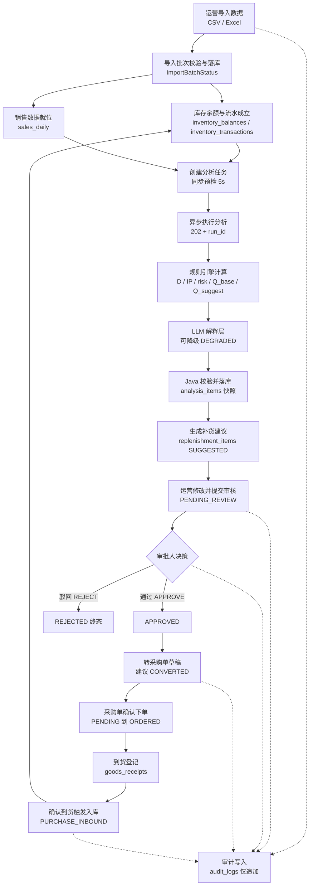

# ShopPilot AI 产品需求文档（PRD）

## 文档元信息

| 项 | 内容 |
| --- | --- |
| 文档名称 | ShopPilot AI 产品需求文档（Product Requirements Document） |
| 文档路径 | `docs/00-product/PRD.md` |
| 文档优先级 | P4（见 `DESIGN_BASIS.md §1.1`） |
| 所属阶段 | M0 设计阶段 |
| 版本 | v1.0（M0 定稿） |
| 上游权威来源 | `docs/DESIGN_BASIS.md`（SSOT，优先级 P0） |
| 主要读者 | 产品、开发、测试、验收方 |
| 状态 | 已定稿，待评审 |

### 本文档负责什么

- 描述**为什么做、给谁做、做什么、做到什么程度**（产品意图与范围）。
- 定义**功能清单**，并给每条功能绑定：功能编号、所属 Java 模块、所属里程碑、优先级。
- 给出**业务闭环主流程**的产品叙述与流程图。
- 给出**需求追踪矩阵**：功能编号 ↔ 模块 ↔ 表 ↔ API ↔ 里程碑。该矩阵是后续一致性检查（见 `docs/06-development/DESIGN_REVIEW.md`）的唯一依据。
- 汇总**非功能需求**与**验收口径总述**。

### 本文档不负责什么

- **不定义术语、命名、枚举值、错误码、补货公式、风险规则阈值、角色代码**。这些事实的唯一权威定义处是 `DESIGN_BASIS.md`，本文档只做**引用**，严禁复述或改写（依据 `DESIGN_BASIS.md §1.2 第 3 条`）。
- 不定义数据库表结构（见 `docs/02-database/DATABASE_DESIGN.md`）。
- 不定义对外 API 细节（见 `docs/03-api/API_CONTRACT.md`）与内部契约（见 `docs/03-api/AI_SERVICE_CONTRACT.md`）。
- 不定义模块依赖规则（见 `docs/01-architecture/MODULE_BOUNDARIES.md`）与技术选型（见 `docs/01-architecture/TECH_STACK.md`）。
- 不定义测试用例（见 `docs/06-development/TEST_STRATEGY.md`）与验收明细（见 `docs/00-product/ACCEPTANCE_CRITERIA.md`）。

---

## 1. 项目背景

ShopPilot AI（项目代号 `shoppilot-ai`，见 `DESIGN_BASIS.md §2`）是一款面向**小型电商团队**的**电商库存决策与采购协同平台**。

当前小型电商团队的库存与补货决策普遍依赖人工经验：运营每天打开平台后台看销量与库存，用 Excel 手工计算"这个 SKU 还能卖几天""要不要补货""补多少"，再靠微信/口头通知老板审批、通知采购下单。这个过程中存在 6 个典型问题，它们构成了本产品的**待解决命题**。

### 1.1 六大待解决问题

| # | 问题 | 现状表现 | 本项目对策 |
| --- | --- | --- | --- |
| P-1 | **数据割裂、口径不一** | 商品/SKU/库存/销售数据分散在平台后台、Excel、聊天记录，同一 SKU 的"可用量"各处不同 | 统一定义**库存位置 `IP`** 与可用量口径（见 `DESIGN_BASIS.md §3`），所有判断基于同一数据源 |
| P-2 | **补货靠拍脑袋** | 补多少全凭经验，容易缺货或压货 | 引入**确定性补货公式** `Q_base`/`Q_suggest`（见 `DESIGN_BASIS.md §10`），先算后说 |
| P-3 | **风险发现滞后** | 缺货/滞销/库存过高往往在损失发生后才被发现 | 引入**库存风险规则集**（见 `DESIGN_BASIS.md §11`），主动识别风险等级与类型 |
| P-4 | **审批链路不成闭环** | 补货建议靠口头审批，无留痕、无状态、无追溯 | 建立**补货建议状态机 + 审核记录**（见 `DESIGN_BASIS.md §9.11`、`§9.12`） |
| P-5 | **采购与库存脱节** | 下了多少单、收了多少货、库存回写了没有，靠人记 | 建立**采购 → 到货 → 入库 → 库存流水**的闭环（见 `DESIGN_BASIS.md §9.6`、`§9.13`、`§9.14`） |
| P-6 | **多团队/多角色数据不安全** | 老板、运营、外部代运营共用账号，越权可看别人的数据 | **多团队隔离 6 条硬规则 + 5 种角色权限矩阵**（见 `DESIGN_BASIS.md §5`、`§6`） |

> **产品判断**：P-1 到 P-3 解决"算得准不准"，P-4、P-5 解决"跑得通不通"，P-6 解决"信不信得过"。三者缺一不可，因此本产品不是"先做计算再加功能"，而是**首期就要形成完整闭环**。

---

## 2. 目标用户画像

产品服务的是**同一个团队内的三种使用者**，他们的角色代码严格取自 `DESIGN_BASIS.md §5`。

### 2.1 使用者一：小电商运营（`OPERATOR`）

| 维度 | 描述 |
| --- | --- |
| 画像 | 1–3 人小团队的日常执行者，负责上架、备货、发货、盯库存 |
| 工具现状 | 电商后台 + Excel + 聊天工具 |
| 核心诉求 | 少手工算数；一眼看出哪些 SKU 要补货、要补多少；把建议提交给老板审批 |
| 关键痛点 | 导入数据麻烦、口径容易错、忘记录入、审批来回沟通成本高 |
| 使用频率 | 每天（高频） |
| 权限特征 | 有写权限、无审批权（见 `DESIGN_BASIS.md §5`） |
| 成功指标 | 单次备货决策从"半天 Excel"降到"导入 + 看建议 + 提交"几步完成 |

### 2.2 使用者二：老板 / 审批人（`APPROVER`）

| 维度 | 描述 |
| --- | --- |
| 画像 | 团队负责人或实际出资人，关心资金占用与断货风险 |
| 核心诉求 | 快速知道"这批建议合不合理、要花多少钱"；一键批准或驳回；能看到谁做了什么 |
| 关键痛点 | 看不到决策依据、审批无留痕、事后无法追溯 |
| 使用频率 | 每天或每两天（中频，但每次决策金额大） |
| 权限特征 | 具备 `OPERATOR` 全部权限 + **审批/驳回 + 创建/取消采购单**（见 `DESIGN_BASIS.md §5`） |
| 成功指标 | 审批时能直接看到风险等级、建议量、计算依据摘要（LLM 解释层） |

### 2.3 使用者三：管理员（`ADMIN` / `OWNER`）

| 维度 | 描述 |
| --- | --- |
| 画像 | 团队内负责配置与账号管理的人，小团队中常由老板兼任 |
| 核心诉求 | 管成员、管团队配置、管策略参数（交期、覆盖天数、MOQ 等）、排查数据问题 |
| 关键痛点 | 成员权限混乱、基础资料录入繁琐、数据出错难定位 |
| 使用频率 | 低频（配置与排障时） |
| 权限特征 | `OWNER` 拥有全部权限含成员管理与团队配置；`ADMIN` 除"所有者转移"外全部权限（见 `DESIGN_BASIS.md §5`） |
| 成功指标 | 新成员开通、策略调整、导入错误排查均可在系统内自助完成 |

### 2.4 使用者四：只读观察者（`VIEWER`）——次要

用于给外部顾问、临时查看者开放**只读**视图（含分析结果与建议），不能做任何写操作，也不能创建分析任务（见 `DESIGN_BASIS.md §5.1 第 3 条`）。

---

## 3. 产品定位

### 3.1 一句话定位

> ShopPilot AI 是**面向小型电商团队的库存决策与采购协同闭环系统**：把"原始数据 → 库存现状 → 风险识别 → 补货建议 → 人工审批 → 采购到货 → 库存回写"这条链路在**同一个系统里跑完并留痕**。

### 3.2 它不是这三样东西

| 容易误解为 | 实际定位 | 说明 |
| --- | --- | --- |
| ❌ **一个聊天页面**（对话框套壳 LLM） | ✅ 业务闭环系统，LLM 只是解释层 | 计算由**确定性规则引擎**完成，LLM **不参与任何判定**（见 `DESIGN_BASIS.md §11` 开篇）。AI 失败时系统仍可用（`DEGRADED` 状态，见 `DESIGN_BASIS.md §9.7`） |
| ❌ **一个纯看板 / 报表工具** | ✅ 有状态机、有写操作、有事务的业务系统 | 建议会流转状态、采购单会产生库存流水、库存余额必须能由流水推导（见 `DESIGN_BASIS.md §3.1 第 4 条`） |
| ❌ **一个全自动下单机器人** | ✅ 人在环中的辅助决策系统 | 所有采购、库存修改、审批**必须由人授权**，LLM 不能直接执行（见 `docs/01-architecture/SYSTEM_ARCHITECTURE.md §调用与写入边界` 第 9 条） |

### 3.3 差异化价值

1. **口径统一**：把"库存位置 `IP`"这类容易混淆的口径固化下来（见 `DESIGN_BASIS.md §3.1`），杜绝"各算各的"。
2. **可解释**：每条补货建议都能追溯到分析明细快照（`analysis_items`，不可变），回答"当时为什么这么算"。
3. **可追溯**：建议 → 审核 → 采购 → 到货 → 库存流水，全链路可审计（`audit_logs`）。
4. **可隔离**：多团队 + 5 角色的权限体系把"数据谁看得见"作为一等公民（见 `DESIGN_BASIS.md §5`、`§6`）。

---

## 4. 功能范围

### 4.1 功能编号与分级约定

- **功能编号**格式：`F-<域>-<两位序号>`，域与 `DESIGN_BASIS.md §12.2` 的业务域缩写保持一致：
  `AUTH`（认证）、`TEAM`（团队）、`CAT`（商品资料）、`IMP`（导入）、`INV`（库存）、`SAL`（销售）、`ANL`（分析）、`RPL`（补货建议与审核）、`PO`（采购到货）、`AUD`（审计）。
- **优先级**：`P0` = 闭环必需，首期必须有；`P1` = 首期应有，可延后至里程碑尾部；`P2` = 首期可选增强，不影响验收。
- **里程碑**：`M0`–`M7`。里程碑划分**不是 `DESIGN_BASIS.md` 已定义的事实**，本文档给出建议划分（见 §4.7），若偏离需以 `docs/06-development/DEVELOPMENT_PLAN.md` 为准。

### 4.2 P0 功能清单（闭环必需）

| 功能编号 | 功能名 | 所属模块 | 里程碑 | 优先级 |
| --- | --- | --- | --- | --- |
| F-AUTH-01 | 用户登录与登出（JWT） | `identity` | M1 | P0 |
| F-AUTH-02 | 令牌刷新与失效（Access 2h / Refresh 7d） | `identity` | M1 | P0 |
| F-AUTH-03 | 用户状态管控（`UserStatus` 启用/禁用） | `identity` | M1 | P0 |
| F-TEAM-01 | 团队成员与角色管理（`TeamRole`） | `identity` | M1 | P0 |
| F-TEAM-02 | 团队级数据隔离（`team_id` 由服务端注入） | `identity` | M1 | P0 |
| F-TEAM-03 | 团队配置（时区、名称、状态 `TeamStatus`） | `identity` | M1 | P0 |
| F-CAT-01 | 仓库管理（`warehouses`，含默认仓） | `catalog` | M2 | P0 |
| F-CAT-02 | 供应商管理（`suppliers`，含交期、MOQ） | `catalog` | M2 | P0 |
| F-CAT-03 | 商品管理（`products`） | `catalog` | M2 | P0 |
| F-CAT-04 | SKU 管理（`skus`，含规格与采购属性） | `catalog` | M2 | P0 |
| F-CAT-05 | 主数据启停（`MasterDataStatus`，停用不参与新分析） | `catalog` | M2 | P0 |
| F-CAT-06 | 补货策略参数维护（`replenishment_policies`） | `inventory` | M3 | P0 |
| F-IMP-01 | CSV / Excel 导入（6 类 `ImportBizType`） | `importdata` | M2 | P0 |
| F-IMP-02 | 导入模板与字段映射 | `importdata` | M2 | P0 |
| F-IMP-03 | 导入预览与全量校验、错误报告下载 | `importdata` | M2 | P0 |
| F-IMP-04 | 导入批次查询与状态跟踪（`ImportBatchStatus`） | `importdata` | M2 | P0 |
| F-IMP-05 | 导入文件级幂等（`file_hash` + `biz_type`） | `importdata` | M2 | P0 |
| F-INV-01 | 库存余额查询（`on_hand_qty` / `available_qty`） | `inventory` | M3 | P0 |
| F-INV-02 | 库存流水查询（`InventoryTxnType`） | `inventory` | M3 | P0 |
| F-INV-03 | 库存盘点调整（`COUNT_ADJUST`） | `inventory` | M3 | P0 |
| F-INV-04 | 手工调整（`MANUAL_ADJUST`，需 `ADMIN`+） | `inventory` | M3 | P0 |
| F-INV-05 | 库存预警（低库存/缺货提示） | `inventory` | M3 | P0 |
| F-SAL-01 | 日销售数据导入与管理（`sales_daily`） | `sales` | M3 | P0 |
| F-SAL-02 | 日销售数据查询与按日期聚合 | `sales` | M3 | P0 |
| F-ANL-01 | 创建分析任务（同步预检 + 异步执行） | `analysis` | M4 | P0 |
| F-ANL-02 | 分析任务状态与进度查询（`AnalysisRunStatus`） | `analysis` | M4 | P0 |
| F-ANL-03 | 日均销量估算 `D`（`avg-ma-3sigma-v1`） | `analysis` | M4 | P0 |
| F-ANL-04 | 库存风险识别（`RiskType` / `RiskLevel`） | `analysis` | M4 | P0 |
| F-ANL-05 | 补货需求计算（`Q_base` → `Q_suggest`） | `analysis` | M4 | P0 |
| F-ANL-06 | 分析明细快照查询（`analysis_items`，不可变） | `analysis` | M4 | P0 |
| F-ANL-07 | 任务取消与超时处理（`CANCELLED` / `TIMEOUT`） | `analysis` | M4 | P0 |
| F-RPL-01 | 补货建议生成（由分析明细派生） | `replenishment` | M5 | P0 |
| F-RPL-02 | 补货建议数量人工修改 | `replenishment` | M5 | P0 |
| F-RPL-03 | 提交审核 / 撤回（`SUBMIT` / `WITHDRAW`） | `replenishment` | M5 | P0 |
| F-RPL-04 | 审批通过 / 驳回（`APPROVE` / `REJECT`，驳回必填意见） | `replenishment` | M5 | P0 |
| F-RPL-05 | 建议作废与被取代（`CANCELLED` / `SUPERSEDED`） | `replenishment` | M5 | P0 |
| F-RPL-06 | 审核记录查询（`replenishment_reviews`） | `replenishment` | M5 | P0 |
| F-PO-01 | 由已审批建议生成采购单（草稿） | `purchasing` | M6 | P0 |
| F-PO-02 | 采购单确认与下单（`DRAFT → PENDING → ORDERED`） | `purchasing` | M6 | P0 |
| F-PO-03 | 采购单取消（`CANCELLED`，含在途影响提示） | `purchasing` | M6 | P0 |
| F-PO-04 | 到货登记与部分到货（支持 `PARTIALLY_RECEIVED`） | `purchasing` | M6 | P0 |
| F-PO-05 | 到货确认触发库存入库（`PURCHASE_INBOUND` 流水） | `purchasing` | M6 | P0 |
| F-PO-06 | 采购单与到货单查询 | `purchasing` | M6 | P0 |
| F-AUD-01 | 关键操作审计写入（`audit_logs`，仅追加） | `audit` | M3 | P0 |
| F-AUD-02 | 审计日志查询与筛选 | `audit` | M6 | P0 |

> 上述 P0 清单已覆盖任务书要求的全部 P0 范围：导入、商品/SKU/供应商/仓库、库存余额/流水/盘点/预警、销售数据、分析任务、补货建议、审核、采购单、到货入库、审计、团队隔离、登录权限。

### 4.3 P1 功能清单（首期应有）

| 功能编号 | 功能名 | 所属模块 | 里程碑 | 优先级 |
| --- | --- | --- | --- | --- |
| F-ANL-08 | LLM 解释层（可降级，`LlmStatus`） | `analysis` | M6 | P1 |
| F-ANL-09 | 分析运行历史对比 | `analysis` | M6 | P1 |
| F-INV-06 | 库存流水冲销（`REVERSAL`） | `inventory` | M6 | P1 |
| F-IMP-06 | 导入错误行在线修正后重导 | `importdata` | M6 | P1 |
| F-RPL-07 | 建议批量提交 / 批量审批 | `replenishment` | M6 | P1 |
| F-PO-07 | 到货单作废（`DRAFT → CANCELLED`） | `purchasing` | M6 | P1 |
| F-AUD-03 | 审计日志导出 | `audit` | M7 | P1 |
| F-TEAM-04 | 团队成员自助修改密码 | `identity` | M7 | P1 |

### 4.4 P2 功能清单（首期可选）

| 功能编号 | 功能名 | 所属模块 | 里程碑 | 优先级 |
| --- | --- | --- | --- | --- |
| F-INV-07 | 库存趋势可视化（ECharts） | `inventory` | M7 | P2 |
| F-ANL-10 | 分析结果导出（CSV） | `analysis` | M7 | P2 |
| F-PO-08 | 采购单打印/导出 | `purchasing` | M7 | P2 |
| F-CAT-07 | 基础资料批量启停 | `catalog` | M7 | P2 |
| F-SAL-03 | 销售数据异常提示（导入期轻量检查） | `sales` | M7 | P2 |

### 4.5 里程碑建议划分

> **说明**：`DESIGN_BASIS.md` 未定义 M1–M7 的交付内容，仅出现过 M0（设计）、M1（编码起点）、M2（Refresh Token 存储决策）、M3（审计权限方案）、M7（DB 级权限）。本节为**建议划分**，最终以 `docs/06-development/DEVELOPMENT_PLAN.md` 为准。

| 里程碑 | 主题 | 交付重点 |
| --- | --- | --- |
| M0 | 设计基线 | 本批设计文档、ADR、SSOT 定稿 |
| M1 | 骨架 + 身份 | 工程骨架、`identity` 模块、JWT 认证、团队隔离底座 |
| M2 | 基础资料 + 导入 | `catalog`、`importdata`，打通"数据进得来" |
| M3 | 库存 + 销售 + 审计底座 | `inventory`、`sales`、`audit` 写入通道 |
| M4 | 分析引擎 | `analysis` 模块、Java↔Python 异步任务、规则引擎 |
| M5 | 建议与审核 | `replenishment` 状态机与审核闭环 |
| M6 | 采购到货 + LLM 层 | `purchasing` 闭环、LLM 解释层、前端整合 |
| M7 | 加固与验收 | 性能、安全（含 DB 级审计权限）、验收用例 |

### 4.6 与 `DESIGN_BASIS.md §2.1` 的对齐说明

本文档功能清单**严格限定在 `DESIGN_BASIS.md §2.1` In Scope 范围内**，未引入任何 Out of Scope 内容（平台 API 对接、ML 预测、Multi-Agent、MQ、K8s、Redis、移动端等）。逐条核对见 §8。

---

## 5. 业务闭环主流程

### 5.1 闭环叙述

闭环共 9 个环节，每个环节都指向明确的模块与数据对象：

1. **导入**：运营通过 CSV/Excel 导入基础资料（商品/SKU/供应商/仓库）、库存快照、历史销售数据。导入经历"上传 → 解析 → 映射 → 校验 → 落库"全流程，状态由 `ImportBatchStatus` 管理（见 `DESIGN_BASIS.md §9.5`）。文件级幂等防止重复导入。
2. **库存成型**：库存快照导入与盘点调整产生 `inventory_transactions`（`INIT_IMPORT` / `COUNT_ADJUST`），并累加为 `inventory_balances`。**余额必须能由流水推导**（见 `DESIGN_BASIS.md §3.1 第 4 条`）。
3. **销售数据就位**：`sales_daily` 提供日均销量 `D` 的估算输入。
4. **分析**：运营创建分析任务，Java 先做轻量预检（同步，5s），再发起异步分析（`POST /internal/v1/analysis/runs`，202 + `run_id`）。Python 侧做数据质量校验、销量统计、风险规则、补货计算，并（可选）调用 LLM 生成解释。
5. **建议**：Java 校验 Python 返回结果与业务关联后落库，`analysis_items`（不可变快照）+ `replenishment_items`（有状态业务对象，初始 `SUGGESTED`）。
6. **审核**：运营可修改建议数量（`SUGGESTED`），提交审核（`SUGGESTED → PENDING_REVIEW`，`ReviewAction.SUBMIT`）；审批人批准（`PENDING_REVIEW → APPROVED`）或驳回（`→ REJECTED`，必填 `review_comment`）。
7. **采购**：已批准建议（`APPROVED`）转采购单草稿（`DRAFT`），建议状态变为 `CONVERTED`（终态）。采购单经 `DRAFT → PENDING → ORDERED`。
8. **到货入库**：到货登记产生 `goods_receipts`，确认到货时调用库存写服务产生 `PURCHASE_INBOUND` 流水，回写 `inventory_balances`；采购单状态推进为 `PARTIALLY_RECEIVED` 或 `RECEIVED`。
9. **审计**：以上关键操作均写入 `audit_logs`（仅追加），实现"谁在何时对什么做了什么"的追溯。

### 5.2 闭环主流程图

> 图中 `PURCHASE_INBOUND` 流水回写到 `inventory_balances` 后，下一轮分析会基于最新库存重新计算，从而**形成真正的闭环**。

### 5.3 闭环的"最小可交付"定义

一个功能闭环要能自证成立，必须满足：

1. 库存余额与流水可对账（`Σ流水 = 余额`）。
2. 建议可追溯到来源分析明细（`source_analysis_item_id`，见 `DESIGN_BASIS.md §3.1 第 1 条`）。
3. 建议到采购单的转换不可重复（`PO-9001`，见 `DESIGN_BASIS.md §12.3`）。
4. 到货数量不得超过待收数量（`PO-9002`）。
5. 任一关键写操作均有审计记录。

---

## 6. 非功能需求

### 6.1 性能

| 编号 | 需求 | 指标 | 验证方式 |
| --- | --- | --- | --- |
| NFR-PERF-01 | 列表类接口响应 | p95 **< 500ms**（在 1 万 SKU、10 万流水量级下） | 压测 + APM 埋点 |
| NFR-PERF-02 | 数据导入吞吐 | 1 万行文件**导入完成 < 60s** | 基准数据导入测试 |
| NFR-PERF-03 | 同步预检接口 | 超时 **5s** 快速失败（见 `DESIGN_BASIS.md §13.4`） | 契约测试 |
| NFR-PERF-04 | 异步分析整体 | 单次运行默认 `timeout_at` **300s** | 超时用例 |
| NFR-PERF-05 | 前端轮询 | 初始间隔 2s，指数退避至 10s（见 `docs/01-architecture/SYSTEM_ARCHITECTURE.md §异步任务设计`） | 前端用例 |
| NFR-PERF-06 | 单次分析 SKU 上限 | `MAX_ANALYSIS_SKUS = 2000`（见 `DESIGN_BASIS.md §10.6`） | 边界用例 |

### 6.2 可用性

| 编号 | 需求 |
| --- | --- |
| NFR-AVAIL-01 | **LLM 不可用时业务不中断**：规则计算结果仍可用，任务进入 `DEGRADED`（终态，业务可用，见 `DESIGN_BASIS.md §9.7`）。 |
| NFR-AVAIL-02 | **AI 服务不可用/超时时必须返回明确错误码**：`ANL-7002` / `ANL-7003`（见 `DESIGN_BASIS.md §12.3`），不得静默失败。 |
| NFR-AVAIL-03 | Python 服务仅内网可达，不因外部依赖宕机而拖垮 Java 主链路。 |
| NFR-AVAIL-04 | 分析失败可重试：用户发起新 run（不自动重试，见 `DESIGN_BASIS.md §13.4`）。 |

### 6.3 可维护性

| 编号 | 需求 |
| --- | --- |
| NFR-MAINT-01 | Java 采用模块化单体，模块依赖方向强制（见 `DESIGN_BASIS.md §7.1`、`docs/01-architecture/MODULE_BOUNDARIES.md`）。 |
| NFR-MAINT-02 | 分层仅 4 层（api/application/domain/infrastructure），不引入 Repository 接口与实现分离（见 `DESIGN_BASIS.md §4.2`）。 |
| NFR-MAINT-03 | 枚举以大写字符串存库，可由数据库 `CHECK` 约束兜底（见 `DESIGN_BASIS.md §4.1`）。 |
| NFR-MAINT-04 | 每个风险规则至少 3 个测试用例（命中边界/未命中/数据不足，见 `DESIGN_BASIS.md §11.3`）。 |
| NFR-MAINT-05 | 算法版本可追溯（`analysis_runs.algorithm_version`，见 `DESIGN_BASIS.md §10.1`）。 |

### 6.4 安全

| 编号 | 需求 |
| --- | --- |
| NFR-SEC-01 | **多团队隔离 6 条硬规则**全部落实（见 `DESIGN_BASIS.md §6`），`team_id` 绝不由客户端传入。 |
| NFR-SEC-02 | 认证采用 JWT（待决策 `D-01`）；登录失败不区分用户是否存在（`AUTH-1002`）。 |
| NFR-SEC-03 | 审批权与执行权分离（见 `DESIGN_BASIS.md §5.1 第 2 条`）。 |
| NFR-SEC-04 | 高风险操作（库存调整、审批、确认到货、取消采购单）必须服务端二次校验权限（见 `docs/00-product/USER_ROLES.md §授权判定规则`）。 |
| NFR-SEC-05 | Java→Python 内部调用需 `X-Internal-Token`（见 `DESIGN_BASIS.md §13.3`）。 |
| NFR-SEC-06 | 审计日志仅追加，应用层禁止 `UPDATE`/`DELETE`（待决策 `D-05`）。 |
| NFR-SEC-07 | 主数据停用后不参与新分析/采购，但历史数据仍可查（见 `DESIGN_BASIS.md §9.4`）。 |

### 6.5 可观测性

| 编号 | 需求 |
| --- | --- |
| NFR-OBS-01 | 全链路 `X-Request-Id` 透传（Java ↔ Python，见 `DESIGN_BASIS.md §13.3`）。 |
| NFR-OBS-02 | 关键指标埋点：导入成功率、分析成功率/降级率、同步/异步耗时、LLM 调用成功率。 |
| NFR-OBS-03 | 分析任务进度可查询（`progress` / `current_step`，见 `DESIGN_BASIS.md §9.7`）。 |
| NFR-OBS-04 | 错误码稳定且分级（见 `DESIGN_BASIS.md §12`）。 |

---

## 7. 关键业务规则摘要（仅引用，不复述定义）

> 本节**只做索引**。任何定义冲突以 `DESIGN_BASIS.md` 为准。

| 规则主题 | 关键点 | 权威定义位置 |
| --- | --- | --- |
| 库存一致性 | 余额 `inventory_balances` 必须能由流水 `inventory_transactions` 推导；`on_hand_qty ≥ 0` 不允许负库存 | `DESIGN_BASIS.md §3.1 第 4 条`、待决策 `D-08` |
| 幂等 | 导入文件级幂等（`team_id + file_hash + biz_type`）；库存/采购/到货均有 `idempotency_key` 唯一约束 | `DESIGN_BASIS.md §9.5`、`§8`（表清单唯一约束列） |
| 状态机 | 分析运行、补货建议、采购单、到货单、导入批次均为显式状态机 | `DESIGN_BASIS.md §9.5`、`§9.7`、`§9.11`、`§9.13`、`§9.14` |
| 补货公式 | `D`、`Q_base`、`SS`、`effective_in_transit_qty`、`Q_suggest` | `DESIGN_BASIS.md §10.1–§10.5` |
| 风险规则 | 6 条确定性规则与等级合成 | `DESIGN_BASIS.md §11` |
| 多团队隔离 | 6 条硬规则 | `DESIGN_BASIS.md §6` |
| 数值精度 | 数量 `DECIMAL(18,3)`、单价 `DECIMAL(18,4)`、金额 `DECIMAL(18,2)`，禁用浮点 | `DESIGN_BASIS.md §14.2` |
| 时区 | 时间戳存 UTC，业务日期为团队时区自然日 | `DESIGN_BASIS.md §14.1` |
| 权限判定 | 团队隔离优先于角色；审批权与执行权分离 | `DESIGN_BASIS.md §5.1`、`docs/00-product/USER_ROLES.md` |
| 安全库存公式 | 首期简化为 `SS = D × ceil(L × 0.5)` | `DESIGN_BASIS.md §10.3`、待决策 `D-04` |

---

## 8. 首期明确不做（Out of Scope）与理由

> 以下清单与 `DESIGN_BASIS.md §2.1` Out of Scope **完全一致**，此处补充产品视角的理由。

| 不做项 | 理由（产品视角） |
| --- | --- |
| 真实电商平台 API 对接（抖店/淘宝/拼多多） | 各平台 API 授权与限流差异大，首期用 CSV/Excel 导入即可满足小团队需求；只预留适配层位，避免首期被平台方接口变更绑架。 |
| 机器学习时间序列预测（LSTM/Prophet） | 小团队历史数据量与质量不足以支撑模型训练；确定性移动平均 + 3σ 截尾**可解释、可测试**，更适合首期建立信任。 |
| Multi-Agent 系统 | 当前任务无需多智能体协作，单次分析编排足够；引入会显著增加复杂度和不可解释性。 |
| Kubernetes / 微服务拆分 / 服务注册中心 | 小团队规模用 Docker Compose 单机部署即可；模块化单体保留拆分可能但不必提前支付运维成本。 |
| Kafka / RabbitMQ | 首期异步分析用 HTTP + 状态轮询即可满足（见 `DESIGN_BASIS.md §13.1`）；引入 MQ 增加部署与排障负担。 |
| Redis | 首期无强缓存/分布式锁刚需（待决策 `D-07`）；避免多一个需要运维的组件。 |
| SaaS 计费 / 多币种 | 目标客户是单团队自用，非 SaaS 多租户计费场景。 |
| 多仓库跨仓调拨 UI | 数据模型保留仓库维度（待决策 `D-02`），但首期 UI 只暴露默认仓，降低页面复杂度。 |
| 移动端 / 小程序 | 目标是运营在电脑上批量操作，Web 优先。 |
| 正式 Flyway 迁移 SQL | M1 起才生成（见 `DESIGN_BASIS.md §2.1`），M0 阶段只做设计。 |
| 独立采购审批流（`PENDING_APPROVAL`） | 首期 `APPROVER` 直接确认 `DRAFT → PENDING` 即视为审批（待决策 `D-06`），避免页面与状态机膨胀。 |

---

## 9. 验收口径总述

> 详细验收用例见 `docs/00-product/ACCEPTANCE_CRITERIA.md`。本节只给总述与"必须可验证"的判定线。

### 9.1 闭环验收（最高优先级）

| 编号 | 验收项 | 判定标准 |
| --- | --- | --- |
| AC-E2E-01 | 完整闭环走通 | 从导入到"到货入库并回写库存"全流程可在一套演示数据上完整跑通 |
| AC-E2E-02 | 库存对账 | 任意 SKU×仓库，`Σ inventory_transactions.qty_delta == inventory_balances.on_hand_qty` |
| AC-E2E-03 | 建议可追溯 | 每条 `replenishment_items` 都能通过 `source_analysis_item_id` 找到对应 `analysis_items` |
| AC-E2E-04 | 转换唯一 | 同一建议重复转采购单返回 `PO-9001` |
| AC-E2E-05 | 到货不超收 | 到货数量超过待收数量返回 `PO-9002` |

### 9.2 隔离与权限验收

| 编号 | 验收项 | 判定标准 |
| --- | --- | --- |
| AC-SEC-01 | 跨团队隔离 | 任意角色跨团队请求均返回 `TEAM-2001`（含 `OWNER`） |
| AC-SEC-02 | 角色越权 | 无权限操作返回 `TEAM-2003` |
| AC-SEC-03 | 审批权分离 | `OPERATOR` 无法审批（`TEAM-2003`），只能起草采购单 |
| AC-SEC-04 | 团队停用 | 停用团队内所有接口返回 `TEAM-2002` |

### 9.3 分析能力验收

| 编号 | 验收项 | 判定标准 |
| --- | --- | --- |
| AC-ANL-01 | 数据不足不猜测 | `n < MIN_DAYS` → `RiskType.DATA_INSUFFICIENT`，`D = null`，**不生成补货建议** |
| AC-ANL-02 | LLM 可降级 | 关闭/故障 LLM 时任务为 `DEGRADED` 且业务结果完整 |
| AC-ANL-03 | 并发保护 | 同团队同 SKU 范围已有 `RUNNING` 任务时返回 `ANL-7001` |
| AC-ANL-04 | 结果校验 | Python 返回未通过 Schema 校验时返回 `ANL-7004` 并不落库 |
| AC-ANL-05 | 规则可测 | 6 条风险规则各至少 3 个用例通过（见 `DESIGN_BASIS.md §11.3`） |

### 9.4 性能验收

见 §6.1 的 NFR-PERF-01、NFR-PERF-02。

---

## 10. 需求追踪矩阵

> 本矩阵是**后续一致性检查的唯一依据**：每一行的"模块 / 表 / API / 里程碑"必须与 `DESIGN_BASIS.md §7.1`、`§8` 及 `docs/03-api/API_CONTRACT.md` 保持一致。API 路径为**规划路径**，最终以 `API_CONTRACT.md` 为准。

### 10.1 P0 功能追踪矩阵

| 功能编号 | 功能名 | 模块 | 主要表 | 规划 API | 里程碑 |
| --- | --- | --- | --- | --- | --- |
| F-AUTH-01 | 用户登录与登出 | `identity` | `users`、`team_members` | `POST /api/v1/auth/login`、`POST /api/v1/auth/logout` | M1 |
| F-AUTH-02 | 令牌刷新与失效 | `identity` | `users` | `POST /api/v1/auth/refresh` | M1 |
| F-AUTH-03 | 用户状态管控 | `identity` | `users` | `PATCH /api/v1/users/{id}/status` | M1 |
| F-TEAM-01 | 团队成员与角色管理 | `identity` | `team_members` | `GET/POST/PATCH /api/v1/teamss/{teamId}/members` | M1 |
| F-TEAM-02 | 团队级数据隔离 | `identity` | 全部团队业务表 | `TeamContext` 注入（非独立 API） | M1 |
| F-TEAM-03 | 团队配置 | `identity` | `teams` | `GET/PATCH /api/v1/teams` | M1 |
| F-CAT-01 | 仓库管理 | `catalog` | `warehouses` | `GET/POST/PATCH /api/v1/warehouses` | M2 |
| F-CAT-02 | 供应商管理 | `catalog` | `suppliers` | `GET/POST/PATCH /api/v1/suppliers` | M2 |
| F-CAT-03 | 商品管理 | `catalog` | `products` | `GET/POST/PATCH /api/v1/products` | M2 |
| F-CAT-04 | SKU 管理 | `catalog` | `skus` | `GET/POST/PATCH /api/v1/skus` | M2 |
| F-CAT-05 | 主数据启停 | `catalog` | `warehouses`/`suppliers`/`products`/`skus` | `PATCH /api/v1/{resource}/{id}/status` | M2 |
| F-CAT-06 | 补货策略参数维护 | `inventory` | `replenishment_policies` | `GET/PUT /api/v1/replenishment-policies` | M3 |
| F-IMP-01 | CSV/Excel 导入 | `importdata` | `import_batches` | `POST /api/v1/import/batches` | M2 |
| F-IMP-02 | 导入模板与字段映射 | `importdata` | `import_batches` | `POST /api/v1/import/batches/{id}/mapping` | M2 |
| F-IMP-03 | 导入预览与校验 | `importdata` | `import_batches`、`import_row_errors` | `POST /api/v1/import/batches/{id}/validate`、`GET /api/v1/import/batches/{id}/errors` | M2 |
| F-IMP-04 | 导入批次查询 | `importdata` | `import_batches` | `GET /api/v1/import/batches`、`GET /api/v1/import/batches/{id}` | M2 |
| F-IMP-05 | 导入文件级幂等 | `importdata` | `import_batches` | 内置于 `POST /api/v1/import/batches` | M2 |
| F-INV-01 | 库存余额查询 | `inventory` | `inventory_balances` | `GET /api/v1/inventory/balances` | M3 |
| F-INV-02 | 库存流水查询 | `inventory` | `inventory_transactions` | `GET /api/v1/inventory/transactions` | M3 |
| F-INV-03 | 库存盘点调整 | `inventory` | `inventory_balances`、`inventory_transactions` | `POST /api/v1/inventory/adjustments` | M3 |
| F-INV-04 | 手工调整 | `inventory` | `inventory_balances`、`inventory_transactions` | `POST /api/v1/inventory/adjustments` | M3 |
| F-INV-05 | 库存预警 | `inventory` | `inventory_balances` | `GET /api/v1/inventory/alerts` | M3 |
| F-SAL-01 | 日销售数据管理 | `sales` | `sales_daily` | 经 `F-IMP-01` 导入 | M3 |
| F-SAL-02 | 日销售数据查询 | `sales` | `sales_daily` | `GET /api/v1/sales/daily` | M3 |
| F-ANL-01 | 创建分析任务 | `analysis` | `analysis_runs` | `POST /api/v1/analysis/runs` | M4 |
| F-ANL-02 | 分析状态与进度查询 | `analysis` | `analysis_runs` | `GET /api/v1/analysis/runs/{id}` | M4 |
| F-ANL-03 | 日均销量估算 | `analysis` | `analysis_items` | 内置于运行结果 | M4 |
| F-ANL-04 | 库存风险识别 | `analysis` | `analysis_items` | 内置于运行结果 | M4 |
| F-ANL-05 | 补货需求计算 | `analysis` | `analysis_items` | 内置于运行结果 | M4 |
| F-ANL-06 | 分析明细快照查询 | `analysis` | `analysis_items` | `GET /api/v1/analysis/runs/{id}/items` | M4 |
| F-ANL-07 | 任务取消与超时 | `analysis` | `analysis_runs` | `POST /api/v1/analysis/runs/{id}:cancel` | M4 |
| F-RPL-01 | 补货建议生成 | `replenishment` | `replenishment_items` | 由分析落库时生成 | M5 |
| F-RPL-02 | 建议数量修改 | `replenishment` | `replenishment_items` | `PATCH /api/v1/replenishment/items/{id}` | M5 |
| F-RPL-03 | 提交审核/撤回 | `replenishment` | `replenishment_items`、`replenishment_reviews` | `POST /api/v1/replenishment/items/{id}:submit`、`:withdraw` | M5 |
| F-RPL-04 | 审批通过/驳回 | `replenishment` | `replenishment_items`、`replenishment_reviews` | `POST /api/v1/replenishment/items/{id}:approve`、`:reject` | M5 |
| F-RPL-05 | 建议作废/被取代 | `replenishment` | `replenishment_items` | `POST /api/v1/replenishment/items/{id}:cancel` | M5 |
| F-RPL-06 | 审核记录查询 | `replenishment` | `replenishment_reviews` | `GET /api/v1/replenishment/items/{id}/reviews` | M5 |
| F-PO-01 | 生成采购单 | `purchasing` | `purchase_orders`、`purchase_order_items` | `POST /api/v1/purchasing/orders` | M6 |
| F-PO-02 | 采购单确认与下单 | `purchasing` | `purchase_orders` | `POST /api/v1/purchasing/orders/{id}:confirm`、`:order` | M6 |
| F-PO-03 | 采购单取消 | `purchasing` | `purchase_orders` | `POST /api/v1/purchasing/orders/{id}:cancel` | M6 |
| F-PO-04 | 到货登记 | `purchasing` | `goods_receipts`、`goods_receipt_items` | `POST /api/v1/purchasing/receipts` | M6 |
| F-PO-05 | 到货确认入库 | `purchasing` | `goods_receipts`、`inventory_transactions`、`inventory_balances` | `POST /api/v1/purchasing/receipts/{id}:confirm` | M6 |
| F-PO-06 | 采购与到货查询 | `purchasing` | `purchase_orders`、`goods_receipts` | `GET /api/v1/purchasing/orders`、`GET /api/v1/purchasing/receipts` | M6 |
| F-AUD-01 | 审计写入 | `audit` | `audit_logs` | 由各模块埋点触发（非独立 API） | M3 |
| F-AUD-02 | 审计日志查询 | `audit` | `audit_logs` | `GET /api/v1/audit/logs` | M6 |

### 10.2 P1/P2 功能追踪矩阵（简表）

| 功能编号 | 功能名 | 模块 | 主要表 | 规划 API | 里程碑 |
| --- | --- | --- | --- | --- | --- |
| F-ANL-08 | LLM 解释层 | `analysis` | `analysis_runs`、`analysis_items` | 内置于运行结果（`llm_status`） | M6 |
| F-ANL-09 | 分析运行历史对比 | `analysis` | `analysis_runs` | `GET /api/v1/analysis/runs` | M6 |
| F-INV-06 | 库存流水冲销 | `inventory` | `inventory_transactions` | `POST /api/v1/inventory/transactions/{id}:reverse` | M6 |
| F-IMP-06 | 错误行修正后重导 | `importdata` | `import_batches`、`import_row_errors` | `POST /api/v1/import/batches/{id}:reimport` | M6 |
| F-RPL-07 | 批量提交/审批 | `replenishment` | `replenishment_items` | `POST /api/v1/replenishment/items:batch-submit`、`:batch-approve` | M6 |
| F-PO-07 | 到货单作废 | `purchasing` | `goods_receipts` | `POST /api/v1/purchasing/receipts/{id}:cancel` | M6 |
| F-AUD-03 | 审计日志导出 | `audit` | `audit_logs` | `GET /api/v1/audit/logs:export` | M7 |
| F-TEAM-04 | 成员自助改密 | `identity` | `users` | `POST /api/v1/auth/change-password` | M7 |
| F-INV-07 | 库存趋势可视化 | `inventory` | `inventory_transactions` | 前端聚合 | M7 |
| F-ANL-10 | 分析结果导出 | `analysis` | `analysis_items` | `GET /api/v1/analysis/runs/{id}/items:export` | M7 |
| F-PO-08 | 采购单打印/导出 | `purchasing` | `purchase_orders` | `GET /api/v1/purchasing/orders/{id}:export` | M7 |
| F-CAT-07 | 基础资料批量启停 | `catalog` | 主数据四表 | `POST /api/v1/{resource}:batch-status` | M7 |
| F-SAL-03 | 销售导入期轻量检查 | `sales` | `sales_daily` | 内置于导入校验 | M7 |

### 10.3 矩阵可核对性声明

- **模块列**必须属于 `DESIGN_BASIS.md §7.1` 的 10 个模块之一。
- **表列**必须属于 `DESIGN_BASIS.md §8` 的 22 张表之一。
- **API 列**规划路径必须符合 `DESIGN_BASIS.md §2` 的版本前缀 `/api/v1`。
- 任一功能若在实现阶段发现需要新增表、新增模块或改变依赖方向，必须先走 ADR 流程并同步更新本矩阵。

---

## 11. 风险与开放问题

### 11.1 产品风险

| 风险 | 影响 | 缓解 |
| --- | --- | --- |
| 导入数据质量差导致分析无意义 | 建议不可信 | 强化导入期校验与错误报告（F-IMP-03）；数据不足明确提示而非猜测 |
| 用户不理解 `IP` 与 `available_qty` 区别 | 误用展示口径做补货判断 | 前端严格区分两个口径（见 `DESIGN_BASIS.md §3.1 第 3 条`），并在界面加口径说明 |
| LLM 解释产生幻觉 | 误导审批 | LLM 不参与判定；输出必须经 Schema 校验；失败即降级 `DEGRADED` |
| 多团队隔离被绕过 | 数据泄露 | 6 条硬规则 + MyBatis 租户插件兜底 + 业务层显式校验双保险 |

### 11.2 与 `DESIGN_BASIS.md` 相关的开放问题

本文档所有待决策项均引用 `DESIGN_BASIS.md §15` 的编号，未新增编号：
`D-01`（认证方案）、`D-02`（多仓 UI）、`D-03`（趋势修正）、`D-04`（安全库存公式）、`D-05`（审计独立账号）、`D-06`（采购审批流）、`D-07`（Redis）、`D-08`（负库存）。

### 11.3 本文档发现的与 `DESIGN_BASIS.md` 不一致之处

| # | 位置 | 现象 | 建议 |
| --- | --- | --- | --- |
| 1 | `DESIGN_BASIS.md §9.5` | `DUPLICATE_REJECTED` 行中写"允许用户强制重导 → `FORCE_REIMPORT`"，但 `FORCE_REIMPORT` 未在 `ImportBatchStatus` 枚举表中定义，无法判断它是**状态值**还是**动作**。 | 与 DESIGN_BASIS 不一致（表述歧义），建议修订 `§9.5`：明确 `FORCE_REIMPORT` 是一个**操作/参数**（如 `force=true` 请求参数）还是新增枚举值，二者不得混用。本文档 §4.2 F-IMP-05 按"动作"理解，未定义该状态值。 |

---

## 12. 变更记录

| 版本 | 日期 | 变更 | 作者 |
| --- | --- | --- | --- |
| v1.0 | 2026-10-14 | M0 初稿：功能清单、闭环流程、追踪矩阵 | 产品 / 架构 |
