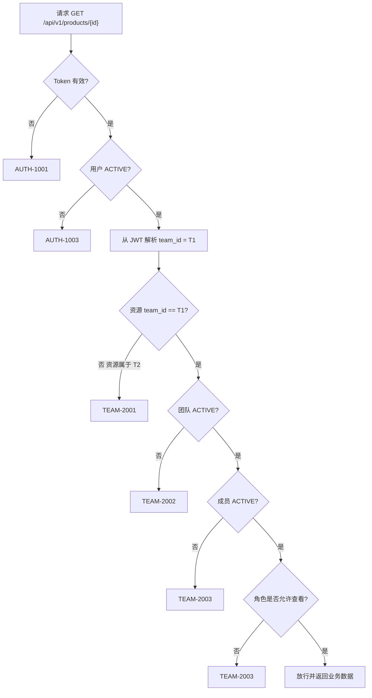

# ShopPilot AI 用户角色与权限设计（USER_ROLES）

## 文档元信息

| 项 | 内容 |
| --- | --- |
| 文档名称 | 用户角色与权限设计 |
| 文档路径 | `docs/00-product/USER_ROLES.md` |
| 文档优先级 | P4（见 `DESIGN_BASIS.md §1.1`） |
| 所属阶段 | M0 设计阶段 |
| 版本 | v1.0（M0 定稿） |
| 上游权威来源 | `docs/DESIGN_BASIS.md §5`（角色权威定义）、`§6`（团队隔离）、`§12`（错误码） |
| 主要读者 | 开发、测试、安全评审 |

### 本文档负责什么

- 展开 `DESIGN_BASIS.md §5` 定义的五种角色，给出**完整权限矩阵**与每个角色的详细说明与典型场景。
- 定义**授权判定规则**（治理逻辑）与**服务端校验要求**。
- 给出**越权场景示例**，并绑定 `DESIGN_BASIS.md §12.3` 的错误码。

### 本文档不负责什么

- **不定义角色代码本身**。角色代码 `OWNER` / `ADMIN` / `OPERATOR` / `APPROVER` / `VIEWER` 的权威定义在 `DESIGN_BASIS.md §5`，本文档不得新增、改名或删除角色。
- **不定义团队隔离的 6 条硬规则**（见 `DESIGN_BASIS.md §6`），本文档只引用并说明其在授权判定中的优先级。
- 不定义错误码数值（见 `DESIGN_BASIS.md §12`）；本文档只引用错误码常量。
- 不定义 API 契约（见 `docs/03-api/API_CONTRACT.md`），矩阵中的功能点为**业务语言**，具体 API 见 `PRD.md §10`。

---

## 1. 角色定义

> 角色是**团队内角色（team-scoped role）**，不是全局角色。同一用户在不同团队可以有不同角色（见 `DESIGN_BASIS.md §5`）。角色代码必须与 `DESIGN_BASIS.md §5`、`§9.3` 完全一致。

| 角色代码 | 中文 | 一句话定位 | 数量约束 |
| --- | --- | --- | --- |
| `OWNER` | 团队所有者 | 团队的最高责任人，拥有全部权限含成员管理与团队配置 | 每团队恰好 1 名（未来可支持转移） |
| `ADMIN` | 管理员 | 除"团队所有者转移"外的全部权限，可管理成员（不能移除 `OWNER`） | 0..N |
| `OPERATOR` | 运营 | 日常执行者：导入、看库存、建分析、改建议、提交审核；**不能审批** | 0..N |
| `APPROVER` | 审批人（老板） | `OPERATOR` 全部权限 + 审批/驳回建议 + 创建/取消采购单 | 0..N |
| `VIEWER` | 只读 | 只读查看业务数据（含分析结果与建议），不能做任何写操作 | 0..N |

### 1.1 角色能力包含关系（非严格继承）

```
OWNER ⊃ ADMIN ⊃ APPROVER ⊃ OPERATOR ⊃ VIEWER
```

> **重要**：这是**能力包含**关系（上层角色能做下层能做的事），但**授权判定不采用"继承链 + 覆盖"实现**，而是采用**权威矩阵直查**（见 §4）。原因：避免"继承链"在多处被实现出不同语义，也便于对高风险操作做**例外收窄**（例如 `VIEWER` 连"创建分析"都没有，而 `OPERATOR` 有；`OPERATOR` 不能审批，`APPROVER` 才能）。矩阵是唯一事实来源（见 `DESIGN_BASIS.md §5.1 第 4 条`）。

---

## 2. 完整权限矩阵

### 2.1 图例

| 标记 | 含义 |
| --- | --- |
| ✅ 允许 | 该角色可执行该操作 |
| ❌ 禁止 | 该角色不可执行，服务端返回 `TEAM-2003` |
| ⚠️ 需二次确认 | 可执行，但为**高风险操作**，服务端必须做额外前置校验（见 §4.4），前端需弹确认框 |

### 2.2 权限矩阵（权威）

> 行 = 功能点，列 = 5 个角色。**代码中的授权判定必须以本矩阵为唯一依据**（见 `DESIGN_BASIS.md §5.1 第 4 条`）。

| # | 功能点 | OWNER | ADMIN | OPERATOR | APPROVER | VIEWER |
| --- | --- | --- | --- | --- | --- | --- |
| 1 | 数据导入（CSV/Excel） | ✅ | ✅ | ✅ | ✅ | ❌ |
| 2 | 商品 / SKU / 供应商 / 仓库管理 | ✅ | ✅ | ✅ | ✅ | ❌ |
| 3 | 库存调整（盘点 / 手工） | ⚠️ | ⚠️ | ⚠️ | ⚠️ | ❌ |
| 4 | 创建分析任务 | ✅ | ✅ | ✅ | ✅ | ❌ |
| 5 | 查看分析（结果与建议） | ✅ | ✅ | ✅ | ✅ | ✅ |
| 6 | 修改补货建议（数量） | ✅ | ✅ | ✅ | ✅ | ❌ |
| 7 | 提交审核 | ✅ | ✅ | ✅ | ✅ | ❌ |
| 8 | 审批（通过 / 驳回） | ✅ | ✅ | ❌ | ✅ | ❌ |
| 9 | 创建采购单 | ✅ | ✅ | ⚠️（仅起草 `DRAFT`） | ✅ | ❌ |
| 10 | 到货登记 | ✅ | ✅ | ✅ | ✅ | ❌ |
| 11 | 查看审计 | ✅ | ✅ | ❌ | ❌ | ❌ |
| 12 | 成员管理 | ✅ | ✅ | ❌ | ❌ | ❌ |
| 13 | 团队配置 | ✅ | ✅ | ❌ | ❌ | ❌ |
| 14 | 团队所有者转移 | ⚠️ | ❌ | ❌ | ❌ | ❌ |

#### 矩阵要点说明

| 功能点 | 说明 | 依据 |
| --- | --- | --- |
| #1 数据导入 | `VIEWER` 只读，不能导入 | `DESIGN_BASIS.md §5` |
| #2 主数据管理 | 视为常规写操作，`OPERATOR` 及以上可做 | `DESIGN_BASIS.md §5` |
| #3 库存调整 | **高风险写入**，需二次确认；注意 `MANUAL_ADJUST` 在业务规则上要求 `ADMIN`+（见下） | `DESIGN_BASIS.md §9.6` `MANUAL_ADJUST` 备注"需 `ADMIN`+" |
| #4 创建分析 | `VIEWER` 不能创建，只能看历史结果 | `DESIGN_BASIS.md §5.1 第 3 条` |
| #5 查看分析 | 所有角色（含 `VIEWER`）可查看 | `DESIGN_BASIS.md §5`、`§5.1 第 3 条` |
| #8 审批 | **仅 `OWNER` / `ADMIN` / `APPROVER`** | `DESIGN_BASIS.md §5`、`§5.1 第 2 条` |
| #9 创建采购单 | `OPERATOR` 只能**起草**（`PurchaseOrderStatus.DRAFT`），**生效需 `APPROVER` 确认** | `DESIGN_BASIS.md §5.1 第 2 条`、`§9.13` |
| #11 查看审计 | 仅管理角色；审计含团队治理与成员行为 | 本设计与 `D-05` |
| #12 成员管理 | `ADMIN` 可管理成员，但**不能移除 `OWNER`** | `DESIGN_BASIS.md §5` |
| #14 所有者转移 | 仅 `OWNER`，需二次确认（未来能力） | `DESIGN_BASIS.md §5`（"可在未来支持转移"） |

### 2.3 库存调整的权限收窄（重要例外）

矩阵 #3 对 `OPERATOR` / `APPROVER` 标为 ⚠️，但 `DESIGN_BASIS.md §9.6` 明确规定 `MANUAL_ADJUST`（手工调整）**需 `ADMIN` 及以上**。因此需要**按流水类型细分**：

| 库存操作 | 对应 `InventoryTxnType` | OWNER | ADMIN | OPERATOR | APPROVER | VIEWER |
| --- | --- | --- | --- | --- | --- | --- |
| 盘点调整 | `COUNT_ADJUST` | ⚠️ | ⚠️ | ⚠️ | ⚠️ | ❌ |
| 手工调整 | `MANUAL_ADJUST` | ⚠️ | ⚠️ | ❌ | ❌ | ❌ |
| 冲销 | `REVERSAL` | ⚠️ | ⚠️ | ❌ | ❌ | ❌ |

> **与 DESIGN_BASIS 一致性**：本细表**直接落实** `DESIGN_BASIS.md §9.6` 中 `MANUAL_ADJUST` 的"需 `ADMIN`+"约束，未与之冲突。矩阵 #3 的粗粒度标记是对应的**合并视图**。

---

## 3. 各角色详细权限说明与典型场景

### 3.1 `OWNER`（团队所有者）

- **权限**：全部权限，含成员管理与团队配置、所有者转移。
- **约束**：
  - 每团队恰好 1 名（见 `DESIGN_BASIS.md §5`）。
  - **仍然受团队隔离约束**：`OWNER` 不能访问其他团队数据（见 `DESIGN_BASIS.md §5.1 第 1 条`）。
- **典型场景**：开团队第一天，用 `OWNER` 建团队、配好默认仓库、把老板设为 `APPROVER`、把运营设为 `OPERATOR`；之后主要用管理视图看数据健康度。

### 3.2 `ADMIN`（管理员）

- **权限**：除"团队所有者转移"外的全部权限（见 `DESIGN_BASIS.md §5`）。
- **约束**：可管理成员，但**不能移除 `OWNER`**。
- **典型场景**：老板兼任管理员，负责录入基础资料、调整补货策略参数（交期 `L`、覆盖天数 `R`、MOQ）、排查导入错误、查审计。

### 3.3 `OPERATOR`（运营）

- **权限**：数据导入、查看库存、创建分析任务、查看/修改补货建议、提交审核；**不能审批**（见 `DESIGN_BASIS.md §5`）。
- **约束**：可**起草**采购单但不生效（`DRAFT`），需 `APPROVER` 确认（见 `DESIGN_BASIS.md §5.1 第 2 条`）。
- **典型场景**：每天早上导出前一日数据 → 导入 → 建分析任务 → 看待补货清单 → 调整建议数量 → 提交审核 → 等老板审批。

### 3.4 `APPROVER`（审批人/老板）

- **权限**：`OPERATOR` 全部权限 + 审批/驳回补货建议 + 创建/取消采购单（见 `DESIGN_BASIS.md §5`）。
- **典型场景**：收到待审批建议 → 看风险等级与 LLM 解释摘要 → 批量批准金额可接受的建议 → 驳回明显不合理的（填写驳回意见）。批准后可直接建采购单，或让运营起草后自己确认。

### 3.5 `VIEWER`（只读）

- **权限**：只读查看业务数据（含分析结果与建议），不能做任何写操作（见 `DESIGN_BASIS.md §5`）。
- **约束**：不能创建分析任务（见 `DESIGN_BASIS.md §5.1 第 3 条`）。
- **典型场景**：外部顾问或临时查看者，只给"看"的账号。

---

## 4. 授权判定规则

> 授权判定是**服务端职责**，不依赖前端隐藏按钮。前端隐藏只是体验优化，**安全边界在服务端**。

### 4.1 判定顺序（固定，不得调换）

服务端处理任一请求时，按以下顺序判定，**任一环节失败立即返回对应错误码并终止**：

```
1. 认证：Token 是否有效？            否 → AUTH-1001
2. 用户状态：用户是否 ACTIVE？        否 → AUTH-1003
                            （UserStatus 见 DESIGN_BASIS §9.1）
3. 团队解析：从 JWT claim 解析 team_id，绝不接受客户端传入
                            （见 DESIGN_BASIS §6 第 3 条）
4. 团队归属：请求资源是否属于该 team_id？  否 → TEAM-2001
5. 团队状态：团队是否 ACTIVE？        否 → TEAM-2002
                            （TeamStatus 见 DESIGN_BASIS §9.2）
6. 成员状态：请求者在该团队是否为 ACTIVE 成员？  否 → TEAM-2003
                            （team_members.status 见 DESIGN_BASIS §9.3）
7. 角色授权：该角色是否具备该操作权限？  否 → TEAM-2003
                            （依据 §2.2 矩阵）
8. 高风险二次校验：是否需要额外前置校验？  否 → 返回对应业务错误码
                            （见 §4.4）
9. 业务规则校验：状态机、幂等、数量约束等 → 返回对应业务错误码
```

> **第 4 步先于第 7 步**：这就是"团队隔离优先于角色"的落地——即使用户是该团队 `OWNER`，访问别的团队资源也在第 4 步就被拦截（`TEAM-2001`），不会走到角色判定。

### 4.2 规则一：团队隔离优先于角色

- **定义**：任何角色都不能访问其他团队的任何数据，包括 `OWNER`（见 `DESIGN_BASIS.md §5.1 第 1 条`）。
- **实现要求**：
  - `team_id` 由服务端从 JWT 与上下文解析，存入 `TeamContext`（见 `DESIGN_BASIS.md §6 第 3 条`）。
  - MyBatis-Plus 全局租户插件自动追加 `team_id` 条件作为**兜底**，但**业务层仍需显式校验**（见 `DESIGN_BASIS.md §6 第 4 条`）。
  - 跨表关联写入必须做**同团队校验**（如 `sku.team_id == po.team_id`），不能仅因参数带 `team_id` 就认为隔离完成。

### 4.3 规则二：审批权与执行权分离

- **定义**：创建（生效的）采购单需要 `APPROVER`；`OPERATOR` 只能起草 `DRAFT`（见 `DESIGN_BASIS.md §5.1 第 2 条`）。
- **实现要求**：
  - 建议的 `PENDING_REVIEW → APPROVED` 转换仅 `APPROVER` / `ADMIN` / `OWNER` 可执行。
  - 采购单 `DRAFT → PENDING` 的确认动作仅 `APPROVER` / `ADMIN` / `OWNER` 可执行。
  - `OPERATOR` 提交 `DRAFT → PENDING` 直接返回 `TEAM-2003`。
- **产品意义**：避免"既当运动员又当裁判"，让资金决策有独立确认。

### 4.4 规则三：高风险操作的服务端校验要求

以下 4 类操作被定义为**高风险操作**，无论角色是否允许，服务端都必须做**额外前置校验**：

| 高风险操作 | 额外服务端校验要求 | 相关错误码 |
| --- | --- | --- |
| **库存调整**（盘点和手工） | ① 校验角色满足 `COUNT_ADJUST` / `MANUAL_ADJUST` 的类型要求（见 §2.3）；② 校验目标 SKU 与仓库同团队且状态可操作；③ 校验调整不使 `on_hand_qty < 0`（**`D-08` 已裁定：不允许负库存**）；④ 校验 `idempotency_key` 唯一；⑤ 校验 `team_id` 一致 | `TEAM-2001`、`TEAM-2003`、`INV-5006`、`INV-5002`、`INV-5003` |
| **审批**（通过/驳回） | ① 校验审批人角色；② 校验建议当前状态为 `PENDING_REVIEW`（否则 `RPL-8001`）；③ 校验审批人与提交人可分离（建议默认要求，见 §7 新增决策）；④ 校验乐观锁版本未变（否则 `RPL-8003`）；⑤ 驳回必填 `review_comment`（否则 `COM-0001`） | `TEAM-2003`、`RPL-8001`、`RPL-8002`、`RPL-8003`、`COM-0001` |
| **确认到货** | ① 校验操作者角色；② 校验到货数量不超过待收数量（否则 `PO-9002`）；③ 校验采购单状态允许（否则 `PO-9003`）；④ 校验 `goods_receipts` 幂等键唯一；⑤ 校验跨表同团队 | `TEAM-2003`、`PO-9002`、`PO-9003`、`PO-9001` |
| **取消采购单** | ① 仅 `APPROVER` / `ADMIN` / `OWNER`（取消影响在途与 `IP`）；② 校验采购单状态允许取消（`DRAFT`/`PENDING`/`ORDERED`/`PARTIALLY_RECEIVED`）；③ 已全部到货（`RECEIVED`）不可取消（否则 `PO-9003`）；④ 提示对在途量与后续补货计算的影响 | `TEAM-2003`、`PO-9003` |

> **为何高风险操作要"双重校验"**：矩阵已限定角色（第 7 步），但高风险操作还需校验**业务前置条件**（状态、数量、幂等），否则可能出现"有权限但操作非法"导致的脏数据。

### 4.5 规则四：数据可见性分级

| 数据 | `OWNER` | `ADMIN` | `OPERATOR` | `APPROVER` | `VIEWER` |
| --- | --- | --- | --- | --- | --- |
| 业务数据（商品/库存/销售/建议/采购） | ✅ | ✅ | ✅ | ✅ | ✅ |
| 分析结果与建议 | ✅ | ✅ | ✅ | ✅ | ✅ |
| 审计日志 | ✅ | ✅ | ❌ | ❌ | ❌ |
| 成员列表与角色 | ✅ | ✅ | ❌ | ❌ | ❌ |
| 团队配置 | ✅ | ✅ | ❌ | ❌ | ❌ |

---

## 5. 越权场景示例

> 以下场景均给出**期望返回的错误码**，错误码取自 `DESIGN_BASIS.md §12.3`。

| # | 场景描述 | 请求者角色 | 期望结果 | 错误码 | 判定依据 |
| --- | --- | --- | --- | --- | --- |
| 1 | 用户 A 属于团队 T1，尝试通过把 URL 里的资源 ID 换成团队 T2 的商品 ID 来查看 T2 的商品详情 | T1 的 `OWNER` | 拒绝 | `TEAM-2001` | `DESIGN_BASIS.md §5.1 第 1 条`、`§6` |
| 2 | `OPERATOR` 尝试对一个 `PENDING_REVIEW` 的补货建议执行"审批通过" | `OPERATOR` | 拒绝 | `TEAM-2003` | `DESIGN_BASIS.md §5.1 第 2 条` |
| 3 | `VIEWER` 尝试创建分析任务 | `VIEWER` | 拒绝 | `TEAM-2003` | `DESIGN_BASIS.md §5.1 第 3 条` |
| 4 | `OPERATOR` 尝试执行手工库存调整（`MANUAL_ADJUST`） | `OPERATOR` | 拒绝 | `TEAM-2003` | `DESIGN_BASIS.md §9.6`（`MANUAL_ADJUST` 需 `ADMIN`+） |
| 5 | `ADMIN` 尝试移除本团队的 `OWNER` 成员 | `ADMIN` | 拒绝 | `TEAM-2003` | `DESIGN_BASIS.md §5`（`ADMIN` 不能移除 `OWNER`） |
| 6 | 用户属于已停用团队，仍尝试调用任一业务接口 | 该团队任意角色 | 拒绝 | `TEAM-2002` | `DESIGN_BASIS.md §9.2` |
| 7 | 请求体伪造 `team_id = 999`（非其所属团队）试图写入数据 | 任意角色 | 服务端忽略传入值，仅以 JWT 解析的团队为准；若资源不属于其团队 → 拒绝 | `TEAM-2001` | `DESIGN_BASIS.md §6 第 3 条` |
| 8 | `OPERATOR` 起草了采购单后，尝试自行将其从 `DRAFT` 确认为 `PENDING`（生效） | `OPERATOR` | 拒绝 | `TEAM-2003` | `DESIGN_BASIS.md §5.1 第 2 条` |
| 9 | `OPERATOR` 尝试查看本团队审计日志 | `OPERATOR` | 拒绝 | `TEAM-2003` | 本文档 §2.2 #11 |
| 10 | 用户账号状态为 `DISABLED`，持旧 Token 访问 | 任意角色 | 拒绝 | `AUTH-1003` | `DESIGN_BASIS.md §9.1` |
| 11 | 已登录但 Token 过期 | 任意角色 | 拒绝 | `AUTH-1001` | `DESIGN_BASIS.md §12.3` |
| 12 | 采购单属于 T1，采购明细参数中传入 T2 的 `sku_id` | T1 的 `APPROVER` | 拒绝 | `TEAM-2001` | `DESIGN_BASIS.md §6 第 4 条`（跨表同团队校验） |

### 5.1 场景判定顺序示例（场景 1 展开）



> 该流程图对应 §4.1 的 9 步判定顺序，在**第 4 步**（团队归属）即拦截了场景 1，早于角色判定。

---

## 6. 角色与团队的边界

### 6.1 核心模型

```
User（全局，一条 users 记录）
  └── team_members（关联表，一条记录 = 用户在某个团队里的成员身份）
        ├── team_id  → teams.id
        ├── user_id  → users.id
        ├── role     → TeamRole（OWNER / ADMIN / OPERATOR / APPROVER / VIEWER）
        └── status   → ACTIVE / REMOVED
```

- 一个用户可属于**多个团队**（`uk_tm_team_user (team_id, user_id)` 保证同一团队内不重复，见 `DESIGN_BASIS.md §8`）。
- **同一用户在不同团队可以有不同角色**（见 `DESIGN_BASIS.md §5`）。
- `users` 是跨团队全局的（见 `DESIGN_BASIS.md §6` 例外说明）；`teams` 自身即团队。

### 6.2 多团队场景示例

| 用户 | 团队 A 中的角色 | 团队 B 中的角色 | 说明 |
| --- | --- | --- | --- |
| 小王 | `OPERATOR` | 无成员记录 | 只在 A 团队工作，访问 B 返回 `TEAM-2001` |
| 老板李 | `OWNER`（A） | `APPROVER`（B） | 在 A 是所有者，在 B 只是审批人；**在 B 不能管理成员** |
| 顾问张 | `VIEWER`（A） | `VIEWER`（B） | 两个团队都只读 |

> **关键**：`OWNER`、`ADMIN` 等角色**不带跨团队含义**。老板李在团队 B 中不是 `OWNER`，因此不能对 B 执行成员管理；能力完全由"当前请求的团队 × 该用户在该团队的角色"决定。

### 6.3 角色变更的生效

| 变更 | 生效时机 | 说明 |
| --- | --- | --- |
| 成员被设为 `REMOVED` | 立即（下次请求即拒绝） | 保留历史记录（见 `DESIGN_BASIS.md §9.3`） |
| 成员角色下调 | 立即 | 例：`APPROVER` 降为 `OPERATOR` 后立即不能审批 |
| 用户被 `DISABLED` | 立即 | 全团队生效（`AUTH-1003`） |
| 团队被 `DISABLED` | 立即 | 团队内所有接口 `TEAM-2002` |

> **实现提示**：若采用 JWT 且在 Token 中缓存角色，必须处理"角色变更后旧 Token 仍携带旧角色"的窗口期问题（如短 TTL、或服务端每次校验成员状态）。该问题与待决策 `D-01`（认证方案）强相关。

### 6.4 `team_id` 传递红线（重申 `DESIGN_BASIS.md §6 第 3 条`）

- `team_id` **绝不接受客户端主动传入**。
- 一律由服务端从 JWT 的 `team_id` claim 与请求路径/上下文解析，由 `TeamContext` 统一提供。
- 任何 Controller 签名里出现 `teamId` 作为**请求参数**，均视为**违规**（见 `docs/01-architecture/MODULE_BOUNDARIES.md §模块边界检查清单`）。

---

## 7. 开放问题与待决策

### 7.1 引用的既有待决策

| 编号 | 与本文档的关系 |
| --- | --- |
| `D-01` | 认证方案（JWT vs Session）直接决定"角色变更后的即时生效"如何实现（见 §6.3） |
| `D-05` | 审计日志独立 DB 账号（仅 INSERT）影响 `ADMIN` / `OWNER` 对审计的访问边界 |

### 7.2 新增待决策

| 编号（建议） | 问题 | 推荐方案 | 可选方案 | 影响 |
| --- | --- | --- | --- | --- |
| **新增待决策（建议编号 D-09）** | 审批是否需要"提交人与审批人必须分离"（四眼原则） | **推荐：默认要求分离**。即 `SUBMIT` 的提交人不能是同一建议的 `APPROVE` / `REJECT` 执行人；若团队只有 1 人（既是 `OPERATOR` 又是 `APPROVER`，即 `OWNER`）则允许并记录审计标记 | 不强制分离（小团队单人场景更灵活） | 影响 `F-RPL-04` 的服务端校验、审核记录字段（需记录提交人与审批人）、`RPL-8002` 语义；单人团队可能被阻塞 |

> 声明：该问题**未在 `DESIGN_BASIS.md §15` 中列出**，属于本文档新发现的关键决策点，编号为**建议** D-09，最终编号与采纳与否以 `DESIGN_BASIS.md` 修订为准。若采纳，需同步更新 `DESIGN_BASIS.md §15` 与 `§5.1`。

### 7.3 本文档发现的与 `DESIGN_BASIS.md` 不一致之处

| # | 位置 | 现象 | 建议 |
| --- | --- | --- | --- |
| 1 | `DESIGN_BASIS.md §5` vs `§9.6` | `§5` 把"库存调整"整体描述为运营常规权限的一部分（`OPERATOR` 权限概述未排除），而 `§9.6` 又规定 `MANUAL_ADJUST` 需 `ADMIN`+。两处**未显式对齐**，容易实现出不一致。 | 与 DESIGN_BASIS 存在**表述未尽一致**，建议修订 `§5` 的 `OPERATOR` 权限概述，补一句"`MANUAL_ADJUST` 除外，见 §9.6"。本文档 §2.3 已按 `§9.6` 细化，以 `§9.6` 为准。 |
| 2 | `DESIGN_BASIS.md §9.5` | `FORCE_REIMPORT` 未在枚举中定义（同 `PRD.md §11.3`）。 | 建议修订 `§9.5` 明确其语义。 |

---

## 8. 变更记录

| 版本 | 日期 | 变更 | 作者 |
| --- | --- | --- | --- |
| v1.0 | 2026-10-14 | M0 初稿：角色定义、权限矩阵、授权规则、越权场景 | 产品 / 架构 |
