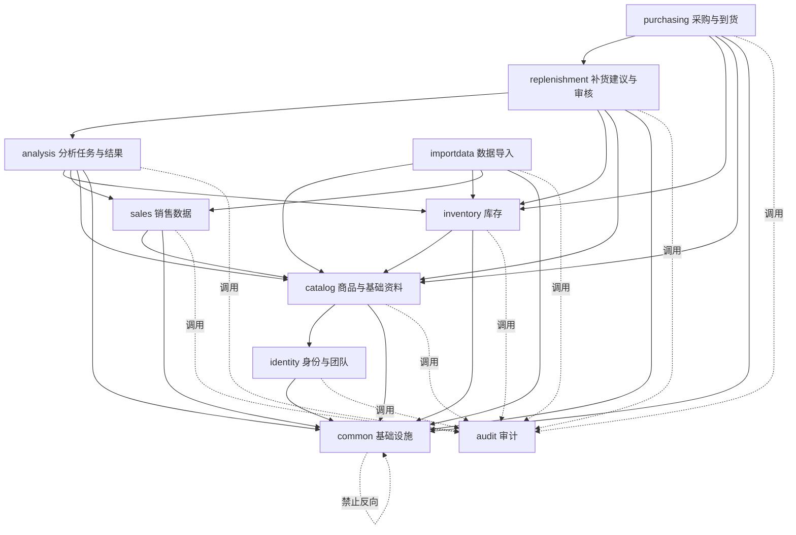

# ShopPilot AI 模块边界设计（MODULE_BOUNDARIES）

## 文档元信息

| 项 | 内容 |
| --- | --- |
| 文档名称 | 模块边界设计 |
| 文档路径 | `docs/01-architecture/MODULE_BOUNDARIES.md` |
| 文档优先级 | P3（见 `DESIGN_BASIS.md §1.1`） |
| 所属阶段 | M0 设计阶段 |
| 版本 | v1.0（M0 定稿） |
| 上游权威来源 | `docs/DESIGN_BASIS.md §7.1`（Java 模块清单与依赖）、`§7.2`（Python 模块）、`§6`（团队隔离）、`§4.2`（分层） |
| 主要读者 | 开发、code review、架构评审 |

### 本文档负责什么

- 逐模块定义 **负责什么 / 不负责什么 / 拥有哪些表 / 对外暴露的服务接口 / 可依赖模块 / 禁止的反向依赖 / 关键事务边界**。
- 定义 **`common` 模块的边界红线**。
- 定义 **跨模块调用规范**（含"反例 vs 正例"结构示意）。
- 说明 **模块间数据读取的例外**
- 定义 **Python AI 服务的 8 个模块边界**。
- 提供 **模块边界检查清单**（供 code review 使用）。

### 本文档不负责什么

- **不定义**表字段与索引细节（见 `docs/02-database/DATABASE_DESIGN.md`）。
- **不定义** API 请求/响应体（见 `docs/03-api/API_CONTRACT.md`、`AI_SERVICE_CONTRACT.md`）。
- **不定义**状态枚举值（见 `DESIGN_BASIS.md §9`）与错误码（见 `§12`）。
- **不定义**技术选型（见 `TECH_STACK.md`）与目录结构（见 `PROJECT_STRUCTURE.md`）。

> **总原则**：模块依赖方向是**强制约束**，来源为 `DESIGN_BASIS.md §7.1`。任何模块若需要新的依赖关系，必须先走 ADR 流程并同步更新 `DESIGN_BASIS.md §7.1` 与本文件。

---

## 1. 顶层依赖方向



> 实线 = 编译期依赖（`import`），虚线 = 运行期调用（通过 `audit` 的埋点能力）。`audit` **被所有模块调用，但自身不依赖任何业务模块**（见 `DESIGN_BASIS.md §7.1`）。`common` **只能依赖框架，禁止依赖任何业务模块**。

### 1.1 完整依赖规则（引用 `DESIGN_BASIS.md §7.1`）

| 模块 | 允许依赖 |
| --- | --- |
| `identity` | `common` |
| `catalog` | `identity`、`common` |
| `importdata` | `catalog`、`inventory`、`sales`、`common` |
| `inventory` | `catalog`、`common` |
| `sales` | `catalog`、`common` |
| `analysis` | `inventory`、`sales`、`catalog`、`common` |
| `replenishment` | `analysis`、`inventory`、`catalog`、`common` |
| `purchasing` | `replenishment`、`inventory`、`catalog`、`common` |
| `audit` | `common`（自身不依赖业务模块） |
| `common` | 仅框架 |
| `app` | 全部 10 个业务模块 + `common`（组合根，自身不被任何业务模块依赖） |

> **通用可依赖叶子模块（F-40 裁定）**：`common` 与 `audit` 为基础设施/横切叶子模块，**任何业务模块均可依赖，无需在上方逐行列出**。`audit` 被所有业务模块调用（见 §2.10、§8.1），`common` 被所有模块依赖；二者均不依赖任何业务模块，故不破坏依赖方向 DAG。ArchUnit 模块依赖断言据此豁免对 `common`/`audit` 的逐模块白名单检查。

### 1.2 强制依赖方向链

```
purchasing → replenishment → analysis → {inventory, sales} → catalog → identity → common
importdata → {catalog, inventory, sales} → catalog → identity → common
app → 全部业务模块 → common（组合根，依赖所有业务模块 + common，自身不被依赖）
```

### 1.3 禁止的反向依赖（代码审查必查）

| 反例 | 说明 |
| --- | --- |
| `catalog` 依赖 `inventory` / `analysis` / `purchasing` | ❌ 基础资料不应感知上层业务 |
| `analysis` 直接读 `purchasing` 表 | ❌ 需采购在途数据时走 `inventory` 的在途口径服务 |
| `inventory` 依赖 `purchasing` | ❌ 入库方向是 `purchasing → inventory`，不能反向 |
| 任何模块依赖 `common` 中的业务逻辑 | ❌ `common` 只有工具、异常基类、上下文、统一响应 |
| 模块间"直接访问对方 Mapper / 表" | ❌ 只能通过对方的 `application` 层服务接口 |

---

## 2. Java 10 个模块详述

> 命名约定：接口签名用**伪代码级描述**（非真实代码文件）。所有服务接口位于被调用方的 `application` 层（`*AppService` 或对外即 `*Service` 命名见 `DESIGN_BASIS.md §4.2`）。

### 2.1 `common`（基础设施）

| 项 | 内容 |
| --- | --- |
| **负责什么** | 统一响应体、异常基类与全局异常处理、错误码常量、`TeamContext`、分页对象、日期/金额工具、MyBatis 租户插件、审计埋点注解、公共校验注解 |
| **明确不负责什么** | 任何业务规则；任何业务表读写；任何业务实体；跨模块业务流程编排 |
| **拥有的表** | 无业务表 |
| **对外暴露的服务接口** | 不暴露业务服务；只暴露技术能力（见 §3） |
| **可以依赖哪些模块** | 仅框架与第三方库（Spring、MyBatis-Plus、Jackson 等） |
| **禁止的反向依赖** | 禁止依赖任何业务模块（`identity` 及以上全部禁止） |
| **关键事务边界** | 无事务；不参与业务事务 |

### 2.2 `identity`（身份与团队）

| 项 | 内容 |
| --- | --- |
| **负责什么** | 用户、团队、团队成员与角色；登录/登出/令牌刷新；用户状态管控；团队状态管控；提供 `TeamContext` 的解析结果（团队归属与角色） |
| **明确不负责什么** | 不负责业务数据的可见性判定**规则之外**的过滤（业务过滤由各模块结合 `TeamContext` 完成）；不负责审计存储（调用 `audit`）；不负责业务数据 |
| **拥有的表** | `users`、`teams`、`team_members` |
| **对外暴露的服务接口** | `AuthAppService.login(username, password)` → 返回令牌对<br/>`AuthAppService.refresh(refreshToken)`<br/>`AuthAppService.logout(userId, tokenId)`<br/>`TeamMemberAppService.listMembers()`<br/>`TeamMemberAppService.addMember(userId, role)`<br/>`TeamMemberAppService.changeRole(memberId, role)`<br/>`TeamMemberAppService.removeMember(memberId)`（**禁止移除 `OWNER`**）<br/>`TeamAuthQueryService.getRoleOf(userId, teamId)` → `TeamRole`<br/>`TeamQueryService.getTeam(teamId)` → 团队信息（含 `default_timezone`、`status`）<br/>`UserStatusQueryService.isUserActive(userId)` |
| **可以依赖哪些模块** | `common` |
| **禁止的反向依赖** | 禁止依赖 `catalog`、`inventory`、`sales`、`analysis`、`replenishment`、`purchasing`、`importdata` |
| **关键事务边界** | 成员增删改：单事务（`team_members` 写 + 校验唯一约束 `uk_tm_team_user`）；角色变更：单事务 |

> **身份与团队的角色判定**：`identity` 提供"该用户在团队的 `TeamRole`"，**授权判定**（该角色能否做该操作）由各模块依据 `docs/00-product/USER_ROLES.md §2.2` 矩阵执行，或在统一鉴权切面中执行（见 §6）。

### 2.3 `catalog`（商品与基础资料）

| 项 | 内容 |
| --- | --- |
| **负责什么** | 仓库、供应商、商品、SKU 的增删改查与启停（`MasterDataStatus`）；编码在团队内唯一性校验；提供基础资料的查询能力（供导入、库存、分析等使用） |
| **明确不负责什么** | 不负责库存数量；不负责策略参数（属 `inventory` 的 `replenishment_policies`）；不负责销售数据 |
| **拥有的表** | `warehouses`、`suppliers`、`products`、`skus` |
| **对外暴露的服务接口** | `WarehouseQueryService.getDefaultWarehouse(teamId)`<br/>`WarehouseQueryService.listActive()`<br/>`SupplierQueryService.getById(supplierId)`<br/>`SupplierQueryService.getLeadTimeDays(supplierId)`<br/>`ProductQueryService.getById(productId)`<br/>`SkuQueryService.listActiveSkus(teamId)`<br/>`SkuQueryService.getSku(skuId)`<br/>`SkuQueryService.getCodesByIds(skuIds)`<br/>`CatalogWriteService.upsertProduct(...)` / `upsertSku(...)` / `upsertSupplier(...)` / `upsertWarehouse(...)`（供 `importdata` 调用）<br/>`CatalogWriteService.changeStatus(resourceType, id, status)` |
| **可以依赖哪些模块** | `identity`、`common` |
| **禁止的反向依赖** | 禁止依赖 `inventory`、`sales`、`analysis`、`replenishment`、`purchasing`、`importdata` |
| **关键事务边界** | 单实体 upsert：单事务；批量导入 upsert：**按批事务**（由 `importdata` 决定批次大小，`catalog` 保证单批原子） |

### 2.4 `importdata`（数据导入）

| 项 | 内容 |
| --- | --- |
| **负责什么** | 导入批次全生命周期（`ImportBatchStatus`）；文件哈希与文件级幂等；解析、字段映射、全量校验、错误报告（`import_row_errors`）；按 `ImportBizType` 分派落库到 `catalog` / `inventory` / `sales` |
| **明确不负责什么** | 不直接写 `catalog` / `inventory` / `sales` 的表（**必须调用它们各自的 application 服务接口**）；不负责库存计算逻辑；不负责销售统计 |
| **拥有的表** | `import_batches`、`import_row_errors` |
| **对外暴露的服务接口** | `ImportAppService.createBatch(fileMeta, bizType, idempotencyKey)`<br/>`ImportAppService.parse(batchId)` → 表头与预览<br/>`ImportAppService.confirmMapping(batchId, mapping)`<br/>`ImportAppService.validate(batchId)` → 错误报告<br/>`ImportAppService.execute(batchId)` → 分批落库<br/>`ImportAppService.cancel(batchId)`<br/>`ImportQueryService.getBatch(batchId)` / `listBatches(filter)`<br/>`ImportQueryService.listRowErrors(batchId)` |
| **可以依赖哪些模块** | `catalog`、`inventory`、`sales`、`common` |
| **禁止的反向依赖** | 禁止依赖 `analysis`、`replenishment`、`purchasing`；禁止直接注入 `catalog` / `inventory` / `sales` 的 Mapper |
| **关键事务边界** | 批次状态推进：单事务；**落库执行：按批事务**，每批成功后记录进度，失败行写入 `import_row_errors`；批次可进入 `PARTIAL_SUCCESS`（部分成功） |

> **落库时的库存写入必须经 `InventoryWriteService`**（见 §5 与 `SYSTEM_ARCHITECTURE.md §5` 边界 8），`importdata` 不得直接 `UPDATE inventory_balances`。

### 2.5 `inventory`（库存）

| 项 | 内容 |
| --- | --- |
| **负责什么** | 库存余额（`inventory_balances`）与库存流水（`inventory_transactions`）的唯一写入口；各类 `InventoryTxnType` 的落账与校验；补货策略参数（`replenishment_policies`）；库存预警口径；**在途口径计算**（`effective_in_transit_qty`，见 `DESIGN_BASIS.md §10.4`） |
| **明确不负责什么** | 不负责采购单与到货单（属 `purchasing`）；不负责分析计算；不负责基础资料维护 |
| **拥有的表** | `inventory_balances`、`inventory_transactions`、`replenishment_policies` |
| **对外暴露的服务接口** | **写接口（唯一入口）**：<br/>`InventoryWriteService.applyInitialImport(skuId, warehouseId, qty, bizRefId, idempotencyKey)`<br/>`InventoryWriteService.applyInbound(skuId, warehouseId, qty, bizType, bizRefId, idempotencyKey)`<br/>`InventoryWriteService.applyOutbound(skuId, warehouseId, qty, bizType, bizRefId, idempotencyKey)`<br/>`InventoryWriteService.applyCountAdjust(skuId, warehouseId, targetQty, bizRefId, idempotencyKey)`<br/>`InventoryWriteService.applyManualAdjust(skuId, warehouseId, qtyDelta, reason, idempotencyKey)`<br/>`InventoryWriteService.applyReversal(txnId, reason, idempotencyKey)`<br/>**读接口**：<br/>`InventoryQueryService.getBalance(skuId, warehouseId)` → 含 `on_hand_qty` / `committed_qty` / `available_qty`<br/>`InventoryQueryService.listBalances(filter, page)`<br/>`InventoryQueryService.listTransactions(filter, page)`<br/>`InventoryQueryService.listAlerts(filter)`<br/>**在途口径（供 analysis）**：<br/>`InventoryInTransitQueryService.getEffectiveInTransit(skuId, warehouseId, windowEndDate)`<br/>`InventoryInTransitQueryService.batchGetEffectiveInTransit(pairs, windowEndDate)`<br/>**策略**：<br/>`ReplenishmentPolicyService.getEffectivePolicy(teamId, skuId, warehouseId)` → 解析 `L` / `R` / `SS` / MOQ / `order_multiple` 三级来源<br/>**同口径锚点行锁（供 `purchasing`，`F-03`）**：<br/>`InventoryWriteService.lockBalanceAnchors(teamId, warehouseId, skuIdsAscending)` → `AnchorLockResult(lockedSkuIds, missingSkuIds)` |
| **可以依赖哪些模块** | `catalog`、`common` |
| **禁止的反向依赖** | 禁止依赖 `purchasing`、`analysis`、`replenishment`、`importdata` |
| **关键事务边界** | **单笔库存变更 = 单事务**：校验（含 `on_hand_qty ≥ 0`）→ 写 `inventory_transactions`（含幂等键唯一约束）→ 更新 `inventory_balances`（乐观锁）→ 提交。余额与流水**必须同事务**（保证可对账） |

> **`InventoryWriteService` 的实现要点**：① 所有方法必须带 `idempotencyKey`，命中 `uk_invtxn_team_idem` 时若内容一致返回既有结果，否则 `INV-5003`；② 乐观锁失败返回 `INV-5002`；③ 出库导致负库存返回 `INV-5001`（`D-08` **已裁定：不允许负库存**；调整/冲销方向为 `INV-5006`）。

### 2.6 `sales`（销售数据）

| 项 | 内容 |
| --- | --- |
| **负责什么** | 日销售数据（`sales_daily`）的写入与查询；按 SKU×仓库×日期的唯一性保证；提供分析所需的销售序列 |
| **明确不负责什么** | 不负责销量统计与日均估算（属 `analysis` / Python 统计模块）；不负责库存出库（销售出库流水属 `inventory`） |
| **拥有的表** | `sales_daily` |
| **对外暴露的服务接口** | `SalesWriteService.upsertDaily(skuId, warehouseId, saleDate, qty, amount, idempotencyKey)`（供 `importdata` 调用）<br/>`SalesWriteService.batchUpsert(rows)`<br/>`SalesQueryService.listDaily(filter, page)`<br/>`SalesQueryService.getSeries(skuId, warehouseId, fromDate, toDate)` → 按日期升序的销量序列（供 `analysis` 组装给 Python） |
| **可以依赖哪些模块** | `catalog`、`common` |
| **禁止的反向依赖** | 禁止依赖 `inventory`、`analysis`、`replenishment`、`purchasing`、`importdata` |
| **关键事务边界** | 单条 upsert：单事务；批量 upsert：按批事务（唯一约束 `uk_sales_team_wh_sku_date` 保证幂等语义） |

### 2.7 `analysis`（分析任务与结果）

| 项 | 内容 |
| --- | --- |
| **负责什么** | 分析任务（`analysis_runs`）全生命周期；任务并发控制（`ANL-7001`）；调用 Python 内部分析接口；**Java 侧权威状态维护**（`AnalysisRunStatus` / `LlmStatus`）；分析明细快照（`analysis_items`）落库；把结果派发为补货建议（调用 `replenishment`） |
| **明确不负责什么** | 不负责风险规则的具体计算（在 Python）；不负责 LLM 调用（与 LLM 通信在 Python）；不负责建议的状态机（属 `replenishment`） |
| **拥有的表** | `analysis_runs`、`analysis_items` |
| **对外暴露的服务接口** | `AnalysisAppService.createRun(scopeType, scopePayload, params, idempotencyKey)` → 校验并发与幂等，建 `PENDING` 记录，返回 `runNo`<br/>`AnalysisAppService.start(runId)` → 同步预检后发起异步<br/>`AnalysisAppService.cancel(runId)`<br/>`AnalysisAppService.handleCallback(runId, resultPayload)` → Java 解析结果、二次校验、落库、派发建议<br/>`AnalysisQueryService.getRun(runId)` / `listRuns(filter, page)`<br/>`AnalysisQueryService.listItems(runId, filter, page)`<br/>`AnalysisQueryService.getAnalysisItem(itemId)`（供 `replenishment` 溯源）<br/>`AnalysisWriteService`（内部）`persistItems(runId, items)`、`markDegraded(runId, llmStatus)` |
| **可以依赖哪些模块** | `inventory`、`sales`、`catalog`、`common`（**派发建议时通过接口契约调用 `replenishment` 的 application 服务**，见 §4 依赖方向例外说明） |
| **禁止的反向依赖** | 禁止依赖 `purchasing`；**禁止直接读 `purchasing` 表**（在途数据走 `inventory` 的 `InventoryInTransitQueryService`）；禁止直接注入 `replenishment` 的 Mapper |
| **关键事务边界** | 创建 run：单事务（幂等键 + 并发校验）；**结果落库 + 派发建议：同一事务**（保证 `analysis_items` 与 `replenishment_items` 一致）；状态更新：单事务 |

> **依赖方向说明**：`DESIGN_BASIS.md §7.1` 未列出 `analysis → replenishment` 的依赖（因为方向是 `replenishment → analysis`）。因此"把分析结果派发为补货建议"这一步**不能由 `analysis` 反调用 `replenishment`**。约定：**由 `replenishment` 侧作为编排入口**发起（例如 `replenishment` 订阅/被通知分析完成，或以 `replenishment` 的 `ReplenishmentGenerationService.generateFromRun(runId)` 被上层流程调用）。**该点是本文件识别的边界歧义，见 §7.3 不一致 #1。**

### 2.8 `replenishment`（补货建议与审核）

| 项 | 内容 |
| --- | --- |
| **负责什么** | 补货建议（`replenishment_items`）状态机；建议数量人工修改；提交/撤回/批准/驳回/作废；审核记录（`replenishment_reviews`）；沿用分析明细作为来源（`source_analysis_item_id`） |
| **明确不负责什么** | 不负责分析计算；不负责采购单（属 `purchasing`）；不负责库存写入 |
| **拥有的表** | `replenishment_items`、`replenishment_reviews` |
| **对外暴露的服务接口** | `ReplenishmentGenerationService.generateFromRun(runId)` → 由分析明细生成建议（`SUGGESTED`）<br/>`ReplenishmentAppService.updateQuantity(itemId, newQty, version)`<br/>`ReplenishmentAppService.submit(itemId, comment)`<br/>`ReplenishmentAppService.withdraw(itemId)`<br/>`ReplenishmentAppService.approve(itemId, comment)`<br/>`ReplenishmentAppService.reject(itemId, comment)`（**`comment` 必填**）<br/>`ReplenishmentAppService.cancel(itemId, reason)`<br/>`ReplenishmentQueryService.listItems(filter, page)` / `getItem(itemId)`<br/>`ReplenishmentQueryService.listReviews(itemId)`<br/>`ReplenishmentAppService.markConverted(itemId, purchaseOrderItemId)`（供 `purchasing` 调用）<br/>`ReplenishmentQueryService.getItems(itemIds)`（供 `purchasing` 步骤 ① 校验入参）<br/>`ReplenishmentQueryService.findByTeamWhSkuApproved(teamId, warehouseId, skuIds, excludeItemIds)`（供 `purchasing` 步骤 ③ 取同口径冲突候选集）<br/>`ReplenishmentAppService.lockApprovedAnchors(teamId, warehouseId, skuIds)`（供 `purchasing` 步骤 ②b 降级锚点，返回 `void`） |

> **`markConverted` 的契约注记**（`F-03`）：
> - `purchaseOrderItemId` = 本次转单**新建的 `purchase_order_items.id`**，**不是** `purchase_orders.id`。
>   依据：`replenishment_items.converted_po_item_ids` 回填的正是「采购明细 ID」。
> - 回填语义：`converted_po_item_ids` 是 **JSON 数组** → 实现为「读原数组 → 追加本 `poiId` → 去重」；1:1 语义下即单元素数组 `[poiId]`。
> - ⚠️ 该字段**只是展示缓存**，权威判据仍是 `purchase_order_items.replenishment_item_id` 反查；
>   **任何以 `converted_po_item_ids` 为准的业务判断都是错误的**。
> - READ-MODIFY-WRITE 的正确性由**同语句状态守卫**承担：`WHERE id=? AND status='APPROVED' AND version=?`；
>   影响行数 0 → 已被并发转单 → 整事务回滚 → `PO-9001`。
>
> **`lockApprovedAnchors` 的契约注记**：
> - 只加行锁、返回 `void`、不返回业务语义、不改变任何状态、不写任何数据。
> - **必须在调用方事务内执行**（`REQUIRED`）：`FOR UPDATE` 的锁在**事务结束时**释放；调用方若无外层事务，
>   锁会在方法返回瞬间释放 → **静默退化为无锁**。
> - 内部：`SELECT id FROM replenishment_items WHERE team_id=? AND warehouse_id=? AND sku_id IN (:skuIds)
>   AND status='APPROVED' ORDER BY sku_id FOR UPDATE`。
> - **锁取得序 = `sku_id` 升序**：走 `idx_repl_team_sku_time (team_id, sku_id, created_at)`，与
>   `DATABASE_CONSTRAINTS.md §7.3` 死锁预防 ①「批量加锁按主键升序」一致；`warehouse_id` 与 `status` 为**索引外过滤条件**，不参与锁序。
> - ⚠️ **不得写 `ORDER BY id FOR UPDATE`**：`id` 不在该索引前缀 → filesort，实际加锁序仍是 `(sku_id, created_at)`，与声明自相矛盾。
> - 归属 `ReplenishmentAppService` 而非 `QueryService`：**`FOR UPDATE` 是写意图锁**，一律归该表所属模块的
>   **业务写入入口服务**（见 §4.1 规则 1 推论）。
| **可以依赖哪些模块** | `analysis`、`inventory`、`catalog`、`common` |
| **禁止的反向依赖** | 禁止依赖 `purchasing`、`importdata`；禁止直接注入 `analysis` / `inventory` / `catalog` 的 Mapper |
| **关键事务边界** | 状态流转 + 审核记录：**同一事务**（保证状态与审核记录一致）；数量修改：单事务 + 乐观锁（版本不一致返回 `RPL-8003`）；`markConverted` 与被 `purchasing` 调用的外层事务**必须同一事务**（避免建议已 `CONVERTED` 而采购单回滚） |

### 2.9 `purchasing`（采购与到货）

| 项 | 内容 |
| --- | --- |
| **负责什么** | 采购单（`purchase_orders`）与明细（`purchase_order_items`）生命周期（`PurchaseOrderStatus`）；到货单（`goods_receipts`）与到货明细（`goods_receipt_items`）；确认到货时调用 `inventory` 产生 `PURCHASE_INBOUND` 流水；部分到货支持；取消采购单 |
| **明确不负责什么** | 不负责库存表写入（**必须调用 `InventoryWriteService`**）；不负责建议审批；不负责在途口径计算（在途由 `inventory` 从采购明细聚合，`purchasing` 只提供查询能力） |
| **拥有的表** | `purchase_orders`、`purchase_order_items`、`goods_receipts`、`goods_receipt_items` |
| **对外暴露的服务接口** | `PurchaseOrderAppService.createFromApprovedItems(itemIds, warehouseId, expectedArrivalDate, conflictAcknowledged, acknowledgedItemIds, idempotencyKey)` → 建 `DRAFT`<br/>`PurchaseOrderAppService.confirm(poId)`（`DRAFT → PENDING`，仅 `APPROVER`+）<br/>`PurchaseOrderAppService.order(poId)`（`PENDING → ORDERED`）<br/>`PurchaseOrderAppService.cancel(poId, reason)`<br/>`PurchaseOrderQueryService.getOrder(poId)` / `listOrders(filter, page)`<br/>`GoodsReceiptAppService.createDraft(poId, lines, idempotencyKey)`<br/>`GoodsReceiptAppService.confirm(receiptId)` → 校验后调用 `InventoryWriteService.applyInbound(...)`，推进采购单状态<br/>`GoodsReceiptAppService.cancelDraft(receiptId)`（仅 `DRAFT`）<br/>`GoodsReceiptQueryService.listReceipts(filter, page)` / `getReceipt(receiptId)` |
| **可以依赖哪些模块** | `replenishment`、`inventory`、`catalog`、`common` |
| **禁止的反向依赖** | 禁止依赖 `analysis`、`sales`、`importdata`；禁止直接 `UPDATE inventory_balances` |
| **关键事务边界** | `createFromApprovedItems`：**单事务**（建单 + 明细 + 调用 `replenishment.markConverted`，保证 `PO-9001` 不被重复触发）；内含 **3 个跨模块调用点**——② 锚点锁 `inventory.InventoryWriteService.lockBalanceAnchors`、②b/③ `replenishment.ReplenishmentAppService.lockApprovedAnchors` 与 `ReplenishmentQueryService.findByTeamWhSkuApproved`、⑧ `replenishment.ReplenishmentAppService.markConverted`——**全部 `REQUIRED`（参与外层事务），被调方不得提交/回滚外层事务**（`F-03`；步骤序见 `DATABASE_DESIGN.md §7.2 #8`）；`confirm` 到货：**单事务**（写 `goods_receipts` 状态 + 调用 `InventoryWriteService` + 推进 PO 状态 + 校验 `PO-9002`）；**跨模块调用在事务内**，因此 `InventoryWriteService` 必须支持传播到外层事务 |

> **在途数据方向**：`inventory` 计算 `effective_in_transit_qty` 时需要采购明细数据。按 `DESIGN_BASIS.md §7.1` 禁止 `inventory → purchasing` 依赖，因此**在途口径由 `inventory` 定义并对外提供查询服务，采购明细的数据聚合通过"由 `purchasing` 提供的只读投影/由 `inventory` 持有的在途物化口径"实现**。这是本文件识别的**关键边界歧义**，见 §7.3 不一致 #2 与 §8.2 例外说明。

### 2.10 `audit`（审计）

| 项 | 内容 |
| --- | --- |
| **负责什么** | 审计日志（`audit_logs`）的写入与查询；提供审计埋点能力（注解/AOP 或显式调用）；仅追加，不修改 |
| **明确不负责什么** | 不负责业务规则；不依赖任何业务模块；不主动感知业务语义（记录由各模块传入） |
| **拥有的表** | `audit_logs` |
| **对外暴露的服务接口** | `AuditWriteService.record(AuditEvent event)` → `event` 含 操作者、团队、动作、目标类型、目标 ID、变更摘要、`requestId`、结果<br/>`AuditQueryService.listLogs(filter, page)`<br/>`AuditQueryService.export(filter)`（P1） |
| **可以依赖哪些模块** | `common`（**不依赖任何业务模块**） |
| **禁止的反向依赖** | 禁止依赖 `identity` 及以上所有业务模块 |
| **关键事务边界** | **审计写入默认与业务事务解耦（独立事务）**，避免审计失败阻塞业务；但高风险操作（库存调整、审批、确认到货、取消采购单）**要求审计与业务同事务或在业务提交后立即写入并可补偿**。具体策略见待决策 `D-05` |

> **审计写入的取舍**：若审计与业务同事务，审计失败会导致业务回滚；若解耦，可能业务成功而审计缺失。首期建议：**高风险操作同事务，普通查询/低风险操作解耦**。该策略需在 `docs/02-database/DATABASE_CONSTRAINTS.md` 与 ADR 中固化。

---

## 3. `common` 模块的边界红线

### 3.1 允许放入 `common` 的内容（白名单）

| 类别 | 示例 |
| --- | --- |
| 统一响应结构 | `ApiResponse<T>`（成功/失败包装） |
| 异常基类与全局处理 | `BizException`、`GlobalExceptionHandler` |
| 错误码常量 | `ErrorCodes`（**只放常量，数值定义以 `DESIGN_BASIS.md §12` 为准**） |
| 团队上下文 | `TeamContext`（ThreadLocal / RequestScope）及其过滤器/拦截器 |
| 分页对象 | `PageQuery`、`PageResult<T>` |
| 日期 / 金额 / 数量工具 | `DateUtils`、`MoneyUtils`（`BigDecimal` 精度工具）、`QtyUtils` |
| MyBatis 租户插件 | `TenantLineInnerInterceptor` 配置与 `team_id` 注入 |
| 审计埋点注解 | `@Audited` 注解定义（实现可在 `audit` 或 `common` 切面） |
| 公共校验注解 | `@TeamScopedId` 等 |
| 通用枚举基接口 | `CodedEnum` 接口（不含任何具体业务枚举值） |

### 3.2 禁止放入 `common` 的内容（黑名单）

| 类别 | 原因 |
| --- | --- |
| 任何业务实体 / DTO | 会诱导 `common` 承载业务语义，破坏"只依赖框架"约束 |
| 任何业务 Mapper | 会让所有模块间接获得数据访问权，隔离失效 |
| 业务规则 / 计算公式 | 业务规则必须有唯一归属模块（如补货公式属 `analysis`/Python，库存校验属 `inventory`） |
| 跨模块业务编排服务 | 编排属于 `application` 层，不属于基础设施 |
| 具体业务枚举值 | 枚举值定义在 `DESIGN_BASIS.md §9`，代码中应放在**拥有该状态的模块**内 |
| 对某个业务模块的依赖 | 直接违反 `DESIGN_BASIS.md §7.1` |
| 业务表的 SQL / 查询 | 数据访问必须归属拥有表的模块 |

### 3.3 判定口诀

> **"`common` 里不应出现任何业务名词。"** 一旦出现（如 `Sku`、`PurchaseOrder`、`ReplenishmentItem`），说明放错了地方。

---

## 4. 跨模块调用规范

### 4.1 三条硬规则

1. **只能调用对方 `application` 层的服务接口**（`*AppService` / `*QueryService`），**禁止直接注入对方的 Mapper**。
   > **推论（同类问题的唯一依据，`F-03` 确立）**：**`SELECT ... FOR UPDATE` 是写意图锁**，因此凡带 `FOR UPDATE` 的方法，
   > 一律归属「该表所属模块的**业务写入入口服务**」（`*WriteService` / `*AppService`），**不得放进任何 `*QueryService`**。
   > 本项目两处实例：`inventory_balances` → `InventoryWriteService.lockBalanceAnchors(...)`（§2.5）；
   > `replenishment_items` → `ReplenishmentAppService.lockApprovedAnchors(...)`（§2.8）。
   > 依据：① 各模块已各自声明该表的「唯一写入口」（§2.5 / §2.8）；② `*QueryService` 的契约是只读，
   > 把加锁方法放进去会让「查询服务可在只读场景任意并发调用」的假设失效（最坏情况：有人在只读 HTTP 请求里误用，
   > 把行锁一直持有到请求结束）。
2. **必须在调用前显式校验同团队**（`DESIGN_BASIS.md §6 第 4 条`）——不能只因为参数带了 `team_id` 就认为隔离完成；租户插件是兜底不是替代。
3. **跨模块调用若涉及写，必须明确事务传播**：默认复用调用方事务（`REQUIRED`）；被调用方**不得**提交/回滚外层事务。

### 4.2 反例 vs 正例（结构示意）

#### 反例 1：直接注入对方 Mapper（最严重）

```text
// ❌ 反例：inventory 直接注入 purchasing 的 Mapper
package com.shoppilot.inventory.application;

public class InventoryInTransitAppService {
    // 越界：inventory 不允许依赖 purchasing
    private final PurchaseOrderItemMapper purchaseOrderItemMapper; // ❌ 反向依赖

    public BigDecimal getEffectiveInTransit(Long skuId, Long warehouseId) {
        // 直接查 purchasing 的表
        return purchaseOrderItemMapper.sumPendingBySku(skuId, warehouseId); // ❌
    }
}
```

```text
// ✅ 正例：在途口径的唯一归属
// 数据获取职责由 purchasing 以只读投影/事件同步方式提供给 inventory，
// 或 inventory 持有在途物化口径并由 purchasing 在采购单变更时通知刷新。
// inventory 对外只暴露口径服务，不暴露数据来源：
package com.shoppilot.inventory.application;

public interface InventoryInTransitQueryService {
    BigDecimal getEffectiveInTransit(Long skuId, Long warehouseId, LocalDate windowEndDate);
    Map<SkuWarehouseKey, BigDecimal> batchGetEffectiveInTransit(
        List<SkuWarehouseKey> keys, LocalDate windowEndDate);
}
```

> 该点涉及 `DESIGN_BASIS.md §7.1` 未明确的"采购明细 → 在途口径"的实现路径，见 §7.3 与 §8.2。

#### 反例 2：跳过服务接口，直接写对方表

```text
// ❌ 反例：purchasing 直接更新库存余额表
package com.shoppilot.purchasing.application;

public class GoodsReceiptAppService {
    private final InventoryBalanceMapper inventoryBalanceMapper; // ❌ 违反边界 8

    public void confirm(Long receiptId) {
        inventoryBalanceMapper.increaseQty(skuId, warehouseId, qty); // ❌ 绕过流水与校验
    }
}
```

```text
// ✅ 正例：经库存写服务
package com.shoppilot.purchasing.application;

public class GoodsReceiptAppService {
    private final InventoryWriteService inventoryWriteService; // ✅ 依赖 inventory 的 application 接口

    @Transactional
    public void confirm(Long receiptId) {
        // 1. 校验到货数量不超过待收数量，否则 PO-9002
        // 2. 推进到货单与采购单状态
        // 3. 调用库存写服务（同一事务）
        inventoryWriteService.applyInbound(
            skuId, warehouseId, qty,
            InventoryTxnType.PURCHASE_INBOUND,
            receiptId, idempotencyKey); // ✅
    }
}
```

#### 反例 3：`analysis` 反向调用 `replenishment`

```text
// ❌ 反例：analysis 直接生成补货建议（反向依赖解析）
package com.shoppilot.analysis.application;
// analysis → replenishment 是反向依赖（DESIGN_BASIS §7.1 未允许）
private final ReplenishmentAppService replenishmentAppService; // ❌
```

```text
// ✅ 正例：由 replenishment 侧编排"从 run 生成建议"
// 上层流程（或 replenishment 被通知）调用：
package com.shoppilot.replenishment.application;

public interface ReplenishmentGenerationService {
    // replenishment → analysis 方向正确
    GenerateResult generateFromRun(Long analysisRunId);
}
// analysis 只负责"分析结果落库"，通过查询服务暴露 analysis_items：
// analysis.application.AnalysisQueryService.getItemsOfRun(runId)
```

#### 反例 4：跨模块直接 `FOR UPDATE` 对方的表（`F-03`）

```text
// ❌ 反例：purchasing 在转采购事务里直接锁 inventory 的表
package com.shoppilot.purchasing.application;

// ❌ 直接注入对方 Mapper / 直接写 SQL
private final InventoryBalanceMapper inventoryBalanceMapper;

// ❌ 或：把加锁放进对方的 *QueryService（只读契约被破坏）
private final InventoryQueryService inventoryQueryService; // 内含 FOR UPDATE
```

```text
// ✅ 正例：谁拥有表和锁，谁提供接口；加锁方法归"业务写入入口服务"
package com.shoppilot.purchasing.application;

// ② 锚点行锁 —— 走 inventory 的写入入口服务
AnchorLockResult r = inventoryWriteService.lockBalanceAnchors(teamId, warehouseId, skuIdsAscending);
// ②b 缺锚点时降级 —— 走 replenishment 的写入入口服务（不是 QueryService）
if (!r.missingSkuIds().isEmpty()) {
    replenishmentAppService.lockApprovedAnchors(teamId, warehouseId, r.missingSkuIds());
}
// ③ 候选集 —— 只读，走 QueryService
var candidates = replenishmentQueryService.findByTeamWhSkuApproved(teamId, warehouseId, skuIds, inputItemIds);
```

> 判据见 §4.1 规则 1 的**推论**：`FOR UPDATE` 是写意图锁 → 归 `*WriteService` / `*AppService`，不进 `*QueryService`。

---

## 5. 模块间数据读取例外说明

### 5.1 例外一：`analysis` 需要采购在途数据

- **背景**：补货公式 `IP = on_hand_qty + effective_in_transit_qty − committed_qty`（见 `DESIGN_BASIS.md §3`），其中 `effective_in_transit_qty` 依赖采购明细（`§10.4` 定义为 Σ(`ordered_qty − received_qty`) over 特定 PO 状态）。
- **表面做法（错误）**：`analysis` 直接查 `purchase_order_items`，或 `analysis` 依赖 `purchasing`。这违反 `DESIGN_BASIS.md §7.1` 的禁止反向依赖（`analysis` 直接读 `purchasing` 表 ❌）。
- **正确做法**：`analysis` **只调用 `inventory` 的 `InventoryInTransitQueryService`**，由 `inventory` 提供**已经算好的在途口径值**。
- **为什么这样做（3 个理由）**：
  1. **保持依赖方向**：`DESIGN_BASIS.md §7.1` 明确"`analysis` 需要采购数据时应通过 `inventory` 提供的在途口径"；这是 SSOT 的直接要求。
  2. **口径唯一**：在途的定义（哪些 PO 状态、是否在覆盖窗口内、`expected_arrival_date` 为空时保守计入）是**库存语义**（见 `§10.4`），必须由 `inventory` 单点解释，避免 `analysis` 与 `inventory` 各算各的导致 `IP` 不一致。
  3. **最小数据原则**：`analysis`（进而 Python）只需要一个数值，不需要看到采购单明细（金额、供应商、单号等），符合 `SYSTEM_ARCHITECTURE.md §5` 边界 5。

### 5.2 例外二：`analysis` 需要销售序列

- **正确做法**：`analysis` 调用 `sales.SalesQueryService.getSeries(...)` 获取销售序列，不直接查 `sales_daily`（虽然 `analysis` 允许依赖 `sales`，但仍应经服务接口而非 Mapper，保持一致性）。

### 5.3 例外汇总表

| 需求方 | 需要的异地数据 | 不允许的做法 | 允许的做法 |
| --- | --- | --- | --- |
| `analysis` | 采购在途量 | 查 `purchasing` 表 / 依赖 `purchasing` | 调 `inventory.InventoryInTransitQueryService` |
| `analysis` | 销售序列 | 注入 `sales_daily` 的 Mapper | 调 `sales.SalesQueryService.getSeries` |
| `analysis` | SKU / 仓库 / 供应商基础资料 | 注入 `catalog` 的 Mapper | 调 `catalog` 的 Query 服务 |
| `importdata` | 库存写入 | 直接 `UPDATE inventory_balances` | 调 `inventory.InventoryWriteService` |
| `importdata` | 主数据写入 | 直接写 `skus` / `products` 等 | 调 `catalog.CatalogWriteService` |
| `purchasing` | 库存入库 | 直接改 `inventory_balances` | 调 `inventory.InventoryWriteService.applyInbound` |
| `replenishment` | 分析明细来源 | 注入 `analysis_items` 的 Mapper | 调 `analysis.AnalysisQueryService.getAnalysisItem` |
| `purchasing` | **同口径串行化锚点**（转采购，`F-03`） | 直接 `SELECT ... FROM inventory_balances FOR UPDATE` / 直读 `replenishment_items` | 调 `inventory.InventoryWriteService.lockBalanceAnchors` + `replenishment.ReplenishmentAppService.lockApprovedAnchors` / `replenishment.ReplenishmentQueryService.findByTeamWhSkuApproved` |

---

## 6. 统一鉴权切面（跨模块一致性）

> 授权判定是横切关注点，但**不属于 `common` 的业务逻辑**。约定：

- 权限矩阵（`docs/00-product/USER_ROLES.md §2.2`）作为**声明式元数据**（如注解 `@RequireRole(TeamRole.OPERATOR)`）配置在 `api` 层 Controller 方法上。
- 切面从 `TeamContext` 读取当前角色并比对矩阵；不通过返回 `TEAM-2003`。
- **团队归属校验（`TEAM-2001`）由数据访问层 + 业务层双保险完成**，不由切面单独承担。
- 切面实现归属 `common`（技术能力），**矩阵数据**可不放入 `common`，通过配置或常量提供，避免业务语义进入 `common`。

---

## 7. Python AI 服务内部 8 个模块边界

> 模块清单与职责来源为 `DESIGN_BASIS.md §7.2`。

| # | 模块 | 路径 | 输入 | 输出 | 明确不负责什么 |
| --- | --- | --- | --- | --- | --- |
| 1 | API 层 | `app/api/` | HTTP 请求（`/internal/v1/*`）、`X-Internal-Token`、`X-Request-Id` | HTTP 响应（Pydantic 序列化）、错误转换 | 不做业务计算；不做权限判定（Java 负责） |
| 2 | Schema 层 | `app/schemas/` | 原始 dict / JSON | 校验后的 Pydantic 模型 | 不做统计与规则；不访问外部资源 |
| 3 | 编排层 | `app/orchestration/` | `AnalyzeRequest`（含 `analysis_run_id`） | `AnalyzeResponse`（含步骤状态、结果、降级标记） | 不实现具体算法；不做数据质量判定规则本身（委托 `validation`）；不写 Java 库 |
| 4 | 数据校验层 | `app/validation/` | 输入序列（销售、库存口径） | 质量报告（缺口、异常值、样本是否充足） | 不做统计建模；不改数据（只读判定） |
| 5 | 统计模块 | `app/analytics/sales_stats.py` | 销售序列、窗口参数 | `D`（日均销量）、CV（波动率）、异常标记 | 不做风险等级判定；不做补货量计算 |
| 6 | 风险规则模块 | `app/rules/risk_rules.py` | 库存口径、`D`、`L`、`R`、窗口销量 | `risk_types`、`risk_level` | 不做补货量计算；不调用 LLM |
| 7 | 补货计算模块 | `app/rules/replenishment.py` | `Q_base` 输入项（`D`、`L`、`R`、`SS`、`IP`、MOQ、`order_multiple`、预算） | `Q_suggest` 及标记（`volatility_adjusted` / `truncated_by_budget`） | 不生成业务建议对象（Java 落库）；不做风险判定 |
| 8 | LLM 模块 | `app/llm/` | Prompt 模板 + 结构化事实 | 解释文本（经 Schema 校验）或降级标记 | 不参与任何判定；不读写业务数据；不做授权 |

**基础设施**：`app/core/`（配置、日志、Trace、外部 HTTP 客户端、异常）——与 `common` 类似，只放技术能力，不含业务规则。

### 7.1 Python 内部依赖方向

```
api → orchestration → {validation, analytics, rules, llm} → core
schemas ← 所有模块（纯数据结构）
```

- `validation`、`analytics`、`rules`、`llm` **互相不直接依赖**，由 `orchestration` 顺序调用。
- `core` 被所有模块依赖，但**不依赖任何业务模块**。
- **禁止**：`rules` 调用 `llm`（LLM 只能由 `orchestration` 在计算完成后调用）；`analytics` 直接读数据库（无数据库连接）。

### 7.2 Python 与 Java 的职责红线（重申 `DESIGN_BASIS.md §13.2`）

| 职责 | 归属 |
| --- | --- |
| 生成 `analysis_run_id` | Java |
| 业务状态（`AnalysisRunStatus`）权威 | Java |
| Python 执行进度 | Python（不写 Java 库） |
| 结果持久化 | Java |
| 权限与业务校验 | Java |

---

## 8. 边界例外汇总与不一致记录

### 8.1 已批准的行为例外

| 例外 | 说明 | 依据 |
| --- | --- | --- |
| `importdata` 依赖三个下游模块 | `DESIGN_BASIS.md §7.1` 明确允许 `importdata` 依赖 `catalog`/`inventory`/`sales` | `§7.1` |
| `audit` 被所有模块调用 | `audit` 不依赖业务模块，但所有模块可调用它 | `§7.1` |
| 切面承载权限矩阵比对 | 技术能力在 `common`，矩阵数据以注解/配置提供 | 本文件 §6 |

### 8.2 需以 ADR 固化的实现路径（本文件识别）

| # | 问题 | 建议 |
| --- | --- | --- |
| E-1 | "采购明细 → 在途口径"如何在**不违反依赖方向**的前提下实现 | 方案 A：`purchasing` 在采购单/到货变更时，把在途量以**只读投影**写入 `inventory` 可访问的口径（如由 `inventory` 提供的 `applyInTransitProjection`，方向为 `purchasing → inventory`，合法）；方案 B：在途口径由 `inventory` 从 `inventory` 自有的在途物化表计算，`purchasing` 负责维护该物化数据（通过 `inventory` 接口）。**推荐方案 A**，因它保持方向合法且口径单点。需 ADR 固化。 |
| E-2 | "分析完成 → 生成建议"的编排入口归属 | 由 `replenishment.ReplenishmentGenerationService.generateFromRun(runId)` 作为入口，避免 `analysis → replenishment` 反向依赖。需 ADR 固化触发时机（同步调用 or 分析落库后由上层编排调用）。 |
| E-3 | 审计写入的事务策略（同事务 vs 解耦） | 高风险操作同事务，低风险解耦；需 ADR 与 `DATABASE_CONSTRAINTS.md` 固化（关联待决策 `D-05`）。 |

### 8.3 本文件发现的与 `DESIGN_BASIS.md` 不一致 / 未明确之处

| # | 位置 | 现象 | 建议 |
| --- | --- | --- | --- |
| 1 | `DESIGN_BASIS.md §7.1` | 补货建议（`replenishment_items`）由分析结果"派生"。但按依赖方向 `replenishment → analysis`，**`analysis` 不能反向调用 `replenishment` 来生成建议**。SSOT 未说明该派发由谁触发。 | 与 DESIGN_BASIS **未明确**（非冲突但缺实现路径），建议在 `§7.1` 或 ADR 中明确"由 `replenishment` 侧编排生成"。见 §8.2 E-2。 |
| 2 | `DESIGN_BASIS.md §7.1` | `inventory` 计算 `effective_in_transit_qty`（`§10.4`）需要采购明细数据，但 `inventory` 被禁止依赖 `purchasing`，SSOT 只说"通过 `inventory` 提供的在途口径"却未说明数据来源实现。 | 与 DESIGN_BASIS **未明确**，建议在 ADR 中固化"在途口径的数据写入方向"（见 §8.2 E-1）。 |
| 3 | `DESIGN_BASIS.md §7.1` | 依赖方向图把 `importdata` 画为"可写入 inventory / sales / catalog"，但依赖清单里 `importdata` 允许依赖 `catalog`、`inventory`、`sales`、`common`。图中还出现 `sales` 位于 `{inventory, sales}` 并列，与 `importdata → sales` 一致，但图中未画 `analysis`/`replenishment`/`purchasing` 对 `common` 的依赖箭头，仅作示意。 | **非冲突**，仅为图示简化；本文件 §1 已补全全部依赖边。建议 `§7.1` 图示补注"省略 common 边"。 |

---

## 9. 模块边界检查清单（供 code review 使用）

> 每条均为**可判定的是/否**问题。任一"否"即需在 PR 中说明或修改。

| # | 检查项 | 判定 |
| --- | --- | --- |
| 1 | 新增的模块依赖是否在 `DESIGN_BASIS.md §7.1` 的允许列表中？ | 是 / 否 |
| 2 | 是否存在**反向依赖**（如 `catalog → inventory`、`analysis → purchasing`、`inventory → purchasing`）？ | 无 |
| 3 | 是否存在跨模块**直接注入对方 Mapper** 的情况？ | 无 |
| 4 | 跨模块写入是否**通过对方 `application` 层服务接口**？ | 是 |
| 5 | 跨模块写入是否**正确声明事务传播**，且被调用方不自行提交/回滚外层事务？ | 是 |
| 6 | 库存相关变更是否**全部经 `InventoryWriteService`**，无任何直接 `UPDATE inventory_balances`？ | 是 |
| 7 | 余额与流水是否**在同一事务**内写入？ | 是 |
| 8 | 跨表关联写入是否做了**显式同团队校验**（而非仅依赖租户插件）？ | 是 |
| 9 | 所有库存/采购/到货/导入写操作是否携带 **`idempotencyKey`** 并命中唯一约束？ | 是 |
| 10 | `common` 模块是否**未新增任何业务名词、业务实体、业务 Mapper、业务规则**？ | 是 |
| 11 | Controller 签名中是否**未出现 `teamId` 作为请求参数**（应由 `TeamContext` 提供）？ | 未出现 |
| 12 | 权限判定是否以 `docs/00-product/USER_ROLES.md §2.2` 矩阵为唯一依据，且**服务端校验**（非仅前端隐藏）？ | 是 |
| 13 | 高风险操作（库存调整/审批/确认到货/取消采购单）是否具备**额外前置校验**（见 `USER_ROLES.md §4.4`）？ | 是 |
| 14 | 是否存在 Python 直接写业务库、或 Java 允许前端直连 Python 的代码路径？ | 无 |
| 15 | 传给 Python 的数据是否满足**最小必要**原则（不含无关业务字段）？ | 是 |
| 16 | 是否存在模块内使用了**另一个模块的枚举/实体**（而非通过服务接口 DTO 转换）？ | 无 |
| 17 | 状态流转是否**仅由拥有该状态的模块**执行，且符合 `DESIGN_BASIS.md §9` 合法转换？ | 是 |
| 18 | 审计写入是否覆盖了该操作（高风险操作必须），且不修改/删除历史审计？ | 是 |

---

## 10. 变更记录

| 版本 | 日期 | 变更 | 作者 |
| --- | --- | --- | --- |
| v1.0 | 2026-10-14 | M0 初稿：10 个 Java 模块边界、common 红线、跨模块规范、Python 8 模块、检查清单 | 架构 |
