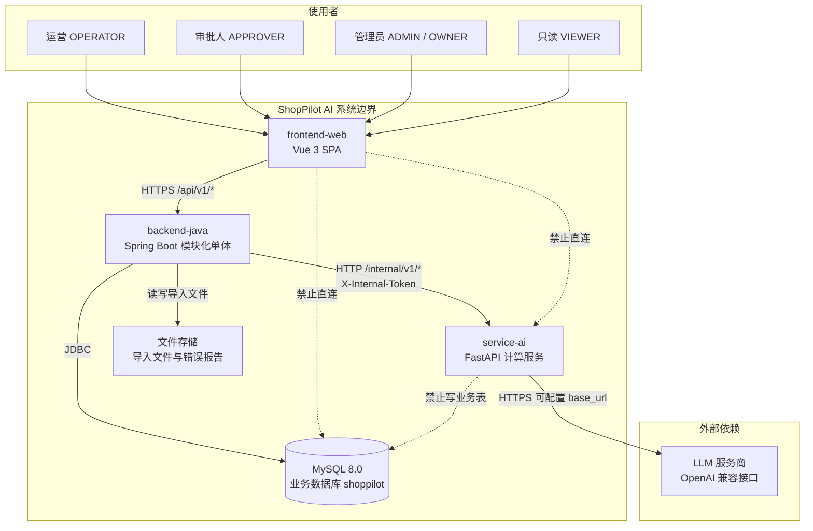
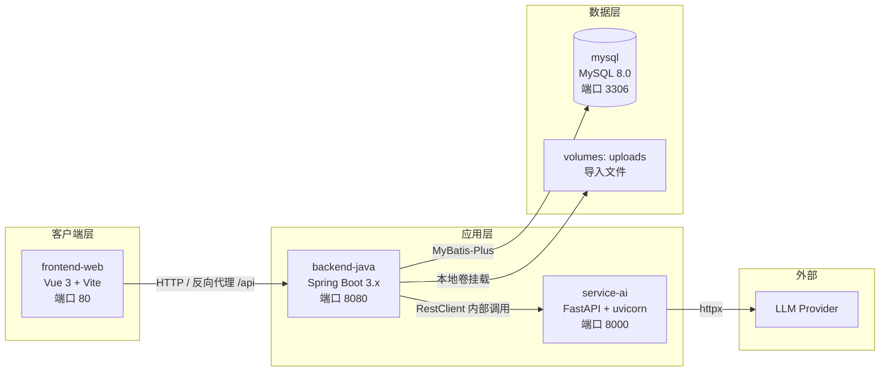
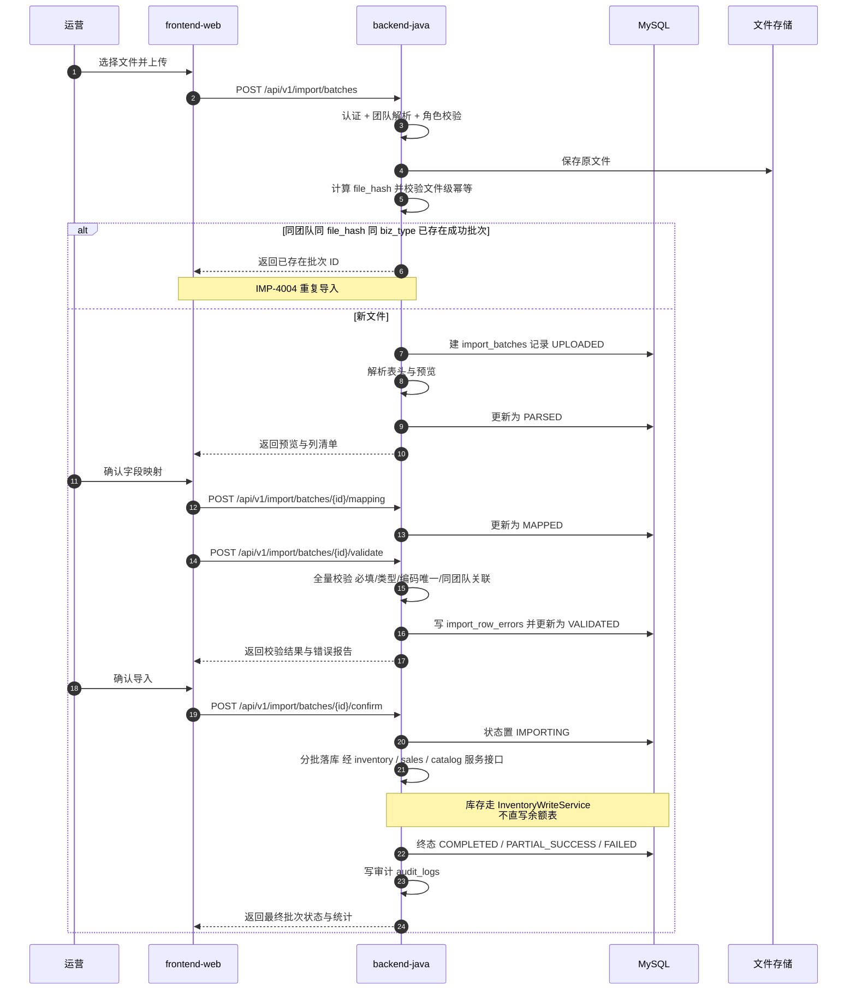
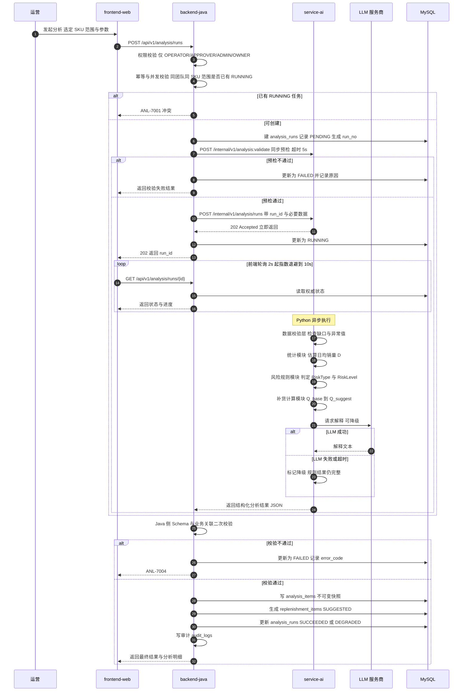
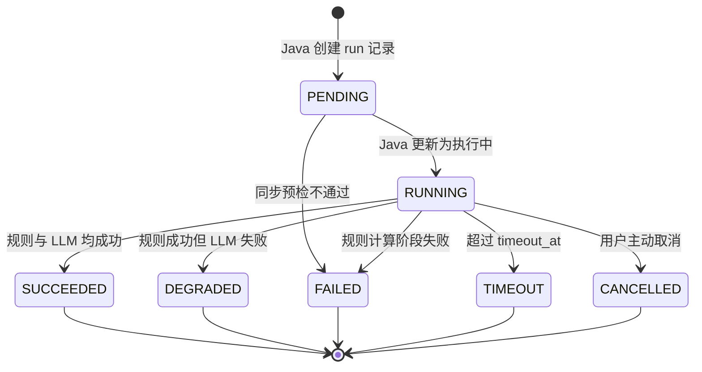
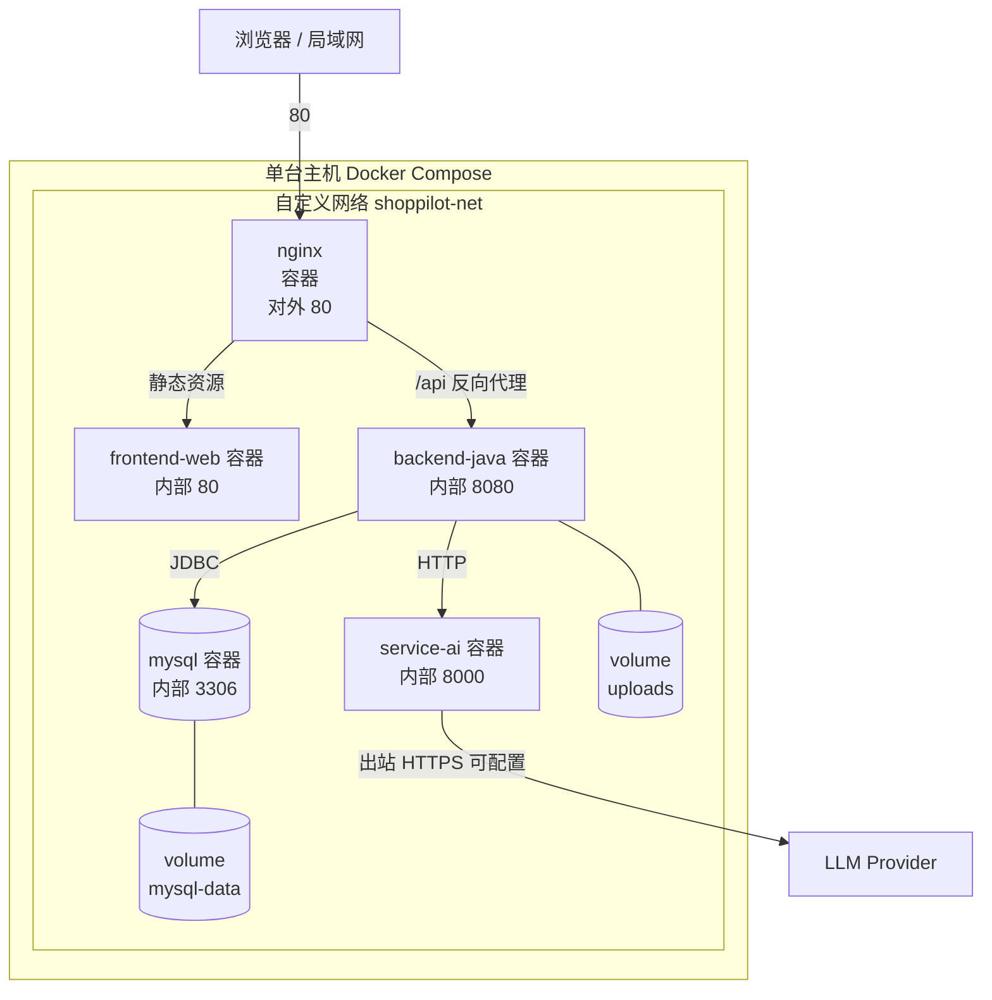

# ShopPilot AI 系统架构设计（SYSTEM_ARCHITECTURE）

## 文档元信息

| 项 | 内容 |
| --- | --- |
| 文档名称 | 系统架构设计 |
| 文档路径 | `docs/01-architecture/SYSTEM_ARCHITECTURE.md` |
| 文档优先级 | P3（见 `DESIGN_BASIS.md §1.1`） |
| 所属阶段 | M0 设计阶段 |
| 版本 | v1.0（M0 定稿） |
| 上游权威来源 | `docs/DESIGN_BASIS.md`（SSOT）、`docs/decisions/ADR-001-*.md` |
| 主要读者 | 开发、运维、架构评审 |

### 本文档负责什么

- 描述系统的**整体形态**：上下文、组件划分、部署拓扑。
- 描述**核心业务流程**在系统组件间的流转（不讨论表结构细节）。
- 定义**调用与写入边界**（9 条硬约束）及其违反后果。
- 定义**同步调用 vs 异步任务分析**的取舍与**异步任务设计**。
- 记录**架构风险与权衡**。

### 本文档不负责什么

- **不定义**表结构（见 `docs/02-database/DATABASE_DESIGN.md`）、对外 API（见 `docs/03-api/API_CONTRACT.md`）、内部契约（见 `docs/03-api/AI_SERVICE_CONTRACT.md`）。
- **不定义**模块内部职责与依赖细则（见 `docs/01-architecture/MODULE_BOUNDARIES.md`）。
- **不定义**技术选型与版本（见 `docs/01-architecture/TECH_STACK.md`）。
- **不复述**状态枚举、错误码、补货公式（分别见 `DESIGN_BASIS.md §9`、`§12`、`§10`），只引用。

---

## 1. 架构总览

ShopPilot AI 首期采用 **前后端分离 + 模块化单体（Java）+ 独立 AI 服务（Python）** 的三段式架构：

- **`frontend-web`（Vue 3）**：纯前端 SPA，只与 Java 通信。
- **`backend-java`（Spring Boot 模块化单体，10 个模块）**：业务的**唯一权威**，负责身份、权限、业务规则、状态机、事务与落库。
- **`service-ai`（FastAPI，8 个内部模块）**：只做**计算与解释**，不碰业务库，不感知权限。
- **MySQL 8.0**：唯一业务持久化存储，由 Java 独占写入。

**核心架构原则**：**Java 是业务真相的唯一持有者（writer）**，Python 是**无状态的纯计算器**，前端是**纯展示与交互层**。所有"写"都必须穿过 Java。

---

## 2. 系统上下文图



> 虚线表示**被明确禁止**的调用。这三条禁令分别对应 §5 的第 1、1、4 条边界。

---

## 3. 系统组件图



### 3.1 组件职责与端口约定

| 组件 | 技术栈 | 建议端口 | 对外暴露 | 职责 |
| --- | --- | --- | --- | --- |
| `frontend-web` | Vue 3 + Vite | **80** | ✅ 公网/局域网 | 页面渲染、交互、轮询、展示；**不承载任何业务规则** |
| `backend-java` | Spring Boot 3.x | **8080** | ✅（可经 nginx 反代） | 认证、授权、业务规则、状态机、事务、落库、审计 |
| `service-ai` | FastAPI + uvicorn | **8000** | ❌ 仅内网 | 数据质量校验、销量统计、风险规则、补货计算、LLM 解释 |
| `mysql` | MySQL 8.0 | **3306** | ❌ 仅内网 | 业务数据持久化 |
| 文件存储 | 本地卷 / 挂载卷 | — | ❌ | 导入原文件、错误报告 |

> 端口约定与 `docs/01-architecture/PROJECT_STRUCTURE.md §deploy` 的 Docker Compose 配置一致。

---

## 4. 核心业务数据流

### 4.1 流程一：数据导入流程



> 状态流转见 `DESIGN_BASIS.md §9.5`（`ImportBatchStatus`）。导入写入库存与销售时，**必须经对应模块的 application 层服务接口**（见 `docs/01-architecture/MODULE_BOUNDARIES.md`）。

### 4.2 流程二：AI 分析到补货建议流程



> 状态与职责归属见 `DESIGN_BASIS.md §9.7`（`AnalysisRunStatus`）、`§9.8`（`LlmStatus`）、`§13.2`（职责归属）。**Java 是 `AnalysisRunStatus` 的权威持有者**，Python 侧状态只是执行细节。

---

## 5. 调用与写入边界（9 条硬约束）

> 这是本项目**最容易被无意破坏**的部分。以下 9 条为强制约束，违反将导致数据一致性、安全或可追溯性缺陷。

| # | 边界 | 要求 | 违反后果 |
| --- | --- | --- | --- |
| 1 | 前端调用边界 | 前端只调用 Java 对外 API（`/api/v1/*`），**禁止直连数据库或 Python** | 绕过认证/授权/业务规则 → 越权与脏数据；前端持有 DB 凭证 → 凭证泄露；前端直连 AI → 破坏"Java 校验结果"的边界，污染业务库 |
| 2 | 身份与规则归属 | Java 负责身份、权限、业务规则校验 | 校验分散到多处 → 口径不一致；Python 感知权限 → 权限逻辑无法单点维护，易被绕过 |
| 3 | 按需调用分析 | Java 按需调用 Python 内部分析 API（`/internal/v1/*`） | 若前端或第三方直接调 Python → 无认证无授权，且 `run_id` 与业务记录脱节 |
| 4 | Python 只读不写 | Python **不直接修改** Java 管理的业务表 | 双写导致状态双源、事务无法覆盖 → `analysis_runs` 与 `analysis_items` 不一致；绕过 Java 的状态机与幂等 |
| 5 | 最小数据原则 | Python 只接收完成分析所必需的字段，**不获取全量业务数据** | 数据面过大 → 泄露风险与传输开销；诱导 Python 越权计算（如直接算 `IP` 时用到它不该看的数据） |
| 6 | 结果结构化 | Python 返回**经结构校验**的分析结果（Pydantic Schema） | 自由文本/半结构结果 → Java 无法可靠落库；LLM 幻觉渗入业务数据 |
| 7 | 落库前二次校验 | Java **再次校验**分析结果与业务关联后才落库 | 仅信任 Python → Python 缺陷直接污染业务库；`sku_id`/`warehouse_id` 可能不属于当前团队 |
| 8 | 库存变更唯一入口 | 所有库存变更必须经 Java 业务逻辑（`InventoryWriteService`） | 绕过余额与流水推导关系 → 库存对账失败（`Σ流水 ≠ 余额`）；越过 `on_hand_qty ≥ 0` 校验（`D-08` **已裁定：不允许负库存**） |
| 9 | LLM 无执行权 | LLM **不能**直接执行未经授权的采购、库存修改或审批 | 自动化越权 → 资金与库存失控；无法追责（审计无法归属到人） |

### 5.1 边界 5 与 8 的强化说明

- **边界 5（最小数据）** 与"在途口径"配合：Python 计算 `IP` 所需的 `effective_in_transit_qty`，由 Java 从 `inventory` 模块的**在途口径查询服务**取出后，作为**已计算好的数值**传入 Python，Python 不接触 `purchase_orders` / `purchase_order_items`（见 `docs/01-architecture/MODULE_BOUNDARIES.md §模块间数据读取例外说明`）。
- **边界 8（库存唯一入口）** 意味着：导入初始库存、采购入库、销售出库、盘点、手工调整、冲销，**全部**必须调用 `InventoryWriteService`，不允许任何模块直接 `UPDATE inventory_balances`。

---

## 6. 同步调用 vs 异步任务分析

### 6.1 对比表

| 维度 | 同步调用 | 异步任务 |
| --- | --- | --- |
| 适用场景 | 轻量、快速、可预测耗时的操作（如数据质量预检） | 耗时长、耗资源、结果需要进度反馈的操作（如完整分析） |
| 优点 | 实现简单、无状态查询、调用链直观、错误即时返回 | 不阻塞调用方、可承载长耗时与大批量、失败可重试、进度可观测 |
| 缺点 | 长耗时会占满连接与线程、超时难控制、用户体验差 | 需要状态存储、轮询/回调机制、幂等与并发控制、状态机复杂度高 |
| 交互复杂度 | 低 | 中（前端轮询 + 后端状态查询） |
| 失败恢复 | 重试即重来 | 需区分"创建失败"与"执行失败"，执行失败不自动重试 |
| 本项目结论 | **轻量预检用同步**（`analysis:validate`，**超时 5s**） | **完整分析用异步**（`POST /internal/v1/analysis/runs` → **202 + `run_id` + 轮询**） |

### 6.2 结论与理由

1. **预检用同步（超时 5s）**：预检只做数据结构与质量检查（缺口、样本不足、异常值），耗时可预测且短；同步返回能让用户**立即**知道数据是否满足分析条件，避免创建一个注定失败的任务。超时 5s 与 `DESIGN_BASIS.md §13.4` 一致。
2. **完整分析用异步（202 + `run_id` + 轮询）**：完整分析涉及最多 `MAX_ANALYSIS_SKUS = 2000` 个 SKU 的统计、规则、LLM 调用（单次 LLM 默认 30s，最多重试 2 次），整体默认 `timeout_at` 300s。同步无法承载，必须异步。
3. **不使用消息队列**：首期用 **HTTP 创建任务 + 状态轮询** 实现异步（见 `DESIGN_BASIS.md §13.1`、`§7.2`）。理由见 §7.5。

---

## 7. 异步任务设计

> 权威状态定义见 `DESIGN_BASIS.md §9.7`（`AnalysisRunStatus`）与 `§9.8`（`LlmStatus`）。本节只描述**机制**。

### 7.1 状态机



> 合法转换：`PENDING → RUNNING → {SUCCEEDED | DEGRADED | FAILED | TIMEOUT | CANCELLED}`；终态不可再变（见 `DESIGN_BASIS.md §9.7`）。

### 7.2 进度上报

- `analysis_runs` 的 `progress`（0–100）与 `current_step` 由 Java 依据 Python 回报更新（见 `DESIGN_BASIS.md §9.7`）。
- Python 侧维护执行步骤与进度，但**不写 Java 数据库**（见 `DESIGN_BASIS.md §13.2`）。
- 典型步骤：`VALIDATING` → `STATS` → `RISK_RULES` → `REPLENISHMENT` → `LLM_EXPLAIN` → `DONE`。

### 7.3 超时（`timeout_at`）

- 创建任务时，Java 计算 `timeout_at = now + 300s`（默认，见 `DESIGN_BASIS.md §13.4`）。
- Java 侧的轮询/状态查询在发现 `now > timeout_at` 且状态仍为 `RUNNING` 时，将任务推进为 `TIMEOUT` 终态（**Java 权威**，见 `DESIGN_BASIS.md §13.2`）。
- `TIMEOUT` 后**不自动重试**；用户可发起新 run 生成新的 `run_no`。

### 7.4 失败恢复与重复请求处理

| 情况 | 处理 |
| --- | --- |
| 创建任务重复提交（同一请求重放） | 使用**幂等键**（`uk_run_team_idem`，见 `DESIGN_BASIS.md §8` 第 14 行）。同幂等键且请求体一致 → 返回既有 run；请求体不一致 → `COM-0009` |
| 同团队同 SKU 范围已有 `RUNNING` 任务 | 返回 **`ANL-7001`**（见 `DESIGN_BASIS.md §12.3`） |
| Python 创建接口网络失败 | 允许重试 1 次（仅网络错误，见 `DESIGN_BASIS.md §13.4`） |
| 规则计算阶段失败 | 任务 `FAILED`，记录 `error_code` / `error_message`；用户可发起新 run |
| LLM 失败 | 任务 `DEGRADED`（业务可用，见 `DESIGN_BASIS.md §9.7`），`llm_status` 记为 `FAILED` / `TIMEOUT` / `VALIDATION_FAILED` |
| Python 服务不可用 | `ANL-7002`（502）；超时 → `ANL-7003`（504） |
| Python 返回结果未过 Schema | `ANL-7004`（422），任务 `FAILED`，不落库 |

### 7.5 前端轮询机制

```
第 1 次：T + 2s
第 2 次：T + 4s
第 3 次：T + 8s
之后：  固定 10s（上限）
终止条件：
  - 任务进入终态（SUCCEEDED / DEGRADED / FAILED / TIMEOUT / CANCELLED）
  - 页面卸载（onUnmounted / beforeunload）→ 立即停止轮询
  - 达到前端最大轮询时长（建议 时间上限 = timeout_at + 30s）→ 停止并提示
```

- 轮询接口：`GET /api/v1/analysis/runs/{id}`（Java 对外）。
- 采用**指数退避（2s → 10s 封顶）**而非固定 2s，兼顾"快速感知"与"降低空转请求"。
- **页面卸载必须停止轮询**，避免无主的定时器泄漏与服务端压力。

### 7.6 为何首期不用 MQ

| 维度 | 结论 |
| --- | --- |
| 规模 | 单团队单次分析任务量小、并发低，HTTP + 轮询足够 |
| 复杂度 | 引入 MQ 需要额外中间件部署、运维、监控、消息幂等与顺序处理，收益不匹配 |
| 可观测性 | HTTP 调用天然带 `X-Request-Id`，链路追踪成本低（见 `DESIGN_BASIS.md §13.3`） |
| 一致性 | 首期不需要跨服务事务消息；Java 拿到 Python 结果后自行落库，链路清晰 |
| 一致性要求 | 与 `DESIGN_BASIS.md §2.1` Out of Scope（Kafka / RabbitMQ）一致 |
| 未来演进 | 若单次运行 SKU 规模或并发显著增长，可将"创建任务"的 HTTP 调用替换为消息投递，**接口语义（202 + run_id + 轮询）保持不变**，降低迁移成本 |

---

## 8. 部署视图



### 8.1 端口暴露策略

| 服务 | 容器内端口 | 主机暴露 | 说明 |
| --- | --- | --- | --- |
| nginx | 80 | ✅ 80 | 唯一对外入口 |
| frontend-web | 80 | ❌ | 仅经 nginx 访问 |
| backend-java | 8080 | ⚠️ 开发环境可暴露，生产仅经 nginx | — |
| service-ai | 8000 | ❌ **绝不暴露**（见 `DESIGN_BASIS.md §13.3`） | 仅 `shoppilot-net` 内可达 |
| mysql | 3306 | ❌ | 仅 `shoppilot-net` 内可达 |

### 8.2 网络与安全要求

1. **`service-ai` 不对公网暴露**（见 `DESIGN_BASIS.md §13.3`），只有 `backend-java` 可通过内部网络访问。
2. Java→Python 调用携带 `X-Internal-Token`（来自环境变量 `AI_INTERNAL_TOKEN`）。
3. 所有内部调用携带 `X-Request-Id` 用于链路追踪。
4. MySQL 仅内网可达，凭证通过环境变量注入，不入库到镜像。

### 8.3 环境划分

| 环境 | Compose 文件 | 说明 |
| --- | --- | --- |
| 开发 | `deploy/docker-compose.dev.yml` | MySQL 暴露 3306、Java 暴露 8080、挂载源码卷、可热重载 |
| 集成/演示 | `deploy/docker-compose.yml` | 仅 nginx 暴露 80，其余内网 |
| 生产 | `deploy/docker-compose.yml`（叠加覆盖） | 同上，额外启用资源限制与日志收集 |

> 目录与文件规划见 `docs/01-architecture/PROJECT_STRUCTURE.md §deploy 目录`。

---

## 9. 架构风险与权衡

| # | 风险 / 权衡 | 说明 | 缓解措施 |
| --- | --- | --- | --- |
| R-1 | **Java 成为性能瓶颈（单点 writer）** | 所有写经 Java，库存与导入是热点 | 导入分批落库；库存写入使用乐观锁（`INV-5002`）；关键路径索引以 `team_id` 最左（见 `DESIGN_BASIS.md §6 第 6 条`）；首期规模可控 |
| R-2 | **HTTP 轮询带来的额外负载** | 前端轮询与 Java 状态查询增加请求量 | 指数退避 2s→10s；页面卸载停止；轮询接口只读轻量 |
| R-3 | **无 MQ 的可靠性缺口** | Java 创建任务成功后进程崩溃，Python 任务成为"孤儿" | 状态以 Java 为权威，`timeout_at` 兜底推进 `TIMEOUT`；孤儿任务不影响业务库一致性 |
| R-4 | **LLM 不确定性与成本** | LLM 延迟抖动、输出不稳定、按量计费 | LLM 不参与判定，仅解释；`DEGRADED` 保证业务可用；单次 LLM 30s 超时 + 最多 2 次重试；输出强制 Schema 校验 |
| R-5 | **团队隔离依赖"双保险"是否落实** | 仅靠租户插件或仅靠业务校验都可能漏 | 强制"业务层显式校验 + 租户插件兜底"双保险（见 `DESIGN_BASIS.md §6 第 4 条`），并在 code review 清单中固化检查项 |
| R-6 | **模块化单体的边界退化** | 长期开发中易出现跨模块直连 Mapper | 强制依赖方向 + 禁止反向依赖（见 `DESIGN_BASIS.md §7.1`）+ `docs/01-architecture/MODULE_BOUNDARIES.md §模块边界检查清单` |
| R-7 | **数据导入质量决定分析可信度** | 脏数据 → 无效分析 | 导入全流程校验 + 错误报告 + 数据不足明确提示（`RiskType.DATA_INSUFFICIENT`） |
| R-8 | **单机部署的可用性上限** | Docker Compose 单机，主机故障即全部不可用 | 首期接受（目标客户为小团队）；定期备份 MySQL 卷；未来可平滑迁移至编排平台 |

---

## 10. 与 `DESIGN_BASIS.md` 的一致性核对

| 本文档内容 | `DESIGN_BASIS.md` 出处 | 一致性 |
| --- | --- | --- |
| 端口 80 / 8080 / 8000 / 3306 | 无（本文档新增约定，与 `TECH_STACK.md`、`PROJECT_STRUCTURE.md` 保持一致） | 建议固化，供部署文档引用 |
| `analysis:validate` 同步 5s 超时 | `§13.1`、`§13.4` | ✅ 一致 |
| 异步 202 + `run_id` + 轮询 | `§13.1` | ✅ 一致 |
| `ANL-7001` 并发冲突 | `§12.3` | ✅ 一致 |
| `ANL-7002` / `ANL-7003` / `ANL-7004` | `§12.3` | ✅ 一致 |
| `DEGRADED` 业务可用 | `§9.7` | ✅ 一致 |
| Python 不写业务库 | `§13.2`、`§7.1` | ✅ 一致 |
| 内部认证 `X-Internal-Token` | `§13.3` | ✅ 一致 |
| 不使用 MQ | `§2.1`、`§7.2`、`§13.1` | ✅ 一致 |
| 默认 `timeout_at` 300s | `§13.4` | ✅ 一致 |

> 本文档**未发现**与 `DESIGN_BASIS.md` 的不一致之处；端口约定为本文档新增的工程约定，已在 `TECH_STACK.md`、`PROJECT_STRUCTURE.md` 同步，不构成对 SSOT 的修订。

---

## 11. 变更记录

| 版本 | 日期 | 变更 | 作者 |
| --- | --- | --- | --- |
| v1.0 | 2026-10-14 | M0 初稿：上下文、组件、数据流、边界、异步设计、部署 | 架构 |
