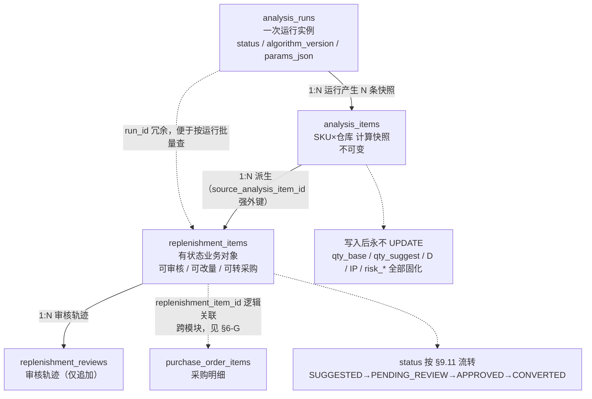
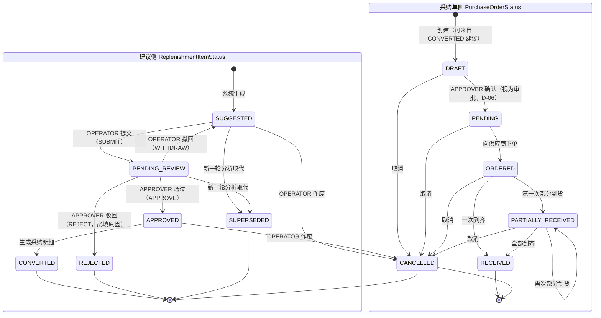

# ShopPilot AI 数据库设计（Database Design）

> **文档编号**：`docs/02-database/DATABASE_DESIGN.md`
> **文档地位**：数据模型的**权威定义**（`DESIGN_BASIS §1.1` 中的 P2）。
> 与 `API_CONTRACT.md` 冲突时**以本文件为准**（`DESIGN_BASIS §1.2`）。
> **SSOT 约束**：本文件**不重新定义**表清单、状态枚举、错误码、公式与精度，只**引用** `docs/DESIGN_BASIS.md`。
> **阶段**：M0 设计阶段，**不生成正式 Flyway 迁移 SQL**（`DESIGN_BASIS §2.1`）。
> 文中出现的 SQL 片段**仅为说明性示例，未在 MySQL 中执行验证**。

---

## 1. 文档职责与范围

| 本文件负责 | 本文件不负责 |
| --- | --- |
| 22 张表的字段、类型、可空性、默认值、更新规则 | 面向使用者的字段中文名速查（见 `DATA_DICTIONARY.md`） |
| 唯一约束、索引、团队隔离规则 | 约束的完整清单与幂等矩阵（见 `DATABASE_CONSTRAINTS.md`） |
| 关系与基数（概要） | 关系图（见 `ER_DIAGRAM.md`） |
| 事务边界、隔离级别、锁策略 | API 请求/响应结构（见 `API_CONTRACT.md`） |
| Flyway 迁移组织规范 | 实际迁移 SQL（M1 起才生成） |

**数据库**：`shoppilot`（MySQL 8.0.16+，`utf8mb4` / `utf8mb4_0900_ai_ci`）。
**唯一权威写入方**：Java Spring Boot（模块化单体，10 模块）。**Python AI 服务不写业务库**（`DESIGN_BASIS §13.2`）。

---

## 2. 设计原则

| # | 原则 | 含义与落地 |
| --- | --- | --- |
| P1 | **团队隔离优先** | `team_id` 是每个业务表的**第一公民**；所有唯一约束带 `team_id` 前缀，所有主查询索引以 `team_id` 为最左列；`team_id` 绝不接受客户端传入（`DESIGN_BASIS §6`） |
| P2 | **金额与数量绝不用浮点** | 数量 `DECIMAL(18,3)`、单价 `DECIMAL(18,4)`、金额 `DECIMAL(18,2)`；禁用 `FLOAT`/`DOUBLE`（`§14.2`）；Java 用 `BigDecimal`，Python 用 `Decimal` |
| P3 | **状态用可读枚举，不用魔法数字** | 状态列统一 `VARCHAR(32)` 存**大写字符串**（`§4.1`），由应用层枚举 + DB `CHECK` 双重保证；枚举取值**只在 `§9` 定义一次** |
| P4 | **流水不可变** | `inventory_transactions`、`analysis_items`、`replenishment_reviews`、`audit_logs`、`import_row_errors` 写入后**永不 UPDATE / DELETE**；纠错靠反向流水或新增记录 |
| P5 | **余额可推导** | `inventory_balances` 是**物化的可推导状态**，必须能由 `inventory_transactions` 累加复原；两者在同一本地事务内写入，并由对账任务定期校验（§6-C） |
| P6 | **业务数据禁止物理删除** | 全库外键 `ON DELETE RESTRICT`；停用/作废一律走状态字段（`MasterDataStatus` / `PurchaseOrderStatus` / …）；历史数据必须永远可查 |
| P7 | **幂等优先于锁** | 先设计**唯一键 / 幂等键**，让重复请求在数据库层被拒绝或被吸收；乐观锁只用于"真实并发修改同一行"的场景；悲观锁只用于"必须串行化的计数/累加"（§7、§8） |
| P8 | **不提前过度设计** | 首期不做 MQ、分库分表、多币种、跨仓调拨、预测模型、多供应商比价（`§2.1`）。**多仓维度保留但 UI 只暴露默认仓**（`D-02`） |
| P9 | **不机械地给所有表加 `version`** | `version` 只为"真实存在丢失更新风险"的表引入。仅靠唯一约束 / 状态守卫即可保证正确的表**不加** `version`，避免每行多 4 字节和一个必填更新条件的维护负担（§7.4 给出判定） |
| P10 | **可追溯优于简洁** | 任何"算出来的结论"都必须能回答"用的什么数据、什么参数、什么算法版本"。因此 `analysis_runs` 记录 `algorithm_version` / `prompt_version` / `model_name` / 数据时间范围，`analysis_items` 保存输入快照 |
| P11 | **失败可诊断** | 导入失败必须能定位到**行号 + 列 + 错误码**；分析失败必须能区分"规则失败（`FAILED`）"与"LLM 失败（`DEGRADED`）"（`§9.7` / `§9.8`） |
| P12 | **数值可复现** | 计算中间量保留 4 位小数，最终按精度四舍五入；同一输入 + 同一 `algorithm_version` 必须得出同一输出（`§14.2`） |

---

## 3. 通用约定

### 3.1 主键与命名

- 主键统一 `id`：`BIGINT UNSIGNED NOT NULL AUTO_INCREMENT`，**永不变更**，因此全库 `ON UPDATE RESTRICT`。
- 表名复数、字段名单数、时间戳 `_at`、业务日期 `_date`、数量 `_qty`、金额 `_amount`/`_price`、布尔 `is_`/`has_`（`§4.1`）。
- 索引 `idx_<表简写>_<字段>`、唯一 `uk_<表简写>_<字段>`、外键 `fk_<表简写>_<字段>`。

### 3.2 公共审计字段（两种集合）

| 集合 | 字段 | 适用表 |
| --- | --- | --- |
| **集合 A（可变表）** | `created_at DATETIME(3) NOT NULL`、`updated_at DATETIME(3) NOT NULL`、`created_by BIGINT UNSIGNED NULL`、`updated_by BIGINT UNSIGNED NULL` | 所有**可被 UPDATE** 的业务表 |
| **集合 B（仅追加表）** | `created_at DATETIME(3) NOT NULL`、`created_by BIGINT UNSIGNED NULL` | 仅追加表（流水、快照、审核、审计、错误行） |
| **`version INT UNSIGNED NOT NULL DEFAULT 0`** | 乐观锁版本号 | 仅 §7.4 表 A 列出的 12 张表 |

- `created_at` / `updated_at` 由数据库 `DEFAULT CURRENT_TIMESTAMP(3)` / `ON UPDATE CURRENT_TIMESTAMP(3)` 提供，应用层**不得显式覆盖**。
- 所有时间戳存 **UTC**（`§14.1`）；业务日期存 `DATE`，代表团队时区下的自然日，**不做时区转换**。
- `created_by` / `updated_by` 指向 `users.id`，为**逻辑关联**（不建外键，理由见 `ER_DIAGRAM.md §6.2`）。

### 3.3 类型使用速查

| 类型 | 用途 |
| --- | --- |
| `BIGINT UNSIGNED` | 主键、外键、`*_id` |
| `VARCHAR(32)` | 状态枚举、`biz_type`、`source`、角色代码 |
| `VARCHAR(64)` | 业务编号（`sku_code` / `po_no` / `run_no` / 请求标识）、`CHAR(64)` 用于哈希 |
| `VARCHAR(128)` | 名称、`idempotency_key`、`model_name` |
| `DECIMAL(18,3)` | 数量 |
| `DECIMAL(18,4)` | 单价、比率 |
| `DECIMAL(18,2)` | 金额 |
| `DATE` | 业务日期 |
| `DATETIME(3)` | 时间戳（UTC，毫秒精度） |
| `JSON` | 结构化参数、摘要、快照明细、多值列（`risk_types`） |
| `TINYINT(1)` | 布尔 |

### 3.4 生成列与派生值政策

| 派生值 | 是否落库 | 理由 |
| --- | --- | --- |
| `inventory_balances.available_qty = on_hand_qty − committed_qty` | **落库（`STORED` 生成列）** | 表达式为**同表确定性运算**，可用生成列保证永不与来源不一致，并可建索引支持"可用库存排序/筛选"（`§3` 定义） |
| `inventory_balances.effective_in_transit_qty` | **不落库** | 依赖 `purchase_order_items` 与"窗口内"日期条件，**跨表 + 随时间变化**，无法作为生成列；由查询侧计算 |
| `IP`（Inventory Position） | **不落库**（仅快照进 `analysis_items.inventory_position_qty`） | 同上；`IP` 是"某时刻的判断依据"，只在分析快照中固化，避免成为第二个真相来源 |
| `purchase_order_items.pending_qty` | **不落库** | 纯派生（`ordered_qty − received_qty`），落库会新增一个必须维护的一致性点；查询侧计算（§6-I） |
| `purchase_orders.total_qty` / `received_qty` | **落库** | 列表页需要**排序与聚合**（"待收数量不为 0 的采购单"），落库并有同事务更新规则，成本低于每次 JOIN 聚合 |

---

## 4. 相对任务书清单的变更说明

`DESIGN_BASIS §8` 相对任务书清单做了 3 处调整，逐条展开如下。

### 4.1 新增 `replenishment_policies`（补货策略参数）

**任务书清单中无此表**。新增理由：

1. **`L`、`R`、`SS`、MOQ、`order_multiple` 必须有稳定归属。** `DESIGN_BASIS §10.2` 规定 `L` 三级取源：`replenishment_policies` → `skus.default_lead_time_days` → `suppliers.lead_time_days` → 全局默认；`R` 只来自策略；`§10.5` 规定 MOQ / `order_multiple` 三级取源同样以策略为第一级。
2. **若没有本表，参数只能塞进 `skus`**，会导致：① `skus` 承载与仓库相关的参数（`coverage_days` 本应是 SKU×仓库维度）；② 参数值混在商品主数据里，无法按仓库/类目差异化配置；③ 数据模型不支持 `§2.1` 保留的"仓库维度"。
3. **若交给 LLM 推断，则不可复现、不可审计。** `§11` 明确"规则引擎为确定性计算，LLM 不参与任何判定"；参数必须是**人类可配置、可解释、可测试**的字段。
4. **它是 `P4/P5` 原则的载体**：策略变更不改历史分析结果（`analysis_items` 保存当时的 `lead_time_days` / `coverage_days` / `safety_stock_qty` 快照），因此策略可放心调整。
5. **粒度选择 SKU×仓库**：唯一约束 `uk_pol_team_sku_wh (team_id, sku_id, warehouse_id)`。选择"SKU×仓库"而非"SKU"或"类目"，是因为 `IP`、在途与销售都是 SKU×仓库维度；类目级策略可通过**服务层继承**（本表无记录 → 回退到 SKU 默认值）实现，无需新增表。

### 4.2 新增 `analysis_items`（分析明细快照）

**任务书清单中无此表**。新增理由：

1. **必须把"计算事实快照"与"有状态的业务建议"分离**（`DESIGN_BASIS §3.1` 关键区分第 1 条）。
   - `analysis_items`：写入后**不可变**，回答"当时为什么这么算"。
   - `replenishment_items`：有状态机、可人工改量、可审核、可转采购。
2. **两者的数量可以不同**（人工改过 `qty`），若合并为一张表，则"人工修改"会**污染计算事实**，导致无法复现、无法做算法回归对比。
3. **一条运行产生 N 条 SKU 级事实**，其中大量 SKU 只产出风险标记、**不产出建议**（`§10.5`：`Q_base <= 0` → 不生成建议，只记录风险）。若没有 `analysis_items`，这些"只记录风险"的结论无处存放，风险报表将被迫依赖重算。
4. **LLM 解释挂载点**：`§9.8` 的 `LlmStatus` 是**运行级**状态，但 LLM 输出是 **SKU 级**的解释文本，必须落在 `analysis_items.llm_explanation`。
5. **可重放不重算**：任何建议都能通过 `source_analysis_item_id` 回到完整输入快照（`D`、`IP`、`L`、`R`、`SS`、`Q_base`、命中规则），满足 P10 / P12。

### 4.3 不新增独立"预测结果表"

**结论：预测结果即为 `analysis_items` 的字段**（`DESIGN_BASIS §8` 说明 3）。理由：

1. **本期唯一的"预测"是日均销量 `D`（移动平均）**（`§10.1`），它只有 3 个相关量：`D`、`CV`、样本天数 `n`。为 3 个标量建一张表属于**一次数据两处存放**，只会引入同步问题。
2. **首期明确不做 ML 时间序列预测**（`§2.1` Out of Scope）。当未来引入多模型/多算法预测时，`D` 会升级为"每个 `algorithm_version` 一组预测值"，**那时**才需要 `forecast_results`（含 `algorithm_version`、`horizon_days`、`predicted_qty`）。当前用 `analysis_runs.algorithm_version` + `analysis_items.avg_daily_sales` 已能完整表达并支持未来扩展。
3. **避免过度设计**（P8）：提前建表会带来"写不写、写什么值"的悬空问题，以及额外的清理与权限策略，收益为零。
4. **触发条件已明确记录**：当出现"同一运行需要保存多个模型的多期预测"需求时新增该表——这是可判定的升级信号，无需现在预留。

---

## 5. 逐表设计

> **阅读约定**
> - 每张表的「公共审计字段」按 §3.2 的**集合 A / B** 引用，不再重复列出；`version` 仅出现在 §7.4 表 A 的 12 张表中。
> - 「字段表」列：`字段名 / 类型 / 可空 / 默认值 / 含义 / 更新规则`。
> - 索引一律**以 `team_id` 为最左列**（无 `team_id` 的表除外），符合 `DESIGN_BASIS §6` 规则 6。

---

### 5.1 `users`（用户）

- **业务用途**：平台全局账号，跨团队存在；承载认证凭据与用户状态。
- **所属模块 / 写入方**：`identity`（`§7.1`）。
- **是否含 `team_id`**：**否**（`§6` 规则 1 的显式例外）。
- **公共审计字段**：集合 A + `version`。

| 字段名 | 类型 | 可空 | 默认值 | 含义 | 更新规则 |
| --- | --- | --- | --- | --- | --- |
| `id` | `BIGINT UNSIGNED` | 否 | AUTO_INCREMENT | 主键 | 不可变 |
| `username` | `VARCHAR(64)` | 否 | — | 登录名 | 可更新（需唯一校验） |
| `email` | `VARCHAR(128)` | 是 | `NULL` | 邮箱 | 可更新 |
| `password_hash` | `VARCHAR(255)` | 否 | — | 口令哈希（BCrypt） | 仅通过改密接口更新；**禁止写入审计日志** |
| `display_name` | `VARCHAR(64)` | 是 | `NULL` | 显示名 | 可更新 |
| `phone` | `VARCHAR(32)` | 是 | `NULL` | 手机号 | 可更新 |
| `status` | `VARCHAR(32)` | 否 | `'ACTIVE'` | `UserStatus`（`§9.1`） | 仅 `ACTIVE` ↔ `DISABLED` |
| `last_login_at` | `DATETIME(3)` | 是 | `NULL` | 最近登录时间（UTC） | 登录成功时更新 |

- **主键**：`id`。**外键**：无。
- **唯一约束**：`uk_users_username (username)`、`uk_users_email (email)`。**本表无 `team_id`，故不适用 `§6` 规则 2**（`§8` 已明确这两个约束为全局唯一）。`email` 可空 → MySQL 唯一索引允许多个 `NULL`，符合"邮箱可选"的业务。
- **索引**：`idx_users_status (status)`（支撑"按状态筛选用户"，选择性低但数据量小）。
- **团队隔离**：本表全局可见性由**权限层**控制：任何角色只能看到与自己有 `team_members` 关联的用户（`USER_ROLES.md`）。`users` 本身不提供团队数据。
- **更新规则**：不物理删除；禁用走 `status = 'DISABLED'`。
- **设计要点**：`password_hash` 属**敏感数据**，禁止进入 `audit_logs.before_json` / `after_json`（§6-J）。

---

### 5.2 `teams`（团队）

- **业务用途**：数据隔离的最外层边界，一个团队 = 一个中小电商经营主体。
- **所属模块 / 写入方**：`identity`。
- **`team_id`**：自身即团队，无 `team_id` 列。
- **公共审计字段**：集合 A + `version`。

| 字段名 | 类型 | 可空 | 默认值 | 含义 | 更新规则 |
| --- | --- | --- | --- | --- | --- |
| `id` | `BIGINT UNSIGNED` | 否 | AUTO_INCREMENT | 主键 | 不可变 |
| `code` | `VARCHAR(32)` | 否 | — | 团队编码 | **不可变**（作为对外标识） |
| `name` | `VARCHAR(128)` | 否 | — | 团队名称 | 可更新 |
| `status` | `VARCHAR(32)` | 否 | `'ACTIVE'` | `TeamStatus`（`§9.2`） | 仅 `ACTIVE` ↔ `DISABLED` |
| `default_timezone` | `VARCHAR(64)` | 否 | `'Asia/Shanghai'` | 团队默认时区（`§14.1`） | 可更新 |
| `default_warehouse_id` | `BIGINT UNSIGNED` | 是 | `NULL` | 默认仓库（首期 UI 唯一暴露的仓） | 可更新；**逻辑关联**，须校验属本团队 |
| `contact_name` | `VARCHAR(64)` | 是 | `NULL` | 联系人 | 可更新 |
| `contact_phone` | `VARCHAR(32)` | 是 | `NULL` | 联系电话 | 可更新 |

- **主键**：`id`。**外键**：无（`default_warehouse_id` 为逻辑关联，避免环形外键，见 `ER_DIAGRAM.md §4.1`）。
- **唯一约束**：`uk_teams_code (code)`。
- **索引**：`idx_teams_status (status)`。
- **团队隔离**：`teams` 是"团队"本身；跨团队访问返回 `TEAM-2001`；团队停用后其所有接口返回 `TEAM-2002`（`§9.2`）。
- **更新规则**：不物理删除；`code` 不可变。
- **设计要点**：同时有"每团队恰好 1 名 OWNER"的隐含约束，由 `team_members` 的 `uk_tm_team_user` + `TeamAppService` 事务内校验实现（DB 无法表达部分唯一）。

---

### 5.3 `team_members`（团队成员）

- **业务用途**：`users` 与 `teams` 的多对多关联，并承载**团队内角色**（`§5`：角色是 team-scoped）。
- **所属模块 / 写入方**：`identity`。
- **公共审计字段**：集合 A（**无 `version`**）。

| 字段名 | 类型 | 可空 | 默认值 | 含义 | 更新规则 |
| --- | --- | --- | --- | --- | --- |
| `id` | `BIGINT UNSIGNED` | 否 | AUTO_INCREMENT | 主键 | 不可变 |
| `team_id` | `BIGINT UNSIGNED` | 否 | — | 团队 ID | **不可变** |
| `user_id` | `BIGINT UNSIGNED` | 否 | — | 用户 ID | **不可变** |
| `role` | `VARCHAR(32)` | 否 | `'VIEWER'` | `TeamRole`（`§9.3`） | 可更新（仅 `OWNER`/`ADMIN`）；变更需写审计 |
| `status` | `VARCHAR(32)` | 否 | `'ACTIVE'` | `ACTIVE` / `REMOVED` | 仅 `ACTIVE` ↔ `REMOVED` |
| `joined_at` | `DATETIME(3)` | 否 | `CURRENT_TIMESTAMP(3)` | 加入时间 | 不可变 |
| `removed_at` | `DATETIME(3)` | 是 | `NULL` | 移出时间 | 移出时写入；复活时清空 |

- **主键**：`id`。**外键**：`fk_tm_user (user_id) → users(id)`、`fk_tm_team (team_id) → teams(id)`，均 `ON DELETE RESTRICT` / `ON UPDATE RESTRICT`。
- **唯一约束**：`uk_tm_team_user (team_id, user_id)`（`§8`）。**语义**：一个用户在一个团队只有一行；重新加入时**复活同一行**（`status` 改回 `ACTIVE`），不新增行——这就是该约束的存在意义。
- **索引**：`idx_tm_team_role (team_id, role)`（支撑"查本团队 APPROVER 列表"、校验"每团队 1 名 OWNER"）；`idx_tm_user_status (user_id, status)`（支撑"我的团队列表"，登录后高频查询）。
- **团队隔离**：含 `team_id`，是"哪些团队对我可见"的唯一来源；`TeamContext` 解析 JWT 的 `team_id` claim 后，必须校验 `team_members(team_id, user_id, status='ACTIVE')` 存在。
- **更新规则**：不物理删除（软停用 `REMOVED`）；`team_id` / `user_id` / `joined_at` 不可变。
- **设计要点**：`OWNER` 不能被移除（`§5` 硬规则），由服务层校验；`REMOVED` 行保留用于审计"谁曾在何时拥有何种角色"。

---

### 5.4 `warehouses`（仓库）

- **业务用途**：库存物理存放位置；首期每团队一个默认仓，但**数据模型保留仓库维度**（`§2.1`、`D-02`）。
- **所属模块 / 写入方**：`catalog`。
- **公共审计字段**：集合 A + `version`。

| 字段名 | 类型 | 可空 | 默认值 | 含义 | 更新规则 |
| --- | --- | --- | --- | --- | --- |
| `id` | `BIGINT UNSIGNED` | 否 | AUTO_INCREMENT | 主键 | 不可变 |
| `team_id` | `BIGINT UNSIGNED` | 否 | — | 团队 ID | **不可变** |
| `code` | `VARCHAR(32)` | 否 | — | 仓库编码 | 可更新（需唯一校验） |
| `name` | `VARCHAR(128)` | 否 | — | 仓库名称 | 可更新 |
| `status` | `VARCHAR(32)` | 否 | `'ACTIVE'` | `MasterDataStatus`（`§9.4`） | 仅 `ACTIVE` ↔ `INACTIVE` |
| `is_default` | `TINYINT(1)` | 否 | `0` | 是否默认仓 | 可更新；同团队**至多一行为 1**（服务层保证） |
| `address` | `VARCHAR(255)` | 是 | `NULL` | 地址 | 可更新 |
| `contact_name` | `VARCHAR(64)` | 是 | `NULL` | 联系人 | 可更新 |
| `contact_phone` | `VARCHAR(32)` | 是 | `NULL` | 联系电话 | 可更新 |
| `remark` | `VARCHAR(255)` | 是 | `NULL` | 备注 | 可更新 |

- **主键**：`id`。**外键**：无（`team_id` 统一逻辑关联）。
- **唯一约束**：`uk_wh_team_code (team_id, code)`（`§6` 规则 2）。
- **索引**：`idx_wh_team_status (team_id, status)`（支撑仓库列表页）；`idx_wh_team_default (team_id, is_default)`（支撑"取默认仓"，登录后高频）。
- **团队隔离**：所有查询强制 `WHERE team_id = ?`（租户插件兜底）；`is_default` 的唯一性只在团队内。
- **更新规则**：不物理删除；`team_id` 不可变；存在库存余额（`on_hand_qty != 0`）时禁止停用。
- **设计要点**：`is_default` 不用唯一索引（`UNIQUE(team_id, is_default)` 会限制同团队只能有 1 个非默认仓），改由服务层在事务内 `UPDATE ... SET is_default = 0 WHERE team_id = ?` 后置 1。

---

### 5.5 `suppliers`（供应商）

- **业务用途**：供应商主数据，并作为 `L` / MOQ / `order_multiple` 的**二级来源**（`§10.2`、`§10.5`）。
- **所属模块 / 写入方**：`catalog`。
- **公共审计字段**：集合 A + `version`。

| 字段名 | 类型 | 可空 | 默认值 | 含义 | 更新规则 |
| --- | --- | --- | --- | --- | --- |
| `id` | `BIGINT UNSIGNED` | 否 | AUTO_INCREMENT | 主键 | 不可变 |
| `team_id` | `BIGINT UNSIGNED` | 否 | — | 团队 ID | **不可变** |
| `code` | `VARCHAR(32)` | 否 | — | 供应商编码 | 可更新 |
| `name` | `VARCHAR(128)` | 否 | — | 供应商名称 | 可更新 |
| `status` | `VARCHAR(32)` | 否 | `'ACTIVE'` | `MasterDataStatus` | 仅 `ACTIVE` ↔ `INACTIVE` |
| `contact_name` | `VARCHAR(64)` | 是 | `NULL` | 联系人 | 可更新 |
| `contact_phone` | `VARCHAR(32)` | 是 | `NULL` | 联系电话 | 可更新 |
| `email` | `VARCHAR(128)` | 是 | `NULL` | 邮箱 | 可更新 |
| `address` | `VARCHAR(255)` | 是 | `NULL` | 地址 | 可更新 |
| `lead_time_days` | `INT UNSIGNED` | 是 | `NULL` | 供应商级交期 `L` | 可更新 |
| `moq` | `DECIMAL(18,3)` | 是 | `NULL` | 供应商级最小起订量 | 可更新 |
| `order_multiple` | `DECIMAL(18,3)` | 是 | `NULL` | 供应商级采购倍数 | 可更新 |
| `payment_terms` | `VARCHAR(64)` | 是 | `NULL` | 付款条件（仅展示） | 可更新 |
| `remark` | `VARCHAR(255)` | 是 | `NULL` | 备注 | 可更新 |

- **主键**：`id`。**外键**：无（`team_id` 逻辑关联）。
- **唯一约束**：`uk_sup_team_code (team_id, code)`。
- **索引**：`idx_sup_team_status (team_id, status)`。
- **团队隔离**：同 §5.4。
- **更新规则**：不物理删除；存在未完结采购单（`status NOT IN ('RECEIVED','CANCELLED')`）时禁止停用。
- **设计要点**：`lead_time_days` / `moq` / `order_multiple` 可空 → **可空即"未配置"，触发向下一级回退**（`§10.2`）。禁止用 0 表示"未配置"，因为 `0` 是合法的交期（即时交付）。

---

### 5.6 `products`（商品）

- **业务用途**：业务概念上的商品，承载**商品级共享属性**（名称、类目、品牌、单位）。
- **所属模块 / 写入方**：`catalog`。
- **公共审计字段**：集合 A + `version`。

| 字段名 | 类型 | 可空 | 默认值 | 含义 | 更新规则 |
| --- | --- | --- | --- | --- | --- |
| `id` | `BIGINT UNSIGNED` | 否 | AUTO_INCREMENT | 主键 | 不可变 |
| `team_id` | `BIGINT UNSIGNED` | 否 | — | 团队 ID | **不可变** |
| `product_code` | `VARCHAR(64)` | 否 | — | 商品编码 | 可更新 |
| `name` | `VARCHAR(200)` | 否 | — | 商品名称 | 可更新 |
| `category` | `VARCHAR(64)` | 是 | `NULL` | 类目（用于 `CATEGORY` 分析范围，`§9.16`） | 可更新 |
| `brand` | `VARCHAR(64)` | 是 | `NULL` | 品牌 | 可更新 |
| `unit` | `VARCHAR(16)` | 是 | `NULL` | 计量单位 | 可更新 |
| `status` | `VARCHAR(32)` | 否 | `'ACTIVE'` | `MasterDataStatus` | 仅 `ACTIVE` ↔ `INACTIVE` |
| `default_supplier_id` | `BIGINT UNSIGNED` | 是 | `NULL` | 默认供应商 | 可更新；须同团队 |
| `spec_summary` | `VARCHAR(255)` | 是 | `NULL` | 规格摘要（展示用） | 可更新 |
| `remark` | `VARCHAR(255)` | 是 | `NULL` | 备注 | 可更新 |

- **主键**：`id`。**外键**：`fk_prod_supplier (default_supplier_id) → suppliers(id)`（可空，`RESTRICT`）。
- **唯一约束**：`uk_prod_team_code (team_id, product_code)`。
- **索引**：`idx_prod_team_status (team_id, status)`；`idx_prod_team_category (team_id, category, status)`（支撑 `scope_type = 'CATEGORY'` 的分析范围选取，`§9.16`）；`idx_prod_team_supplier (team_id, default_supplier_id)`。
- **团队隔离**：同 §5.4。
- **更新规则**：不物理删除；`team_id` 不可变；停用（`INACTIVE`）后**不参与新的分析任务与采购**，但历史数据仍可查（`§9.4`）。
- **设计要点**：**商品级 vs SKU 级属性的划分见 §6-B**。`category` 单列而非独立类目表：首期类目是扁平字符串（`§2.1` 无类目树需求），建表属过度设计。

---

### 5.7 `skus`（SKU）

- **业务用途**：最小可库存单元，隶属一个商品，承载规格与**采购属性**。
- **所属模块 / 写入方**：`catalog`。
- **公共审计字段**：集合 A + `version`。

| 字段名 | 类型 | 可空 | 默认值 | 含义 | 更新规则 |
| --- | --- | --- | --- | --- | --- |
| `id` | `BIGINT UNSIGNED` | 否 | AUTO_INCREMENT | 主键 | 不可变 |
| `team_id` | `BIGINT UNSIGNED` | 否 | — | 团队 ID | **不可变** |
| `product_id` | `BIGINT UNSIGNED` | 否 | — | 所属商品 | **不可变**（换商品须新建 SKU，见 §6-B） |
| `sku_code` | `VARCHAR(64)` | 否 | — | SKU 编码 | 可更新（团队内唯一） |
| `name` | `VARCHAR(200)` | 是 | `NULL` | SKU 展示名 | 可更新 |
| `barcode` | `VARCHAR(64)` | 是 | `NULL` | 条码 | 可更新 |
| `spec_json` | `JSON` | 是 | `NULL` | 规格键值（颜色/尺码等） | 可更新 |
| `status` | `VARCHAR(32)` | 否 | `'ACTIVE'` | `MasterDataStatus` | 仅 `ACTIVE` ↔ `INACTIVE` |
| `supplier_id` | `BIGINT UNSIGNED` | 是 | `NULL` | SKU 级供应商 | 可更新；须同团队 |
| `default_lead_time_days` | `INT UNSIGNED` | 是 | `NULL` | SKU 级交期 `L` | 可更新 |
| `moq` | `DECIMAL(18,3)` | 是 | `NULL` | SKU 级最小起订量 | 可更新 |
| `order_multiple` | `DECIMAL(18,3)` | 是 | `NULL` | SKU 级采购倍数 | 可更新 |
| `qty_step` | `DECIMAL(18,3)` | 是 | `NULL` | 最小起订精度（`§10.5`） | 可更新 |
| `purchase_price` | `DECIMAL(18,4)` | 是 | `NULL` | 参考采购单价 | 可更新 |
| `sale_price` | `DECIMAL(18,4)` | 是 | `NULL` | 参考售价 | 可更新 |
| `weight_gram` | `DECIMAL(18,3)` | 是 | `NULL` | 重量（克） | 可更新 |
| `listed_date` | `DATE` | 是 | `NULL` | 上架日期（滞销判定输入，`§11` `R-SLOWMOVING`） | 可更新 |

- **主键**：`id`。**外键**：`fk_sku_product (product_id) → products(id)`、`fk_sku_supplier (supplier_id) → suppliers(id)`（可空），均 `RESTRICT`。
- **唯一约束**：`uk_sku_team_code (team_id, sku_code)`。**同团队内 `sku_code` 唯一；跨团队可重复**（`§6` 规则 2 的直接体现）。
- **索引**：`idx_sku_team_product (team_id, product_id, status)`（支撑"商品详情页列出其 SKU"、`SELECTED_SKUS` 范围校验）；`idx_sku_team_status (team_id, status)`（支撑 `scope_type = 'ALL_ACTIVE'` 取全量启用 SKU，`§9.16`）；`idx_sku_team_supplier (team_id, supplier_id)`。
- **团队隔离**：同 §5.4。**特别注意**：`sku_code` 的单团队唯一意味着跨团队导入同一份 SKU 模板**不会互相冲突**。
- **更新规则**：不物理删除；`product_id` **不可变**；停用不影响历史数据（`§9.4`）。停用时若该 SKU 仍有 `on_hand_qty != 0`，允许停用（库存仍需继续管理），但不再进入新分析。
- **设计要点**：`product_id` 不可变是**全局冗余列安全性的根基**——`sales_daily` / `analysis_items` / `replenishment_items` / `purchase_order_items` 上的 `product_id` 冗余列因此永远正确。

---

### 5.8 `replenishment_policies`（补货策略参数）

- **业务用途**：SKU×仓库维度的补货参数（`L`、`R`、`SS`、MOQ、倍数、统计窗口），是 `§10` 全部参数的**第一级来源**。
- **所属模块 / 写入方**：`inventory`（`§7.1`；因此 `analysis` 可通过依赖 `inventory` 读到它，不违反模块边界）。
- **公共审计字段**：集合 A + `version`。

| 字段名 | 类型 | 可空 | 默认值 | 含义 | 更新规则 |
| --- | --- | --- | --- | --- | --- |
| `id` | `BIGINT UNSIGNED` | 否 | AUTO_INCREMENT | 主键 | 不可变 |
| `team_id` | `BIGINT UNSIGNED` | 否 | — | 团队 ID | **不可变** |
| `sku_id` | `BIGINT UNSIGNED` | 否 | — | SKU ID | **不可变** |
| `warehouse_id` | `BIGINT UNSIGNED` | 否 | — | 仓库 ID | **不可变** |
| `lead_time_days` | `INT UNSIGNED` | 是 | `NULL` | 交期 `L` | 可更新 |
| `coverage_days` | `INT UNSIGNED` | 是 | `NULL` | 覆盖天数 `R`（默认 7，`§10.6`） | 可更新 |
| `safety_stock_qty` | `DECIMAL(18,3)` | 是 | `NULL` | 安全库存绝对值（优先于公式，`§10.3`） | 可更新 |
| `safety_ratio` | `DECIMAL(18,4)` | 是 | `NULL` | `SAFETY_RATIO` 覆盖值（默认 0.5） | 可更新 |
| `moq` | `DECIMAL(18,3)` | 是 | `NULL` | 最小起订量 | 可更新 |
| `order_multiple` | `DECIMAL(18,3)` | 是 | `NULL` | 采购倍数 | 可更新 |
| `qty_step` | `DECIMAL(18,3)` | 是 | `NULL` | 数量精度步长 | 可更新 |
| `window_days` | `INT UNSIGNED` | 是 | `NULL` | 统计窗口 `N`（默认 28） | 可更新 |
| `min_days` | `INT UNSIGNED` | 是 | `NULL` | 最少有效天数 `MIN_DAYS`（默认 7） | 可更新 |
| `cv_high` | `DECIMAL(18,4)` | 是 | `NULL` | 高波动阈值 `CV_HIGH`（默认 1.0） | 可更新 |
| `slow_moving_days` | `INT UNSIGNED` | 是 | `NULL` | 滞销窗口（默认 30） | 可更新 |
| `overstock_days` | `INT UNSIGNED` | 是 | `NULL` | 过高库存窗口（默认 90） | 可更新 |
| `is_enabled` | `TINYINT(1)` | 否 | `1` | 是否启用 | 可更新 |
| `remark` | `VARCHAR(255)` | 是 | `NULL` | 备注 | 可更新 |

- **主键**：`id`。**外键**：`fk_pol_sku (sku_id) → skus(id)`、`fk_pol_warehouse (warehouse_id) → warehouses(id)`，均 `RESTRICT`。
- **唯一约束**：`uk_pol_team_sku_wh (team_id, sku_id, warehouse_id)`。**语义**：一个 SKU 在一个仓库至多一条策略；保存策略时用 **upsert**（`INSERT ... ON DUPLICATE KEY UPDATE`）语义，不报冲突。
- **索引**：`idx_pol_team_sku (team_id, sku_id, is_enabled)`（支撑分析时为一批 SKU 批量取策略）；`idx_pol_team_wh (team_id, warehouse_id)`。
- **团队隔离**：写入时必须校验 `sku.team_id == warehouse.team_id == team_id`（`§6` 规则 4）。
- **更新规则**：可更新全部参数；`team_id` / `sku_id` / `warehouse_id` 不可变；停用走 `is_enabled = 0`；不物理删除。
- **设计要点**：**所有参数列可空 = "未配置"，触发回退**（`§10.2` / `§10.5`）。**策略变更立即生效但只影响未来的 run**——历史结论已被 `analysis_items` 快照固化（P4 / P10）。

---

### 5.9 `inventory_balances`（库存余额）

- **业务用途**：SKU×仓库的**当前库存状态**（现有 / 在途 / 已承诺 / 可用）。
- **所属模块 / 写入方**：`inventory`（唯一写入入口 `InventoryWriteService`；`purchasing` 通过它写入，方向不可反，`§7.1`）。
- **公共审计字段**：集合 A + `version`。

| 字段名 | 类型 | 可空 | 默认值 | 含义 | 更新规则 |
| --- | --- | --- | --- | --- | --- |
| `id` | `BIGINT UNSIGNED` | 否 | AUTO_INCREMENT | 主键 | 不可变 |
| `team_id` | `BIGINT UNSIGNED` | 否 | — | 团队 ID | **不可变** |
| `warehouse_id` | `BIGINT UNSIGNED` | 否 | — | 仓库 ID | **不可变** |
| `sku_id` | `BIGINT UNSIGNED` | 否 | — | SKU ID | **不可变** |
| `on_hand_qty` | `DECIMAL(18,3)` | 否 | `0` | 现有库存（`§3`：已实际在仓、可直接出库） | **只能由流水驱动**（见设计要点） |
| `in_transit_qty` | `DECIMAL(18,3)` | 否 | `0` | 在途库存（`§3`：已下采购单未确认到货） | 由采购单状态变更驱动 |
| `committed_qty` | `DECIMAL(18,3)` | 否 | `0` | 已承诺库存（首期默认 0，仅保留写入通道） | 由业务占用/释放驱动 |
| `available_qty` | `DECIMAL(18,3)` | 否 | **生成列** | `on_hand_qty − committed_qty`（`§3`，**不含在途**） | **不可写**（`STORED` 生成列自动维护） |
| `last_txn_id` | `BIGINT UNSIGNED` | 是 | `NULL` | 最近一次流水 ID | 每次写流水时同步更新；用于对账定位 |
| `last_txn_at` | `DATETIME(3)` | 是 | `NULL` | 最近一次流水发生时间 | 同上 |

- **主键**：`id`。**外键**：`fk_invbal_warehouse (warehouse_id) → warehouses(id)`、`fk_invbal_sku (sku_id) → skus(id)`，均 `RESTRICT`。**无指向 `inventory_transactions` 的外键**（账本↔快照不分强绑，见 `ER_DIAGRAM.md §6.2`）。
- **唯一约束**：`uk_invbal_team_wh_sku (team_id, warehouse_id, sku_id)`。**语义**：一 SKU 一仓库一行。**这是"余额不存在重复行"的根本保证**，也是并发首次建行的冲突吸收点。
- **索引**：`idx_invbal_team_sku (team_id, sku_id)`（支撑"该 SKU 在各仓的库存"）；`idx_invbal_team_wh (team_id, warehouse_id, sku_id)`（库存总览分页，与唯一键前缀重叠，可依赖唯一键）；`idx_invbal_team_available (team_id, available_qty)`（生成列上的索引，支撑"可用库存为 0 的预警列表"）。
- **团队隔离**：`team_id` 最左；所有更新语句必须带 `team_id` 条件（租户插件兜底）。
- **更新规则**：**不物理删除**（即使数量为 0 也保留行，作为历史锚点）；`team_id` / `warehouse_id` / `sku_id` 不可变；`available_qty` 不可写。
- **设计要点（核心）**：
  1. **`version` 乐观锁 + 失败重试**（本项目的明确结论，见 §6-C 与 §7.2）。
  2. **余额只能由流水驱动**：任何修改 `on_hand_qty` 的路径都必须在**同一本地事务**内写一条 `inventory_transactions`，并满足 `txn.qty_after == balance.on_hand_qty`。
  3. **`in_transit_qty` 由采购单驱动而非流水**：在途不是库存流水（没有实物移动），只在采购单创建/确认收货/取消时增减，因此它**没有对应的流水行**，只受 §10.4 的窗口过滤影响计算。
  4. `available_qty` 用 `STORED` 生成列而非普通列：**物理上不产生第二个可写真相**，同时可索引排序。

---

### 5.10 `inventory_transactions`（库存流水）

- **业务用途**：库存变更的**不可变账本**；余额必须能由它累加复原（`§3.1` 关键区分第 4 条）。
- **所属模块 / 写入方**：`inventory`。
- **公共审计字段**：集合 B（**无 `updated_at`、无 `version`**）。
- **可变性**：**写入后永不 UPDATE / DELETE**。

| 字段名 | 类型 | 可空 | 默认值 | 含义 | 更新规则 |
| --- | --- | --- | --- | --- | --- |
| `id` | `BIGINT UNSIGNED` | 否 | AUTO_INCREMENT | 主键 | 不可变 |
| `team_id` | `BIGINT UNSIGNED` | 否 | — | 团队 ID | 不可变 |
| `warehouse_id` | `BIGINT UNSIGNED` | 否 | — | 仓库 ID | 不可变 |
| `sku_id` | `BIGINT UNSIGNED` | 否 | — | SKU ID | 不可变 |
| `txn_type` | `VARCHAR(32)` | 否 | — | `InventoryTxnType`（`§9.6`） | 不可变 |
| `qty_delta` | `DECIMAL(18,3)` | 否 | — | 本次变更量（带符号） | 不可变 |
| `qty_before` | `DECIMAL(18,3)` | 否 | — | 变更前 `on_hand_qty` | 不可变 |
| `qty_after` | `DECIMAL(18,3)` | 否 | — | 变更后 `on_hand_qty` | 不可变 |
| `biz_type` | `VARCHAR(32)` | 否 | — | 业务来源类型（`GOODS_RECEIPT` / `COUNT` / `MANUAL` / `IMPORT` / `SALE` / `REVERSAL`） | 不可变 |
| `biz_ref_id` | `BIGINT UNSIGNED` | 是 | `NULL` | 业务单据 ID（**多态，逻辑关联**） | 不可变 |
| `biz_ref_no` | `VARCHAR(64)` | 是 | `NULL` | 业务单据编号（冗余展示） | 不可变 |
| `idempotency_key` | `VARCHAR(128)` | 否 | — | 幂等键（见 §6-C） | 不可变 |
| `reason` | `VARCHAR(255)` | 是 | `NULL` | 变更原因（盘点/手工调整必填） | 不可变 |
| `reversed_txn_id` | `BIGINT UNSIGNED` | 是 | `NULL` | 被冲销的原流水 ID（仅 `REVERSAL`） | 不可变 |
| `operator_id` | `BIGINT UNSIGNED` | 是 | `NULL` | 操作人 | 不可变 |
| `occurred_at` | `DATETIME(3)` | 否 | — | 业务发生时间（UTC） | 不可变 |

- **主键**：`id`。**外键**：`fk_invtxn_warehouse (warehouse_id) → warehouses(id)`、`fk_invtxn_sku (sku_id) → skus(id)`，均 `RESTRICT`。
- **唯一约束**：`uk_invtxn_team_idem (team_id, idempotency_key)`（`§8`）。**语义**：同一团队内幂等键唯一 → 重复提交被 DB 拒绝（映射 `INV-5003`，若内容一致则返回原流水并成功）。
- **索引**：`idx_invtxn_team_wh_sku_time (team_id, warehouse_id, sku_id, id DESC)`（支撑流水分页与"某 SKU 在时间窗口内的流水"，也是**对账**的核心索引）；`idx_invtxn_team_biz (team_id, biz_type, biz_ref_id)`（支撑"从到货单反查入库流水"、"冲销时定位原流水"）；`idx_invtxn_team_occurred (team_id, occurred_at)`（支撑流水报表按时间筛选）。
- **团队隔离**：`team_id` 最左；流水查询一律带 `team_id`。
- **更新规则**：**仅 INSERT**。纠错只能写反向 `REVERSAL` 流水，`reversed_txn_id` 指向原行；原行保持不动。
- **设计要点（核心）**：
  1. **`qty_before` / `qty_after` 的写法**：由 `InventoryWriteService` 在**持有余额行锁或乐观锁成功之后**，用余额当前值作为 `qty_before`，`qty_after = qty_before + qty_delta`，再写余额。`CHECK` 约束强制 `qty_after = qty_before + qty_delta` 且 `qty_before >= 0`、`qty_after >= 0`（`D-08` 不允许负库存）。
  2. **为什么存 `qty_before` / `qty_after`**：① 让**每一条流水自证**，对账无需排序重放即可发现断裂；② 流水是账本也是审计证据，历史值不可被后续变更影响。
  3. **`biz_type` 用字符串而非 `txn_type`**：`txn_type` 描述**库存动作**（`PURCHASE_INBOUND`），`biz_type` 描述**业务来源单据**（`GOODS_RECEIPT`）。二者正交：一张到货单可能产生"入库 + 冲销"两种动作，但来源都是 `GOODS_RECEIPT`。
  4. **幂等键的构造**：`<txn_type>:<biz_type>:<biz_ref_id>:<sku_id>`（对盘点/手工调整追加操作人+时间戳）。**禁止**用 `UUID` 作幂等键——那样永远不冲突，等于没有幂等。

---

### 5.11 `sales_daily`（日销售）

- **业务用途**：日粒度销售事实，是 `D`（`§10.1`）与滞销/异常规则的唯一数据源。
- **所属模块 / 写入方**：`sales`（导入由 `importdata` 调用 `sales` 的写入服务）。
- **公共审计字段**：集合 A（**无 `version`**，理由见 §7.4）。

| 字段名 | 类型 | 可空 | 默认值 | 含义 | 更新规则 |
| --- | --- | --- | --- | --- | --- |
| `id` | `BIGINT UNSIGNED` | 否 | AUTO_INCREMENT | 主键 | 不可变 |
| `team_id` | `BIGINT UNSIGNED` | 否 | — | 团队 ID | **不可变** |
| `warehouse_id` | `BIGINT UNSIGNED` | 否 | — | 仓库 ID | **不可变** |
| `sku_id` | `BIGINT UNSIGNED` | 否 | — | SKU ID | **不可变** |
| `product_id` | `BIGINT UNSIGNED` | 否 | — | 冗余商品 ID（加速类目/商品汇总） | **不可变**（由不可变 `skus.product_id` 保证安全） |
| `sale_date` | `DATE` | 否 | — | 业务日期（团队时区自然日，`§14.1`） | **不可变** |
| `qty` | `DECIMAL(18,3)` | 否 | `0` | 净销售数量 | **upsert 覆盖** |
| `return_qty` | `DECIMAL(18,3)` | 否 | `0` | 退货数量 | **upsert 覆盖** |
| `sales_amount` | `DECIMAL(18,2)` | 是 | `NULL` | 销售金额 | **upsert 覆盖** |
| `order_count` | `INT UNSIGNED` | 是 | `NULL` | 订单数（可选） | **upsert 覆盖** |
| `source` | `VARCHAR(32)` | 否 | `'IMPORT'` | 数据来源：`IMPORT` / `MANUAL` / `PLATFORM`（`SalesSource`，`DESIGN_BASIS §9.17`） | **upsert 覆盖** |
| `batch_id` | `BIGINT UNSIGNED` | 是 | `NULL` | 来源导入批次（逻辑关联） | **upsert 覆盖** |

- **主键**：`id`。**外键**：`fk_sales_warehouse (warehouse_id) → warehouses(id)`、`fk_sales_sku (sku_id) → skus(id)`，均 `RESTRICT`。`product_id` / `batch_id` 为逻辑关联。
- **唯一约束**：`uk_sales_team_wh_sku_date (team_id, warehouse_id, sku_id, sale_date)`（`§8`）。**粒度定义**：`团队 × 仓库 × SKU × 自然日`——这是**重复导入 upsert 的落点**（§6-D）。
- **索引**：`idx_sales_team_sku_date (team_id, sku_id, sale_date)`（**最高频**：`D` 的 28 天窗口扫描、滞销判定、异常检测）；`idx_sales_team_date (team_id, sale_date)`（团队级日报/月报）；`idx_sales_team_product_date (team_id, product_id, sale_date)`（商品/类目维度汇总）；`idx_sales_team_batch (team_id, batch_id)`（批次回溯，可删批次数据）。
- **团队隔离**：落库时必须校验 `sku.team_id == warehouse.team_id == team_id` 且 `sku.product_id == product_id`。
- **更新规则**：**upsert 语义**（覆盖，非累加，见 §6-D）；`team_id` / `warehouse_id` / `sku_id` / `sale_date` / `product_id` 不可变（它们构成业务键）；不物理删除。
- **设计要点**：`qty` 语义为**净销量**（已扣退货）；`return_qty` 单独保留以支持退货率分析与未来冲销需求。**`source` 字段用于避免重复统计**：统计口径统一 `WHERE team_id=? AND sale_date BETWEEN ? AND ?`，不区分 `source`（同一 `(wh, sku, date)` 只有一行，天然不重复）。

---

### 5.12 `import_batches`（导入批次）

- **业务用途**：一次导入上传的执行实例，承载文件级幂等、状态机、进度与结果计数。
- **所属模块 / 写入方**：`importdata`。
- **公共审计字段**：集合 A（`created_by` 记录上传人；**无 `version`**，用状态守卫）。

| 字段名 | 类型 | 可空 | 默认值 | 含义 | 更新规则 |
| --- | --- | --- | --- | --- | --- |
| `id` | `BIGINT UNSIGNED` | 否 | AUTO_INCREMENT | 主键 | 不可变 |
| `team_id` | `BIGINT UNSIGNED` | 否 | — | 团队 ID | **不可变** |
| `batch_no` | `VARCHAR(64)` | 否 | — | 批次号（业务编号） | **不可变** |
| `biz_type` | `VARCHAR(32)` | 否 | — | `ImportBizType`（`§9.15`） | **不可变** |
| `file_name` | `VARCHAR(255)` | 否 | — | 原始文件名（**仅展示，不作幂等依据**） | 不可变 |
| `file_hash` | `CHAR(64)` | 否 | — | 文件内容 **SHA-256**（十六进制小写） | 不可变 |
| `dedupe_hash` | `CHAR(64)` | 是 | `NULL` | **幂等槽位列**：占用时 = `file_hash`，释放时为 `NULL` | 由 §6-E 的"占用/释放"规则驱动 |
| `file_size` | `BIGINT UNSIGNED` | 是 | `NULL` | 文件字节数 | 不可变 |
| `storage_path` | `VARCHAR(512)` | 是 | `NULL` | 原始文件存储路径 | 不可变 |
| `status` | `VARCHAR(32)` | 否 | `'UPLOADED'` | `ImportBatchStatus`（`§9.5`） | 按状态机单向流转 |
| `total_rows` | `INT UNSIGNED` | 否 | `0` | 数据行总数（不含表头） | `PARSED` 后固定 |
| `success_rows` | `INT UNSIGNED` | 否 | `0` | 成功落库行数 | `IMPORTING` 期间累加，终态固定 |
| `failed_rows` | `INT UNSIGNED` | 否 | `0` | 失败行数 | 同上 |
| `attempt_no` | `INT UNSIGNED` | 否 | `1` | 同一文件的第几次导入尝试 | 强制重导时递增 |
| `field_mapping_json` | `JSON` | 是 | `NULL` | 字段映射（源列 → 目标字段） | `MAPPED` 时写入，之后不可变 |
| `parse_options_json` | `JSON` | 是 | `NULL` | 解析选项（工作表、表头行号、编码、日期格式） | `PARSED` 时写入 |
| `template_version` | `VARCHAR(32)` | 是 | `NULL` | 模板版本（用于诊断"为什么昨天能导入今天不行"） | 不可变 |
| `error_code` | `VARCHAR(32)` | 是 | `NULL` | 批次级错误码（`IMP-xxxx`） | 失败时写入 |
| `error_message` | `VARCHAR(500)` | 是 | `NULL` | 批次级错误说明 | 失败时写入 |
| `duplicate_of_batch_id` | `BIGINT UNSIGNED` | 是 | `NULL` | 命中重复时指向的**已存在批次**（逻辑关联） | `DUPLICATE_REJECTED` 时写入 |
| `superseded_by_batch_id` | `BIGINT UNSIGNED` | 是 | `NULL` | 被哪一批次取代（`FORCE_REIMPORT`，逻辑关联） | 强制重导时写入 |
| `started_at` | `DATETIME(3)` | 是 | `NULL` | 开始落库时间 | `IMPORTING` 时写入 |
| `finished_at` | `DATETIME(3)` | 是 | `NULL` | 结束时间 | 进入终态时写入 |

- **主键**：`id`。**外键**：无（自关联为逻辑关联）。
- **唯一约束**：`uk_imp_team_hash_biz (team_id, dedupe_hash, biz_type)`。
  > ⚠️ **与 `DESIGN_BASIS §8` 不一致，建议修订**：§8 将唯一约束写作 `uk_imp_team_hash_biz (team_id, file_hash, biz_type)`，但 §9.5 同时要求存在 `DUPLICATE_REJECTED` 批次记录，并要求支持 `FORCE_REIMPORT` 生成新批次。若唯一键直接建在 `file_hash` 上，则：① **重复上传时无法插入** `DUPLICATE_REJECTED` 记录；② **强制重导时新批次必然违反唯一键**（旧批次是终态 `COMPLETED`，不可改状态）。因此把物理列改为**可空槽位列 `dedupe_hash`**（占用/释放规则见 §6-E），**约束名与业务语义不变**。建议修订 §8 为 `uk_imp_team_hash_biz (team_id,dedupe_hash,biz_type)`，并在 §9.5 补充"槽位占用/释放"规则。已登记为待决策 **`D-09`**（§11）。
- **索引**：`idx_imp_team_status_time (team_id, status, created_at)`（批次列表页按状态筛选 + 倒序）；`idx_imp_team_biz_time (team_id, biz_type, created_at)`（按业务类型查历史）；`idx_imp_team_file_hash (team_id, file_hash)`（**非唯一**：按原始哈希回溯全部尝试；唯一键已保证槽位唯一，此索引用于历史查询）。
- **团队隔离**：`team_id` 最左；文件哈希的幂等判定**只在团队内**（不同团队上传同一文件互不影响）。
- **更新规则**：状态按 `§9.5` 单向流转，终态不可变；`file_hash` / `biz_type` / `batch_no` / `file_name` 不可变；不物理删除（取消 → `CANCELLED`）。
- **设计要点**：**为何不以文件名作幂等依据** → 见 §6-E。

---

### 5.13 `import_row_errors`（导入行错误）

- **业务用途**：导入失败行的逐行错误明细，供用户下载错误报告并修正后重导。
- **所属模块 / 写入方**：`importdata`。
- **公共审计字段**：集合 B（**仅追加，无 `version`**）。

| 字段名 | 类型 | 可空 | 默认值 | 含义 | 更新规则 |
| --- | --- | --- | --- | --- | --- |
| `id` | `BIGINT UNSIGNED` | 否 | AUTO_INCREMENT | 主键 | 不可变 |
| `team_id` | `BIGINT UNSIGNED` | 否 | — | 团队 ID | 不可变 |
| `batch_id` | `BIGINT UNSIGNED` | 否 | — | 所属批次 | 不可变 |
| `row_no` | `INT UNSIGNED` | 否 | — | 数据行号（1 起，不含表头） | 不可变 |
| `error_level` | `VARCHAR(16)` | 否 | `'ERROR'` | `ERROR`（阻断该行）/ `WARNING`（仅提示） | 不可变 |
| `error_code` | `VARCHAR(32)` | 否 | — | 错误码（`IMP-4003` / `COM-0001` / `CAT-3002` …） | 不可变 |
| `error_field` | `VARCHAR(64)` | 是 | `NULL` | 出错字段名（多字段错误写首个） | 不可变 |
| `error_message` | `VARCHAR(500)` | 否 | — | 可读错误说明（中文） | 不可变 |
| `raw_data` | `JSON` | 是 | `NULL` | **仅失败行**的原始行数据 | 不可变 |

- **主键**：`id`。**外键**：`fk_ire_batch (batch_id) → import_batches(id)`，`RESTRICT`。
- **唯一约束**：**无**（`§8`）。理由：同一行可能同时命中多条规则（如"必填缺失 + 数值非法 + 编码重复"），强制唯一会丢弃诊断信息。
- **索引**：`idx_ire_team_batch_row (team_id, batch_id, row_no)`（**最高频**：错误报告按行号排序导出）；`idx_ire_team_code (team_id, error_code)`（错误码分布统计，用于改进模板）；`idx_ire_team_level (team_id, batch_id, error_level)`（区分阻断错误与警告）。
- **团队隔离**：`team_id` 最左；错误报告下载强制带 `team_id`。
- **更新规则**：**仅 INSERT**，不 UPDATE / DELETE（批次取消也不删错误行，历史可查）。
- **设计要点**：`raw_data` **只存失败行**——理由见 §6-E。

---

### 5.14 `analysis_runs`（分析任务）

- **业务用途**：一次完整分析任务的执行实例，记录**输入快照依据**（数据范围、参数、算法/模型版本）与运行状态。
- **所属模块 / 写入方**：`analysis`（业务状态由 Java 权威维护，`§13.2`）。
- **公共审计字段**：集合 A（**无 `version`**，用状态守卫，见 §7.4）。

| 字段名 | 类型 | 可空 | 默认值 | 含义 | 更新规则 |
| --- | --- | --- | --- | --- | --- |
| `id` | `BIGINT UNSIGNED` | 否 | AUTO_INCREMENT | 主键（**业务 ID，由 Java 生成后传给 Python**，`§13.2`） | 不可变 |
| `team_id` | `BIGINT UNSIGNED` | 否 | — | 团队 ID | **不可变** |
| `run_no` | `VARCHAR(64)` | 否 | — | 运行编号 | **不可变** |
| `status` | `VARCHAR(32)` | 否 | `'PENDING'` | `AnalysisRunStatus`（`§9.7`） | 按 `§9.7` 合法转换单向流转，终态不可变 |
| `scope_type` | `VARCHAR(32)` | 否 | — | `AnalysisScopeType`（`§9.16`） | 不可变 |
| `scope_json` | `JSON` | 是 | `NULL` | 范围明细（`SELECTED_SKUS` 的 SKU 列表 / `CATEGORY` 的类目列表） | 不可变 |
| `warehouse_id` | `BIGINT UNSIGNED` | 是 | `NULL` | 限定仓库（`NULL` = 默认仓） | 不可变 |
| `params_json` | `JSON` | 是 | `NULL` | 运行参数（`window_days` / `min_days` / `budget_limit` 等，`§10.6`） | 不可变 |
| `algorithm_version` | `VARCHAR(64)` | 否 | — | 算法版本，如 `avg-ma-3sigma-v1`（`§10.1`） | 不可变 |
| `prompt_version` | `VARCHAR(64)` | 是 | `NULL` | Prompt 模板版本 | 不可变 |
| `model_name` | `VARCHAR(128)` | 是 | `NULL` | LLM 模型名（来自配置，**不写密钥**） | 不可变 |
| `llm_status` | `VARCHAR(32)` | 否 | `'NOT_REQUESTED'` | `LlmStatus`（`§9.8`） | 执行期更新 |
| `llm_error_message` | `VARCHAR(500)` | 是 | `NULL` | LLM 失败原因（`DEGRADED` 时非空） | 执行期更新 |
| `data_start_date` | `DATE` | 是 | `NULL` | 输入销售数据最早日期 | 执行期写入后固定 |
| `data_end_date` | `DATE` | 是 | `NULL` | 输入销售数据最晚日期 | 执行期写入后固定 |
| `summary_json` | `JSON` | 是 | `NULL` | 结果摘要（各风险等级 SKU 数、建议数、截断数） | 终态时写入 |
| `total_skus` | `INT UNSIGNED` | 否 | `0` | 计划分析 SKU 数 | 执行期更新 |
| `processed_skus` | `INT UNSIGNED` | 否 | `0` | 已完成 SKU 数 | 执行期更新 |
| `risk_sku_count` | `INT UNSIGNED` | 否 | `0` | 存在风险的 SKU 数 | 终态时写入 |
| `suggestion_count` | `INT UNSIGNED` | 否 | `0` | 生成补货建议数 | 终态时写入 |
| `progress` | `TINYINT UNSIGNED` | 否 | `0` | 进度 0–100（`§9.7`） | 执行期更新 |
| `current_step` | `VARCHAR(64)` | 是 | `NULL` | 当前步骤名 | 执行期更新 |
| `error_code` | `VARCHAR(32)` | 是 | `NULL` | 失败错误码（`ANL-7002`/`ANL-7003`/`ANL-7004`…） | 失败时写入 |
| `error_message` | `VARCHAR(500)` | 是 | `NULL` | 失败原因 | 失败时写入 |
| `request_id` | `VARCHAR(64)` | 是 | `NULL` | 链路追踪 `X-Request-Id`（`§13.3`） | 不可变 |
| `idempotency_key` | `VARCHAR(128)` | 是 | `NULL` | 创建幂等键 | 不可变 |
| `triggered_by` | `BIGINT UNSIGNED` | 是 | `NULL` | 触发人 | 不可变 |
| `started_at` | `DATETIME(3)` | 是 | `NULL` | 开始执行时间 | `RUNNING` 时写入 |
| `finished_at` | `DATETIME(3)` | 是 | `NULL` | 结束时间 | 终态时写入 |
| `timeout_at` | `DATETIME(3)` | 是 | `NULL` | 超时截止（默认创建 + 300s，`§13.4`） | 不可变 |

- **主键**：`id`。**外键**：无（`warehouse_id` 逻辑关联，避免为可空统计维度加约束；`triggered_by` 逻辑关联）。
- **唯一约束**：`uk_run_team_no (team_id, run_no)`、`uk_run_team_idem (team_id, idempotency_key)`。`idempotency_key` 可空 → 允许多行 `NULL`，即"未指定幂等键的请求不受幂等约束"。
- **索引**：`idx_run_team_status (team_id, status, created_at)`（**最高频**：任务列表 + "是否有 `RUNNING`/`PENDING` 的任务"判定，支撑 `ANL-7001`）；`idx_run_team_created (team_id, created_at)`；`idx_run_team_timeout (status, timeout_at)`（**无 `team_id` 最左**：全局超时扫描任务，属系统级调度查询，见 `DATABASE_CONSTRAINTS.md §4.3` 的例外说明）。
- **团队隔离**：`team_id` 最左；Python 侧**不感知团队**（`§13.2`），团队维度只存在于 Java 侧记录。
- **更新规则**：`status` 仅按 `§9.7` 单向流转，终态不可再变；`scope_*` / `params_json` / `algorithm_version` / 版本类字段**写入后不可变**（它们是追溯依据）；执行期只允许更新进度与统计列。
- **设计要点**：**本表是"输入快照依据"的载体**（§6-F 给出字段清单）。`ANL-7001`（同一 SKU 范围已有运行中的任务）通过"查 `status IN ('PENDING','RUNNING')` 且范围重叠"实现——首期限定**每团队同时只能有 1 个运行中的任务**（简化范围重叠计算，避免昂贵的集合交集）。

---

### 5.15 `analysis_items`（分析明细 · 计算事实快照）

- **业务用途**：一次运行中**单个 SKU×仓库**的完整计算快照：输入、中间量、输出、命中规则。**写入后不可变**。
- **所属模块 / 写入方**：`analysis`（Python 只返回 JSON，Java 校验后落库，`§13.2`）。
- **公共审计字段**：集合 B（**仅追加，无 `version`**）。
- **可变性**：**不可变**。

| 字段名 | 类型 | 可空 | 默认值 | 含义 | 更新规则 |
| --- | --- | --- | --- | --- | --- |
| `id` | `BIGINT UNSIGNED` | 否 | AUTO_INCREMENT | 主键 | 不可变 |
| `team_id` | `BIGINT UNSIGNED` | 否 | — | 团队 ID | 不可变 |
| `run_id` | `BIGINT UNSIGNED` | 否 | — | 所属分析运行 | 不可变 |
| `sku_id` | `BIGINT UNSIGNED` | 否 | — | SKU ID | 不可变 |
| `product_id` | `BIGINT UNSIGNED` | 否 | — | 冗余商品 ID（类目聚合） | 不可变 |
| `warehouse_id` | `BIGINT UNSIGNED` | 否 | — | 仓库 ID | 不可变 |
| `on_hand_qty` | `DECIMAL(18,3)` | 否 | — | 快照：现有库存 | 不可变 |
| `in_transit_qty` | `DECIMAL(18,3)` | 否 | `0` | 快照：在途库存 | 不可变 |
| `effective_in_transit_qty` | `DECIMAL(18,3)` | 否 | `0` | 快照：有效在途（`§10.4` 窗口过滤后） | 不可变 |
| `committed_qty` | `DECIMAL(18,3)` | 否 | `0` | 快照：已承诺库存 | 不可变 |
| `inventory_position_qty` | `DECIMAL(18,3)` | 否 | `0` | 快照：`IP` = `on_hand + effective_in_transit − committed`（`§3`） | 不可变 |
| `available_qty` | `DECIMAL(18,3)` | 否 | `0` | 快照：`available` = `on_hand − committed`（展示口径） | 不可变 |
| `avg_daily_sales` | `DECIMAL(18,3)` | 是 | `NULL` | `D`（`§10.1`）；数据不足时为 `NULL` | 不可变 |
| `sales_window_days` | `INT UNSIGNED` | 是 | `NULL` | 统计窗口 `N`（默认 28） | 不可变 |
| `valid_days` | `INT UNSIGNED` | 是 | `NULL` | 有效销售天数 `n`（`§10.1`） | 不可变 |
| `total_sales_qty` | `DECIMAL(18,3)` | 是 | `NULL` | 窗口内总销量 | 不可变 |
| `cv` | `DECIMAL(18,4)` | 是 | `NULL` | 波动率 `CV`（`mean=0` 时为 `NULL`） | 不可变 |
| `lead_time_days` | `INT UNSIGNED` | 是 | `NULL` | 采用值 `L` | 不可变 |
| `lead_time_source` | `VARCHAR(32)` | 是 | `NULL` | `L` 来源：`POLICY`/`SKU`/`SUPPLIER`/`DEFAULT`（`§10.2`、`§11.2`） | 不可变 |
| `coverage_days` | `INT UNSIGNED` | 是 | `NULL` | 采用值 `R` | 不可变 |
| `safety_stock_qty` | `DECIMAL(18,3)` | 是 | `NULL` | 采用值 `SS`（`§10.3`） | 不可变 |
| `volatility_adjusted` | `TINYINT(1)` | 否 | `0` | 是否因高波动上浮 50%（`§10.3`） | 不可变 |
| `qty_base` | `DECIMAL(18,3)` | 是 | `NULL` | `Q_base`（`§10.2`） | 不可变 |
| `qty_suggest` | `DECIMAL(18,3)` | 是 | `NULL` | `Q_suggest`（`§10.5`，套用 MOQ/倍数/预算后） | 不可变 |
| `moq_applied` | `DECIMAL(18,3)` | 是 | `NULL` | 实际生效的 MOQ | 不可变 |
| `order_multiple_applied` | `DECIMAL(18,3)` | 是 | `NULL` | 实际生效的采购倍数 | 不可变 |
| `truncated_by_budget` | `TINYINT(1)` | 否 | `0` | 是否因预算被截断（`§10.5`） | 不可变 |
| `risk_level` | `VARCHAR(16)` | 否 | `'NONE'` | `RiskLevel`（`§9.9`，`MAX` 合成，`§11.1`） | 不可变 |
| `risk_types` | `JSON` | 是 | `NULL` | `RiskType` 数组（`§9.10`，如 `["STOCKOUT","LOW_STOCK"]`） | 不可变 |
| `risk_detail_json` | `JSON` | 是 | `NULL` | 命中规则明细（规则代码 → 判定值），用于解释与测试 | 不可变 |
| `data_quality_json` | `JSON` | 是 | `NULL` | 数据质量检查结果（缺口、异常值、样本量） | 不可变 |
| `llm_explanation` | `TEXT` | 是 | `NULL` | LLM 生成的解释文本（降级时为 `NULL`） | 不可变 |

- **主键**：`id`。**外键**：`fk_ai_run (run_id) → analysis_runs(id)`、`fk_ai_sku (sku_id) → skus(id)`、`fk_ai_warehouse (warehouse_id) → warehouses(id)`，均 `RESTRICT`。`product_id` 逻辑关联。
- **唯一约束**：`uk_ai_run_sku_wh (run_id, sku_id, warehouse_id)`（`§8`）。
  > **与 `DESIGN_BASIS §6` 规则 2 的张力（非冲突）**：本约束未带 `team_id` 前缀。理由：`run_id` 已在 `analysis_runs` 中唯一绑定团队（`uk_run_team_no` 带 `team_id`），`(run_id, sku_id, warehouse_id)` 已能保证"一次运行内每个 SKU×仓库只有一条快照"，且 `run_id` 本身即团队内唯一标识。团队隔离由 `analysis_runs.team_id` + `idx_ai_team_run` 保证。**建议**在 `§6` 规则 2 补充一句豁免说明："经团队归属父表派生的业务键（如 `run_id`、`purchase_order_id`）可豁免 `team_id` 前缀"。已登记 `D-10`（§11）。
- **索引**：`idx_ai_team_run (team_id, run_id, risk_level)`（**最高频**：结果页按运行 + 风险等级筛选）；`idx_ai_team_sku_time (team_id, sku_id, created_at)`（**历史对比**：某 SKU 的 `D`/`IP` 时间序列，用于解释"为何这次建议变了"）；`idx_ai_team_run_risk (team_id, run_id, risk_level)`（风险汇总）。
- **团队隔离**：`team_id` 最左；写入时校验 `run.team_id == sku.team_id == warehouse.team_id`。
- **更新规则**：**仅 INSERT**，永不 UPDATE / DELETE。**任何"重新分析"都产生新 `run`**，不修改旧快照。
- **设计要点**：本表是 P10 / P12 的核心载体；`risk_types` 用 JSON 而 `risk_level` 用关系型列，判定原则见 §6-F。

---

### 5.16 `replenishment_items`（补货建议）

- **业务用途**：从分析快照派生的、**有状态、可审核、可采购**的业务对象。
- **所属模块 / 写入方**：`replenishment`。
- **公共审计字段**：集合 A + `version`（**必须**：人工改量 + 状态机 + 审批并发，见 §7.4）。

| 字段名 | 类型 | 可空 | 默认值 | 含义 | 更新规则 |
| --- | --- | --- | --- | --- | --- |
| `id` | `BIGINT UNSIGNED` | 否 | AUTO_INCREMENT | 主键 | 不可变 |
| `team_id` | `BIGINT UNSIGNED` | 否 | — | 团队 ID | **不可变** |
| `source_analysis_item_id` | `BIGINT UNSIGNED` | 否 | — | 来源分析快照（追溯链核心） | **不可变** |
| `run_id` | `BIGINT UNSIGNED` | 否 | — | 冗余：来源运行 | **不可变** |
| `sku_id` | `BIGINT UNSIGNED` | 否 | — | SKU ID | **不可变** |
| `product_id` | `BIGINT UNSIGNED` | 否 | — | 冗余商品 ID | **不可变** |
| `warehouse_id` | `BIGINT UNSIGNED` | 否 | — | 仓库 ID | **不可变** |
| `status` | `VARCHAR(32)` | 否 | `'SUGGESTED'` | `ReplenishmentItemStatus`（`§9.11`） | 按 `§9.11` 合法转换单向流转 |
| `suggested_qty` | `DECIMAL(18,3)` | 否 | — | 系统原始建议量（= 快照 `qty_suggest`） | **不可变**（保留系统原值用于对比人工修改幅度） |
| `qty` | `DECIMAL(18,3)` | 否 | — | 当前生效数量（**运营可改**） | 仅 `SUGGESTED` / `PENDING_REVIEW` 可改；进入 `APPROVED` 后冻结 |
| `risk_level` | `VARCHAR(16)` | 否 | `'NONE'` | 冗余快照：风险等级 | **不可变** |
| `reason` | `VARCHAR(500)` | 是 | `NULL` | 建议理由摘要（规则摘要或 LLM 解释） | 可更新（仅 `SUGGESTED`） |
| `supplier_id` | `BIGINT UNSIGNED` | 是 | `NULL` | 指定供应商 | 可更新（`APPROVED` 前） |
| `purchase_price` | `DECIMAL(18,4)` | 是 | `NULL` | 参考采购单价 | 可更新（`APPROVED` 前） |
| `expected_arrival_date` | `DATE` | 是 | `NULL` | 期望到货日 | 可更新（`APPROVED` 前） |
| `converted_po_item_ids` | `JSON` | 是 | `NULL` | 已生成的采购明细 ID 摘要（**仅展示**，§6-G） | `CONVERTED` 时写入 |
| `converted_at` | `DATETIME(3)` | 是 | `NULL` | 转采购时间 | `CONVERTED` 时写入 |
| `superseded_by_item_id` | `BIGINT UNSIGNED` | 是 | `NULL` | 被哪条新建议取代（逻辑自关联） | `SUPERSEDED` 时写入 |
| `submitted_at` | `DATETIME(3)` | 是 | `NULL` | 提交审核时间 | 状态流转时写入 |
| `approved_at` | `DATETIME(3)` | 是 | `NULL` | 审批通过时间 | 状态流转时写入 |
| `approved_by` | `BIGINT UNSIGNED` | 是 | `NULL` | 审批人 | 状态流转时写入 |
| `closed_at` | `DATETIME(3)` | 是 | `NULL` | 进入终态时间 | 状态流转时写入 |
| `remark` | `VARCHAR(500)` | 是 | `NULL` | 备注 | 可更新（终态前） |

- **主键**：`id`。**外键**：`fk_repl_source (source_analysis_item_id) → analysis_items(id)`、`fk_repl_run (run_id) → analysis_runs(id)`、`fk_repl_sku (sku_id) → skus(id)`、`fk_repl_warehouse (warehouse_id) → warehouses(id)`、`fk_repl_supplier (supplier_id) → suppliers(id)`（可空），均 `RESTRICT`。`superseded_by_item_id` / `product_id` 为逻辑关联。
- **唯一约束**：`uk_repl_run_sku_wh (run_id, sku_id, warehouse_id)`（`§8`）。**语义**：一次运行对同一 SKU×仓库只产出一条建议；新一轮运行是新 `run_id`，因此**不会**与旧建议冲突（旧建议保留并可能置 `SUPERSEDED`）。与 `uk_ai_run_sku_wh` 同样的 `team_id` 前缀说明见 §5.15（`D-10`）。
- **索引**：`idx_repl_team_status_time (team_id, status, created_at)`（**最高频**：建议列表按状态筛选，`PENDING_REVIEW` 待办）；`idx_repl_team_sku_time (team_id, sku_id, created_at)`（某 SKU 的建议历史）；`idx_repl_team_run (team_id, run_id)`（按运行拉取建议）；`idx_repl_team_source (team_id, source_analysis_item_id)`（追溯：由快照反查建议）。
- **团队隔离**：写入时校验 `source_item.team_id == run.team_id == sku.team_id == warehouse.team_id == team_id`。
- **更新规则**：**`suggested_qty` 不可变**；`qty` 仅 `SUGGESTED`/`PENDING_REVIEW` 可改；`APPROVED` 后**所有业务字段冻结**（只允许状态流转）；不物理删除（作废 → `CANCELLED`）。
- **设计要点（核心）**：**`SUPERSEDED` 不覆盖任何已审批/已执行业务**。新一轮分析只把**仍处于 `SUGGESTED` / `PENDING_REVIEW`** 的旧建议置为 `SUPERSEDED`；对 `APPROVED` / `CONVERTED` 的建议**保持原状**（它们已进入采购流程，不能因数据更新而失效）。详见 §6-F。

---

### 5.17 `replenishment_reviews`（审核记录）

- **业务用途**：补货建议状态流转的**追加式**轨迹（提交/撤回/通过/驳回/作废）。
- **所属模块 / 写入方**：`replenishment`。
- **公共审计字段**：集合 B（**仅追加**）。

| 字段名 | 类型 | 可空 | 默认值 | 含义 | 更新规则 |
| --- | --- | --- | --- | --- | --- |
| `id` | `BIGINT UNSIGNED` | 否 | AUTO_INCREMENT | 主键 | 不可变 |
| `team_id` | `BIGINT UNSIGNED` | 否 | — | 团队 ID | 不可变 |
| `replenishment_item_id` | `BIGINT UNSIGNED` | 否 | — | 被操作的建议 | 不可变 |
| `action` | `VARCHAR(32)` | 否 | — | `ReviewAction`（`§9.12`） | 不可变 |
| `from_status` | `VARCHAR(32)` | 否 | — | 变更前状态 | 不可变 |
| `to_status` | `VARCHAR(32)` | 否 | — | 变更后状态 | 不可变 |
| `comment` | `VARCHAR(500)` | 是 | `NULL` | 意见（`REJECT` 时**必填**，`§9.11`） | 不可变 |
| `qty_before` | `DECIMAL(18,3)` | 是 | `NULL` | 变更前的建议数量 | 不可变 |
| `qty_after` | `DECIMAL(18,3)` | 是 | `NULL` | 变更后的建议数量 | 不可变 |
| `reviewer_id` | `BIGINT UNSIGNED` | 否 | — | 操作人 | 不可变 |
| `reviewer_role` | `VARCHAR(32)` | 否 | — | 操作时角色（`TeamRole` 快照） | 不可变 |
| `request_id` | `VARCHAR(64)` | 是 | `NULL` | 链路追踪 | 不可变 |
| `occurred_at` | `DATETIME(3)` | 否 | — | 操作发生时间（与 `created_at` 同值，语义更明确） | 不可变 |

- **主键**：`id`。**外键**：`fk_rr_item (replenishment_item_id) → replenishment_items(id)`，`RESTRICT`。`reviewer_id` 逻辑关联。
- **唯一约束**：**无**（`§8`）。理由：同一条建议会被多次操作（提交 → 驳回 → 修改 → 再提交 → 通过），**每一步都必须留痕**，唯一约束会摧毁轨迹。
- **索引**：`idx_rr_team_item_time (team_id, replenishment_item_id, occurred_at)`（**最高频**：建议详情页时间线）；`idx_rr_team_reviewer_time (team_id, reviewer_id, occurred_at)`（审批工作量统计）；`idx_rr_team_action_time (team_id, action, occurred_at)`（驳回原因分析）。
- **团队隔离**：`team_id` 最左；审核接口强制校验 `item.team_id == team_id`。
- **更新规则**：**仅 INSERT**，永不 UPDATE / DELETE。
- **设计要点**：`reviewer_role` 存为**快照**而非实时 JOIN——因为角色可能变更，审计需要"当时的角色"。这与 `reviewer_id` 一起构成完整的操作证据。

---

### 5.18 `purchase_orders`（采购单）

- **业务用途**：采购单主体，承载采购状态机（`§9.13`）与汇总数量。
- **所属模块 / 写入方**：`purchasing`。
- **公共审计字段**：集合 A + `version`。

| 字段名 | 类型 | 可空 | 默认值 | 含义 | 更新规则 |
| --- | --- | --- | --- | --- | --- |
| `id` | `BIGINT UNSIGNED` | 否 | AUTO_INCREMENT | 主键 | 不可变 |
| `team_id` | `BIGINT UNSIGNED` | 否 | — | 团队 ID | **不可变** |
| `po_no` | `VARCHAR(64)` | 否 | — | 采购单号 | **不可变** |
| `supplier_id` | `BIGINT UNSIGNED` | 否 | — | 供应商 | 仅 `DRAFT` 可更新 |
| `warehouse_id` | `BIGINT UNSIGNED` | 否 | — | 到货仓库 | 仅 `DRAFT` 可更新 |
| `status` | `VARCHAR(32)` | 否 | `'DRAFT'` | `PurchaseOrderStatus`（`§9.13`） | 按 `§9.13` 合法转换单向流转 |
| `source` | `VARCHAR(32)` | 否 | `'MANUAL'` | 来源：`MANUAL` / `REPLENISHMENT` | **不可变** |
| `expected_arrival_date` | `DATE` | 是 | `NULL` | 期望到货日（`§10.4` 窗口判定的输入） | 仅 `DRAFT` / `PENDING` 可更新 |
| `total_qty` | `DECIMAL(18,3)` | 否 | `0` | 下单总数量 | 明细变更时同事务重算 |
| `received_qty` | `DECIMAL(18,3)` | 否 | `0` | 已到货总数量 | 确认到货时同事务累加 |
| `total_amount` | `DECIMAL(18,2)` | 否 | `0` | 总金额 | 明细变更时同事务重算 |
| `remark` | `VARCHAR(500)` | 是 | `NULL` | 备注 | 仅 `DRAFT` 可更新 |
| `idempotency_key` | `VARCHAR(128)` | 是 | `NULL` | 创建幂等键 | **不可变** |
| `confirmed_at` | `DATETIME(3)` | 是 | `NULL` | `DRAFT → PENDING` 时间（视为审批，`D-06`） | 状态流转时写入 |
| `confirmed_by` | `BIGINT UNSIGNED` | 是 | `NULL` | 确认人（须 `APPROVER`，`§5.1` 硬规则 2） | 状态流转时写入 |
| `ordered_at` | `DATETIME(3)` | 是 | `NULL` | `PENDING → ORDERED` 时间 | 状态流转时写入 |
| `cancelled_at` | `DATETIME(3)` | 是 | `NULL` | 取消时间 | 状态流转时写入 |
| `cancel_reason` | `VARCHAR(255)` | 是 | `NULL` | 取消原因 | 状态流转时写入 |
| `closed_at` | `DATETIME(3)` | 是 | `NULL` | 终态时间 | 状态流转时写入 |

- **主键**：`id`。**外键**：`fk_po_supplier (supplier_id) → suppliers(id)`、`fk_po_warehouse (warehouse_id) → warehouses(id)`，均 `RESTRICT`。`confirmed_by` 逻辑关联。
- **唯一约束**：`uk_po_team_no (team_id, po_no)`、`uk_po_team_idem (team_id, idempotency_key)`。
- **索引**：`idx_po_team_status_time (team_id, status, created_at)`（**最高频**：采购单列表 + 待收货待办）；`idx_po_team_supplier_status (team_id, supplier_id, status)`（按供应商统计）；`idx_po_team_expected (team_id, expected_arrival_date)`（**在途窗口查询**，`§10.4` 的输入之一）。
- **团队隔离**：写入时校验 `supplier.team_id == warehouse.team_id == team_id`（`§6` 规则 4 的显式例子）。
- **更新规则**：`po_no` / `source` / `team_id` 不可变；`status` 按 `§9.13` 流转；`total_qty` / `received_qty` / `total_amount` 只由系统在同事务内重算，**不接受客户端直接修改**；不物理删除。
- **设计要点**：**不设独立采购审批流**（`D-06`）：`APPROVER` 执行 `DRAFT → PENDING` 即视为审批，`confirmed_by` 记录审批人。这样 `PurchaseOrderStatus` 保持 6 个值，避免状态爆炸。

---

### 5.19 `purchase_order_items`（采购明细）

- **业务用途**：采购单行项目，承载 `ordered_qty` / `received_qty` 的累加与**部分到货**能力。
- **所属模块 / 写入方**：`purchasing`。
- **公共审计字段**：集合 A + `version`（**必须**：`received_qty` 累加存在丢失更新风险，见 §6-I）。

| 字段名 | 类型 | 可空 | 默认值 | 含义 | 更新规则 |
| --- | --- | --- | --- | --- | --- |
| `id` | `BIGINT UNSIGNED` | 否 | AUTO_INCREMENT | 主键 | 不可变 |
| `team_id` | `BIGINT UNSIGNED` | 否 | — | 团队 ID | **不可变** |
| `purchase_order_id` | `BIGINT UNSIGNED` | 否 | — | 所属采购单 | **不可变** |
| `line_no` | `INT UNSIGNED` | 否 | — | 行号（1 起） | **不可变** |
| `sku_id` | `BIGINT UNSIGNED` | 否 | — | 采购 SKU | 仅 `DRAFT` 可更新 |
| `product_id` | `BIGINT UNSIGNED` | 否 | — | 冗余商品 ID | **不可变** |
| `replenishment_item_id` | `BIGINT UNSIGNED` | 是 | `NULL` | 来源补货建议（**跨模块逻辑关联**） | **不可变** |
| `ordered_qty` | `DECIMAL(18,3)` | 否 | — | 下单数量 | 仅 `DRAFT` 可更新；已收货后**不可减少到低于 `received_qty`** |
| `received_qty` | `DECIMAL(18,3)` | 否 | `0` | 累计已收数量 | **只增不减**（除冲销），由确认到货同事务累加 |
| `unit_price` | `DECIMAL(18,4)` | 是 | `NULL` | 单价 | 仅 `DRAFT` 可更新 |
| `amount` | `DECIMAL(18,2)` | 是 | `NULL` | 行金额（`ordered_qty × unit_price`） | 与 `ordered_qty`/`unit_price` 同事务重算 |
| `expected_arrival_date` | `DATE` | 是 | `NULL` | 行级期望到货日（覆盖单头） | 仅 `DRAFT` / `PENDING` 可更新 |
| `remark` | `VARCHAR(255)` | 是 | `NULL` | 备注 | 仅 `DRAFT` 可更新 |

- **主键**：`id`。**外键**：`fk_poi_po (purchase_order_id) → purchase_orders(id)`、`fk_poi_sku (sku_id) → skus(id)`，均 `RESTRICT`。`replenishment_item_id` / `product_id` 逻辑关联。
- **唯一约束**：`uk_poi_po_lino (purchase_order_id, line_no)`。
- **索引**：`idx_poi_team_po (team_id, purchase_order_id, line_no)`（详情页与汇总重算，带 `line_no` 保证有序返回）；`idx_poi_team_sku (team_id, sku_id)`（按 SKU 查采购历史）；`idx_poi_team_repl (team_id, replenishment_item_id)`（**追溯建议 → 采购明细**，§6-G）；`idx_poi_team_pending (team_id, purchase_order_id, ordered_qty, received_qty)`（可选：支撑"还有待收数量的明细"，见 `DATABASE_CONSTRAINTS.md §4.3`）。
- **团队隔离**：写入时校验 `po.team_id == sku.team_id == team_id`；若带 `replenishment_item_id`，额外校验 `replenishment_item.team_id == po.team_id`。
- **更新规则**：`purchase_order_id` / `line_no` / `sku_id` / `product_id` / `replenishment_item_id` / `product_id` **不可变**；`ordered_qty` / `unit_price` 仅 `DRAFT` 可改；`received_qty` **只增不减**；不物理删除（行作废通过改 `ordered_qty` 到 `received_qty` 实现，需记录审计）。
- **设计要点**：
  1. **不设行级状态字段**：行状态（"未收/部分收/已收"）完全由 `ordered_qty` 与 `received_qty` 派生（`received_qty = 0` / `0 < received_qty < ordered_qty` / `received_qty = ordered_qty`）。这**避免引入 `§9` 之外的枚举**（P3：枚举只在 SSOT 定义一次）。
  2. **`pending_qty` 不落库**（`§3.4`）：它是纯派生值 `ordered_qty − received_qty`，落库会新增一致性维护点。
  3. **`replenishment_item_id` 为逻辑关联**，关系设计与未来扩展见 §6-G。

---

### 5.20 `goods_receipts`（到货单）

- **业务用途**：一次到货登记的凭证，确认后触发出库入库（`PURCHASE_INBOUND` 流水与余额变更）。
- **所属模块 / 写入方**：`purchasing`（调用 `inventory.InventoryWriteService` 落库存，方向不可反）。
- **公共审计字段**：集合 A + `version`。

| 字段名 | 类型 | 可空 | 默认值 | 含义 | 更新规则 |
| --- | --- | --- | --- | --- | --- |
| `id` | `BIGINT UNSIGNED` | 否 | AUTO_INCREMENT | 主键 | 不可变 |
| `team_id` | `BIGINT UNSIGNED` | 否 | — | 团队 ID | **不可变** |
| `receipt_no` | `VARCHAR(64)` | 否 | — | 到货单号 | **不可变** |
| `purchase_order_id` | `BIGINT UNSIGNED` | 否 | — | 关联采购单 | **不可变** |
| `warehouse_id` | `BIGINT UNSIGNED` | 否 | — | 入库仓库 | **不可变** |
| `status` | `VARCHAR(32)` | 否 | `'DRAFT'` | `GoodsReceiptStatus`（`§9.14`） | `DRAFT → CONFIRMED`；`DRAFT → CANCELLED`；`CONFIRMED → REVERSED`（冲销） |
| `receipt_date` | `DATE` | 否 | — | 到货业务日期 | **不可变** |
| `total_qty` | `DECIMAL(18,3)` | 否 | `0` | 到货总数量 | 明细变更时同事务重算 |
| `total_amount` | `DECIMAL(18,2)` | 是 | `NULL` | 到货总金额 | 同上 |
| `idempotency_key` | `VARCHAR(128)` | 否 | — | **幂等键**（`§8` 唯一约束） | **不可变** |
| `remark` | `VARCHAR(500)` | 是 | `NULL` | 备注 | 仅 `DRAFT` 可更新 |
| `operator_id` | `BIGINT UNSIGNED` | 是 | `NULL` | 录入人 | **不可变** |
| `confirmed_at` | `DATETIME(3)` | 是 | `NULL` | 确认时间 | `CONFIRMED` 时写入 |
| `confirmed_by` | `BIGINT UNSIGNED` | 是 | `NULL` | 确认人 | `CONFIRMED` 时写入 |
| `cancelled_at` | `DATETIME(3)` | 是 | `NULL` | 作废时间 | `CANCELLED` 时写入 |

- **主键**：`id`。**外键**：`fk_gr_po (purchase_order_id) → purchase_orders(id)`、`fk_gr_warehouse (warehouse_id) → warehouses(id)`，均 `RESTRICT`。
- **唯一约束**：`uk_gr_team_no (team_id, receipt_no)`、`uk_gr_team_idem (team_id, idempotency_key)`。**`idempotency_key` 为 `NOT NULL`**（与 `purchase_orders.idempotency_key` 可空不同）：到货确认会产生**不可逆的库存变更**，必须强制幂等保护。
- **索引**：`idx_gr_team_po_status (team_id, purchase_order_id, status)`（采购单详情页的到货记录）；`idx_gr_team_status_time (team_id, status, created_at)`（待确认到货待办）；`idx_gr_team_date (team_id, receipt_date)`（到货统计）。
- **团队隔离**：写入/确认时校验 `po.team_id == warehouse.team_id == team_id`；明细中的 `poi.team_id` 必须等于 `receipt.team_id`。
- **更新规则**：`receipt_no` / `purchase_order_id` / `warehouse_id` / `receipt_date` / `idempotency_key` / `operator_id` **不可变**；`DRAFT` 可改明细；`CONFIRMED` 后**一切字段冻结**（只能通过 `REVERSAL` 冲销修正库存）；`REVERSED` 仅可从 `CONFIRMED` 进入（冲销，终态）；`CANCELLED` 仅可从 `DRAFT` 进入。
- **设计要点**：`CONFIRMED` 后不可作废（`§9.14`）——因为库存已变动。要撤销必须走**冲销**，保留完整证据链。这是"可追溯优于简洁"（P10）的直接体现。

---

### 5.21 `goods_receipt_items`（到货明细）

- **业务用途**：到货单行项目，逐条对应采购明细并记录本次到货数量。
- **所属模块 / 写入方**：`purchasing`。
- **公共审计字段**：集合 B（确认后不可变，**无 `version`**）。

| 字段名 | 类型 | 可空 | 默认值 | 含义 | 更新规则 |
| --- | --- | --- | --- | --- | --- |
| `id` | `BIGINT UNSIGNED` | 否 | AUTO_INCREMENT | 主键 | 不可变 |
| `team_id` | `BIGINT UNSIGNED` | 否 | — | 团队 ID | 不可变 |
| `goods_receipt_id` | `BIGINT UNSIGNED` | 否 | — | 所属到货单 | 不可变 |
| `purchase_order_item_id` | `BIGINT UNSIGNED` | 否 | — | 对应采购明细 | 不可变 |
| `sku_id` | `BIGINT UNSIGNED` | 否 | — | 冗余 SKU ID（入账免 JOIN） | 不可变 |
| `received_qty` | `DECIMAL(18,3)` | 否 | — | **本次**到货数量 | 仅到货单 `DRAFT` 时可改 |
| `unit_price` | `DECIMAL(18,4)` | 是 | `NULL` | 本次到货单价 | 仅 `DRAFT` 可改 |
| `amount` | `DECIMAL(18,2)` | 是 | `NULL` | 本行金额 | 仅 `DRAFT` 可改 |
| `batch_no` | `VARCHAR(64)` | 是 | `NULL` | 供应方批号（仅记录） | 仅 `DRAFT` 可改 |
| `remark` | `VARCHAR(255)` | 是 | `NULL` | 备注 | 仅 `DRAFT` 可改 |

- **主键**：`id`。**外键**：`fk_gri_receipt (goods_receipt_id) → goods_receipts(id)`、`fk_gri_poi (purchase_order_item_id) → purchase_order_items(id)`、`fk_gri_sku (sku_id) → skus(id)`，均 `RESTRICT`。
- **唯一约束**：`uk_gri_receipt_poi (goods_receipt_id, purchase_order_item_id)`。**语义**：一张到货单内同一条采购明细只能有一行（防止同单内重复提交同一行造成重复入库）。
- **索引**：`idx_gri_team_receipt (team_id, goods_receipt_id)`（详情页）；`idx_gri_team_poi_time (team_id, purchase_order_item_id)`（**最高频**：某采购明细的到货历史，也是 `received_qty` 重算的依据）。
- **团队隔离**：写入时校验 `receipt.team_id == poi.team_id == team_id`。
- **更新规则**：到货单 `CONFIRMED` 后**不可变**；不物理删除。
- **设计要点**：`sku_id` 冗余自 `purchase_order_items.sku_id`（不可变），使"到货 → 写库存流水"无需 JOIN；且到货 `sku_id` 与采购明细 `sku_id` 必须在服务层校验一致（同一行的强一致点）。

---

### 5.22 `audit_logs`（审计日志）

- **业务用途**：全部关键操作的**追加式**审计轨迹，满足"谁在何时对什么做了什么、结果如何"。
- **所属模块 / 写入方**：`audit`（被所有模块调用，自身不依赖任何业务模块，`§7.1`）。
- **公共审计字段**：集合 B（**仅追加**）。

| 字段名 | 类型 | 可空 | 默认值 | 含义 | 更新规则 |
| --- | --- | --- | --- | --- | --- |
| `id` | `BIGINT UNSIGNED` | 否 | AUTO_INCREMENT | 主键 | 不可变 |
| `team_id` | `BIGINT UNSIGNED` | 否 | — | 团队 ID（`0` = **系统域**，无团队上下文的操作） | 不可变 |
| `action` | `VARCHAR(64)` | 否 | — | 动作常量（见 §6-J 的 12+ 审计点） | 不可变 |
| `biz_type` | `VARCHAR(64)` | 否 | — | 业务对象类型（表名或领域名，如 `REPLENISHMENT_ITEM`） | 不可变 |
| `biz_id` | `BIGINT UNSIGNED` | 是 | `NULL` | 业务对象 ID（**多态，逻辑关联**） | 不可变 |
| `biz_no` | `VARCHAR(64)` | 是 | `NULL` | 业务编号快照（对象可能已被软停用） | 不可变 |
| `operator_id` | `BIGINT UNSIGNED` | 是 | `NULL` | 操作人（系统任务为 `NULL`） | 不可变 |
| `operator_name` | `VARCHAR(64)` | 是 | `NULL` | 操作人显示名快照 | 不可变 |
| `operator_role` | `VARCHAR(32)` | 是 | `NULL` | 操作时角色快照 | 不可变 |
| `http_method` | `VARCHAR(8)` | 是 | `NULL` | HTTP 方法（系统任务为空） | 不可变 |
| `request_uri` | `VARCHAR(255)` | 是 | `NULL` | 请求路径（**不含查询串中的敏感参数**） | 不可变 |
| `request_id` | `VARCHAR(64)` | 是 | `NULL` | `X-Request-Id`，链路追踪（`§13.3`） | 不可变 |
| `ip` | `VARCHAR(64)` | 是 | `NULL` | 客户端 IP | 不可变 |
| `user_agent` | `VARCHAR(255)` | 是 | `NULL` | UA（截断至 255） | 不可变 |
| `result` | `VARCHAR(16)` | 否 | `'SUCCESS'` | `SUCCESS` / `FAILURE` | 不可变 |
| `error_code` | `VARCHAR(32)` | 是 | `NULL` | 失败错误码 | 不可变 |
| `change_summary` | `VARCHAR(1000)` | 是 | `NULL` | 人类可读变更摘要（如"数量 100 → 80"） | 不可变 |
| `before_json` | `JSON` | 是 | `NULL` | 变更前关键字段（**已脱敏**） | 不可变 |
| `after_json` | `JSON` | 是 | `NULL` | 变更后关键字段（**已脱敏**） | 不可变 |
| `occurred_at` | `DATETIME(3)` | 否 | — | 操作发生时间（UTC） | 不可变 |

- **主键**：`id`。**外键**：**无**（全表零外键，理由见 `ER_DIAGRAM.md §4.6`：多态关联 + 只追加 + 需记录已停用对象）。
- **唯一约束**：**无**（`§8`）。同一操作可能产生多条审计（如"审批通过"同时记录状态变更与数量冻结）；强制唯一会丢失信息。
- **索引**：`idx_al_team_biz_time (team_id, biz_type, biz_id, occurred_at)`（**最高频**：某对象的操作历史）；`idx_al_team_operator_time (team_id, operator_id, occurred_at)`（按人审计）；`idx_al_team_action_time (team_id, action, occurred_at)`（按动作类型审计/统计）；`idx_al_team_request (team_id, request_id)`（**一次请求的全部审计**，链路排查）；`idx_al_team_result_time (team_id, result, occurred_at)`（失败审计巡检）。
- **团队隔离**：`team_id` 由 `TeamContext` 注入，**不接受客户端传入**（`§6` 规则 3）；系统域操作用 `team_id = 0`（登记为 `D-11`）。
- **更新规则**：**仅 INSERT**。应用层禁止 UPDATE/DELETE：审计写入只走独立 `AuditMapper`（只有 `insert` 方法与只读查询方法），服务方法标注 `@Transactional(readOnly = false)` 且**不暴露任何写方法**；M7 视需要增加 DB 级账号权限（`D-05`）。
- **设计要点**：**审计点与脱敏规则见 §6-J**。

---

## 6. 重点审查项（A ~ J）

> 本节对应任务书 §5.3 的十项硬性要求。每项给出**设计 + 理由 + 落地位置**。

### 6-A 多团队数据隔离

#### A.1 五层纵深防御

| 层 | 手段 | 落地 |
| --- | --- | --- |
| L1 **数据模型** | 20 张团队业务表含 `team_id BIGINT UNSIGNED NOT NULL`（`§6` 规则 1） | 表结构 |
| L2 **唯一约束** | 所有团队业务表的唯一约束带 `team_id` 前缀（`§6` 规则 2）；跨团队可重复编码 | `uk_sku_team_code` 等 |
| L3 **复合索引** | 所有主查询索引以 `team_id` 为最左列（`§6` 规则 6） | `DATABASE_CONSTRAINTS.md §4` |
| L4 **服务层关联校验** | 跨表写入显式校验同团队（`§6` 规则 4）；`team_id` 永不来自客户端（规则 3） | 10 个 `*AppService` |
| L5 **租户插件兜底** | MyBatis-Plus `TenantLineInnerInterceptor` 自动为 SQL 追加 `team_id = ?` | `common` 模块配置 |

> **关键认知**（`§6` 规则 4 原文）：**"不能只因为参数带了 `team_id` 就认为隔离已完成"**。租户插件是**兜底**而不是**唯一防线**——因为插件对原生 SQL、`JOIN` 别名、`UNION` 的解析存在盲区，且**关联校验**（`sku.team_id == po.team_id`）是插件**无法**表达的。

#### A.2 关联校验服务

设 `TeamScopeValidator`（位于 `common`，只提供断言、不依赖业务模块），提供：

| 方法 | 语义 | 违反时 |
| --- | --- | --- |
| `assertSameTeam(Long teamId, Long... refTeamIds)` | 所有 `refTeamId` 必须等于 `teamId` | `TEAM-2001` |
| `assertOwner(Long teamId, String refType, Long refId)` | 目标对象存在且属于 `teamId` | `TEAM-2001`（对象不存在时用业务域 404，如 `CAT-3001`，**且不区分"不存在"与"不属于本团队"**，防对象探测） |

> **防对象探测**：跨团队请求与"对象不存在"返回**同一个错误码**（`TEAM-2001`），避免攻击者通过错误码差异枚举其他团队的 ID。

#### A.3 跨团队越权测试点（服务层）

| # | 场景 | 期望 HTTP | 期望错误码 |
| --- | --- | --- | --- |
| 1 | 用团队 A 的 Token 请求团队 B 的 `GET /api/v1/skus/{id}` | 403 | `TEAM-2001` |
| 2 | 用团队 A 的 Token 创建采购明细，`sku_id` 属于团队 B | 403 | `TEAM-2001` |
| 3 | 用团队 A 的 Token 提交属于团队 B 的补货建议审核 | 403 | `TEAM-2001` |
| 4 | 请求体显式传 `teamId = B`（客户端伪造） | 403 | `TEAM-2001`（`team_id` 被忽略并记录审计） |
| 5 | 团队停用后任意接口 | 403 | `TEAM-2002` |

（DB 层对应的 5 个测试场景见 `DATABASE_CONSTRAINTS.md §7.3`。）

---

### 6-B 商品与 SKU

#### B.1 商品级 vs SKU 级属性划分

| 属性 | 归属 | 理由 |
| --- | --- | --- |
| 名称、类目、品牌、单位、规格摘要 | **商品级**（`products`） | 同一商品的所有规格共享，重复存储会产生更新不一致 |
| 编码 `product_code` | **商品级** | 业务对商品的唯一标识 |
| 编码 `sku_code`、条码 `barcode` | **SKU 级** | 仓库/条码级别的唯一标识 |
| 规格键值 `spec_json`（颜色/尺码） | **SKU 级** | 区分「同一商品的哪一个」 |
| 采购属性（`supplier_id`、`default_lead_time_days`、`moq`、`order_multiple`、`qty_step`） | **SKU 级** | 同一商品不同规格可由不同供应商供货（**例外**：`order_multiple` 在两处都有——`§10.5` 规定 SKU 级可覆盖供应商级） |
| 价格（`purchase_price`、`sale_price`） | **SKU 级** | 价格随规格变化 |
| 仓库/策略相关参数（`L`/`R`/`SS`/窗口） | **`replenishment_policies`（SKU×仓库）** | 与仓库强相关，不能放 `products` 或 `skus` |
| 库存相关（`on_hand` 等） | **`inventory_balances`（SKU×仓库）** | 数量随仓库与时间变化 |

**判定原则**：*"换一个规格这句话还成立吗？"* 成立 → 商品级；不成立 → SKU 级。

#### B.2 `sku_code` 的团队内唯一

- `uk_sku_team_code (team_id, sku_code)`：同团队唯一，**跨团队可重复**。
- 意义：① 满足 `§6` 规则 2；② 让不同团队可以自由使用自己的编码体系（如都叫 `SKU-001`）；③ 若做全局唯一，会让团队 A 的导入占用团队 B 的编码空间，这是**跨团队数据泄漏**的间接形式。

#### B.3 停用商品仍可查历史

- `MasterDataStatus`：`INACTIVE` **不参与新的分析任务与采购**，但历史数据仍可查询（`§9.4`）。
- 落地：① 分析取数时固定加 `status = 'ACTIVE'` 过滤（`scope_type = 'ALL_ACTIVE'`）；② 历史查询**不加** `status` 过滤；③ `skus` / `products` 永不物理删除，因此 `sales_daily` / `analysis_items` / `replenishment_items` / `purchase_order_items` 的外键永远有效。

#### B.4 历史销售如何关联 SKU 与商品

**结论：`sales_daily` 同时存 `sku_id`（强外键）与 `product_id`（冗余，逻辑关联）。**

| 方案 | 评估 |
| --- | --- |
| 只存 `sku_id`，商品维度靠 JOIN `skus` | ① 类目/商品汇总每次都要 JOIN，`sales_daily` 是**最大的事实表**（每团队每 SKU 每天一行，10 万 SKU × 365 天 = 3650 万行/年）；② 商品维度报表是高频需求 |
| 只存 `product_id` | 无法做 SKU 级补货计算（本项目的核心） |
| **同时存两者（选择）** | `sku_id` 支撑 SKU 级计算，`product_id` 冗余支撑类目/商品汇总（`idx_sales_team_product_date`）。**安全性来源**：`skus.product_id` 被定义为**不可变**（§5.7），因此冗余值永不失效；且写入时校验 `sku.product_id == product_id` |

**同样的冗余策略**统一应用于 `analysis_items` / `replenishment_items` / `purchase_order_items`：**冗余是有条件的安全行为**（源列不可变），而不是随手复制。

---

### 6-C 库存余额与流水

#### C.1 五个量的定义与关系（引用 `DESIGN_BASIS §3`，不重新定义）

| 量 | 字段 | 公式 | 用途 |
| --- | --- | --- | --- |
| 现有库存 | `on_hand_qty` | 由流水累加得出 | 可直接出库的实物 |
| 在途库存 | `in_transit_qty` | 由采购单驱动（Σ `ordered − received` 且状态在途） | 判断补给是否在路上 |
| 已承诺库存 | `committed_qty` | 首期默认 0 | 已被业务占用 |
| 可用库存 | `available_qty` | `on_hand_qty − committed_qty`（**不含在途**） | **仅前端展示** |
| 有效在途 | `effective_in_transit_qty` | `§10.4` 窗口过滤后的在途 | 参与 `IP` |
| 库存位置 | `IP` | `on_hand_qty + effective_in_transit_qty − committed_qty` | **仅补货计算** |

**铁律**（`§3.1`）：① 三者含义互斥，任何公式不得重复计入同一批货；② 前端**禁止**用 `available_qty` 参与补货判断；③ `IP != available_qty`。

#### C.2 `qty_before` / `qty_after` 的写法

统一由 `InventoryWriteService.applyTransaction(...)` 完成，步骤固定：

1. 定位余额行（`team_id + warehouse_id + sku_id`）。
2. **乐观锁**读取（`version`）。
3. 校验 `qty_after = qty_before + qty_delta >= 0`（否则 `INV-5001`）。
4. 写流水：`qty_before = 余额当前 on_hand_qty`、`qty_after = qty_before + qty_delta`。
5. `UPDATE inventory_balances SET on_hand_qty = qty_after, last_txn_id = ?, last_txn_at = ?, version = version + 1 WHERE id = ? AND version = ?`。
6. 检查影响行数 = 1；否则抛 `INV-5002` 并由调用方重试（最多 3 次，指数退避）。

#### C.3 与业务单据的关联

- `biz_type`（业务来源类型）+ `biz_ref_id`（多态 ID）+ `biz_ref_no`（冗余编号）。首期 `biz_type` 取值：
  `GOODS_RECEIPT`（到货入库）/ `COUNT`（盘点）/ `MANUAL`（手工调整）/ `IMPORT`（初始库存导入）/ `SALE`（销售出库，预留）/ `REVERSAL`（冲销）。
- 为什么不用 `txn_type` 承担这两件事：二者**正交**（`txn_type` = 库存动作，`biz_type` = 单据来源），合一会导致枚举爆炸（`到货入库` / `到货冲销` / `盘点调整` / …）。

#### C.4 如何保证余额与流水一致（三重保障）

| 保障 | 手段 | 时机 |
| --- | --- | --- |
| ① **同事务写入** | 流水 INSERT 与余额 UPDATE 在**同一本地事务**（`REQUIRED`、`READ COMMITTED`），无跨服务调用 | 每次变更 |
| ② **DB 自证约束** | 流水 `CHECK (qty_after = qty_before + qty_delta)`、`CHECK (qty_after >= 0)`；余额 `CHECK (on_hand_qty >= 0)` | 每次写入 |
| ③ **定期对账任务** | 每日（低峰）跑对账 SQL，比对"余额快照"与"流水累加"，不一致则告警并写入 `audit_logs`（`action = 'INVENTORY_RECONCILE_MISMATCH'`） | 定时 |

**对账 SQL 思路**（⚠️ 以下为示例片段，未在 MySQL 中执行验证）：

```sql
-- ⚠️ 以下为示例片段，未在 MySQL 中执行验证
-- 目的：找出「余额快照」与「流水累加」不一致的 (team_id, warehouse_id, sku_id)
SELECT b.team_id, b.warehouse_id, b.sku_id,
       b.on_hand_qty                      AS balance_qty,
       COALESCE(SUM(t.qty_delta), 0)      AS txn_sum,
       b.on_hand_qty - COALESCE(SUM(t.qty_delta), 0) AS diff
FROM inventory_balances b
LEFT JOIN inventory_transactions t
       ON t.team_id      = b.team_id
      AND t.warehouse_id = b.warehouse_id
      AND t.sku_id       = b.sku_id
WHERE b.on_hand_qty <> 0 OR t.id IS NOT NULL
GROUP BY b.team_id, b.warehouse_id, b.sku_id, b.on_hand_qty
HAVING diff <> 0;
```

- 对账**只报告、不自动修复**：自动修复会掩盖 bug。修复必须人工确认后走 `MANUAL_ADJUST` / `REVERSAL` 流水（保留证据）。
- 辅助手段：`inventory_balances.last_txn_id` / `last_txn_at` 让对账差异能立刻定位到"最后一次变更"。

#### C.5 并发更新方案取舍（本项目结论）

| 方案 | 优点 | 缺点 | 本项目结论 |
| --- | --- | --- | --- |
| **乐观锁 `version`** | 无长事务、无行锁等待、重试粒度小；与"余额是热点行"的场景匹配 | 冲突时需要重试（需实现重试循环） | ✅ **采用**（余额主路径） |
| 悲观锁 `SELECT ... FOR UPDATE` | 实现简单、无重试 | 持有行锁到事务结束；导入/批量入库会长时间锁定热点 SKU；`§2.1` 未引入 Redis，无法做分布式锁，应用层扩缩容下锁竞争更差 | ⚠️ **仅用于必须串行化的场景**：盘点批量调整同一 SKU、以及 `purchase_order_items.received_qty` 累加（见 §6-I） |
| 唯一约束 | 零成本、天然幂等 | 只能防"新增"，不能防"更新冲突" | ✅ 用于建行与幂等 |

**结论表述**：**"以乐观锁为主、悲观锁为例外、唯一约束兜底幂等"**。乐观锁重试上限 3 次；连续失败返回 `INV-5002`（HTTP 409），由前端提示重试。理由：库存写入是**短事务 + 低冲突概率但高热点可能性**，乐观锁的平均延迟与吞吐更优；而悲观锁在导入 1000 行同一 SKU 的场景下会把锁持有时间从"微秒级"放大到"毫秒级 × 行数"。

同时**不允许负库存**（`D-08`）：出库路径在应用层先校验，DB 层用 `CHECK (on_hand_qty >= 0)` 兜底。

#### C.6 事务失败、重复请求、幂等

| 场景 | 行为 |
| --- | --- |
| 事务失败（抛异常） | 流水与余额**同时回滚**，不产生半成品（这是"同事务"的核心价值） |
| 重复请求（同一操作重发） | 幂等键 `(team_id, idempotency_key)` 命中：**内容一致** → 返回原流水并视为成功（HTTP 200）；**内容不一致** → `INV-5003`（HTTP 409） |
| 幂等键构造 | `<txn_type>:<biz_type>:<biz_ref_id>:<sku_id>[:<suffix>]`；同一到货单的同一 SKU 只有一条 `PURCHASE_INBOUND` 流水 |
| 并发首次建行 | 两个请求同时尝试插入同一 `(team_id, wh, sku)` 余额行 → 一个成功、一个撞 `uk_invbal_team_wh_sku` → **捕获后改为读取再走乐观锁路径**（不报错） |

---

### 6-D 销售数据

#### D.1 粒度与唯一性

- 粒度：`team_id × warehouse_id × sku_id × sale_date` → `uk_sales_team_wh_sku_date`。
- **为什么是日粒度而非订单粒度**：① 首期数据来源是 CSV/Excel 导入的**汇总日报**（`§2.1`），没有订单原始数据；② `§10.1` 的 `D` 只需要日序列；③ 订单粒度会让事实表增长 10~100 倍，而首期诉求只是"日均销量 + 风险识别"。

#### D.2 重复导入：**覆盖（upsert），不是累加**（结论）

| 方案 | 后果 |
| --- | --- |
| 累加 | 同一文件误传两次 → 销量翻倍 → `D` 翻倍 → **补货建议夸大**，且错误不可察觉（数据看起来"合理"） |
| **覆盖（选择）** | 同一 `(wh, sku, date)` 的最终值 = **最后一次导入的值**。重传同一文件是幂等的；用"修正后的日报"覆盖也是幂等的、语义正确 |

**理由**：销售日报是**"某一天的权威值"**（快照语义），不是**增量事件流**。覆盖语义与"日粒度唯一性"完全自洽；累加语义必须依赖"每次导入都是增量"这一无法验证的假设。

**实现**：`INSERT ... ON DUPLICATE KEY UPDATE qty = VALUES(qty), return_qty = ..., sales_amount = ..., order_count = ..., source = ..., batch_id = ...`。
**代价与缓解**：覆盖会丢失"被覆盖的旧值"。缓解：① 导入前若命中已存在数据，在 `VALIDATED` 阶段生成 **WARNING 级 `import_row_errors`**（`error_code = 'IMP-4006'`，⚠️ 该码**尚未在 `DESIGN_BASIS §12.3` 定义，建议新增**，登记 `D-12`），让用户确认"将覆盖 N 行"；② 覆盖操作写 `audit_logs`（`action = 'SALES_DAILY_UPSERT'`，`change_summary` 记录被覆盖行数）。

#### D.3 如何避免重复统计

| 手段 | 说明 |
| --- | --- |
| 唯一约束 | 同一 `(wh, sku, date)` 只有一行 → **物理上不可能重复统计**（这是最可靠的手段） |
| 固定 COUNT 口径 | 统计一律 `WHERE team_id = ? AND sale_date BETWEEN ? AND ?`，**不按 `source` 过滤**；`source` 只用于诊断，不参与口径 |
| 唯一约束优先于 `source` | 如果按 `source` 分组统计，同一数据在 `IMPORT` 与 `MANUAL` 两次写入后会只保留 `MANUAL` 一行（覆盖），不会产生重复行 |
| `D` 的窗口口径 | `§10.1` 的 `n` = 窗口内**有记录的天数**（含 0 销量记录）。导入必须**补齐零销量日**（否则 `n` 偏小 → `D` 偏大，见 §6-E 的数据质量校验） |

---

### 6-E 导入批次

#### E.1 批次 / 行错误 / 部分成功机制

```
import_batches（1 行 = 一次导入）
   ├── status: UPLOADED → PARSED → MAPPED → VALIDATED → IMPORTING → {COMPLETED | PARTIAL_SUCCESS | FAILED}
   │                                        └→ CANCELLED
   │            └→ DUPLICATE_REJECTED（命中文件级幂等）
   ├── total_rows / success_rows / failed_rows
   └── import_row_errors（0..N 行错误，仅失败行，逐行一条或多条）
```

- **部分成功**：`PARTIAL_SUCCESS` = 部分行成功 + 部分行失败（`§9.5` 终态）。**关键设计**：**成功行的数据必须已落库**（不是"等用户确认后再落"），因此行级错误**不能回滚已成功的行**。实现：**分批提交**——每 500 行一个本地事务（见 §7.3「导入落库」）。
- 为什么允许部分成功：导入 5000 行中 3 行编码重复，如果整批回滚，用户需要修完 3 行才能导入 4997 行有效数据，效率极低。分批提交 + 错误报告使"先落 4997 行、再补 3 行"成为可能。
- **行级错误的两种级别**：`ERROR`（阻断该行，进入 `failed_rows`）与 `WARNING`（该行仍成功，但提示风险，如覆盖已有销售数据）。

#### E.2 原始数据存哪里

**结论：`import_row_errors.raw_data`（JSON）只存失败行的原始数据，成功行不冗余存原文。**

| 方案 | 评估 |
| --- | --- |
| 存全部行的原始 JSON | ① 存储放大：一次 10 万行导入 → 10 万个 JSON 文档，而**目的只是"给失败行做修正参考"**；② 成功行数据已结构化落库，存原文是**双份真相**，后续修模板会导致"原文与库值不一致"的困惑 |
| **只存失败行（选择）** | ① 体积与失败数成正比（通常 < 1%）；② 精确对应用户需要修正的行；③ 无二义性：`raw_data` 的唯一用途是"把这一行原样还给用户改" |
| 原始文件 | 保留在 `import_batches.storage_path`，需要全量原文时可重新下载（**文件是唯一真相，行级 JSON 只是便利副本**） |

**边界说明**：若未来需要"审计每一行的原始值"，应新增 `import_row_staging` 表并配套**保留期策略**（7/30 天），而不是修改本表语义——这属于首期不做的范围。

#### E.3 成功/失败数量记录

| 字段 | 更新时机 | 约束 |
| --- | --- | --- |
| `total_rows` | `PARSED` 后固定 | ≥ 0 |
| `success_rows` | `IMPORTING` 期间分批累加 | ≥ 0 |
| `failed_rows` | 同上 | ≥ 0 |
| 不变式 | 终态时 | `success_rows + failed_rows = total_rows`（**应用层校验并在终态前断言**；不建 DB CHECK，因为 `IMPORTING` 中间态不满足） |
| 终态判定 | `IMPORTING → COMPLETED`（`failed_rows = 0`）/ `→ PARTIAL_SUCCESS`（两者皆 > 0）/ `→ FAILED`（`success_rows = 0`） | — |

#### E.4 同一文件重复上传的识别（file_hash 幂等）

| 项 | 规定 |
| --- | --- |
| **哈希算法** | 文件**内容**的 **SHA-256**，取十六进制小写 64 字符 → `file_hash CHAR(64)` |
| **哈希计算时机** | 文件接收完成、解析前的 `UPLOADED` 阶段，**流式计算**（不把整个文件读入内存） |
| **幂等维度** | `(team_id, file_hash, biz_type)`——**同团队 + 同内容 + 同业务类型**才算重复 |
| **为什么含 `biz_type`** | 同一份文件以不同业务类型导入是合法场景（如"库存快照"文件与"销售日报"文件结构相同但语义不同）；且 `biz_type` 决定解析与校验规则，不同 `biz_type` 的重复会产生**不同结果**，不应互相判定为重复 |
| **命中时的行为** | ① 记录一条 `status = 'DUPLICATE_REJECTED'` 的批次，`duplicate_of_batch_id` 指向原批次，`attempt_no = 原 attempt_no + 1`；② 返回 **`IMP-4004`（HTTP 409）** 并在响应体中**返回已存在批次的 ID 与信息**（便于前端直接跳转查看）；③ `dedupe_hash = NULL`（不占用槽位） |
| **强制重导（`FORCE_REIMPORT`）** | 用户显式确认后：① **先插入**新批次（`dedupe_hash = NULL`、`status = 'UPLOADED'`、`attempt_no = 原 + 1`）取得 `new_id`；② **释放旧槽位**：`UPDATE import_batches SET dedupe_hash = NULL, superseded_by_batch_id = :new_id WHERE id = :old_id`；③ **占用新槽位**：`UPDATE import_batches SET dedupe_hash = :file_hash WHERE id = :new_id`。三步在**同一事务**内，避免中间态被并发判定为"可用槽位" |
| **槽位（`dedupe_hash`）规则** | **占用**（= `file_hash`）：`UPLOADED` / `PARSED` / `MAPPED` / `VALIDATED` / `IMPORTING` / `COMPLETED` / `PARTIAL_SUCCESS`。**释放**（= `NULL`）：`DUPLICATE_REJECTED` / `FAILED` / `CANCELLED`，或被 `superseded_by_batch_id` 取代 |

**为什么 `FAILED` / `CANCELLED` 释放槽位**：失败或取消的批次没有落库任何数据，用户必须能用同一文件重试，不应被自己的失败记录阻挡。这**不是**"重复导入"，是"重试"。

#### E.5 为什么**不以文件名**作为幂等依据

| 理由 | 说明 |
| --- | --- |
| 文件名**不是内容** | `sales_2026-10.csv` 可以被任意编辑后重新上传；同名不同内容是常态（尤其从 Excel 另存） |
| 同名不同内容**必须**允许 | 用户修正错误后重传，文件名通常不变。以文件名为幂等依据会把**修正后的正确数据**拒之门外，这是比重复导入更严重的问题 |
| 同内容不同名**必须**视为重复 | `清单 (1).xlsx`、`清单 - 副本.xlsx`、`清单.xlsx` 内容完全一致，以文件名为依据会**绕过**幂等保护 |
| 文件名可被客户端伪造 | 文件名来自用户输入，无法作为数据完整性依据（安全上属不可信输入） |
| **结论** | 幂等依据 = **`SHA-256(文件内容)`**。文件名只作为展示信息保存（`file_name`），并且导入**必须**以 `file_hash` 为准 |

#### E.6 数据质量校验（与 `D` 的关联）

在 `VALIDATED` 阶段额外输出 WARNING 级检查（写 `import_row_errors`），保证 `§10.1` 的 `n` 口径可信：

| 检查 | 触发 | 级别 |
| --- | --- | --- |
| 日期缺口 | 同一 SKU 的导入日期区间内缺失日期 > 30% | `WARNING`（`error_code = 'IMP-4014'`，⚠️ 建议新增，登记 `D-12`） |
| 未来日期 | `sale_date > 今天（团队时区）` | `ERROR`（`COM-0001`） |
| 数量为负 | `qty < 0` | `ERROR`（`COM-0001`）；退货必须写 `return_qty` |
| SKU 不存在 | `sku_code` 在团队内查不到 | `ERROR`（`CAT-3001`） |
| SKU 已停用 | `status = 'INACTIVE'` | `WARNING`（仍允许导入，历史数据必须可入） |

---

### 6-F AI 分析任务与补货建议

#### F.1 三者关系图



**关键点**：`analysis_items → replenishment_items` 是 **1:N**（不是 1:1）。当前实现"每条快照至多派生一条建议"，但关系设计不排除未来"一条快照按供应商拆成多条建议"或"重试派生"的可能；用 1:N 描述真实约束（`replenishment_items.source_analysis_item_id` 是外键，PK 在建议侧）。

#### F.2 输入快照可重建依据字段清单

> **目标**：给定 `analysis_items.id`，能完整回答"当时为什么这么算"（P10 / P12）。

| # | 依据 | 字段 | 位置 |
| --- | --- | --- | --- |
| 1 | 数据时间范围 | `data_start_date`、`data_end_date` | `analysis_runs` |
| 2 | 统计窗口 | `sales_window_days`（= `params_json.window_days`） | `analysis_items` / `analysis_runs.params_json` |
| 3 | 计算参数 | `params_json`（`window_days`/`min_days`/`budget_limit`…，`§10.6`） | `analysis_runs` |
| 4 | 算法版本 | `algorithm_version`（`avg-ma-3sigma-v1`，`§10.1`） | `analysis_runs` |
| 5 | Prompt 版本 | `prompt_version` | `analysis_runs` |
| 6 | 模型名 | `model_name` | `analysis_runs` |
| 7 | LLM 状态 | `llm_status`、`llm_error_message` | `analysis_runs` |
| 8 | 数据摘要 | `summary_json`；单 SKU 级 `data_quality_json` | `analysis_runs` / `analysis_items` |
| 9 | 输入量快照 | `on_hand_qty`、`in_transit_qty`、`effective_in_transit_qty`、`committed_qty`、`inventory_position_qty`、`available_qty` | `analysis_items` |
| 10 | 销量统计 | `avg_daily_sales`(`D`)、`total_sales_qty`、`valid_days`(`n`)、`cv` | `analysis_items` |
| 11 | 参数实际采用值 | `lead_time_days`(`L`)、**`lead_time_source`**、`coverage_days`(`R`)、`safety_stock_qty`(`SS`)、`volatility_adjusted` | `analysis_items` |
| 12 | 计算过程 | `qty_base`、`qty_suggest`、`moq_applied`、`order_multiple_applied`、`truncated_by_budget` | `analysis_items` |
| 13 | 判定结果 | `risk_level`、`risk_types`、`risk_detail_json`（命中规则代码与判定值） | `analysis_items` |
| 14 | 解释文本 | `llm_explanation` | `analysis_items` |
| 15 | 范围 | `scope_type`、`scope_json`、`warehouse_id` | `analysis_runs` |
| 16 | 链路 | `request_id` | `analysis_runs` |

**`lead_time_source` 的价值**：`§11.2` 明确"供应商交期未知时用默认值并在结果中标注 `lead_time_source = DEFAULT`"。没有这个字段，用户会误以为 `L=7` 是真实交期。

**范围说明（不重建的部分）**：原始 `sales_daily` 行**不做快照**（那是 3650 万行的表，快照会爆炸）。重建依据是"**范围 + 参数 + 算法版本 + 汇总统计量**"：`data_start_date`/`data_end_date` + `window_days` 定义了取数区间，`avg_daily_sales`/`valid_days`/`total_sales_qty`/`cv` 是区间内的**充分统计量**（足以复算 `D` 与验证截尾）。这是**"可验证"而非"可逐行重放"**的取舍，且首期明确不做 ML 预测（`§2.1`），充分统计量已满足审计诉求。

#### F.3 哪些用 JSON、哪些必须关系型字段

**判定原则（四条，按优先级）**：

| # | 原则 | 说明 |
| --- | --- | --- |
| J1 | **需要被** WHERE / ORDER BY / GROUP BY / 索引**使用的 → 关系型** | 一旦需要查询或排序，JSON 无法（或不可靠地）利用索引 |
| J2 | **需要被** CHECK / 唯一约束 / 外键**约束的 → 关系型** | JSON 内部无法表达引用完整性与枚举约束（MySQL JSON 无 CHECK 支持） |
| J3 | **结构不固定、可变长、仅整体读写 → JSON** | 如参数集合、规则明细、映射表 |
| J4 | **需要跨行聚合（SUM/AVG/MAX）→ 关系型** | JSON 聚合需要 `JSON_EXTRACT`，无法用索引、代价高 |

**逐字段判定表**：

| 字段 | 存储 | 判定理由 |
| --- | --- | --- |
| `analysis_runs.params_json` | **JSON** | J3：参数集合随需求演进（`§10.6` 有 10+ 参数），无需按单参数查询；整体读写 |
| `analysis_runs.scope_json` | **JSON** | J3：`SELECTED_SKUS` 是 SKU 列表（可能 2000 个，`§10.6`），`CATEGORY` 是类目列表；结构随 `scope_type` 变化 |
| `analysis_runs.summary_json` | **JSON** | J3：摘要结构会随报表需求变化，仅整体展示 |
| `analysis_items.risk_types` | **JSON** | `§9.10` 明确定义为 JSON 数组；一条明细可命中多个风险，且**命中集合是基数不定的多值**。**替代方案被否**：建 `analysis_item_risks` 子表会新增第 23 张表、且没有"按单个风险类型索引查询"的强需求（`risk_level` 已承担筛选职责，见 J1） |
| `analysis_items.risk_detail_json` | **JSON** | J3：规则明细结构随规则演进（`§11` 规则集） |
| `analysis_items.data_quality_json` | **JSON** | J3：质量检查项会扩展 |
| `skus.spec_json` | **JSON** | J3：规格键值随品类变化（颜色/尺码/容量…），无固定列 |
| `import_batches.field_mapping_json` / `parse_options_json` | **JSON** | J3：映射与解析选项是开放式配置 |
| `import_row_errors.raw_data` | **JSON** | J3：原始行结构由用户文件决定，正是"结构不固定"的极端案例 |
| `audit_logs.before_json` / `after_json` | **JSON** | J3：审计对象种类多（22 张表），字段集合不可预知 |
| `analysis_items.risk_level` | **关系型** `VARCHAR(16)` | J1+J2：必须按风险等级筛选、排序、`MAX` 合成（`§11.1`），且受 CHECK 枚举约束 |
| `analysis_items.avg_daily_sales` / `qty_base` / `qty_suggest` / `inventory_position_qty` 等全部数量 | **关系型** `DECIMAL(18,3)` | J1+J4：需聚合、排序、精度保证（P2）；JSON 存数值会引入浮点/字符串歧义 |
| `analysis_items.sku_id` / `warehouse_id` / `product_id` / `run_id` | **关系型** | J2：外键与唯一约束（`uk_ai_run_sku_wh`），且是 JOIN 主键 |
| `analysis_items.lead_time_days` / `coverage_days` / `valid_days` / `sales_window_days` | **关系型** `INT UNSIGNED` | J1+J4：需区间筛选与统计 |
| `analysis_items.lead_time_source` | **关系型** `VARCHAR(32)` | J1+J2：需按来源统计"多少比例是默认值"，且受 CHECK 约束 |
| `analysis_items.volatility_adjusted` / `truncated_by_budget` | **关系型** `TINYINT(1)` | J1：布尔筛选（"只看被预算截断的建议"） |
| `replenishment_items.status` | **关系型** `VARCHAR(32)` | J1+J2：状态机核心，需索引与 CHECK（`§9.11`） |
| `replenishment_items.qty` / `suggested_qty` | **关系型** `DECIMAL(18,3)` | J1+J4 |
| `replenishment_items.converted_po_item_ids` | **JSON** | J3：**仅展示**用途的 ID 列表（见 §6-G），不需要按它查询（真正的查询方向是 `po_items.replenishment_item_id`，那个是关系型列） |

**一句话总结**：**"要查、要排序、要聚合、要约束、要 JOIN → 关系型；结构不定、仅整体读写 → JSON。"**

#### F.4 追溯性与不得覆盖已审批/已执行业务

| 需求 | 设计 |
| --- | --- |
| 从建议回溯到计算依据 | `replenishment_items.source_analysis_item_id`（**强外键**，`RESTRICT`）→ 快照全部字段 |
| 从快照发现派生建议 | `idx_repl_team_source (team_id, source_analysis_item_id)` |
| 从运行看全部风险 | `idx_ai_team_run (team_id, run_id, risk_level)` |
| **不得覆盖已审批/已执行的采购业务** | 新一轮运行**只**把仍处于 `SUGGESTED` / `PENDING_REVIEW` 的旧建议置为 `SUPERSEDED`；`APPROVED` / `CONVERTED` / `REJECTED` / `CANCELLED` 的建议**原样保留**（`§9.11` 中 `APPROVED` 的合法转换只有 `CONVERTED` / `CANCELLED`，**不含 `SUPERSEDED`** —— SSOT 已经用状态机阻断了这条危险路径） |
| 快照不可变的实现保障 | ① `analysis_items` **无 `updated_at` 列**（物理上不存在"更新"语义）；② 应用层 `AnalysisItemMapper` 只暴露 `insert` / 只读查询；③ 不提供任何更新 API |

> **`§9.11` 的合法性检查（重要）**：`APPROVED` 的合法转换是 `→ CONVERTED`、`→ CANCELLED`，**`SUPERSEDED` 不在其中**。这从状态机层面保证了"已审批的建议不会因为一轮新分析而失效"。本设计**严格按 SSOT 执行**，不做任何"更宽松"的解释。

---

### 6-G 补货建议与采购明细

#### G.1 当前设计

- `purchase_order_items.replenishment_item_id`（可空，逻辑关联）→ `replenishment_items.id`。
- 方向：**明细持有指向建议的外键（逻辑）**，即 **建议 1 : N 明细**。
- 辅助：`replenishment_items.converted_po_item_ids`（JSON，**仅展示**）。

#### G.2 场景逐项分析

| 场景 | 含义 | 当前设计是否成立 | 说明 |
| --- | --- | --- | --- |
| ① **一条建议 → 一条明细** | 最常见：建议 100 件 → 一张采购单的一行 | ✅ **完全成立** | `poi.replenishment_item_id = item.id`；建议状态 `APPROVED → CONVERTED` |
| ② **多条建议合并成一张采购单** | 运营把 5 个 SKU 的建议一次性生成 1 张采购单 | ✅ **成立**（这是当前设计最强的地方） | 5 条明细各行指向各自的建议；`purchase_orders` 1 张；每条约定的建议各自 `→ CONVERTED`。**因为 `replenishment_item_id` 在明细上（N 侧），"多对一合并"天然支持** |
| ③ **一条建议分批采购** | 建议 100 件，先下 60 件，后补 40 件 | ✅ **成立** | 两条 `purchase_order_items`（可在同一或不同采购单）都指向同一 `replenishment_item_id` → **1 条建议 : N 条明细**。建议在**第一条明细生成时**即置 `CONVERTED`（`§9.11` 中 `CONVERTED` 是终态），第二条明细仍可引用它——**状态不变，关系仍成立** |

**三种场景结论**：**当前设计全部成立**，无需中间关联表。

#### G.3 "能支持合理扩展但不提前实现"的关联设计（推荐并采用）

| 设计 | 内容 | 理由 |
| --- | --- | --- |
| **主关联**（权威） | `purchase_order_items.replenishment_item_id`（多对一，可空） | ① 支持场景 ①②③ 全部成立；② 查询方向明确：**明细 → 建议**（生成采购单时的主流方向）；③ 不引入新表，不违反"不提前过度设计"（P8） |
| **辅助摘要**（展示） | `replenishment_items.converted_po_item_ids`（JSON 数组） | 建议列表页需要显示"已生成的采购明细"，若每次都 `JOIN purchase_order_items` 会引入 `replenishment → purchasing` 的**反向依赖**（`§7.1` 明确禁止）。用 JSON 摘要**只做展示**，权威数据仍在明细表 |
| **一致性规则** | JSON 只是**缓存**：任何以 `converted_po_item_ids` 为准的业务判断都是错误的；其内容可由 `SELECT id FROM purchase_order_items WHERE replenishment_item_id = ?` 完整重建 | 避免"两份真相"（P5 的精神） |
| **扩展点**（不实现） | 若未来需要"分批数量分配、每批的独立状态"，则引入 `replenishment_purchase_links` 中间表，承载 `(replenishment_item_id, purchase_order_item_id, allocated_qty)` | 见下表 |

#### G.4 何时才需要中间关联表（明确触发条件）

引入 `replenishment_purchase_links` 的**唯一充分条件**：**需要把一条建议的数量按多条明细"分配"，并对分配本身做约束**，例如：

1. 需要 DB 级保证 **Σ 分配量 ≤ 建议量**（"一条 100 件的建议不能被分配成 120 件"）；
2. 需要记录**每条明细消耗了建议多少数量**（部分分配的部分跟踪）；
3. 需要支持**一条建议的多个"分配批次"各自带状态**（如某批次已取消、某批次已收货）。

当前设计**不满足也不需要**上述任何一条：场景 ③ 的"分批"由运营自行控制总量（业务上允许 60+40=100，也允许 60+60=120——这属于**人工决策**，系统不做强制），且**没有"分配量"这一业务概念**。

**结论**：**不建中间表**。当前设计在三种场景下成立，且扩展方向已明确（上述触发条件），属于"支持合理扩展但不提前实现"。

---

### 6-H 审批与采购状态

#### H.1 两个独立概念（引用 `DESIGN_BASIS §9.11` / `§9.13`，不重新定义）

| 维度 | `ReplenishmentItemStatus`（`§9.11`） | `PurchaseOrderStatus`（`§9.13`） |
| --- | --- | --- |
| 回答的问题 | "这条**建议**被处理到哪一步" | "这张**采购单**执行到哪一步" |
| 载体 | `replenishment_items.status` | `purchase_orders.status` |
| 取值 | `SUGGESTED` / `PENDING_REVIEW` / `APPROVED` / `CONVERTED` / `REJECTED` / `SUPERSEDED` / `CANCELLED` | `DRAFT` / `PENDING` / `ORDERED` / `PARTIALLY_RECEIVED` / `RECEIVED` / `CANCELLED` |
| 操作者 | `OPERATOR` 提交/撤回，`APPROVER` 审批/驳回 | `APPROVER` 确认/下单/取消，`OPERATOR` 起草 |
| 时间尺度 | 分钟~天（人工审核） | 天~周（供应商交期） |

**为什么不得共用一个字段**（`§3.1` 关键区分第 5 条）：一条建议 `CONVERTED` 之后，对应采购单可能处于 `DRAFT`（未确认），也可能是 `PARTIALLY_RECEIVED`（已到货一半），甚至是 `CANCELLED`（运营取消）。任何单字段方案都需要 `7 × 6 = 42` 个组合值，其中绝大多数是无意义的，且无法表达"两个概念各自的生命周期"。

#### H.2 两者联动的合法转换图



**跨两个状态机的联动（唯一的强耦合点，且是单向的）**：

```
replenishment_items.status = 'APPROVED'
        │  （创建采购明细，一个事务内）
        ├── 新增 purchase_order_items（持有 replenishment_item_id）
        └── replenishment_items.status := 'CONVERTED'（终态）
                  ↓
            此后采购单侧完全独立流转（DRAFT→PENDING→ORDERED→…→RECEIVED 或 CANCELLED）
            ★ 采购单侧的任意流转都【不修改】建议状态 ★
```

#### H.3 禁止的转换及原因

| # | 禁止项 | 原因 |
| --- | --- | --- |
| 1 | `CONVERTED → *`（任何） | `§9.11` 定义为终态。已生成采购明细的建议不可回退；如需调整，应作废采购明细并**新建建议**（新 run），保证追溯链不出现"建议状态回退但采购明细已存在"的矛盾 |
| 2 | `APPROVED → SUPERSEDED` | `§9.11` 的 `APPROVED` 合法转换**只有** `CONVERTED` / `CANCELLED`。若允许，则"新一轮分析可以作废已审批的建议"，会使已启动的采购流程失去依据 |
| 3 | `REJECTED → PENDING_REVIEW` | `REJECTED` 是终态。驳回后修改数量再提交会产生"同一条建议的审批历史自相矛盾"；正确做法是**新一轮分析生成新建议** |
| 4 | `PURCHASE_ORDER_STATUS` 写回建议状态 | 违反 `§3.1` 第 5 条（两个概念不得共用字段）。采购单取消**不**把建议改回 `APPROVED`——建议的 `CONVERTED` 事实不变，业务影响由采购单状态表达 |
| 5 | `DRAFT → ORDERED`（跳过 `PENDING`） | `§9.13` 未定义该转换；且 `DRAFT → PENDING` 是 **APPROVER 审批的落地点**（`§5.1` 硬规则 2：创建采购单需要 `APPROVER`）。跳过会绕过审批隔离 |
| 6 | `RECEIVED → *` / `CANCELLED → *` | 终态（`§9.13`）。已全部到货的采购单更正必须走库存冲销（`REVERSAL`），不能改状态 |
| 7 | `PENDING_REVIEW → APPROVED` 由 `OPERATOR` 执行 | `§5.1` 硬规则 2：**审批权与执行权分离**，`OPERATOR` 不能审批 → `TEAM-2003` |
| 8 | 用一个状态字段表达两个概念 | 例如给 `purchase_orders` 加 `review_status`。违反 `§3.1`；且会产生"建议已审批但采购单未确认"这类无法用单字段表达的真实状态 |
| 9 | `SUGGESTED → REJECTED`（运营直接驳回） | `§9.11` 补充规则 1：**驳回必须经审批**，`REJECTED` 只能由 `APPROVER` 从 `PENDING_REVIEW` 触发；`SUGGESTED` 的合法转换只有 `PENDING_REVIEW` / `SUPERSEDED` / `CANCELLED`。若允许运营直接驳回，则"驳回"这一需留痕、需填原因的审批动作会被未经审批的旁路绕过（违反 `§5.1` 硬规则 2）。**运营若认为建议无意义，正确动作是 `CANCELLED`（作废）** |

#### H.4 落地

- 两个状态机分别落在 `ReplenishmentItemStatusPolicy`（`replenishment` 模块）与 `PurchaseOrderStatusPolicy`（`purchasing` 模块）中，各自持有**合法转换表**（常量 Map），非法转换统一抛 `RPL-8001` / `PO-9003`。
- 状态更新语句**必须带前置状态条件**（状态守卫）：`UPDATE replenishment_items SET status='APPROVED', ... WHERE id=? AND status='PENDING_REVIEW'`；影响行数 = 0 → `RPL-8001`（`ANL`/`PO` 同理）。这样**无需 `SELECT` 后再 `UPDATE`**，天然防并发双审批。

---

### 6-I 到货入库

#### I.1 部分到货与三个量的计算

| 量 | 计算 | 是否落库 |
| --- | --- | --- |
| `ordered_qty` | 用户下单值（`purchase_order_items`） | ✅ 落库 |
| `received_qty` | `Σ goods_receipt_items.received_qty`（仅 `CONFIRMED` 的到货单） | ✅ 落库（**累加**） |
| `pending_qty` | `ordered_qty − received_qty` | ❌ **派生，不落库** |

**`pending_qty` 不落库的理由**：① 它是**纯函数**（两个已落库列之差），落库会新增一个必须与两个来源保持一致的字段，任何漏更新都会造成"待收数量错误"这类**高破坏性**问题；② 查询侧计算零成本（同表两列相减），且可用 `idx_poi_team_pending` 覆盖索引；③ 与 `§3.4` 的 `available_qty` 不同，它不需要被单独索引排序（排序需求可用 `(ordered_qty - received_qty)` 表达式，MySQL 8 支持函数索引）。

- 部分到货后采购单状态：首次部分到货 → `ORDERED → PARTIALLY_RECEIVED`；再次部分到货 → `PARTIALLY_RECEIVED → PARTIALLY_RECEIVED`（自转换，`§9.13` 明确允许）；全部到齐 → `→ RECEIVED`。
- **状态判定依据**：以**全部明细**为准——`MIN(received_qty / ordered_qty) = 1` → `RECEIVED`；否则 `PARTIALLY_RECEIVED`。**行状态是量，单据状态是派生结论**。

#### I.2 到货记录与库存流水的关联

| 项 | 值 |
| --- | --- |
| `inventory_transactions.txn_type` | `PURCHASE_INBOUND`（`§9.6`） |
| `inventory_transactions.biz_type` | `GOODS_RECEIPT` |
| `inventory_transactions.biz_ref_id` | `goods_receipts.id` |
| `inventory_transactions.biz_ref_no` | `goods_receipts.receipt_no`（冗余，便于免 JOIN 展示） |
| 幂等键 | `PURCHASE_INBOUND:GOODS_RECEIPT:<receipt_id>:<sku_id>` |
| 反查方向 | `idx_invtxn_team_biz (team_id, biz_type, biz_ref_id)` → 由到货单查全部入库流水 |

**粒度说明**：**按 SKU 拆分**，一 SKU 一条流水（而不是一张到货单一条）。理由：流水是**SKU×仓库 的账本**，必须可比对到余额行；一张到货单含多 SKU 时，合并流水会让 `qty_before`/`qty_after` 无法对应单一 SKU 的余额。**一项到货明细 → 一条流水**（`goods_receipt_items` 与 `inventory_transactions` 1:1）。

#### I.3 四个并发/重复问题

| 问题 | 方案 | 冲突时 |
| --- | --- | --- |
| **重复提交收货** | ① **`goods_receipts.idempotency_key` 唯一约束**（`uk_gr_team_idem`，`NOT NULL`）：同一 `X-Idempotency-Key` 第二次提交直接撞唯一键 → 返回**原到货单**（内容一致）或 `COM-0009`（内容不一致）；② **`CONFIRMED` 状态守卫**：`UPDATE goods_receipts SET status='CONFIRMED' WHERE id=? AND status='DRAFT'`，影响行数 = 0 → 说明已被确认过 → 返回已确认结果（幂等成功）而非报错 | `COM-0009` |
| **并发收货**（同一采购单两条明细被同时确认） | ① `purchase_order_items.received_qty` 用**悲观锁** `SELECT ... FOR UPDATE`（`§6-C` 的例外场景）：因为这是"读-改-写累加"，乐观锁失败率在批量收货下极高，且重试成本大于持锁成本；② 采购单汇总 `received_qty` 更新用**乐观锁 `version`** + 状态守卫 | `INV-5002`（重试 3 次后） |
| **超额收货** | **服务端校验**：`received_qty + 本次数量 ≤ ordered_qty`，否则抛 **`PO-9002`**（HTTP 409）。**DB 层兜底**：`CHECK (received_qty <= ordered_qty)`（`§8` 唯一约束之外的 CHECK，见 `DATABASE_CONSTRAINTS.md §5`）。**不允许超额**（首期不做"超收挂账"） | `PO-9002` |
| **收货后事务失败** | **单事务覆盖全部动作**，无跨服务调用，因此要么全成、要么全回滚：<br/>① `goods_receipts.status := 'CONFIRMED'`（带状态守卫）<br/>② `goods_receipt_items` 校验并固化<br/>③ 每条明细：`inventory_transactions` INSERT（`PURCHASE_INBOUND`）+ `inventory_balances` 乐观锁 UPDATE + `in_transit_qty` 扣减<br/>④ `purchase_order_items.received_qty += 本次`（悲观锁）<br/>⑤ `purchase_orders.received_qty = Σ`、`status` 重算（乐观锁）<br/>⑥ `audit_logs` INSERT<br/><br/>**Python AI 服务与本流程完全无关**（`§13.2`：AI 只做分析），因此不存在跨服务事务问题 | 整体回滚，DB 无中间态 |

**为什么这里可以安心用悲观锁**：收货是**人工操作、低频、单团队串行**（一个团队一天几次到货），锁竞争概率极低；而乐观锁在这条路径上需要"读快照 → 校验 → 写"，重试要**重复校验超额**，逻辑更复杂。判定标准见 §7.4：**"是否读-改-写累加 + 低频" → 悲观锁**。

---

### 6-J 审计日志

#### J.1 记录哪些操作（审计点与 `action` 常量）

| # | 操作 | `action` 常量 | `biz_type` | `result` |
| --- | --- | --- | --- | --- |
| 1 | 登录成功 | `AUTH_LOGIN_SUCCESS` | `USER` | SUCCESS |
| 2 | 登录失败 | `AUTH_LOGIN_FAILED` | `USER` | FAILURE（`error_code = AUTH-1002`） |
| 3 | 用户禁用/启用 | `USER_STATUS_CHANGE` | `USER` | SUCCESS |
| 4 | 团队成员角色变更 | `TEAM_MEMBER_ROLE_CHANGE` | `TEAM_MEMBER` | SUCCESS |
| 5 | 团队成员移出 | `TEAM_MEMBER_REMOVE` | `TEAM_MEMBER` | SUCCESS |
| 6 | 仓库/供应商/商品/SKU 停用启用 | `MASTER_DATA_STATUS_CHANGE` | `WAREHOUSE`/`SUPPLIER`/`PRODUCT`/`SKU` | SUCCESS |
| 7 | 补货策略变更 | `REPLENISHMENT_POLICY_UPSERT` | `REPLENISHMENT_POLICY` | SUCCESS |
| 8 | 导入批次创建 | `IMPORT_BATCH_CREATE` | `IMPORT_BATCH` | SUCCESS |
| 9 | 导入落库完成 | `IMPORT_BATCH_COMPLETE` | `IMPORT_BATCH` | SUCCESS/FAILURE |
| 10 | 强制重导 | `IMPORT_FORCE_REIMPORT` | `IMPORT_BATCH` | SUCCESS |
| 11 | 库存手工调整 | `INVENTORY_MANUAL_ADJUST` | `INVENTORY_BALANCE` | SUCCESS |
| 12 | 库存盘点调整 | `INVENTORY_COUNT_ADJUST` | `INVENTORY_BALANCE` | SUCCESS |
| 13 | 库存冲销 | `INVENTORY_REVERSAL` | `INVENTORY_TRANSACTION` | SUCCESS |
| 14 | 库存对账不一致 | `INVENTORY_RECONCILE_MISMATCH` | `INVENTORY_BALANCE` | FAILURE（系统任务，`operator_id = NULL`） |
| 15 | 分析任务创建 | `ANALYSIS_RUN_CREATE` | `ANALYSIS_RUN` | SUCCESS |
| 16 | 分析任务终态 | `ANALYSIS_RUN_FINISH` | `ANALYSIS_RUN` | SUCCESS（`FAILED`/`TIMEOUT` 记 FAILURE） |
| 17 | 销售数据 upsert | `SALES_DAILY_UPSERT` | `SALES_DAILY` | SUCCESS（含被覆盖行数） |
| 18 | 建议数量修改 | `REPLENISHMENT_QTY_UPDATE` | `REPLENISHMENT_ITEM` | SUCCESS |
| 19 | 建议提交审核 | `REPLENISHMENT_SUBMIT` | `REPLENISHMENT_ITEM` | SUCCESS |
| 20 | 建议审批通过 | `REPLENISHMENT_APPROVE` | `REPLENISHMENT_ITEM` | SUCCESS |
| 21 | 建议驳回 | `REPLENISHMENT_REJECT` | `REPLENISHMENT_ITEM` | SUCCESS |
| 22 | 建议转采购 | `REPLENISHMENT_CONVERT` | `REPLENISHMENT_ITEM` | SUCCESS |
| 23 | 采购单创建 | `PURCHASE_ORDER_CREATE` | `PURCHASE_ORDER` | SUCCESS |
| 24 | 采购单确认（审批） | `PURCHASE_ORDER_CONFIRM` | `PURCHASE_ORDER` | SUCCESS |
| 25 | 采购单取消 | `PURCHASE_ORDER_CANCEL` | `PURCHASE_ORDER` | SUCCESS |
| 26 | 到货单确认（入库） | `GOODS_RECEIPT_CONFIRM` | `GOODS_RECEIPT` | SUCCESS |
| 27 | 到货单作废 | `GOODS_RECEIPT_CANCEL` | `GOODS_RECEIPT` | SUCCESS |

> 覆盖"至少 12 个"的要求（实际 27 个）。**审计点选择原则**：改变**权限**、**状态**、**数量/金额**、或**数据可见性**的操作必须审计；纯查询不审计（除登录类鉴权事件）。

#### J.2 字段设计要点

| 维度 | 字段 |
| --- | --- |
| 操作者 | `operator_id` + `operator_name`（快照）+ `operator_role`（快照，`§5` 角色可变，审计需"当时角色"） |
| 团队 | `team_id`（由 `TeamContext` 注入，**绝不接受客户端传入**，`§6` 规则 3） |
| 业务对象 | `biz_type` + `biz_id`（多态）+ `biz_no`（编号快照，对象可能已停用） |
| 变更摘要 | `change_summary`（人类可读，如"数量 100 → 80"）+ `before_json` / `after_json`（结构化，已脱敏） |
| 请求标识 | `request_id`（`X-Request-Id`，`§13.3`）、`http_method`、`request_uri`、`ip`、`user_agent` |
| 结果 | `result`（`SUCCESS`/`FAILURE`）+ `error_code` |
| 时间 | `occurred_at`（业务发生，需索引）+ `created_at`（写入时刻，用于排查"审计延迟"） |

#### J.3 敏感数据不得入库（脱敏规则）

| 禁止入库的内容 | 处理 |
| --- | --- |
| `users.password_hash` | **任何情况下**不写入 `before_json` / `after_json` / `change_summary`；口令相关审计只记 `action = 'AUTH_PASSWORD_CHANGE'`（**不记任何值**） |
| 明文口令、Token、Refresh Token、`X-Internal-Token`、LLM API Key | 一律不写；`request_uri` 需**剥离查询串**（防止 `?token=...`） |
| 文件内容 / 文件二进制 | 不写；只写 `file_hash`、`file_name`、`file_size` |
| 手机号 / 邮箱 | 按需**掩码**（`138****8000`、`a***@b.com`）；仅在明确需要时记录 |
| LLM 完整 Prompt / 原始响应 | 不写（体积大且可能含业务数据）；只写 `prompt_version` / `model_name` |

**统一脱敏实现**：`audit` 模块提供 `AuditSanitizer.sanitize(Object before, Object after)`，以**字段名黑名单**（`password`、`password_hash`、`token`、`secret`、`api_key`、`authorization`）+ 正则（手机号/邮箱）双重过滤。**黑名单在 `audit` 模块内集中维护**，业务模块不得自行写入 `before_json`/`after_json`（只能传业务对象，由 `audit` 统一序列化与脱敏）。

#### J.4 仅追加的强制手段

| 层 | 手段 | 阶段 |
| --- | --- | --- |
| 应用层（首期） | `AuditLogMapper` **只暴露** `insert` 与只读查询方法；**不生成** `updateById` / `deleteById`；单元测试断言 Mapper 接口方法集合不含写方法 | M1 |
| 架构约束 | `audit` 模块**不依赖任何业务模块**（`§7.1`），且业务模块只能通过 `AuditAppender` 追加 | M1 |
| 事务保护 | 审计写入使用**独立事务**（`REQUIRES_NEW`）或在业务事务末尾追加；**禁止**在只读事务中写入。若采用只读保护，则查询路径统一标注 `@Transactional(readOnly = true)`，保证任何误写的 UPDATE/DELETE 在只读事务中无法成功 | M1 |
| DB 层（可选，M7） | 为审计表建立**仅 INSERT 的独立数据库账号**（`GRANT INSERT, SELECT`），应用主账号不授予 `UPDATE`/`DELETE` | 视需要（`D-05`） |
| 运维层 | 审计表按时间分区/归档（只读归档），归档后不允许回写 | M7 |

> **为什么不首期就上 DB 级权限**：`D-05` 决定"M3 前用应用层禁止 + 独立 Mapper，M7 视需要加 DB 级权限"。理由是首期数据库账号统一管理，引入双账号会增加部署与本地开发复杂度；应用层的 Mapper 白名单 + 只读事务已能防住"误写"（真正的恶意越权由代码审查兜底）。

---

## 7. 关键事务与并发控制方案

### 7.1 通用约定

| 项 | 约定 | 理由 |
| --- | --- | --- |
| 隔离级别 | **`READ COMMITTED`** | MySQL 默认 `REPEATABLE READ` 会引入间隙锁（Gap Lock），在"按 `team_id` 范围查询 + 插入"的导入路径上极易死锁。`RC` 下唯一约束仍能防止幻读写入，且对账用固定快照 |
| 事务边界 | 全部落在 `application` 层的 `*AppService` 方法上；**Mapper 与 `domain` 层不开事务** | `§4.2` 分层约定 |
| 跨模块写入 | 通过对方 `application` 层服务接口，**同一本地事务**，无远程调用 | `§7.1` 依赖方向 |
| 事务传播 | 公共写入服务（如 `InventoryWriteService`）用 `REQUIRED`：被采购模块调用时**加入调用方事务**，保证"到货单状态 + 流水 + 余额"原子 | 关键：避免 `REQUIRES_NEW` 造成的"部分提交" |
| 事务时长 | 单事务**不超过 500 行 / 100ms 量级**；导入分批提交 | 避免长事务持锁 |
| 重试策略 | 乐观锁冲突 → 重试 3 次（指数退避 20/50/120ms）→ 仍失败返回 `INV-5002` | — |

### 7.2 关键写操作事务表

| # | 操作 | 事务边界 | 主要步骤（同一本地事务） | 锁策略 | 冲突/失败行为 |
| --- | --- | --- | --- | --- | --- |
| 1 | **库存入库**（采购到货） | `GoodsReceiptAppService.confirm()` | ① 到货单状态守卫 `DRAFT→CONFIRMED`；② 每明细：流水 INSERT + 余额 UPDATE + `in_transit_qty` 扣减；③ `poi.received_qty +=`；④ 采购单汇总与状态 | ① 状态守卫（条件 UPDATE）；②③ **悲观锁** `SELECT ... FOR UPDATE` 锁 `poi` 行 + 余额**乐观锁 `version`**；④ 乐观锁 | 超额 → `PO-9002`；余额冲突 → `INV-5002`（重试 3 次） |
| 2 | **库存出库**（销售出库，预留） | `InventoryWriteService.applyOutbound()` | ① 校验 `on_hand_qty - qty >= 0`；② 流水 INSERT（`SALE_OUTBOUND`）；③ 余额 UPDATE | 余额**乐观锁** | 库存不足 → `INV-5001`；并发冲突 → `INV-5002` |
| 3 | **盘点调整** | `InventoryCountAppService.adjust()` | ① 批量读取目标余额（同一 SKU/仓库集合）；② 逐行计算差额；③ 流水 INSERT（`COUNT_ADJUST`）+ 余额 UPDATE | 对**同一 SKU** 的多行调整：**悲观锁**（避免逐行乐观锁重试放大）；跨 SKU 按 `sku_id` 升序加锁**防死锁** | 差额为 0 → 不写流水（幂等）；冲突 → `INV-5002` |
| 4 | **导入落库（分批事务）** | `ImportBatchAppService.importData()` | **每 500 行一个独立事务**：`sales_daily` upsert / `inventory_balances` 首行插入 + `INIT_IMPORT` 流水 / 主数据 insert | 唯一约束（upsert 吸收冲突）+ 余额首行竞争由 `uk_invbal_team_wh_sku` 吸收 | 单批失败**不回滚已成功批次** → 最终 `PARTIAL_SUCCESS`；行级错误写 `import_row_errors` |
| 5 | **分析结果落库** | `AnalysisRunAppService.persistResult()` | ① `analysis_runs` 状态守卫 `RUNNING→SUCCEEDED/DEGRADED/FAILED`；② 批量 INSERT `analysis_items`（一次 run 的 N 条，同一事务）；③ 批量 INSERT `replenishment_items`（`SUGGESTED`）；④ 把旧的 `SUGGESTED`/`PENDING_REVIEW` 建议置 `SUPERSEDED` 并回填 `superseded_by_item_id`；⑤ 更新统计列（`processed_skus` 等） | ①④ 状态守卫（条件 UPDATE）；②③ 批量 INSERT（唯一约束 `uk_ai_run_sku_wh` / `uk_repl_run_sku_wh` 防重） | 重复落库 → 唯一约束冲突（同一 run 幂等：若已落库则跳过，返回既有结果）；LLM 失败但规则成功 → `DEGRADED`（**仍是成功事务**） |
| 6 | **建议提交审批** | `ReplenishmentReviewAppService.submit()` | ① 建议状态守卫 `SUGGESTED→PENDING_REVIEW`；② INSERT `replenishment_reviews`（`SUBMIT`）；③ 若改了数量，写入 `qty_before`/`qty_after`；④ 审计 | 状态守卫 + 建议侧**乐观锁 `version`** | 重复提交 → `RPL-8002`；版本冲突 → `RPL-8003` |
| 7 | **审批通过 / 驳回** | `ReplenishmentReviewAppService.approve()` / `reject()` | ① 权限校验（`APPROVER`）；② 状态守卫 `PENDING_REVIEW→APPROVED` / `→REJECTED`；③ INSERT `replenishment_reviews`（`APPROVE`/`REJECT`，`REJECT` 必填 `comment`）；④ 审计 | 状态守卫（**双审批并发时只有 1 条成功**） | 非 `PENDING_REVIEW` → `RPL-8001`；重复审批 → `RPL-8002`；无权限 → `TEAM-2003` |
| 8 | **创建采购单（由建议转采购）** | `PurchaseOrderAppService.createFromReplenishment()` | ① 幂等键检查/唯一约束；② 校验建议状态为 `APPROVED`；③ INSERT `purchase_orders`（`DRAFT`）+ INSERT `purchase_order_items`（各持 `replenishment_item_id`）；④ 建议状态守卫 `APPROVED→CONVERTED` + 回填 `converted_po_item_ids`；⑤ 审计 | 建议**乐观锁 + 状态守卫**；采购单唯一约束 `uk_po_team_idem` | 建议已转 → `PO-9001`；建议状态非法 → `RPL-8001`；重复提交 → 唯一约束吸收（返回原采购单） |
| 9 | **确认到货** | 同 #1 | 同 #1 | 同 #1 | 同 #1 |
| 10 | **库存冲销** | `InventoryReversalAppService.reverse()` | ① 定位原流水（`idx_invtxn_team_biz`）；② 校验未被冲销（不存在 `reversed_txn_id = 原 id` 的流水）；③ INSERT `REVERSAL` 流水（`qty_delta = -原 qty_delta`，`reversed_txn_id = 原 id`）；④ 余额 UPDATE | 余额乐观锁 + **原流水唯一性校验**（"一笔流水只能冲一次"由 `reversed_txn_id` 上的**唯一索引**保证：`uk_invtxn_team_reversed (team_id, reversed_txn_id)`，⚠️ 该索引**未在 `DESIGN_BASIS §8` 中列出，属本设计新增建议**，登记 `D-13`） | 重复冲销 → `INV-5009`；冲销导致负库存 → `INV-5001` |
| 11 | **手工调整库存** | `InventoryWriteService.applyManualAdjust()` | ① 权限校验（`ADMIN`+，`§9.6`）；② `reason` 必填校验；③ 流水 INSERT（`MANUAL_ADJUST`）+ 余额 UPDATE；④ 审计 | 余额乐观锁 | 原因缺失 → `COM-0001`；无权限 → `TEAM-2003` |
| 12 | **策略 upsert** | `ReplenishmentPolicyAppService.upsert()` | ① 同团队校验；② `INSERT ... ON DUPLICATE KEY UPDATE`；③ 审计 | 唯一约束 `uk_pol_team_sku_wh` | 冲突被 upsert 吸收（无错误） |

### 7.3 导入分批事务的取舍

| 方案 | 评估 |
| --- | --- |
| 单事务全量导入 | ① 10 万行单事务意味着长事务 + 巨大 undo log + 锁持有时间长；② 一行错误导致**全部回滚**，用户体验差；③ 无法支持 `PARTIAL_SUCCESS`（`§9.5` 明确要求） |
| **每行一事务（选择的反面）** | 性能灾难（10 万次提交） |
| **每 N 行一事务（N = 500，选择）** | ① 事务时长可控；② 失败影响面 ≤ 500 行；③ 支持 `PARTIAL_SUCCESS`；④ 行级错误可在事务内捕获并记录（`ERROR` 行跳过、其余行继续） |

### 7.4 哪些表需要 `version`，哪些不需要（判定理由）

**判定标准（四条，命中任一即需要 `version`）**：

- **V1**：存在"**读-改-写**"更新（如 `received_qty += n`、`on_hand_qty = 计算值`）→ 有**丢失更新**风险；
- **V2**：存在**多方并发修改同一行的不同字段**（如运营改数量、审批改状态）；
- **V3**：存在**丢失更新会造成业务不可逆后果**（库存、数量、金额、状态）；
- **V4**：更新**不经过唯一约束**（即不能靠"INSERT 撞唯一键"来防重）。

**表 A：需要 `version`（12 张）**

| 表 | 触发标准 | 说明 |
| --- | --- | --- |
| `inventory_balances` | V1 + V3 | 库存读-改-写，丢失更新 = 账实不符 |
| `replenishment_items` | V1 + V2 + V3 | 运营改量、审批改状态、`SUPERSEDED` 批量流转 |
| `purchase_order_items` | V1 + V3 | `received_qty` 累加 |
| `purchase_orders` | V1 + V3 | 汇总 `received_qty` / `status` |
| `goods_receipts` | V3 | 状态机 + 明细冻结 |
| `skus` | V2 | 多入口（页面/导入）并发编辑同一 SKU |
| `products` | V2 | 同上 |
| `warehouses` | V2 | `is_default` 切换与并发编辑 |
| `suppliers` | V2 | 同上 |
| `replenishment_policies` | V1 + V2 | 参数读-改-写 |
| `users` | V2 | 资料并发编辑 |
| `teams` | V2 | 团队配置并发编辑 |

**表 B：不需要 `version`（10 张）**

| 表 | 不需要的理由（对应标准） |
| --- | --- |
| `inventory_transactions` | **仅 INSERT**（不可变，P4）→ V1 不成立 |
| `analysis_items` | **仅 INSERT**（快照不可变）→ V1 不成立 |
| `import_row_errors` | **仅 INSERT** → V1 不成立 |
| `replenishment_reviews` | **仅 INSERT** → V1 不成立 |
| `audit_logs` | **仅 INSERT** → V1 不成立 |
| `goods_receipt_items` | 确认后不可变；唯一约束 `uk_gri_receipt_poi` 足够防重 → V4 不成立 |
| `sales_daily` | **upsert 覆盖**：语义就是"最后一次写入为准"，不存在"丢失更新"这一概念（覆盖是**设计意图**而非 bug）→ V1 不成立 |
| `team_members` | 唯一约束 `uk_tm_team_user` 保证一行；状态字段的翻转是幂等的 → V4 不成立；角色变更用**条件 UPDATE**（`WHERE role = 旧值`）即可 |
| `analysis_runs` | 状态用**状态守卫**（`UPDATE ... WHERE status = 'PENDING'`）实现 CAS，等价于乐观锁 → V4 不成立 |
| `import_batches` | 同上：状态用状态守卫；计数列在 `IMPORTING` 期间**只有一个执行者**（同批次由单个工作线程推进）→ V4 不成立 |

**结论**：**不加 `version` 不等于没有并发控制**——状态守卫（条件 UPDATE）、唯一约束、upsert 语义都已是并发控制手段，且更轻量。为仅追加表加 `version` 是纯粹的浪费。

---

## 8. 状态枚举定义汇总（引用 `DESIGN_BASIS §9`）

> 本节**不定义**任何枚举，只做**对照引用**。

| # | 状态字段（表.列） | 枚举名 | SSOT 引用位置 | 取值个数 |
| --- | --- | --- | --- | --- |
| 1 | `users.status` | `UserStatus` | `DESIGN_BASIS §9.1` | 2 |
| 2 | `teams.status` | `TeamStatus` | `§9.2` | 2 |
| 3 | `team_members.role` | `TeamRole` | `§9.3`（角色定义见 `§5`） | 5 |
| 4 | `team_members.status` | （`§9.3` 内联定义） | `§9.3` | 2（`ACTIVE`/`REMOVED`） |
| 5 | `warehouses.status` / `suppliers.status` / `products.status` / `skus.status` | `MasterDataStatus` | `§9.4` | 2 |
| 6 | `import_batches.status` | `ImportBatchStatus` | `§9.5` | 10 |
| 7 | `import_batches.biz_type` | `ImportBizType` | `§9.15` | 6 |
| 8 | `inventory_transactions.txn_type` | `InventoryTxnType` | `§9.6` | 6 |
| 9 | `analysis_runs.status` | `AnalysisRunStatus` | `§9.7` | 7 |
| 10 | `analysis_runs.llm_status` | `LlmStatus` | `§9.8` | 7 |
| 11 | `analysis_runs.scope_type` | `AnalysisScopeType` | `§9.16` | 3 |
| 12 | `analysis_items.risk_level` | `RiskLevel` | `§9.9` | 5 |
| 13 | `analysis_items.risk_types`（JSON 数组元素） | `RiskType` | `§9.10` | 6 |
| 14 | `replenishment_items.status` | `ReplenishmentItemStatus` | `§9.11` | 7 |
| 15 | `replenishment_reviews.action` | `ReviewAction` | `§9.12` | 5 |
| 16 | `purchase_orders.status` | `PurchaseOrderStatus` | `§9.13` | 6 |
| 17 | `goods_receipts.status` | `GoodsReceiptStatus` | `§9.14` | 4 |
| 18 | `analysis_items.lead_time_source` | **本设计引入的取源标记** | ⚠️ **`§9` 未定义该枚举**，`§10.2`/`§11.2` 只要求"标注 `lead_time_source = DEFAULT`"。本设计取值 `POLICY`/`SKU`/`SUPPLIER`/`DEFAULT`。**建议在 `§9` 补充定义 `LeadTimeSource`**，登记 `D-14` | 4 |
| 19 | `sales_daily.source` / `purchase_orders.source` | **本设计引入的来源标记** | ⚠️ `§9` 未定义。取值见各表字段表。**建议在 `§9` 补充**，登记 `D-14` | — |
| 20 | `inventory_transactions.biz_type` | **本设计引入的单据来源标记** | ⚠️ `§9` 未定义。**建议在 `§9` 补充 `InventoryBizType`**，登记 `D-14` | 6 |
| 21 | `audit_logs.action` / `result` / `biz_type` | **本设计引入的审计常量** | ⚠️ `§9` 未定义。`action` 常量清单见 §6-J。**建议在 `§9` 补充或明确"审计常量由 `audit` 模块维护"**，登记 `D-14` | — |

---

## 9. Flyway 迁移组织规范

> **本节只写规范，不写实际迁移 SQL 内容**（`DESIGN_BASIS §2.1`：正式 Flyway 迁移 SQL M1 起才生成）。

### 9.1 目录与命名

| 项 | 规定 |
| --- | --- |
| 目录 | `backend-java/src/main/resources/db/migration` |
| 版本化迁移命名 | `V<版本>__<描述>.sql`（**双下划线**，Flyway 强制） |
| 描述规则 | 全小写 + 下划线；**不超过 50 字符**；描述**领域而非动作细节**（如 `init_identity_and_team`、`add_sku_policy_table`） |
| 可重复迁移命名 | `R__<描述>.sql`（无版本号；每次校验和变化即重跑） |
| 回滚脚本 | **不使用** Flyway `undo`（社区版不支持）；回滚靠**新增前向迁移** |
| 编码 | UTF-8 无 BOM |

### 9.2 示例命名（仅命名示例，非 SQL 内容）

| 文件名 | 内容领域 | 说明 |
| --- | --- | --- |
| `V1__init_identity_and_team.sql` | `users` / `teams` / `team_members` | 身份与团队，**必须最先**（其他表依赖 `team_id` 语义） |
| `V2__init_catalog.sql` | `warehouses` / `suppliers` / `products` / `skus` | 商品与基础资料 |
| `V3__init_inventory.sql` | `replenishment_policies` / `inventory_balances` / `inventory_transactions` | 库存三表 |
| `V4__init_sales.sql` | `sales_daily` | 销售 |
| `V5__init_importdata.sql` | `import_batches` / `import_row_errors` | 导入 |
| `V6__init_analysis.sql` | `analysis_runs` / `analysis_items` | 分析 |
| `V7__init_replenishment.sql` | `replenishment_items` / `replenishment_reviews` | 补货与审核 |
| `V8__init_purchasing.sql` | `purchase_orders` / `purchase_order_items` / `goods_receipts` / `goods_receipt_items` | 采购与到货 |
| `V9__init_audit.sql` | `audit_logs` | 审计（最后，不依赖业务表） |
| `V10__add_sku_index_status.sql` | 索引补充 | 独立的索引变更 |
| `R__seed_global_defaults.sql` | 全局默认常量（如有） | 可重复迁移 |

### 9.3 版本号编排原则

1. **按模块依赖顺序递增**：`identity → catalog → {inventory, sales} → importdata → analysis → replenishment → purchasing → audit`（与 `§7.1` 依赖方向一致）。
2. **一个迁移只做一件事**：一个迁移内只建 1~4 张**同一领域、同一依赖层**的表，便于失败时定位。
3. **`V` 号只增不改**：一旦迁移在**任一环境**执行过，**禁止修改其内容**（Flyway 校验和会失败）。
4. **不排期预留号**：不写 `V100__future` 之类的空位；版本号连续递增即可。
5. **多个开发者并行**：**先合并者先占号**；后合并者必须**重新编号**（这是"禁止修改已执行迁移"的必然代价，也是选择连续编号的取舍）。团队约定：合并到 `main` 前必须 rebase 并重排版本号。
6. **索引/约束的独立迁移**：生产环境需要**在线加索引**的变更（大表）单独成一个迁移，便于运维单独评估与择时执行。

### 9.4 行为规则（每类变更）

| 变更类型 | 规则 | 说明 |
| --- | --- | --- |
| **加列** | 优先 `NULL` 或**带默认值**；`NOT NULL` 新列必须带 `DEFAULT`（否则大表加列会锁表/失败） | MySQL 8 支持 Instant DDL 的加列（`ALGORITHM=INSTANT`）需满足"加在末尾且默认值可静态求值" |
| **加索引** | 使用 `ALGORITHM=INPLACE, LOCK=NONE`（MySQL 8 默认支持在线 DDL） | 大表加索引单独一个迁移，避开业务高峰 |
| **改类型** | **禁止**就地修改已执行迁移；用**新迁移**执行 `ALTER ... MODIFY`，并评估是否需要停机窗口 | 改类型可能触发**表重建**；若改变数据语义，必须配套**数据回填**迁移 |
| **数据回填** | 与结构变更**分离**为两个迁移（先结构、后数据），回填必须**幂等**（可重复执行且结果一致） | 回填在应用部署前执行，因此**新旧代码必须同时兼容新旧结构**（扩缩容模式：先加列 → 部署双写 → 回填 → 删旧列） |
| **删列 / 删表** | **分两次发布**：第一次停止使用（代码不再读写），确认无回滚需求后，下一次发布才删除 | 直接删列无法回滚 |
| **重命名** | **禁止**直接 `RENAME`；采用"新增 + 双写 + 回填 + 删除" | 兼容期保证旧版本应用仍可运行 |
| **修改 CHECK / 唯一约束** | 新增约束前必须先确认现有数据满足；用**新的前向迁移** `ALTER ... ADD CONSTRAINT` | MySQL 8 支持 `ALTER TABLE ... ADD CHECK`（不重建表，仅校验） |
| **MySQL 版本要求** | **8.0.16+**（`CHECK` 约束生效的最低版本，`§4.1` 明确依赖） | 若部署环境低于 8.0.16，`CHECK` 会被**静默忽略**——必须在校验脚本中显式检查版本 |

### 9.5 `baseline-on-migrate` 策略

| 环境 | 配置策略 |
| --- | --- |
| **全新环境（开发/CI/新生产）** | `flyway.baseline-on-migrate = false`，从 `V1` 顺序执行到底（**推荐**，保证迁移链被完整验证） |
| **已存在的库（首个版本引入 Flyway）** | 若库里已有与 `V1..Vn` 等价的表结构：`baseline-on-migrate = true` + `baseline-version = Vn`，Flyway 会把 `Vn` 视为基线并跳过之前的迁移 |
| **生产** | **禁止** `clean`（`flyway.clean-disabled = true`），**禁止**手工改 `flyway_schema_history` |
| **校验** | 每个环境启动时执行 `validateOnMigrate = true`，校验和不符 → **启动失败**（宁可起不来，不允许结构漂移） |

> **首期建议**：由于 M1 起才生成迁移，`V1` 即为首个迁移，**默认使用 `baseline-on-migrate = false`**；仅当要把 ShopPilot 迁移机制接入一个"已有手工建表的库"时才临时置 `true`。

### 9.6 R（可重复）迁移的使用场景

| 适用 | 不适用 |
| --- | --- |
| 视图、存储过程、函数、触发器的定义（幂等 `CREATE OR REPLACE`） | 表结构变更（会被误重跑） |
| 权限/角色脚本（`CREATE USER`、`GRANT`） | 数据回填（回填应是 `V` 迁移，执行一次） |
| 静态字典/常量种子数据（`INSERT ... ON DUPLICATE KEY UPDATE` 幂等） | 含 `ALTER` 的语句 |
| **可选**：`R__add_check_constraints.sql`（用幂等方式确保 CHECK 存在） | 需要严格一次性的操作 |

**约束**：R 迁移必须在**任何环境下重复执行结果一致**；含 `INSERT` 时必须使用 `ON DUPLICATE KEY UPDATE` 或 `INSERT IGNORE`。

### 9.7 生产与开发环境的差异

| 项 | 开发 / CI | 生产 |
| --- | --- | --- |
| 迁移执行方式 | 应用启动时自动迁移（`enabled = true`） | **推荐由独立部署步骤执行**（`flyway:migrate` Maven 目标），**应用启动时 `enabled = false`**，避免多实例竞争与启动期长阻塞 |
| 大表在线 DDL | 直接执行 | 单独迁移 + 择时执行 + 执行前后校验（`SHOW PROCESSLIST`、从库延迟） |
| 数据种子 | 可含测试数据（`R__seed_dev_data.sql`，**仅 dev profile**） | **禁止任何测试数据**；只允许全局常量 |
| `clean` | 允许（`flyway.clean` 手动触发） | **禁止**（`clean-disabled = true`） |
| 版本一致性 | 允许落后 | **必须**与代码 tag 对应；灰度发布时结构必须**向后兼容**（新旧代码共存） |
| 回滚 | 重建库 | **前向修复**：新增迁移修正，不执行 `UNDO` |

---

## 10. 数据库设计风险清单

| # | 风险 | 影响 | 缓解措施 | 待决策 |
| --- | --- | --- | --- | --- |
| R1 | **`inventory_balances` 热点行竞争**：同一 SKU 在大促/批量入库时被高频更新，乐观锁重试率上升 | 写入延迟上升，极端情况下 `INV-5002` 频发，用户感知为"保存失败" | ① 乐观锁重试 3 次 + 指数退避；② 导入按**每 500 行**分批并**按 `sku_id` 排序**处理（减少同行碰撞）；③ 前端对 `INV-5002` 提供"重试"按钮；④ 监控重试率，> 5% 时评估"按 SKU 分片合并写入" | 否（已缓解） |
| R2 | **余额与流水长期漂移**：极端情况下（如人工改库、程序 bug）可能出现不一致 | 账实不符，补货决策错误，且**难以发现** | ① 同事务写入 + `CHECK` 自证；② 每日对账任务；③ `last_txn_id` 支持差异快速定位；④ 对账差异**只告警不自动修复** | 否 |
| R3 | **`sales_daily` 唯一约束抑制了"同日多来源"**：同一 `(wh, sku, date)` 只能有一行，若未来需要区分"平台销量 / 手工补录" | 数据被覆盖，丢失来源维度 | ① 首期明确"覆盖"语义并**在导入校验阶段给出 WARNING**；② 若未来需要多来源，则把 `source` 纳入唯一键（`uk_sales_team_wh_sku_date_source`）——**这属于破坏性变更**，需 ADR | **是（`D-12` 相关）** |
| R4 | **`import_batches` 的唯一键与 `DUPLICATE_REJECTED` / `FORCE_REIMPORT` 冲突**（见 §5.12） | 若按 `§8` 字面建唯一键，`FORCE_REIMPORT` 无法实现 | 已采用"可空槽位列 `dedupe_hash`"方案，约束名与语义不变 | **是（`D-09`）** |
| R5 | **`uk_ai_run_sku_wh` / `uk_repl_run_sku_wh` 无 `team_id` 前缀**，与 `§6` 规则 2 的字面表述冲突 | 文档间表述不一致，评审时反复讨论 | 建议在 `§6` 补充豁免说明（经团队归属父表派生的业务键可豁免） | **是（`D-10`）** |
| R6 | **`audit_logs.team_id = 0` 系统域哨兵**：登录等无团队上下文的操作无法归属团队 | 审计查询需特判 `team_id = 0`；且与 `§6` 规则 1 的"`team_id NOT NULL`"表述有张力 | ① 明确约定 `0` = 系统域并在文档/代码常量中固化；② 审计页面默认排除 `team_id = 0`，提供"系统事件"独立入口 | **是（`D-11`）** |
| R7 | **`CHECK` 约束在 MySQL 8.0.16 以下被静默忽略**（`§4.1` 依赖 CHECK） | 版本不符时枚举/非负校验全部失效，且**无任何报错** | ① `TECH_STACK.md` 明确要求 8.0.16+；② CI 增加"数据库版本检查"步骤（`SELECT VERSION()` 断言）；③ 应用层枚举校验与参数校验**独立存在**（不依赖 CHECK） | 否（已缓解） |
| R8 | **`JSON` 字段无法被 `CHECK` / 外键约束**（`risk_types` / `params_json` 等） | JSON 内部结构错误只能在应用层发现；一旦历史 JSON 结构升级，旧数据可能无法解析 | ① 每次写入前用 JSON Schema 校验（应用层）；② JSON 内**携带版本字段**（如 `{"v":1,...}`）；③ 禁止把"需要约束的关键字段"放进 JSON（见 §6-F 判定原则） | 否 |
| R9 | **22 张表的 `team_id` 无外键**，理论上可出现"孤儿团队数据" | 极端情况下出现无归属团队的数据，数据治理困难 | ① 团队**永不物理删除**（软停用）；② 所有写入必须经 `TeamContext`，团队不存在时写入直接失败；③ 定期巡检脚本（`orphan check`）；④ 若未来引入归档/分库，`team_id` 索引已就绪 | 否 |
| R10 | **`inventory_transactions` 无分区/归档策略**：每团队每年可能产生数十万至百万条流水 | 单表膨胀 → 查询与对账变慢，备份时间增加 | ① 首期数据量可控（中小电商），**不做分区**（P8 不提前过度设计）；② 索引已按 `(team_id, ...)` 设计，单团队查询不受其他团队数据影响；③ M7 评估按 `occurred_at` 做**时间分区**或**归档到历史表** | **是（首期不做，登记评审项）** |
| R11 | **`analysis_items` 无条件保留全部历史快照**：每团队每月多次运行 × 数千 SKU | 表快速膨胀（单次 2000 SKU × 每月 10 次 = 2 万行/月/团队） | ① 首期保留全部（追溯价值高于存储成本，P10 优先）；② 提供"运行数据保留期"配置（默认 365 天）在 M7 评估；③ 归档时必须**保留 `replenishment_items` 引用到的快照**（否则外键 `RESTRICT` 会阻止删除——这是外键的保护作用） | **是（保留期策略未定，登记评审项）** |
| R12 | **采购单/到货单编号生成依赖应用层**（`po_no` / `receipt_no` / `batch_no` / `run_no`） | 多实例并发下编号可能重复 → 撞唯一约束 `uk_po_team_no` → 用户看到 500 错误 | ① 编号规则含 `team_id` + 日期 + 随机/序列后缀，冲突概率极低；② 唯一约束**兜底**，冲突时**捕获并重新生成**（重试 3 次）；③ 未来可引入"编号序列表"（**首期不做**，避免新表） | **是（编号生成策略待定，登记评审项）** |
| R13 | **状态字段用 `VARCHAR(32)` 存储**，比 `TINYINT` 多占空间且索引略大 | 存储体积增加（可忽略），但 `CHECK` + 应用层保证正确性 | `§4.1` 已明确该取舍（可读性与调试友好优先）；`CHECK` 约束 + 应用层枚举双重保证；不得写入未经定义的字符串 | 否（SSOT 已决策） |

---

## 11. 与 `DESIGN_BASIS` 的不一致与新增待决策

### 11.1 与 `DESIGN_BASIS` 的不一致（建议修订 SSOT）

| 编号 | 位置 | 不一致描述 | 本设计的处理 | 建议 |
| --- | --- | --- | --- | --- |
| **INC-1** | `DESIGN_BASIS §8` vs `§9.5` | §8 声明 `import_batches` 唯一约束为 `uk_imp_team_hash_biz (team_id,file_hash,biz_type)`；但 §9.5 要求存在 `DUPLICATE_REJECTED` 批次记录并支持 `FORCE_REIMPORT` 新建批次。**两者物理上不可同时满足**（重复上传时无法插入记录；强制重导时新批次必然撞唯一键） | 约束名与业务语义**保持不变**，物理列改为**可空槽位列 `dedupe_hash`**（占用/释放规则见 §6-E.4） | ⚠️ **与 `DESIGN_BASIS §8 不一致，建议修订**：将 §8 明确为 `uk_imp_team_hash_biz (team_id,dedupe_hash,biz_type)`，并在 §9.5 补充"槽位占用/释放"规则。详见 `D-09` |
| **INC-2** | `DESIGN_BASIS §6` 规则 2 vs `§8` | §6 规则 2 要求"所有团队业务表的唯一约束必须带 `team_id` 前缀"，但 §8 中 `uk_ai_run_sku_wh (run_id,sku_id,warehouse_id)` 与 `uk_repl_run_sku_wh (run_id,sku_id,warehouse_id)` **未带 `team_id`** | 按 §8 执行（**§8 是具体清单，优先于 §6 的概括规则**），团队维度由 `analysis_runs.team_id` + `idx_ai_team_run` 保证 | ⚠️ **与 `DESIGN_BASIS §6` 规则 2 字面不一致，建议在 §6 增加豁免条款**："经团队归属父表派生的业务键（如 `run_id`、`purchase_order_id`）可豁免 `team_id` 前缀"。详见 `D-10` |
| **INC-3** | `DESIGN_BASIS §6` 规则 1 的例外清单 | §6 规则 1 的例外只列了 `users` 与 `teams`，但未说明"**无团队上下文的操作**（登录/登出/全局任务）在含 `team_id NOT NULL` 的表（如 `audit_logs`）中如何取值" | 约定 `team_id = 0` 表示**系统域**（哨兵值），并在 `audit_logs.team_id` 上不加外键 | ⚠️ **`DESIGN_BASIS §6` 未覆盖该边界，建议在 §6 补充"系统域哨兵 `team_id = 0`"的说明**。详见 `D-11` |

### 11.2 新增待决策事项（延续 `DESIGN_BASIS §15` 的编号）

> `DESIGN_BASIS §15` 已使用 `D-01`~`D-08`。以下为本设计新发现的待决策项，沿用 `D-xx` 编号。

| 编号 | 问题 | 推荐方案 | 可选方案 | 影响 | 关联 |
| --- | --- | --- | --- | --- | --- |
| **`D-09`** | `import_batches` 文件级幂等的物理实现（`file_hash` 直列 vs 可空槽位列 `dedupe_hash`） | **可空槽位列 `dedupe_hash`**（约束名不变，支持 `DUPLICATE_REJECTED` 与 `FORCE_REIMPORT`） | ① 用 `attempt_no` 纳入唯一键；② 放弃 `DUPLICATE_REJECTED` 记录、只返回错误 | 影响导入幂等的物理约束与 `§8`/`§9.5` 的表述一致性 | `INC-1` |
| **`D-10`** | `§6` 规则 2 是否对"经团队归属父表派生的业务键"豁免 `team_id` 前缀 | **豁免**并在 §6 明确写入豁免条款 | 强制所有唯一键都带 `team_id`（则 `uk_ai_run_sku_wh` 需改为 `(team_id, run_id, sku_id, warehouse_id)`，冗余但一致） | 影响多个唯一约束的定义与索引宽度 | `INC-2` |
| **`D-11`** | 无团队上下文操作（登录/登出/全局定时任务）在 `audit_logs.team_id` 上的取值 | **`team_id = 0` 表示系统域**，并固化常量 | ① 允许 `team_id` 为 `NULL`（与 §6 规则 1 冲突）；② 单独建系统审计表（新增表，违反 22 张清单） | 影响审计查询口径与前端展示 | `INC-3` |
| **`D-12`** | 需要补充若干导入类错误码：覆盖告警（`IMP-4006`）、日期缺口告警（`IMP-4014`）等 | **在 `ERROR_CODES.md` 与 `DESIGN_BASIS §12.3` 补充** | 复用现有 `COM-0001`（则无法区分"格式错误"与"覆盖告警"） | 影响前端能否给出精确提示与用户决策 | §6-D / §6-E |
| **`D-13`** | `inventory_transactions` 是否需要"一笔流水只能被冲销一次"的 DB 级唯一约束 `uk_invtxn_team_reversed (team_id, reversed_txn_id)` | **建议新增该唯一索引**（可空列上的唯一索引允许多行 `NULL`） | 仅在应用层校验（并发冲销可能双写） | 影响冲销的幂等强度；属 `§8` 之外的新增约束 | §7.2 #10 |
| **`D-14`** | 以下枚举/常量在 `§9` 中**未定义**，但本设计为完整表达需要固化：`LeadTimeSource`（`POLICY`/`SKU`/`SUPPLIER`/`DEFAULT`）、`InventoryBizType`（`GOODS_RECEIPT`/`COUNT`/`MANUAL`/`IMPORT`/`SALE`/`REVERSAL`）、`sales_daily.source`（`IMPORT`/`MANUAL`/`API`）、`purchase_orders.source`（`MANUAL`/`REPLENISHMENT`）、审计 `action` 常量表 | **在 `DESIGN_BASIS §9` 补充这些枚举/常量定义**（保持"只定义一次"原则） | 在各文档各写一份（违反 SSOT 原则，必然漂移） | 影响 `CHECK` 约束的可写性与跨文档一致性 | §8 |
| **`D-15`** | `analysis_items` / `inventory_transactions` 等只增表的**保留期与归档策略** | **首期全部保留**（追溯优先，P10）；M7 评估保留期与归档 | 首期即引入保留期（会破坏追溯链，且与 `replenishment_items` 的外键 `RESTRICT` 冲突） | 影响存储成本与查询性能 | R10 / R11 |
| **`D-16`** | 业务编号（`po_no` / `receipt_no` / `batch_no` / `run_no`）的生成策略 | **应用层生成**（团队前缀 + 日期 + 序列/随机），唯一约束兜底 + 冲突重试 3 次 | ① 引入"编号序列表"（新增表，违反 22 张清单）；② 用 `AUTO_INCREMENT` 拼号（会暴露全局业务量） | 影响多实例并发下的可用性与编号可读性 | R12 |

### 11.3 未发现不一致的项（供评审确认）

| 项 | 结论 |
| --- | --- |
| 表数量与表名 | 与 `§8` 完全一致（22 张） |
| 状态枚举取值与合法转换 | 与 `§9` 完全一致，**本设计未新增/修改任何 SSOT 已有的枚举取值** |
| 错误码 | 只使用 `§12.3` 已列出的错误码；新所需错误码记为 `D-12` 而非自行定义 |
| 补货公式与字段映射 | 与 `§10` 完全一致，`lead_time_source` 为表达 `§11.2` "标注 `DEFAULT`"所需（`D-14`） |
| 精度约定 | 与 `§14` 完全一致（数量 `DECIMAL(18,3)`、单价 `DECIMAL(18,4)`、金额 `DECIMAL(18,2)`） |
| 模块归属 | 与 `§7.1` 完全一致（未新增模块，未越界依赖） |

---

## 12. 变更记录与同步责任

| 日期 | 变更 | 依据 |
| --- | --- | --- |
| M0 | 初版创建（22 张表设计、A~J 审查项、事务与并发方案、Flyway 规范、风险清单） | `DESIGN_BASIS.md`、任务书 §5.2 |

> 本文件任何变更必须同步 `DATA_DICTIONARY.md`、`DATABASE_CONSTRAINTS.md`、`ER_DIAGRAM.md`（`DESIGN_BASIS §16`）。
