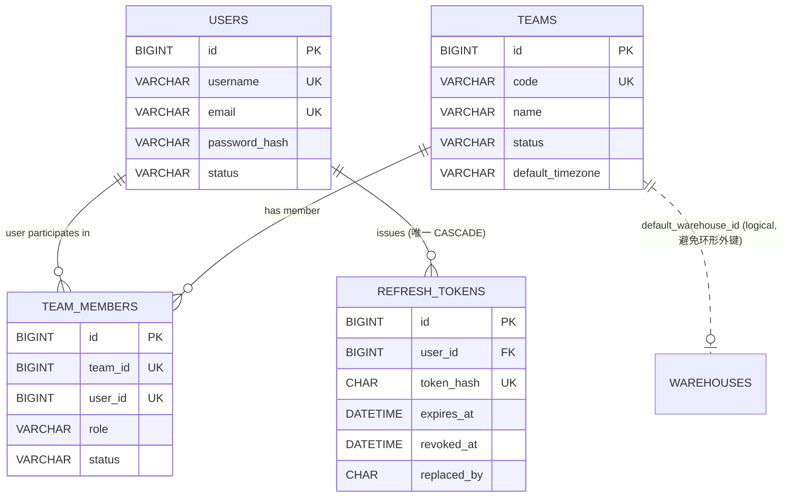
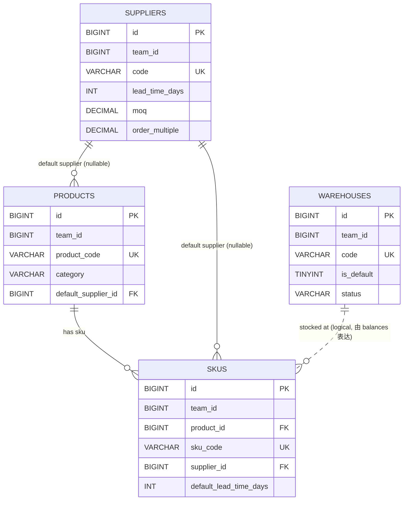
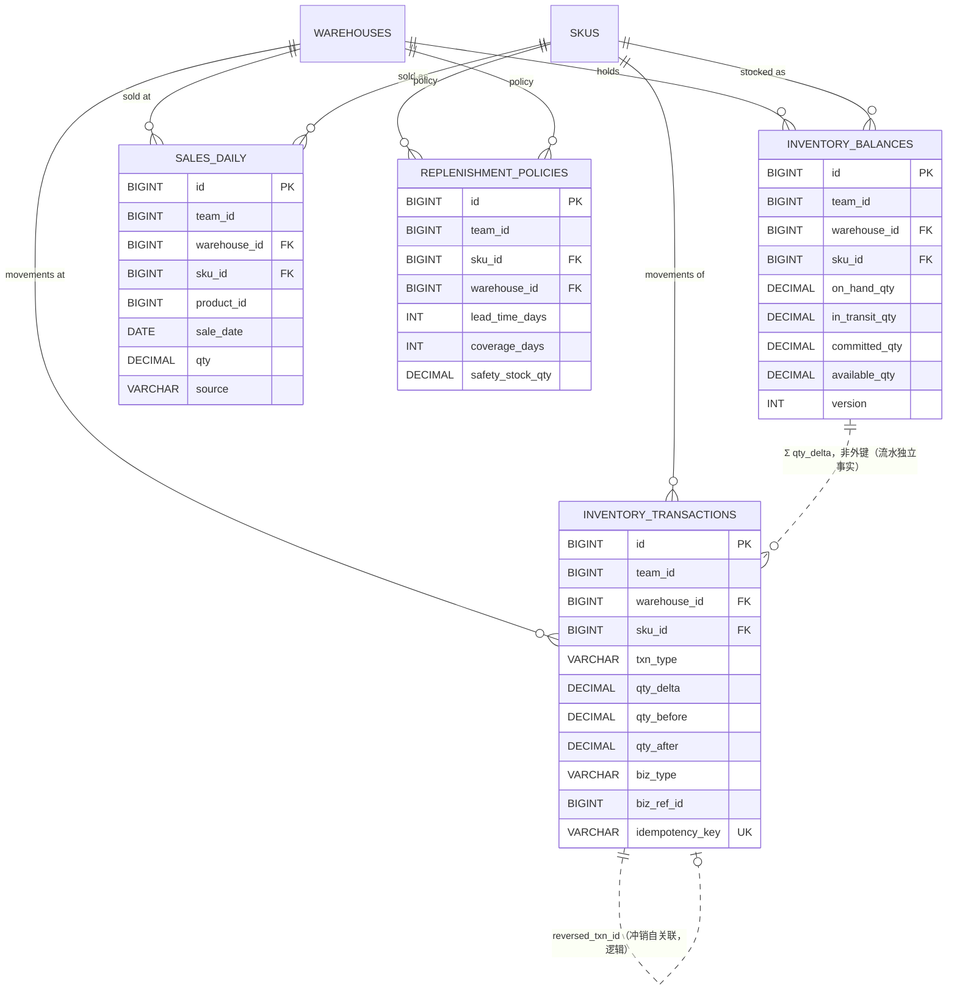
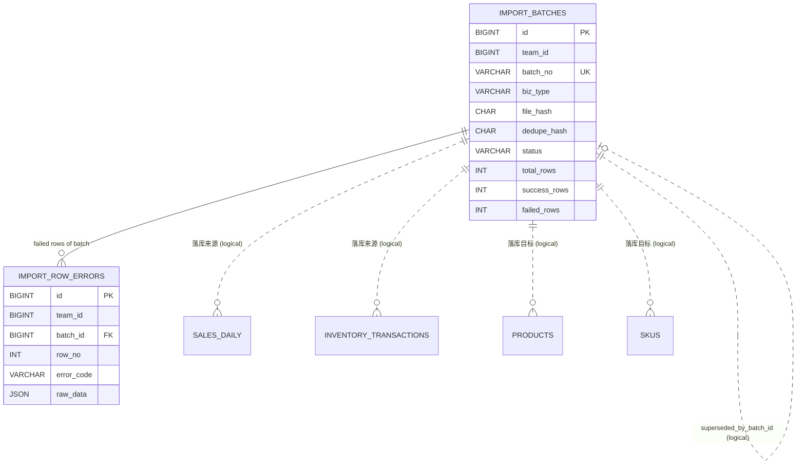
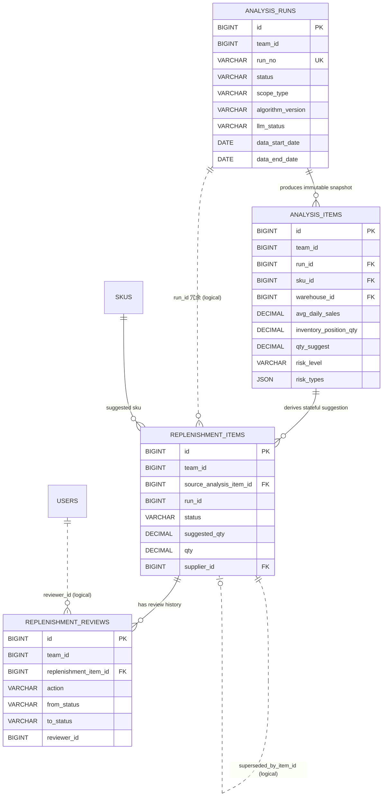
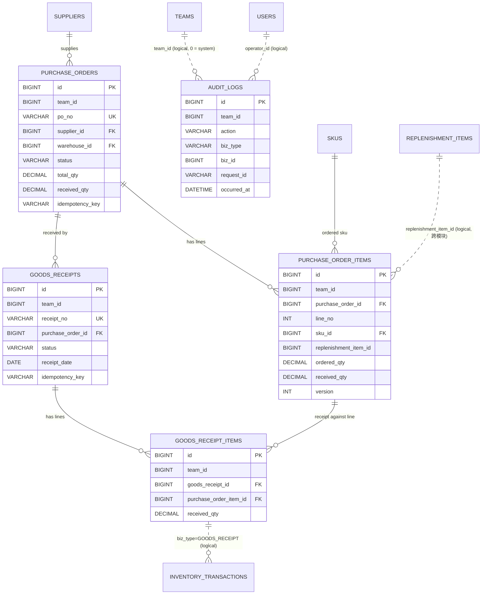

# ShopPilot AI 实体关系图（ER Diagram）

> **文档编号**：`docs/02-database/ER_DIAGRAM.md`
> **文档地位**：数据模型的**关系视图**，服从 `docs/DESIGN_BASIS.md`（SSOT）。本文件不定义任何表、字段、枚举、错误码，
> 只描述**关系、基数、约束强度与级联策略**。表与字段的权威定义见 `DATABASE_DESIGN.md` 与 `DATA_DICTIONARY.md`。
> **阶段**：M0 设计阶段。本文件**不产出任何 SQL**。

---

## 1. 文档职责

| 本文件负责 | 本文件不负责 |
| --- | --- |
| 23 张表的实体关系与基数 | 字段类型、默认值（见 `DATA_DICTIONARY.md`） |
| 区分"强外键关联"与"逻辑关联" | 索引与唯一约束细节（见 `DATABASE_CONSTRAINTS.md`） |
| 级联策略（ON DELETE / ON UPDATE） | 状态枚举取值（见 `DESIGN_BASIS.md §9`） |
| 按领域拆分的关系视图 | 事务边界与并发控制（见 `DATABASE_DESIGN.md §7`） |

**表清单来源**：`DESIGN_BASIS.md §8`（共 23 张，权威）。本文件不得增删表。

---

## 2. 图例约定

| 记号 | 含义 | 说明 |
| --- | --- | --- |
| 实线 `--` | **强外键关联** | 数据库层存在真实 `FOREIGN KEY` 约束（`ON DELETE RESTRICT` / `ON UPDATE RESTRICT`） |
| 虚线 `..` | **逻辑关联（弱关联）** | 数据库层**不建外键**，仅由应用层校验与索引保证；用于多态关联、日志类、冗余快照列、跨模块引用 |
| `\|\|--o{` | 1 : N | 左侧 1 条记录对应右侧 N 条（右侧外键指向左侧主键） |
| `\|o--o\|` | 1 : 1 | 两侧各 1 条（唯一约束保证） |
| `}o--o{` | N : M | 本期**不存在**（无中间表设计，见 `DATABASE_DESIGN.md §6-G`） |
| `FK` | 外键字段 | 生成真实外键约束的字段 |
| `UK` | 唯一约束字段 | 具体约束名见 `DATABASE_CONSTRAINTS.md §3` |

**Mermaid 渲染映射**：Mermaid `erDiagram` 中 `--`（identifying，实线）对应本文件的**强外键**；`..`（non-identifying，虚线）对应**逻辑关联**。

**基数读法**：`A ||--o{ B` 读作"A 有零到多条 B，B 恰好属于一条 A"；`A |o--o| B` 读作"A 与 B 一对一（A 侧可选）"。

---

## 3. 总览 ER 图（23 张表）

> 为避免图谱过大，属性块只标注于 6 张核心表；完整字段见 `DATA_DICTIONARY.md`。
> 图中**未绘制** `team_id` 的连线（23 张表中 20 张含 `team_id`，全部指向 `TEAMS`，若画出会形成 20 条放射线而不可读）；
> `team_id` 的隔离语义见 §4.1 与 `DATABASE_CONSTRAINTS.md §7`。

```mermaid
erDiagram
    USERS {
        BIGINT id PK
        VARCHAR username UK
        VARCHAR status
    }
    TEAMS {
        BIGINT id PK
        VARCHAR code UK
        VARCHAR status
    }
    TEAM_MEMBERS {
        BIGINT id PK
        BIGINT team_id UK
        BIGINT user_id UK
        VARCHAR role
    }
    REFRESH_TOKENS {
        BIGINT id PK
        BIGINT user_id FK
        CHAR token_hash UK
        DATETIME expires_at
        DATETIME revoked_at
    }
    PRODUCTS {
        BIGINT id PK
        BIGINT team_id
        VARCHAR product_code UK
    }
    SKUS {
        BIGINT id PK
        BIGINT team_id
        BIGINT product_id FK
        VARCHAR sku_code UK
    }
    INVENTORY_BALANCES {
        BIGINT id PK
        BIGINT team_id
        DECIMAL on_hand_qty
        DECIMAL in_transit_qty
        DECIMAL committed_qty
        INT version
    }
    INVENTORY_TRANSACTIONS {
        BIGINT id PK
        BIGINT team_id
        VARCHAR txn_type
        VARCHAR idempotency_key UK
    }
    ANALYSIS_RUNS {
        BIGINT id PK
        BIGINT team_id
        VARCHAR run_no UK
        VARCHAR status
    }
    ANALYSIS_ITEMS {
        BIGINT id PK
        BIGINT run_id FK
        BIGINT sku_id FK
        VARCHAR risk_level
    }
    REPLENISHMENT_ITEMS {
        BIGINT id PK
        BIGINT team_id
        BIGINT source_analysis_item_id FK
        VARCHAR status
    }
    PURCHASE_ORDERS {
        BIGINT id PK
        BIGINT team_id
        VARCHAR po_no UK
        VARCHAR status
    }
    PURCHASE_ORDER_ITEMS {
        BIGINT id PK
        BIGINT purchase_order_id FK
        DECIMAL ordered_qty
        DECIMAL received_qty
    }

    USERS ||--o{ TEAM_MEMBERS : "team-scoped role"
    TEAMS ||--o{ TEAM_MEMBERS : "has members"

    USERS ||--o{ REFRESH_TOKENS : "issues refresh tokens (ON DELETE CASCADE — 全库唯一)"

    TEAMS ||--o{ WAREHOUSES : "owns"
    TEAMS ||--o{ SUPPLIERS : "owns"
    TEAMS ||--o{ PRODUCTS : "owns"
    TEAMS ||--o{ SKUS : "owns"

    PRODUCTS ||--o{ SKUS : "has skus"
    SUPPLIERS ||--o{ SKUS : "default supplier (nullable)"
    SUPPLIERS ||--o{ PRODUCTS : "default supplier (nullable)"

    SKUS ||--o{ REPLENISHMENT_POLICIES : "policy per warehouse"
    WAREHOUSES ||--o{ REPLENISHMENT_POLICIES : "policy per sku"

    WAREHOUSES ||--o{ INVENTORY_BALANCES : "holds"
    SKUS ||--o{ INVENTORY_BALANCES : "stocked as"
    WAREHOUSES ||--o{ INVENTORY_TRANSACTIONS : "movements"
    SKUS ||--o{ INVENTORY_TRANSACTIONS : "movements"
    INVENTORY_BALANCES ||..o{ INVENTORY_TRANSACTIONS : "balance = Σ txn (logical)"

    WAREHOUSES ||--o{ SALES_DAILY : "sales at"
    SKUS ||--o{ SALES_DAILY : "sales of"
    PRODUCTS ||..o{ SALES_DAILY : "redundant product_id (logical)"

    IMPORT_BATCHES ||--o{ IMPORT_ROW_ERRORS : "failed rows"
    IMPORT_BATCHES ||..o{ SALES_DAILY : "batch_id (logical)"
    IMPORT_BATCHES ||..o{ INVENTORY_TRANSACTIONS : "batch_id (logical)"
    IMPORT_BATCHES ||..o| IMPORT_BATCHES : "duplicate_of / superseded_by (logical)"

    TEAMS ||--o{ ANALYSIS_RUNS : "runs"
    USERS ||..o{ ANALYSIS_RUNS : "triggered_by (logical)"
    ANALYSIS_RUNS ||--o{ ANALYSIS_ITEMS : "snapshot per sku"
    SKUS ||--o{ ANALYSIS_ITEMS : "analyzed sku"
    WAREHOUSES ||--o{ ANALYSIS_ITEMS : "analyzed warehouse"
    PRODUCTS ||..o{ ANALYSIS_ITEMS : "redundant product_id (logical)"

    ANALYSIS_ITEMS ||--o{ REPLENISHMENT_ITEMS : "source snapshot"
    ANALYSIS_RUNS ||..o{ REPLENISHMENT_ITEMS : "run_id (logical)"
    SKUS ||--o{ REPLENISHMENT_ITEMS : "suggested sku"
    WAREHOUSES ||--o{ REPLENISHMENT_ITEMS : "suggested warehouse"
    SUPPLIERS ||..o{ REPLENISHMENT_ITEMS : "preferred supplier (logical)"
    PRODUCTS ||..o{ REPLENISHMENT_ITEMS : "redundant product_id (logical)"
    REPLENISHMENT_ITEMS ||..o| REPLENISHMENT_ITEMS : "superseded_by (logical)"

    REPLENISHMENT_ITEMS ||--o{ REPLENISHMENT_REVIEWS : "review trail"
    USERS ||..o{ REPLENISHMENT_REVIEWS : "reviewer_id (logical)"

    SUPPLIERS ||--o{ PURCHASE_ORDERS : "supplies"
    WAREHOUSES ||--o{ PURCHASE_ORDERS : "deliver to"
    USERS ||..o{ PURCHASE_ORDERS : "created_by / confirmed_by (logical)"
    PURCHASE_ORDERS ||--o{ PURCHASE_ORDER_ITEMS : "lines"
    SKUS ||--o{ PURCHASE_ORDER_ITEMS : "ordered sku"
    PRODUCTS ||..o{ PURCHASE_ORDER_ITEMS : "redundant product_id (logical)"
    REPLENISHMENT_ITEMS ||..o{ PURCHASE_ORDER_ITEMS : "replenishment_item_id (logical, cross-module)"

    PURCHASE_ORDERS ||--o{ GOODS_RECEIPTS : "receipts"
    WAREHOUSES ||--o{ GOODS_RECEIPTS : "received at"
    GOODS_RECEIPTS ||--o{ GOODS_RECEIPT_ITEMS : "receipt lines"
    PURCHASE_ORDER_ITEMS ||--o{ GOODS_RECEIPT_ITEMS : "received against"
    SKUS ||--o{ GOODS_RECEIPT_ITEMS : "received sku"

    TEAMS ||..o{ AUDIT_LOGS : "team_id (logical, 0 = system)"
    USERS ||..o{ AUDIT_LOGS : "operator_id (logical)"
```

> **图例提示**：`WAREHOUSES` 与 `SUPPLIERS` 在 §4.2 中给出字段定义；上方属性块为节省篇幅未展开。

---

## 4. 分域 ER 图

### 4.1 领域一 · 身份与团队（identity）

**文字说明**

| 项 | 内容 |
| --- | --- |
| 主表 | `users`（跨团队全局）、`teams`（自身即团队边界）、`refresh_tokens`（跨团队全局，按 `user_id` 组织） |
| 从表 | `team_members`（用户↔团队的关联表）、`refresh_tokens`（用户的刷新令牌撤销记录） |
| 基数 | `users` 1:N `team_members`；`teams` 1:N `team_members`；`users` N:M `teams`（**通过对 `team_members` 的两条 1:N 表达，本期不建独立中间表**）；`users` **1:N `refresh_tokens`**（一个用户可有多条并发会话令牌） |
| 级联策略 | `team_members.user_id` / `team_members.team_id` 均为 `ON DELETE RESTRICT`、`ON UPDATE RESTRICT`；**`refresh_tokens.user_id` 为 `ON DELETE CASCADE`（全库唯一例外，见 §7.1）** |
| 团队隔离 | `users`、`teams` 与 **`refresh_tokens`** 是 §6 规则 1 的**显式例外**（`users` 全局、`teams` 自身、`refresh_tokens` 属跨团队全局账号体系），`team_members` 含 `team_id` 并受 §6 全量约束 |
| 为什么 `teams.default_warehouse_id` 是逻辑关联 | `warehouses.team_id → teams.id` 已是强外键，若再为 `teams.default_warehouse_id` 建外键会形成**环形外键**，导致两条表都无法先插入（鸡生蛋问题）。故该列只做逻辑关联，由服务层校验"默认仓属于本团队" |
| 为什么 `users` 不建"每团队恰好 1 名 OWNER"的 DB 约束 | MySQL 无部分唯一索引；`UNIQUE(team_id, role)` 会错误地限制同团队只能有 1 名 APPROVER。故该规则落在 `TeamAppService`（事务内校验 + 行锁）与 `team_members` 的唯一约束 `uk_tm_team_user` 共同保证 |
| 软删除 | `users.status`（`UserStatus`）、`teams.status`（`TeamStatus`）、`team_members.status`（`ACTIVE`/`REMOVED`）。**禁止物理删除**；成员移出后保留历史行，重新加入走"复活同一行"（`status` 改回 `ACTIVE`），不新增行——这正是 `uk_tm_team_user` 的意义 |
| `refresh_tokens` 的特殊处理 | ① **只存 `token_hash`（SHA-256），禁止存明文**；② **无 `team_id`**（跨团队全局），须登记进 `TenantTables.WITHOUT_TEAM_ID`，否则租户线会追加 `team_id = ?` 致**登出静默失效**；③ 唯一允许 `ON DELETE CASCADE` 的表——令牌是派生凭据数据，用户物理删除后必须立即失效 |

---

### 4.2 领域二 · 商品与基础资料（catalog）

**文字说明**

| 项 | 内容 |
| --- | --- |
| 主表 | `products`（商品级共享属性）、`warehouses` / `suppliers`（独立主数据） |
| 从表 | `skus`（隶属 `products`，可选隶属 `suppliers`） |
| 基数 | `products` 1:N `skus`；`suppliers` 1:N `skus`（可空）；`suppliers` 1:N `products`（可空，默认供应商） |
| 级联策略 | 全部 `ON DELETE RESTRICT` / `ON UPDATE RESTRICT`。停用商品**不删除**：`status = 'INACTIVE'`（`MasterDataStatus`） |
| 团队隔离 | 4 张表均含 `team_id`；唯一约束为 `uk_wh_team_code` / `uk_sup_team_code` / `uk_prod_team_code` / `uk_sku_team_code`，均带 `team_id` 前缀（§6 规则 2）。同团队内 `sku_code` 唯一，**跨团队可重复** |
| 为什么 `skus.product_id` 是强外键 | SKU 离开商品无意义，且 `product_id` 一旦写入**不可变更**（换商品必须新建 SKU）。这条不变量使 `sales_daily` / `analysis_items` / `purchase_order_items` 上的 `product_id` 冗余列永远安全 |
| 为什么没有 `skus` ↔ `warehouses` 关系 | 首期"SKU 在哪些仓有货"完全由 `inventory_balances` 与 `replenishment_policies` 表达，`skus` 表不持有仓库维度，避免"全量 SKU × 全量仓库"的笛卡尔膨胀（数据模型保留仓库维度，见 `DESIGN_BASIS §2.1` 与待决策 `D-02`） |
| 软删除 | `warehouses` / `suppliers` / `products` / `skus` 使用 `MasterDataStatus`（`ACTIVE` / `INACTIVE`）。停用后不参与新的分析任务与采购，但历史数据（销售、流水、建议、采购）仍可查询 |

---

### 4.3 领域三 · 库存与销售（inventory + sales）

**文字说明**

| 项 | 内容 |
| --- | --- |
| 主表 | `inventory_balances`（当前值）、`sales_daily`（销售事实）、`replenishment_policies`（参数归属） |
| 从表 | `inventory_transactions`（变更历史，**不可变仅追加**） |
| 基数 | `warehouses` 1:N `inventory_balances` 1:N `inventory_transactions`；`skus` 同理。`inventory_balances` 与 `inventory_transactions` 是**1:N 逻辑关联**，不是外键 |
| 级联策略 | 全部 `ON DELETE RESTRICT` / `ON UPDATE RESTRICT` |
| **为什么余额与流水不做外键** | 流水是**独立事实记录**（append-only 账本），余额是**可推导的物化状态**。若建 `inventory_transactions.balance_id → inventory_balances.id` 外键，会把"账本"与"快照"强绑定，一旦未来重建余额（对账修复、重算）就必须改流水，违背流水不可变原则。二者靠 `(team_id, warehouse_id, sku_id)` 三元组关联（见 `DATABASE_DESIGN.md §6-C`） |
| 为什么 `inventory_transactions` 没有 `warehouse_id/sku_id` 之外的业务外键 | `biz_ref_id` 是**多态关联**（`biz_type` 决定指向 `goods_receipts` / `import_batches` / 盘点单等），MySQL 无法对外键做多态约束，故只建索引 `idx_invtxn_team_biz`（见 §6） |
| 团队隔离 | 3 + 1 张表全部含 `team_id`；`uk_invbal_team_wh_sku`、`uk_invtxn_team_idem`、`uk_sales_team_wh_sku_date`、`uk_pol_team_sku_wh` 均带 `team_id` 前缀 |
| 软删除 | 本域**无软删除**：`inventory_transactions` 与 `sales_daily` 是事实数据，纠正靠**冲销流水**（`txn_type = 'REVERSAL'`）与 **upsert 覆盖**，绝不删除行 |

---

### 4.4 领域四 · 数据导入（importdata）

**文字说明**

| 项 | 内容 |
| --- | --- |
| 主表 | `import_batches` |
| 从表 | `import_row_errors` |
| 基数 | `import_batches` 1:N `import_row_errors`；`import_batches` **自关联 1:0..1**（`duplicate_of_batch_id`、`superseded_by_batch_id`） |
| 级联策略 | `import_row_errors.batch_id` 为 `ON DELETE RESTRICT` / `ON UPDATE RESTRICT`。批次与行错误**均不物理删除**；批次取消走 `status = 'CANCELLED'` |
| **为什么行错误没有唯一约束** | 同一批次同一行可能产生**多条不同级别的错误**（一次校验同时报"必填列缺失 + 数值非法"），强制唯一会丢失诊断信息。改为普通索引 `idx_ire_team_batch_row`，查询侧按 `(batch_id, row_no)` 聚合 |
| 落库目标为何是逻辑关联 | 批次落库会写 `sales_daily` / `inventory_transactions` / `products` / `skus`，这些是"一次性写入后独立演化"的实体；批次只保存 `batch_id` 作为**溯源标签**，不建外键（否则批次成为所有业务表的删除瓶颈，且导入模块会与全部业务模块产生 schema 耦合） |
| 团队隔离 | 两张表均含 `team_id`；`uk_imp_team_hash_biz` 带 `team_id` 前缀（§6 规则 2） |
| 自关联策略 | `duplicate_of_batch_id`、`superseded_by_batch_id` 为**逻辑关联**（不建外键）：因为强制重导存在"插入新批次 → 回写旧批次指针"的两阶段写入，且批次表在极端情况下需要按团队归档，自关联外键会阻碍归档顺序 |

---

### 4.5 领域五 · 分析与补货（analysis + replenishment）

**文字说明**

| 项 | 内容 |
| --- | --- |
| 主表 | `analysis_runs`（运行实例）、`analysis_items`（**不可变计算快照**）、`replenishment_items`（**有状态业务对象**） |
| 从表 | `replenishment_reviews`（审核轨迹，仅追加） |
| 基数 | `analysis_runs` 1:N `analysis_items`；`analysis_items` 1:N `replenishment_items`（**1:N，非 1:1**：同一条快照在当前实现下唯一派生 1 条建议，但设计上允许多条，见 `DATABASE_DESIGN.md §6-F`）；`replenishment_items` 1:N `replenishment_reviews` |
| 级联策略 | 全部 `ON DELETE RESTRICT` / `ON UPDATE RESTRICT` |
| **关键区分**（`DESIGN_BASIS §3.1`） | `analysis_items` 写入后**永不 UPDATE**；`replenishment_items` 有状态机、可改数量、可审核。二者数量可不同（人工改过），因此**不能合并为一张表** |
| `SUPERSEDED` 的落地 | 新一轮 run 产生同 `(sku_id, warehouse_id)` 的新建议时，旧建议置 `SUPERSEDED`（终态）并把 `superseded_by_item_id` 指向新建议；旧建议的 `qty`、`status` 历史**不被覆盖**，因此不影响任何已审批/已执行的采购业务 |
| 团队隔离 | 4 张表均含 `team_id`；`uk_run_team_no`、`uk_run_team_idem`、`uk_repl_run_sku_wh` 带团队维度 |
| 软删除 | 无物理删除。建议的"作废"是 `status = 'CANCELLED'`（终态），运行是 `status = 'CANCELLED'` |

---

### 4.6 领域六 · 采购、到货与审计（purchasing + audit）

**文字说明**

| 项 | 内容 |
| --- | --- |
| 主表 | `purchase_orders`、`goods_receipts`；`audit_logs` 为独立只追加流 |
| 从表 | `purchase_order_items`（隶属采购单）、`goods_receipt_items`（隶属到货单，并指向采购明细） |
| 基数 | `purchase_orders` 1:N `purchase_order_items`；`purchase_orders` 1:N `goods_receipts`（**支持多次部分到货**）；`goods_receipts` 1:N `goods_receipt_items`；`purchase_order_items` 1:N `goods_receipt_items`（**一条采购明细可被多张到货单分批收**） |
| 级联策略 | 全部 `ON DELETE RESTRICT` / `ON UPDATE RESTRICT`。采购单"取消"是 `status = 'CANCELLED'`；到货单已确认后**不可作废**，只能走库存冲销（`txn_type = 'REVERSAL'`） |
| **为什么 `purchase_order_items.replenishment_item_id` 是逻辑关联** | 该列指向 `replenishment` 模块（`purchasing → replenishment` 是合法依赖方向，但 `replenishment` 不得反向依赖 `purchasing`）。若建 DB 外键，则**表级**产生双向引用，使 `replenishment_items` 永远无法独立归档/清理，与模块边界（`MODULE_BOUNDARIES.md`）的意图冲突。故只建索引 `idx_poi_team_repl`，由服务层校验同团队 |
| 为什么 `audit_logs` 与业务表只有逻辑关联 | ① `biz_id` 是**多态关联**（`biz_type` 决定指向哪张表）；② 审计流必须**只追加**，任何外键都会引入对业务表的依赖，阻碍业务表状态机以外的归档策略；③ 审计需要记录**已不存在或已停用**的对象（如被停用的 SKU），外键的 `RESTRICT` 语义会造成写入失败。故全表零外键，仅建 `idx_al_team_biz` |
| 团队隔离 | 5 张表均含 `team_id`；`uk_po_team_no`、`uk_po_team_idem`、`uk_poi_po_lino`、`uk_gr_team_no`、`uk_gr_team_idem`、`uk_gri_receipt_poi` 带团队维度 |
| 软删除 | 无物理删除。采购单 / 到货单使用 `PurchaseOrderStatus` / `GoodsReceiptStatus`；`audit_logs` 永不删除 |

---

## 5. 关系总表

> 「是否强约束」= **是** 表示数据库层存在真实 `FOREIGN KEY`；**否** 表示逻辑关联（应用层校验 + 索引）。
> 「基数」以"从表 → 到表"方向描述：`N:1` 表示从表每条记录对应到表一条记录。

| # | 从表 | 到表 | 基数 | 关联字段 | 是否强约束 | 说明 |
| --- | --- | --- | --- | --- | --- | --- |
| 1 | `team_members` | `users` | N:1 | `user_id` | 是 | 用户可属多团队；移出成员保留行（`status='REMOVED'`） |
| 2 | `team_members` | `teams` | N:1 | `team_id` | 是 | `uk_tm_team_user` 保证一人一团队一行 |
| 3 | `warehouses`/`suppliers`/`products`/`skus` | `teams` | N:1 | `team_id` | **否** | 全库 20 张表统一策略：`team_id` 不建外键（见 §6） |
| 4 | `skus` | `products` | N:1 | `product_id` | 是 | `product_id` **不可变更**（换商品须新建 SKU） |
| 5 | `skus` | `suppliers` | N:1 | `supplier_id` | 是 | 可空；`L`/MOQ/倍数的二级来源（`DESIGN_BASIS §10.2`） |
| 6 | `products` | `suppliers` | N:1 | `default_supplier_id` | 是 | 可空；商品级默认供应商 |
| 7 | `replenishment_policies` | `skus` | N:1 | `sku_id` | 是 | 参数三级来源的第一级 |
| 8 | `replenishment_policies` | `warehouses` | N:1 | `warehouse_id` | 是 | 策略按 SKU×仓库维度 |
| 9 | `inventory_balances` | `warehouses` | N:1 | `warehouse_id` | 是 | `uk_invbal_team_wh_sku` 定唯一 |
| 10 | `inventory_balances` | `skus` | N:1 | `sku_id` | 是 | 同上 |
| 11 | `inventory_transactions` | `warehouses` | N:1 | `warehouse_id` | 是 | 流水携带完整定位三元组 |
| 12 | `inventory_transactions` | `skus` | N:1 | `sku_id` | 是 | 同上 |
| 13 | `inventory_transactions` | `inventory_balances` | N:1 | `(team_id, warehouse_id, sku_id)` | **否** | 账本→快照，靠三元组逻辑关联（避免外键绑定不可变流水） |
| 14 | `inventory_transactions` | `goods_receipts`/`import_batches`/盘点 | N:0..1 | `biz_type` + `biz_ref_id` | **否** | **多态关联**，无法用外键表达 |
| 15 | `sales_daily` | `warehouses` | N:1 | `warehouse_id` | 是 | — |
| 16 | `sales_daily` | `skus` | N:1 | `sku_id` | 是 | — |
| 17 | `sales_daily` | `products` | N:1 | `product_id` | **否** | 冗余列（加速类目/商品汇总，由不可变 `skus.product_id` 保证安全） |
| 18 | `sales_daily` | `import_batches` | N:1 | `batch_id` | **否** | 可空；溯源标签，批次不参与删除约束 |
| 19 | `import_row_errors` | `import_batches` | N:1 | `batch_id` | 是 | 同模块主从；批次不物理删除 |
| 20 | `import_batches` | `import_batches` | 1:0..1 | `duplicate_of_batch_id` | **否** | 自关联；命中文件级幂等时指向原批次 |
| 21 | `import_batches` | `import_batches` | 1:0..1 | `superseded_by_batch_id` | **否** | 自关联；`FORCE_REIMPORT` 后指向新批次 |
| 22 | `analysis_runs` | `teams` | N:1 | `team_id` | **否** | 统一 `team_id` 策略 |
| 23 | `analysis_runs` | `users` | N:1 | `triggered_by` | **否** | `*_by` 类字段统一逻辑关联（保留历史、避免删除瓶颈） |
| 24 | `analysis_items` | `analysis_runs` | N:1 | `run_id` | 是 | 快照隶属运行，`uk_ai_run_sku_wh` 定唯一 |
| 25 | `analysis_items` | `skus` / `warehouses` | N:1 | `sku_id` / `warehouse_id` | 是 | 同团队校验由服务层保证 |
| 26 | `analysis_items` | `products` | N:1 | `product_id` | **否** | 冗余列（快照语义） |
| 27 | `replenishment_items` | `analysis_items` | N:1 | `source_analysis_item_id` | 是 | **追溯链核心**：建议必须能回到"当时为什么这么算" |
| 28 | `replenishment_items` | `analysis_runs` | N:1 | `run_id` | **否** | 冗余列（便于按 run 批量查建议，避免 JOIN） |
| 29 | `replenishment_items` | `skus` / `warehouses` | N:1 | `sku_id` / `warehouse_id` | 是 | — |
| 30 | `replenishment_items` | `suppliers` | N:1 | `supplier_id` | 是 | 可空；运营可指定供应商 |
| 31 | `replenishment_items` | `replenishment_items` | 1:0..1 | `superseded_by_item_id` | **否** | 自关联；避免与外键 `RESTRICT` 形成"互相阻塞" |
| 32 | `replenishment_reviews` | `replenishment_items` | N:1 | `replenishment_item_id` | 是 | 审核轨迹；仅追加 |
| 33 | `replenishment_reviews` | `users` | N:1 | `reviewer_id` | **否** | `*_by` 类统一策略 |
| 34 | `purchase_orders` | `suppliers` / `warehouses` | N:1 | `supplier_id` / `warehouse_id` | 是 | 服务层校验"同团队"（§6 规则 4） |
| 35 | `purchase_order_items` | `purchase_orders` | N:1 | `purchase_order_id` | 是 | `uk_poi_po_lino` 保证行号唯一 |
| 36 | `purchase_order_items` | `skus` | N:1 | `sku_id` | 是 | — |
| 37 | `purchase_order_items` | `replenishment_items` | N:1 | `replenishment_item_id` | **否** | 可空；**跨模块逻辑关联**（见 §4.6） |
| 38 | `purchase_order_items` | `products` | N:1 | `product_id` | **否** | 冗余列（快照语义） |
| 39 | `goods_receipts` | `purchase_orders` | N:1 | `purchase_order_id` | 是 | 支持部分到货 → 1:N |
| 40 | `goods_receipts` | `warehouses` | N:1 | `warehouse_id` | 是 | 到货入库仓库 |
| 41 | `goods_receipt_items` | `goods_receipts` | N:1 | `goods_receipt_id` | 是 | — |
| 42 | `goods_receipt_items` | `purchase_order_items` | N:1 | `purchase_order_item_id` | 是 | `uk_gri_receipt_poi` 防同单重复行 |
| 43 | `goods_receipt_items` | `inventory_transactions` | N:0..1 | `biz_type='GOODS_RECEIPT'` + `biz_ref_id` | **否** | 确认收货时同事务写入流水 |
| 44 | `audit_logs` | 全部业务表 | N:0..1 | `biz_type` + `biz_id` | **否** | **多态关联**；全表零外键（见 §4.6） |
| 45 | `audit_logs` | `teams` / `users` | N:1 | `team_id` / `operator_id` | **否** | `team_id = 0` 表示系统域（登录等无团队上下文操作） |
| 46 | `refresh_tokens` | `users` | N:1 | `user_id` | 是 | **全库唯一 `ON DELETE CASCADE`**：用户物理删除 → 其全部令牌行自动消失，避免"可刷新但用户已不存在"的悬挂凭据（见 §7.1） |

---

## 6. 强约束与逻辑关联的划分理由

### 6.1 使用真实外键（强约束）的四类关系

| 类别 | 典型 | 理由 |
| --- | --- | --- |
| 同模块主从 | `purchase_orders` → `purchase_order_items`、`analysis_runs` → `analysis_items`、`import_batches` → `import_row_errors` | 子行离开父行无意义；外键能在**数据库层**防止"孤儿明细"，这是最后一道防线 |
| 稳定主数据引用 | `sku_id` / `warehouse_id` / `supplier_id` / `product_id` | 主数据采用**软停用**（`MasterDataStatus`），永不物理删除，`RESTRICT` 不会误伤正常业务 |
| 追溯链 | `replenishment_items.source_analysis_item_id` | 追溯链是审计刚需，必须由 DB 保证"建议一定指向一条存在的快照" |
| 团队内自关联（可选） | `replenishment_reviews.replenishment_item_id` | 审核轨迹必须挂靠建议 |

### 6.2 只用逻辑关联（不建外键）的六类关系

| # | 类别 | 实例 | 不建外键的理由 |
| --- | --- | --- | --- |
| 1 | **多态关联** | `audit_logs.biz_id`、`inventory_transactions.biz_ref_id` | 目标表随 `biz_type` 变化，MySQL 无多态外键；建 N 个可空外键列会污染表结构 |
| 2 | **账本 ↔ 快照** | `inventory_transactions` ↔ `inventory_balances` | 流水**不可变**；若绑定外键，未来重建余额（对账修复）就要改流水，违背不变量 |
| 3 | **跨模块引用** | `purchase_order_items.replenishment_item_id` | 保证模块依赖单向（`MODULE_BOUNDARIES.md`），避免表级双向引用阻碍独立归档 |
| 4 | **审计/操作者类字段** | 所有 `created_by` / `updated_by` / `operator_id` / `reviewer_id` / `approved_by` / `confirmed_by` / `triggered_by` / `uploaded_by` | ① 数量巨大（23 张表 × 2~4 列）；② 需记录**已停用/已移出**用户；③ 用户体系独立演化，不应成为全库写入瓶颈 |
| 5 | **冗余快照列** | `product_id`（`sales_daily` / `analysis_items` / `replenishment_items` / `purchase_order_items`）、`biz_ref_no`、`operator_name` | 冗余列的价值在于"不 JOIN 也能查"和"保留当时的值"；建外键会引入不必要的校验成本，且与"快照"语义矛盾 |
| 6 | **统一 `team_id`** | 20 张含 `team_id` 的表 | ① 会新增 20 条同质外键，收益（防孤儿团队）远低于成本；② `teams` 为软停用，不会产生孤儿；③ 团队隔离的真实保障是"带 `team_id` 前缀的唯一约束 + 复合索引 + 服务层校验 + 租户插件兜底"（`DESIGN_BASIS §6`），不依赖外键；④ `audit_logs.team_id = 0`（系统域）若建外键将直接违反约束 |

> **反例说明**：`teams.default_warehouse_id` 若建外键会与 `warehouses.team_id → teams.id` 形成**环形外键**，两条表都无法完成首次插入，故必须为逻辑关联（见 §4.1）。

---

## 7. 级联策略汇总

### 7.1 统一规则

| 操作 | 策略 | 说明 |
| --- | --- | --- |
| `ON DELETE` | **一律 `RESTRICT`** | 除下行的**唯一例外**外，全库 23 张表**不允许 `CASCADE`**，也不允许 `SET NULL`。业务数据禁止物理删除：`teams`/`users`/主数据用状态字段软停用；单据用状态机流转；事实数据（流水、销售）用**冲销 / upsert 覆盖**纠正 |
| `ON DELETE`（**唯一例外**） | `fk_rt_user`（`refresh_tokens.user_id → users.id`）用 **`CASCADE`** | 全库**仅此一条**级联，见下方说明 |
| `ON UPDATE` | **一律 `RESTRICT`** | 主键 `id` 为 `BIGINT UNSIGNED AUTO_INCREMENT`，**永不变更**；因此 `ON UPDATE CASCADE` 无使用场景 |
| 级联的替代方案 | **应用层显式编排** | 需要"批量失效"时（如停用商品 → 停用其 SKU），在 `ApplicationService` 的**单个本地事务**内按依赖顺序 UPDATE，并写审计日志，而不是依赖 DB 级联（DB 级联无法写审计、无法校验权限） |

> **为什么 `refresh_tokens` 可以级联（全库唯一 `ON DELETE CASCADE`）**
>
> 本项目禁止 `CASCADE` 的对象是**业务数据**（商品、单据、流水）——它们的"删除"必须走软停用/状态机/冲销，且需要写审计。
> `refresh_tokens` 不属于这一类，它是**派生凭据数据**（由"用户 + 签发时刻"派生，不含独立业务语义），因此适用不同的权衡：
>
> 1. **安全性优先**：用户被物理删除（仅运维在 DB 层执行）后，其 Refresh Token **必须立即失效**。
>    若沿用 `RESTRICT`，将留下"令牌仍可通过刷新换取 Access Token、而用户已不存在"的**悬挂凭据**。
> 2. **一次性收口**：`CASCADE` 使"删除用户"成为原子动作，无需应用层额外清理步骤，也不会因为运维遗漏而产生残留。
> 3. **不破坏审计**：令牌行本身不是审计对象；"谁在何时登录/登出"由 `audit_logs` 承载（`AuditAction`），与本表无关。
> 4. **边界明确**：该例外已在 `DATABASE_CONSTRAINTS.md §5.2` 与本节**双处登记**，任何新增的 `CASCADE` 都必须回到此处评审。

### 7.2 禁止物理删除的操作对照

| 业务诉求 | 错误做法 | 本设计做法 |
| --- | --- | --- |
| 商品不再销售 | `DELETE FROM products` | `products.status = 'INACTIVE'`（历史销售/建议/采购仍可查，`DESIGN_BASIS §9.4`） |
| SKU 下架 | `DELETE FROM skus` | `skus.status = 'INACTIVE'` |
| 成员离职 | `DELETE FROM team_members` | `status = 'REMOVED'` + `removed_at` |
| 补货建议不再需要 | `DELETE FROM replenishment_items` | `status = 'CANCELLED'`（终态） |
| 采购单取消 | `DELETE FROM purchase_orders` | `status = 'CANCELLED'`（仅 `DRAFT`/`PENDING`/`ORDERED`/`PARTIALLY_RECEIVED` 可转，`DESIGN_BASIS §9.13`） |
| 到货录入错误（未确认） | `DELETE FROM goods_receipts` | `status = 'CANCELLED'`（仅 `DRAFT` 可直接作废） |
| 到货录入错误（已确认） | `DELETE` + 反写余额 | **库存冲销**：写入 `txn_type = 'REVERSAL'` 的反向流水，余额随之修正；原到货单保持 `CONFIRMED` |
| 销售数据录错 | `DELETE FROM sales_daily` | **upsert 覆盖**（同 `team+warehouse+sku+sale_date` 重导即覆盖，见 `DATABASE_DESIGN.md §6-D`） |
| 批次导入错误 | `DELETE FROM import_batches` | `status = 'CANCELLED'`；已落库数据用**冲销/upsert**纠正 |
| 清理审计日志 | `DELETE FROM audit_logs` | **永不删除**（应用层禁止 UPDATE/DELETE，见 `DATABASE_DESIGN.md §6-J`） |

### 7.3 环形与自关联的特别说明

| 位置 | 形态 | 处理 |
| --- | --- | --- |
| `teams.default_warehouse_id` ↔ `warehouses.team_id` | 环形外键（潜在） | `teams.default_warehouse_id` 降级为**逻辑关联**，断开环 |
| `import_batches.duplicate_of_batch_id` / `superseded_by_batch_id` | 自关联（同表） | 逻辑关联；`FORCE_REIMPORT` 需"先插新行、再回写旧行"的两阶段写入，外键会在第一阶段失败 |
| `replenishment_items.superseded_by_item_id` | 自关联（同表） | 逻辑关联；`SUPERSEDED` 批量流转可能一次性更新多行，外键 `RESTRICT` 不必要且降低批量操作灵活性 |
| `inventory_transactions.reversed_txn_id` | 自关联（同表） | 逻辑关联；冲销流水可能在批量修复场景下乱序写入 |

---

## 8. 关系层面的团队隔离校验点

> 每个跨表写入点都必须在服务层做**同团队校验**（`DESIGN_BASIS §6` 规则 4），不能因为参数带了 `team_id` 就认为隔离已完成。

| # | 写入点 | 必须校验的等式 | 违反时错误码 |
| --- | --- | --- | --- |
| 1 | 创建 `skus` | `product.team_id == team_id` 且 `supplier.team_id == team_id`（若指定） | `TEAM-2001` |
| 2 | 创建 `replenishment_policies` | `sku.team_id == team_id == warehouse.team_id` | `TEAM-2001` |
| 3 | 写 `inventory_balances` / `inventory_transactions` | `sku.team_id == warehouse.team_id == team_id` | `TEAM-2001` |
| 4 | upsert `sales_daily` | `sku.team_id == warehouse.team_id == team_id` 且 `sku.product_id == product_id` | `TEAM-2001` |
| 5 | 落库 `import_batches` 明细 | `sku.team_id == batch.team_id` | `TEAM-2001` |
| 6 | 写 `analysis_items` | `run.team_id == sku.team_id == warehouse.team_id` | `TEAM-2001` |
| 7 | 写 `replenishment_items` | `source_item.team_id == run.team_id == team_id` | `TEAM-2001` |
| 8 | 创建 `purchase_order_items` | `po.team_id == sku.team_id`；若带 `replenishment_item_id`，则 `replenishment_item.team_id == po.team_id` | `TEAM-2001` / `PO-9001` |
| 9 | 确认 `goods_receipts` | `receipt.team_id == po.team_id` 且 `poi.team_id == receipt.team_id` 且 `warehouse.team_id == receipt.team_id` | `TEAM-2001` / `PO-9002` |
| 10 | 写 `audit_logs` | 由 `TeamContext` 注入，**不接受客户端传入** | `TEAM-2001` |

---

## 9. 与 `DESIGN_BASIS` 的一致性声明

| 检查项 | 结论 |
| --- | --- |
| 表数量与表名 | 与 `DESIGN_BASIS §8` 完全一致（23 张） |
| 外键字段命名 | 与 `§4.1` 一致（`<被引用表单数>_id`） |
| 多团队隔离 | 20 张表含 `team_id`，`users` / `teams` 为例外，与 `§6` 规则 1 一致 |
| 唯一约束 | 与 `§8` 一致；`uk_ai_run_sku_wh` 与 `uk_repl_run_sku_wh` 未带 `team_id` 前缀，与 `§6` 规则 2 的**字面**表述存在张力（该约束由 `run_id` 派生团队维度），已在 `DATABASE_DESIGN.md §11` 记录 |
| 新增待决策 | 见 `DATABASE_DESIGN.md §11`（`D-09`~`D-12`） |

---

## 10. 变更记录

| 日期 | 变更 | 依据 |
| --- | --- | --- |
| M0 | 初版创建 | `DESIGN_BASIS.md §8`、任务书 §5.1 |
| M2 | 新增 `refresh_tokens`（`users` 1:N，**全库唯一 `ON DELETE CASCADE`**）；表数 22 → **23 张**；§3 总览图、§4.1 身份域、§5 关系总表（+第 46 条）、§7.1 级联例外 同步 | `DESIGN_BASIS.md §8 / §15 D-01`、`DESIGN_REVIEW.md` R15、`DATABASE_DESIGN.md §4.4 / §5.23` |

> 本文件任何变更必须同步 `DATABASE_DESIGN.md`、`DATA_DICTIONARY.md`、`DATABASE_CONSTRAINTS.md`（`DESIGN_BASIS §16`）。
