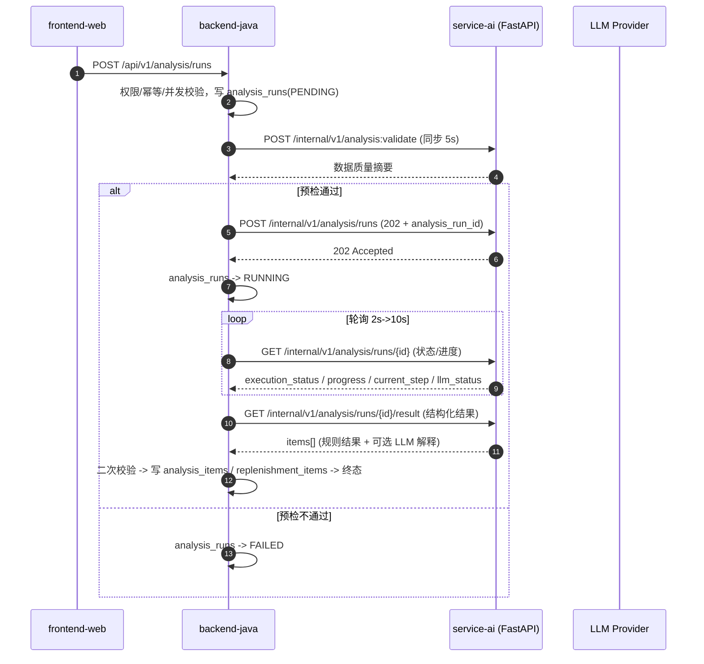

# ShopPilot AI Java ↔ Python 内部契约（AI_SERVICE_CONTRACT）

## 文档元信息

| 项 | 内容 |
| --- | --- |
| 文档名称 | Java ↔ Python 内部服务契约 |
| 文档路径 | `docs/03-api/AI_SERVICE_CONTRACT.md` |
| 文档优先级 | P2（见 `DESIGN_BASIS.md §1.1`） |
| 所属阶段 | M0 设计阶段 |
| 版本 | v1.0（M0 定稿） |
| 上游权威来源 | `docs/DESIGN_BASIS.md §13`（内部契约骨架）、`§10`（公式）、`§11`（规则）、`§14`（精度）、`docs/02-database/DATA_DICTIONARY.md` |
| 主要读者 | Java 后端、Python 服务、测试、联调方 |

### 本文档负责什么

- 定义 `backend-java` 与 `service-ai`（FastAPI）之间的**全部 HTTP 契约**：认证、4 类内部接口的完整请求/响应 Schema、错误结构、超时重试、幂等、降级、数值一致性。
- 定义 **Java 落库前二次校验清单**。
- 定义 **契约测试要求**（两侧）。

### 本文档不负责什么

- **不定义**分析算法与阈值（见 `DESIGN_BASIS.md §10`、`§11`，字段语义与校验规则见 `ANALYSIS_CONTRACT.md`）。
- **不定义**对外 API（见 `API_CONTRACT.md`）。
- **不定义** Python 内部模块结构（见 `DESIGN_BASIS.md §7.2`、`AI_ARCHITECTURE.md`）。
- **不定义**角色/权限（Python **不感知权限**，`DESIGN_BASIS.md §13.2`）。

---

## 1. 调用拓扑与边界

### 1.1 拓扑



### 1.2 硬边界（引用 `DESIGN_BASIS §13.2`、`SYSTEM_ARCHITECTURE.md §5`）

| # | 边界 | 说明 |
| --- | --- | --- |
| 1 | **Java 主动调用 Python，单向** | Python **永不回调** Java 的业务写接口，也**不写业务库**（`DESIGN_BASIS §13.2`）。 |
| 2 | **`analysis_run_id` 由 Java 生成** | Java 先建 `analysis_runs`（`PENDING`），把 `id` 作为 `analysis_run_id` 传给 Python；Python **只使用、不回写**。 |
| 3 | **状态权威在 Java** | `AnalysisRunStatus`（`DESIGN_BASIS §9.7`）由 Java 独占；Python 侧的 `execution_status` 只是**执行细节**。 |
| 4 | **结果持久化在 Java** | Python 只返回 JSON；Java 校验后落 `analysis_items` / `replenishment_items`。 |
| 5 | **最小数据原则** | Java 只传完成分析所必需的字段，不传商品详情、供应商联系方式、价格等无关数据（见 §3.3）。 |
| 6 | **Python 不感知权限** | 权限与业务校验全在 Java。 |

---

## 2. 认证与公共请求头

| 头 | 必填 | 说明 |
| --- | --- | --- |
| `X-Internal-Token` | ✅ | 共享密钥，来自环境变量 `AI_INTERNAL_TOKEN`（`DESIGN_BASIS §13.3`）。缺失或不匹配 → HTTP 401 `AI-0001` |
| `X-Request-Id` | ✅ | 由 Java 生成/透传（`API_CONTRACT.md §7`），Python **必须在响应回显**并记入自身日志（`AI_ARCHITECTURE.md §Trace`） |
| `Content-Type` | ✅ | `application/json`（除 `analysis:validate` 外均有请求体） |
| `Accept` | ❌ | 默认 `application/json` |

- `service-ai` **不对公网暴露**（`SYSTEM_ARCHITECTURE.md §8.1`），仅在 `shoppilot-net` 内部网络可达。
- 令牌比较使用**常量时间比较**（防时序侧信道）。
- Python 记录 `X-Request-Id` 但不接受其它自定义头；不接受 `team_id` 作为独立头（团队通过请求体字段表达，仅用于日志与分组，**不是权限依据**）。

---

## 3. 内部接口清单与完整契约

内部 API 前缀 `/internal/v1`。共 5 个接口：

| # | 方法 | 路径 | 语义 |
| --- | --- | --- | --- |
| 1 | POST | `/internal/v1/analysis:validate` | 同步数据质量预检（5s 超时） |
| 2 | POST | `/internal/v1/analysis/runs` | 创建并**同步返回 202 + `analysis_run_id`**，执行在 Python 后台 |
| 3 | GET | `/internal/v1/analysis/runs/{analysis_run_id}` | 查询执行状态与进度 |
| 4 | GET | `/internal/v1/analysis/runs/{analysis_run_id}/result` | 取结构化结果 |
| 5 | POST | `/internal/v1/analysis/runs/{analysis_run_id}:cancel` | 取消执行 |

### 3.1 `POST /internal/v1/analysis:validate`（同步预检）

**用途**：在创建分析任务前做**轻量数据质量预检**，让用户立即知道数据是否满足分析条件。

```
POST /internal/v1/analysis:validate
X-Internal-Token: <AI_INTERNAL_TOKEN>
X-Request-Id: req_anl_001
Content-Type: application/json
```

**请求体**

```json
{
  "team_id": 7,
  "warehouse_id": 100,
  "scope": {
    "scope_type": "SELECTED_SKUS",
    "sku_ids": [5001, 5002, 5003]
  },
  "date_from": "2026-09-16",
  "date_to": "2026-10-13",
  "params": {
    "window_days": 28,
    "min_days": 7
  },
  "items": [
    { "sku_id": 5001, "sales_series": [{ "date": "2026-09-16", "qty": "6.000" }] },
    { "sku_id": 5002, "sales_series": [] }
  ]
}
```

**响应体（200）**

```json
{
  "code": "OK",
  "data": {
    "analyzable": true,
    "window_days": 28,
    "total_skus": 3,
    "analyzable_skus": 1,
    "insufficient_skus": 2,
    "valid_days_avg": 24.3,
    "missing_days_total": 11,
    "outlier_count_total": 0,
    "per_sku": [
      { "sku_id": 5001, "valid_days": 26, "missing_days": 2, "outlier_count": 0, "quality": "GOOD" },
      { "sku_id": 5002, "valid_days": 0, "missing_days": 28, "outlier_count": 0, "quality": "INSUFFICIENT" }
    ],
    "warnings": ["2 个 SKU 有效销售天数不足，将标记 DATA_INSUFFICIENT 且不产出补货建议"]
  },
  "request_id": "req_anl_001"
}
```

| 字段 | 类型 | 说明 |
| --- | --- | --- |
| `analyzable` | bool | 是否至少有一个 SKU 可分析；全不可分析时 Java 置 run `FAILED`（`ANL-7008`） |
| `window_days` | int | 预检所用窗口 |
| `total_skus` / `analyzable_skus` / `insufficient_skus` | int | 计数 |
| `valid_days_avg` | number | 平均有效天数（**展示用，允许 1 位小数**） |
| `missing_days_total` / `outlier_count_total` | int | 汇总 |
| `per_sku[]` | array | `sku_id`、`valid_days`、`missing_days`、`outlier_count`、`quality`（`GOOD`/`FAIR`/`POOR`/`INSUFFICIENT`） |
| `warnings` | string[] | 中文提示 |

**错误**

- 请求 Schema 非法 → `400 AI-1001`（Java **不重试**，直接 `FAILED`）。
- 缺 `sku_id`/数据 → `422 AI-2001`。
- 超 5s → Java 侧超时（`ANL-7003`），**不重试**（`DESIGN_BASIS §13.4`）。

**超时**：5s，**0 次重试**（快速失败）。

---

### 3.2 `POST /internal/v1/analysis/runs`（创建）

**用途**：接收分析任务与**裁剪后的数据**，Python **立即返回 202 + `analysis_run_id`**，实际执行在 Python 后台（`BackgroundTasks` / 线程池），Java 通过轮询获取进度。

```
POST /internal/v1/analysis/runs
X-Internal-Token: <AI_INTERNAL_TOKEN>
X-Request-Id: req_anl_001
Content-Type: application/json
```

**请求体（完整 Schema）**

```json
{
  "analysis_run_id": 30001,
  "team_id": 7,
  "warehouse_id": 100,
  "scope": {
    "scope_type": "SELECTED_SKUS",
    "sku_ids": [5001, 5002, 5003]
  },
  "date_from": "2026-09-16",
  "date_to": "2026-10-13",
  "params": {
    "window_days": 28,
    "min_days": 7,
    "coverage_days": 7,
    "lead_time_default": 7,
    "ss_ratio": "0.5000",
    "cv_high": "1.0000",
    "budget_limit": null,
    "enable_llm": true
  },
  "algorithm_version": "avg-ma-3sigma-v1",
  "prompt_version": "explain_risk.v1",
  "model_name": "gpt-4o-mini",
  "items": [
    {
      "sku_id": 5001,
      "on_hand_qty": "8.000",
      "committed_qty": "0.000",
      "effective_in_transit_qty": "0.000",
      "lead_time_days": 7,
      "lead_time_source": "SKU",
      "safety_stock_override": null,
      "moq": "50.000",
      "order_multiple": "10.000",
      "qty_step": "1.000",
      "listed_date": "2026-09-01",
      "sales_series": [
        { "date": "2026-09-16", "qty": "6.000" },
        { "date": "2026-09-17", "qty": "5.000" }
      ]
    }
  ],
  "callback": null
}
```

**字段说明**

| 字段 | 必填 | 类型 | 说明 |
| --- | --- | --- | --- |
| `analysis_run_id` | ✅ | int64 | **Java 生成**（`analysis_runs.id`）。Python 只使用不回写。**幂等键**：同一 `analysis_run_id` 重复创建 → 返回首次 202（见 §6） |
| `team_id` | ✅ | int64 | 仅用于日志分组与结果回传对账；**不是权限依据** |
| `warehouse_id` | ✅ | int64 | 分析范围仓库 |
| `scope` | ✅ | object | `scope_type`（`AnalysisScopeType`）+ `sku_ids`（`SELECTED_SKUS` 时必填） |
| `date_from` / `date_to` | ✅ | date（`YYYY-MM-DD`） | 分析数据窗口；`date_from > date_to` → `AI-1001` |
| `params` | ✅ | object | 见 `ANALYSIS_CONTRACT.md §输入数据契约`。字段：`window_days`/`min_days`/`coverage_days`/`lead_time_default`/`ss_ratio`/`cv_high`/`budget_limit`/`enable_llm` |
| `algorithm_version` | ✅ | string | 如 `avg-ma-3sigma-v1` |
| `prompt_version` | ✅ | string | 如 `explain_risk.v1` |
| `model_name` | ❌ | string | LLM 模型名；`enable_llm=false` 时可空 |
| `items` | ✅ | array | **每个 SKU 的计算所需数据**（见 §3.3）；条数 ≤ `MAX_ANALYSIS_SKUS`（2000，`DESIGN_BASIS §10.6`），超过 → `400 AI-7002` |
| `callback` | ❌ | object \| null | **首期不用**，见下 |

**`callback` 字段为何保留但首期不用**

- **保留**：为未来（如引入消息队列或需要事件驱动）预留契约位，避免未来加字段造成不兼容。
- **首期不用**：① Java 侧已是轮询模型（`SYSTEM_ARCHITECTURE.md §7.5`），回调会引入"Python 反向调用 Java"的第二条链路，与"单向调用"边界冲突；② 回调需额外鉴权、重试、幂等设计；③ 单团队规模下轮询成本可接受（指数退避 2s→10s）。
- **结论**：首期 `callback` 恒为 `null`，Java 通过 `GET /internal/v1/analysis/runs/{id}` 轮询。

**响应体（202）**

```json
{
  "code": "OK",
  "data": {
    "analysis_run_id": 30001,
    "execution_status": "ACCEPTED",
    "accepted_at": "2026-10-14T08:00:00.000Z"
  },
  "request_id": "req_anl_001"
}
```

> HTTP 状态码 = **202 Accepted**。响应体仍使用统一信封（`code="OK"`）。

**错误**

| 场景 | HTTP | 错误码 | Java 行为 |
| --- | --- | --- | --- |
| 请求 Schema 非法 | 400 | `AI-1001` | 不重试，置 `FAILED` |
| 缺 `analysis_run_id` | 400 | `AI-1002` | 不重试，置 `FAILED` |
| SKU 数超上限 | 400 | `AI-7002` | 不重试，置 `FAILED`（对外 `ANL-7007`） |
| 令牌无效 | 401 | `AI-0001` | 不重试，置 `FAILED`（运维排查） |
| 未预期内部错误 | 500 | `AI-9001` | 可重试 1 次（仅网络/5xx） |

**超时**：10s（**仅创建，不含执行**）；**重试 1 次（仅网络错误）**（`DESIGN_BASIS §13.4`）。

---

### 3.3 「只传必需数据」原则与裁剪理由

> 对应 `SYSTEM_ARCHITECTURE.md §5` 边界 5（最小数据原则）。

**传（必需）**：

| 字段 | 来源（Java 侧） | 为何必需 |
| --- | --- | --- |
| `sku_id` | `skus.id` | 结果主键与对账 |
| `on_hand_qty` | `inventory_balances.on_hand_qty` | 计算 `IP`、`R-STOCKOUT` |
| `committed_qty` | `inventory_balances.committed_qty` | 计算 `IP` |
| `effective_in_transit_qty` | **Java（`inventory` 模块在途口径服务）已算好** | 计算 `IP`；Python **不接触** `purchase_orders` |
| 策略参数 | `replenishment_policies` → `skus` → `suppliers` 已合并后的 lite 值（`lead_time_days`/`moq`/`order_multiple`/`qty_step`/`safety_stock_qty`） | 计算 `L`/`SS`/`Q_suggest` |
| `sales_series[{date,qty}]` | `sales_daily`（窗内） | 计算 `D`/`CV`/异常/滞销 |

**不传（刻意裁剪）**：

| 不传字段 | 理由 |
| --- | --- |
| 商品详情（`products.name`/`category`/`brand`/`spec_json`） | 不参与计算；`category` 若用于 LLM 解释，由 Java 在**组装 Prompt 输入**时以最小必要字段**另行提供**（见 `PROMPT_DESIGN.md §敏感数据`） |
| 供应商联系方式（`contact_name`/`contact_phone`/`email`/`address`） | 隐私数据，与计算无关 |
| 价格与成本（`purchase_price`/`sale_price`/`unit_price`） | 计算不需要；列为**不发送白名单**（`PROMPT_DESIGN.md`） |
| 供应商/仓库/商品编码与名称 | 结果落库时由 Java 用 `sku_id` 回填展示字段 |
| 采购单明细（`purchase_order_items`） | 在途量已由 Java 计算为 `effective_in_transit_qty` |
| 团队/用户/权限信息 | Python 不感知权限 |

**数据量与开销估算**：单 SKU 的 `sales_series` 最多 `window_days`（默认 28）条 `{date,qty}`，约 28 × 40B ≈ 1.1KB；2000 SKU ≈ 2.2MB/次；加上其它字段总体约 2.5MB。**裁剪掉商品/供应商/价格后可减少约 40%–60% 传输量**（视商品字段多寡），且**彻底阻断**隐私/成本数据外流。因此首期 `POST /analysis/runs` 请求体上限设为 **8MB**（超限 `AI-1001`）。

---

### 3.4 `GET /internal/v1/analysis/runs/{analysis_run_id}`（状态查询）

**用途**：Java 轮询获取 Python 执行状态与进度（`SYSTEM_ARCHITECTURE.md §7.2`）。

```
GET /internal/v1/analysis/runs/30001
X-Internal-Token: <AI_INTERNAL_TOKEN>
X-Request-Id: req_anl_002
```

**响应体（200）**

```json
{
  "code": "OK",
  "data": {
    "analysis_run_id": 30001,
    "execution_status": "RUNNING",
    "progress": 66,
    "current_step": "LLM_EXPLAIN",
    "total_skus": 3,
    "processed_skus": 2,
    "llm_status": "PENDING",
    "started_at": "2026-10-14T08:00:01.000Z",
    "finished_at": null,
    "error": null
  },
  "request_id": "req_anl_002"
}
```

**`execution_status` 取值（Python 执行状态，**非** `AnalysisRunStatus`）**

| 值 | 含义 |
| --- | --- |
| `ACCEPTED` | 已受理，未开始 |
| `RUNNING` | 执行中（附 `progress`/`current_step`） |
| `COMPLETED` | 执行完成（**不代表业务成功**，业务成败由 Java 依据结果与 `llm_status` 判定） |
| `FAILED` | 执行失败（附 `error`） |
| `CANCELLED` | 已取消 |

**`current_step` 取值**（`SYSTEM_ARCHITECTURE.md §7.2`）：`VALIDATING` / `STATS` / `RISK_RULES` / `REPLENISHMENT` / `LLM_EXPLAIN` / `DONE`。

**`llm_status`**：Python 侧 LLM 汇总状态（`NOT_REQUESTED`/`PENDING`/`SUCCEEDED`/`FAILED`/`TIMEOUT`/`VALIDATION_FAILED`/`SKIPPED`，与 `DESIGN_BASIS §9.8` 对齐），供 Java 映射到 `analysis_runs.llm_status`。

**`error` 结构**

```json
{ "code": "AI-3001", "message": "规则引擎执行失败", "detail": { "stage": "RISK_RULES", "sku_id": 5001 } }
```

**错误**：任务不存在 → `404 AI-6001`。

**超时**：3s，**重试 1 次**（`DESIGN_BASIS §13.4`）。

---

### 3.5 `GET /internal/v1/analysis/runs/{analysis_run_id}/result`（取结果）

**用途**：Java 在 Python `execution_status=COMPLETED` 后拉取**结构化结果**，做二次校验并落库。

**分页还是全量？——首期结论：全量返回（不分页）。**

理由：

1. **落库需要一致性快照**：Java 需要一次性拿到该 run 的**全部** items 才能在一个事务内写 `analysis_items` 并推导 `replenishment_items`；分页会引入"部分落库"的中间态与幂等复杂度。
2. **规模可控**：单 run SKU 上限 `MAX_ANALYSIS_SKUS = 2000`（`DESIGN_BASIS §10.6`），全量 JSON 估算见下，单机内存与网络可承受。
3. **轮询成本低**：结果只取一次，不反复拉取。
4. **演进**：若未来 SKU 上限显著提高，可增加 `?page=&pageSize=` 参数并保持响应结构不变（`items` 变为当页切片 + 分页元信息），属**兼容性扩展**（`API_CONTRACT.md §8.2`）。

**结果体积估算**：单 item 约 1.2–2.0KB（含 `risk_findings` 与可选 `llm_explanation`，解释文本设 800 字上限）；2000 items ≈ 3–4MB。< 8MB 上限，可全量。

**响应体（200）**

```json
{
  "code": "OK",
  "data": {
    "analysis_run_id": 30001,
    "execution_status": "COMPLETED",
    "algorithm_version": "avg-ma-3sigma-v1",
    "prompt_version": "explain_risk.v1",
    "model_name": "gpt-4o-mini",
    "llm_status": "TIMEOUT",
    "data_start_date": "2026-09-16",
    "data_end_date": "2026-10-13",
    "summary": {
      "total_skus": 3,
      "risk_sku_count": 2,
      "suggestion_count": 1,
      "truncated_count": 0,
      "by_risk_level": { "HIGH": 1, "UNKNOWN": 1, "NONE": 1 }
    },
    "items": [
      {
        "sku_id": 5001,
        "warehouse_id": 100,
        "avg_daily_sales": "6.250",
        "sales_qty_total": "162.500",
        "valid_days": 26,
        "data_quality": "GOOD",
        "risk_level": "HIGH",
        "risk_types": ["STOCKOUT", "LOW_STOCK"],
        "risk_findings": [
          {
            "rule_code": "R-STOCKOUT",
            "inputs": { "on_hand_qty": "8.000", "D": "6.250" },
            "threshold": "on_hand_qty / D <= 2",
            "result": "HIGH"
          },
          {
            "rule_code": "R-LOWSTOCK",
            "inputs": { "IP": "8.000", "D": "6.250", "L": 7, "R": 7 },
            "threshold": "IP < D * (L + R) = 87.500",
            "result": "MEDIUM"
          }
        ],
        "on_hand_qty": "8.000",
        "effective_in_transit_qty": "0.000",
        "committed_qty": "0.000",
        "inventory_position": "8.000",
        "safety_stock": "21.875",
        "lead_time_days": 7,
        "lead_time_source": "SKU",
        "coverage_days": 7,
        "cv": "0.4200",
        "volatility_adjusted": false,
        "q_base": "79.375",
        "moq_applied": "50.000",
        "order_multiple_applied": "10.000",
        "q_suggest": "80.000",
        "truncated_by_budget": false,
        "llm_explanation": null,
        "llm_evidence": [],
        "llm_status": "TIMEOUT",
        "warnings": ["LLM 解释超时，已降级为无解释结果"]
      },
      {
        "sku_id": 5003,
        "warehouse_id": 100,
        "avg_daily_sales": null,
        "sales_qty_total": "9.000",
        "valid_days": 3,
        "data_quality": "INSUFFICIENT",
        "risk_level": "UNKNOWN",
        "risk_types": ["DATA_INSUFFICIENT"],
        "risk_findings": [
          {
            "rule_code": "R-DATAINSUFFICIENT",
            "inputs": { "valid_days": 3, "min_days": 7 },
            "threshold": "n < MIN_DAYS(7)",
            "result": "UNKNOWN"
          }
        ],
        "on_hand_qty": "0.000",
        "effective_in_transit_qty": "0.000",
        "committed_qty": "0.000",
        "inventory_position": "0.000",
        "safety_stock": null,
        "lead_time_days": 7,
        "lead_time_source": "DEFAULT",
        "coverage_days": 7,
        "cv": null,
        "volatility_adjusted": false,
        "q_base": null,
        "moq_applied": null,
        "order_multiple_applied": null,
        "q_suggest": null,
        "truncated_by_budget": false,
        "llm_explanation": null,
        "llm_evidence": [],
        "llm_status": "SKIPPED",
        "warnings": ["有效销售天数不足，未产出补货建议"]
      }
    ]
  },
  "request_id": "req_anl_003"
}
```

**item 字段一览（与 `ANALYSIS_CONTRACT.md §输出数据契约` 一致；权威定义在此）**

| 字段 | 类型 | 可空 | 说明 |
| --- | --- | --- | --- |
| `sku_id` | int64 | 否 | `skus.id` |
| `warehouse_id` | int64 | 否 | `warehouses.id` |
| `avg_daily_sales` | string(decimal3) | **是** | `D`；数据不足为 `null` |
| `sales_qty_total` | string(decimal3) | 是 | 窗口总销量 |
| `valid_days` | int | 是 | 有效天数 `n` |
| `data_quality` | string | 否 | `GOOD`/`FAIR`/`POOR`/`INSUFFICIENT` |
| `risk_level` | string | 否 | `RiskLevel` |
| `risk_types` | string[] | 否 | `RiskType[]`（可空数组 `[]`） |
| `risk_findings` | object[] | 否 | 每条含 `rule_code`/`inputs`/`threshold`/`result` |
| `on_hand_qty` | string(decimal3) | 否 | 回显输入 |
| `effective_in_transit_qty` | string(decimal3) | 否 | 回显输入 |
| `committed_qty` | string(decimal3) | 否 | 回显输入 |
| `inventory_position` | string(decimal3) | 否 | `IP = on_hand + eff_in_transit − committed` |
| `safety_stock` | string(decimal3) | 是 | `SS` |
| `lead_time_days` | int | 是 | 采用值 `L` |
| `lead_time_source` | string | 是 | `POLICY`/`SKU`/`SUPPLIER`/`DEFAULT` |
| `coverage_days` | int | 是 | `R` |
| `q_base` | string(decimal3) | 是 | `Q_base` |
| `moq_applied` | string(decimal3) | 是 | 生效 MOQ |
| `order_multiple_applied` | string(decimal3) | 是 | 生效倍数 |
| `q_suggest` | string(decimal3) | 是 | `Q_suggest` |
| `truncated_by_budget` | bool | 否 | 预算截断标记 |
| `volatility_adjusted` | bool | 否 | 高波动上浮标记 |
| `llm_explanation` | string | 是 | LLM 解释（降级为 `null`） |
| `llm_evidence` | string[] | 否 | 解释所引用的输入字段名 |
| `llm_status` | string | 否 | 单 item 的 LLM 状态 |
| `warnings` | string[] | 否 | 该 item 的提示 |

- **结果未就绪**（`execution_status != COMPLETED`）→ `409 AI-6002`。
- **任务已取消** → `409 AI-6003`。
- **任务不存在** → `404 AI-6001`。

**超时**：10s（结果可能较大）；**重试 1 次**（仅网络错误）。

---

### 3.6 `POST /internal/v1/analysis/runs/{analysis_run_id}:cancel`（取消）

```
POST /internal/v1/analysis/runs/30001:cancel
X-Internal-Token: <AI_INTERNAL_TOKEN>
X-Request-Id: req_anl_004
Content-Type: application/json
```

```json
{ "reason": "用户主动取消" }
```

**响应体（200）**

```json
{
  "code": "OK",
  "data": {
    "analysis_run_id": 30001,
    "execution_status": "CANCELLED",
    "cancelled_at": "2026-10-14T08:02:00.000Z"
  },
  "request_id": "req_anl_004"
}
```

- **取消是"尽力而为"**：Python 在**步骤边界**检查取消标记；若正卡在 LLM 调用或长循环内，取消可能延迟至该步骤结束。
- **Java 权威兜底**：Java 立即将 `analysis_runs.status` 置 `CANCELLED`（不等 Python），并对后续到达的结果**丢弃**（`AI_ARCHITECTURE.md §步骤状态与可恢复性`）。
- 任务不存在 → `404 AI-6001`；任务已终态 → `409 AI-6002`。
- **超时**：5s；**重试 1 次**。

---

## 4. 数值一致性（关键约定）

> 对应 `DESIGN_BASIS §14.2`。**这是 Java↔Python 最容易出错的地方**。

### 4.1 结论：数量与金额在 JSON 中**用字符串传输**

| 类型 | DB 类型 | JSON 传输 | 示例 |
| --- | --- | --- | --- |
| 数量（库存/销售/采购/建议） | `DECIMAL(18,3)` | **string**，固定 3 位小数 | `"120.000"`、`"0.000"`、`"-8.000"` |
| 单价 | `DECIMAL(18,4)` | **string**，固定 4 位小数 | `"35.5000"` |
| 金额 | `DECIMAL(18,2)` | **string**，固定 2 位小数 | `"2840.00"` |
| 比率（`cv`/`ss_ratio`/`cv_high`） | `DECIMAL(18,4)` | **string**，固定 4 位小数 | `"0.4200"` |
| 计数/天数/进度（`valid_days`/`progress`/`sku_id`） | `INT`/`TINYINT` | **number**（整数，无精度问题） | `26`、`66`、`5001` |

**理由**：

1. **杜绝 IEEE-754 精度丢失**：JSON number 在 JS `JSON.parse`、Python `float`、Java `double` 中均为双精度浮点，`0.1 + 0.2 != 0.3` 会污染库存/金额。字符串 + 两侧 `decimal` 解析可**逐位保真**。
2. **与 DB `DECIMAL` 语义对齐**：字符串是 `DECIMAL` 的**无损文本表示**（`Decimal.toString()` / `BigDecimal.toPlainString()`）。
3. **避免科学计数法**：大数/极小数经 number 序列化可能变成 `1E+3`，破坏前端展示与比较。
4. **两侧约定一致才有效**：仅前端用字符串不够，**必须 Java 与 Python 也全程字符串**。

### 4.2 Java 侧序列化配置（Jackson）

- 所有数量/金额字段类型为 **`BigDecimal`**。
- 统一配置：`WRITE_BIGDECIMAL_AS_PLAIN = true`（禁用科学计数法）；**不**启用 `WRITE_NUMBERS_AS_STRINGS` 全局（会误伤整数），而是**对 decimal 字段显式用 `@JsonSerialize(using = ToStringSerializer.class)`** 或在 DTO 层用 `String` 承载。
- **推荐做法**：Java 的**内部契约 DTO** 中，数量/金额字段直接用 `String`（不是 `BigDecimal`），进入领域层前用 `new BigDecimal(str)` 解析，并在 `DATA_DICTIONARY.md §2.1` 约定的精度上 `setScale(3, RoundingMode.HALF_UP)`。这样**序列化天然是字符串**，无需自定义序列化器。
- 校验：解析失败 → `AI-1001`（Python 侧）或 `ANL-7004`（Java 校验 Python 返回值时）。

### 4.3 Python 侧序列化配置（Pydantic / FastAPI）

- 使用 `Decimal` 类型建模。Pydantic v2 配置：

```
model_config = ConfigDict(
    json_encoders={Decimal: lambda v: format(v, "f")},  # 强制普通十进制字符串，禁科学计数法
    ser_json_inf_nan="strings",
)
```

- 或用 `condecimal(max_digits=18, decimal_places=3)` / 自定义 `Annotated[Decimal, PlainSerializer(lambda v: format(v, "f"))]`。
- **pandas 结果必须显式转换**：`Decimal(str(round(x, 3)))`——`round` 后用 `str` 再转 `Decimal`，避免 `float` 残留（`DESIGN_BASIS §14.2` 明确"pandas 计算结果须显式转换"）。
- `json.dumps` 对 `Decimal` 默认报错，必须用 `format(v, "f")` 或 pydantic 的序列化，**禁止**先 `float(v)`。

### 4.4 舍入与精度（引用 `ANALYSIS_CONTRACT.md §数值精度`）

| 量 | 中间精度 | 最终精度 | 舍入模式 |
| --- | --- | --- | --- |
| `D`（日均销量） | 6 位 | **3 位** | `ROUND_HALF_UP` |
| `Q_base` | 6 位 | **3 位** | `ROUND_HALF_UP` |
| `Q_suggest` | — | 取整到 `qty_step`（默认 1） | 先 `ROUND_HALF_UP` 到 3 位，再按 `qty_step` 向上取整 |
| 金额 | 4 位 | **2 位** | `ROUND_HALF_UP` |

- 两侧**必须用同一舍入模式**（`ROUND_HALF_UP`，Java `RoundingMode.HALF_UP`，Python `decimal.ROUND_HALF_UP`）。`banker's rounding`（`ROUND_HALF_EVEN`）**禁止**，因为会导致两侧结果不一致。
- 一致性校验：Java 落库前**重算关键量**并与 Python 结果比对（见 §7）。

### 4.5 布尔与空值

- 布尔：JSON `true`/`false`（映射 DB `TINYINT(1)` 的 `1`/`0`）。
- 可空 decimal：显式 `null`（**不是** `""` 或 `"0"`）。区分"无值"与"值为 0"。
- 枚举：大写字符串。

---

## 5. 错误结构

内部统一错误响应体：

```json
{
  "code": "AI-1001",
  "message": "request schema validation failed",
  "detail": {
    "field": "items[0].sales_series[3].qty",
    "rejected_value": "abc"
  },
  "request_id": "req_anl_001"
}
```

| 字段 | 类型 | 说明 |
| --- | --- | --- |
| `code` | string | `AI-xxxx`（内部错误码，见 `ERROR_CODES.md §AI 内部错误`） |
| `message` | string | **英文技术描述**（面向开发/日志；内部接口不面向终端用户） |
| `detail` | object | 结构化上下文（字段、阶段、SKU 等） |
| `request_id` | string | 回显 `X-Request-Id` |

### 5.1 业务错误 vs 技术错误（Java 的处置分工）

| 类别 | 错误码 | Java 是否重试 | Java 处置 |
| --- | --- | --- | --- |
| **业务错误** | `AI-1001`（Schema 非法）、`AI-1002`（缺 run_id）、`AI-2001`（数据缺失）、`AI-2002`（数据不足）、`AI-6002`（状态不允许）、`AI-6003`（已取消）、`AI-7002`（SKU 超限） | **否** | 直接置 run `FAILED`（或 `CANCELLED`），记录 `error_code`，**不重试**（重试同样会失败） |
| **技术错误** | `AI-0001`（令牌）、`AI-3001`（规则引擎异常）、`AI-4001`（补货计算异常）、`AI-5001`（LLM 不可用）、`AI-6001`（任务不存在，可能注册延迟）、`AI-7001`（并发超限）、`AI-9001`（未预期） | **有限重试**（见 §6） | 对**创建类**调用可重试 1 次；执行期错误则依据 `llm_status` 决定 `DEGRADED`/`FAILED` |

> **原则**：**业务错误不重试**（确定性失败，重试无意义且放大负载）；**技术错误有限重试**（网络抖动、依赖瞬时不可用）。**LLM 相关错误不导致规则结果丢失**（见 §8）。

---

## 6. 超时、重试与幂等

### 6.1 逐接口超时与重试（展开 `DESIGN_BASIS §13.4`）

| 接口 / 环节 | 超时 | 重试次数 | 退避策略 | 备注 |
| --- | --- | --- | --- | --- |
| `analysis:validate` | **5s** | **0** | — | 快速失败（`DESIGN_BASIS §13.4`） |
| `POST /analysis/runs` | **10s**（仅创建） | **1**（仅网络错误） | 固定 1s | 不含执行 |
| `GET /analysis/runs/{id}` | **3s** | **1** | 固定 500ms | Java 轮询间隔 2s→10s 指数退避 |
| `GET /analysis/runs/{id}/result` | **10s** | **1**（仅网络错误） | 固定 1s | 结果较大 |
| `POST /analysis/runs/{id}:cancel` | **5s** | **1** | 固定 500ms | 尽力而为 |
| 单次 LLM 调用（Python→LLM） | **30s**（默认） | **最多 2** | **指数退避**（1s、2s；仅网络/5xx/429） | 见 `PROMPT_DESIGN.md §降级矩阵` |
| 整体分析执行 | **300s**（`analysis_runs.timeout_at`） | **不自动重试** | — | 用户可发起新 run（新 `run_no`） |
| 单 HTTP 请求体上限 | 8MB | — | — | 超限 `AI-1001` |

**重试的前提**：

1. 仅对**网络错误（连接失败/读超时）**与**5xx**重试；
2. **`4xx` 一律不重试**（含 `AI-0001`/`AI-1001`/`AI-1002`/`AI-7001` 除外的语义错误）；
3. **幂等性保证**：重试必须携带**同一** `X-Request-Id` 与同 `analysis_run_id`，Python 侧幂等处理（见 §6.2）；
4. 重试总时长不得超过该接口的**外层超时预算**。

### 6.2 幂等性：同 `analysis_run_id` 重复创建

- Python 以 `analysis_run_id` 为**幂等键**维护全局执行注册表（内存 + 可选本地持久化）。
- **首次** `POST /analysis/runs`（`analysis_run_id=30001`）→ 受理，返回 `202`，`execution_status=ACCEPTED`。
- **重复** `POST`（同 `analysis_run_id`）→ **返回首次的 202 响应**（`execution_status` 为**当前**状态），**不重复执行**。
- **同一 `analysis_run_id` 但请求体不一致** → `409 AI-1002`（语义等同 `COM-0009`）。Python 通过请求体规范化哈希比对。
- Java 侧同样以 `uk_run_team_idem` 保证对外幂等；两侧幂等键一致（都基于 `analysis_run_id`），形成**双重幂等**。

> **孤儿任务**：若 Java 创建任务后崩溃，Python 任务成为孤儿。Java 侧 `timeout_at` 兜底把它推进 `TIMEOUT`（`SYSTEM_ARCHITECTURE.md §7.3`、`R-3`）；Python 侧任务自然结束，结果无人拉取，无副作用。

---

## 7. Java 侧落库前二次校验清单

> 对应 `SYSTEM_ARCHITECTURE.md §5` 边界 7、`DESIGN_BASIS §13.2`。Java **绝不裸信** Python 结果。任一项失败 → run 置 `FAILED`（`ANL-7004`），**不落库**。

| # | 校验项 | 规则 | 失败处置 |
| --- | --- | --- | --- |
| 1 | `analysis_run_id` 一致 | 返回的 run id == 请求的 run id | `FAILED` |
| 2 | **`sku_id` 属于该团队且启用** | `skus.team_id == team_id` 且 `skus.status == 'ACTIVE'` | 拒绝该 item（记录 `ANL-7004`）；超范围 SKU **拒绝整批或剔除**（见 #12） |
| 3 | `warehouse_id` 属于该团队 | `warehouses.team_id == team_id` | `FAILED` |
| 4 | `risk_level` 在枚举内 | ∈ `RiskLevel`（`NONE`/`LOW`/`MEDIUM`/`HIGH`/`UNKNOWN`） | `FAILED` |
| 5 | `risk_types` 在枚举内 | 每项 ∈ `RiskType`（6 值），去重 | `FAILED` |
| 6 | `data_quality` 在枚举内 | ∈ `GOOD`/`FAIR`/`POOR`/`INSUFFICIENT` | `FAILED` |
| 7 | `q_suggest >= 0` | 非负；且 `q_base <= 0` 时 `q_suggest` 为 `0` 或 `null` | `FAILED` |
| 8 | 数量精度 | `q_base`/`q_suggest`/`safety_stock` 等的小数位 ≤ 3；`D` ≤ 3 位；金额 ≤ 2 位 | `FAILED` |
| 9 | **必填字段非空** | `sku_id`/`warehouse_id`/`risk_level`/`data_quality`/`llm_status` 非空 | `FAILED` |
| 10 | 日期范围与请求一致 | `data_start_date`/`data_end_date` ∈ 请求 `[date_from, date_to]` 且 `start <= end` | `FAILED` |
| 11 | 算法版本与请求一致 | 返回 `algorithm_version` == 请求值 | `FAILED` |
| 12 | **条数不超请求 SKU 数** | `len(items) <= len(request.items)`；超出的 `sku_id` **拒绝** | 拒绝超出项（记 `ANL-7004`） |
| 13 | 重复 `sku_id` 去重 | `(sku_id, warehouse_id)` 唯一（对齐 `uk_ai_run_sku_wh`）；重复则**保留首个**或 `FAILED` | 去重或 `FAILED` |
| 14 | Decimal 精度符合约定 | 用 `BigDecimal(String)` 解析；解析失败或 scale 超限 → `FAILED` | `FAILED` |
| 15 | `llm_explanation` 长度上限 | ≤ 2000 字符（`TEXT` 列安全上限，见 `PROMPT_DESIGN.md §输出 Schema`）；超长截断并告警 | 截断 + 告警（不 `FAILED`） |
| 16 | **超范围 SKU 拒绝** | 任何 `sku_id` 不在请求 `scope` 内 → 该 item 拒绝；若全部被拒 → `FAILED` | 拒绝 / `FAILED` |
| 17 | `q_suggest` 与预算一致性 | `truncated_by_budget=true` 时 `q_suggest <= budget_limit` | `FAILED` |
| 18 | `llm_status` 在枚举内 | ∈ `LlmStatus`（7 值），且与 run 级 `llm_status` 兼容 | `FAILED` |

**落库动作（校验通过后，同一事务）**：

1. 写 `analysis_items`（**不可变快照**，逐 SKU 一行）。
2. 对 `q_suggest > 0` 的 item 生成 `replenishment_items`（`status=SUGGESTED`，`source_analysis_item_id` 指向快照，`suggested_qty=q_suggest`，`qty=q_suggest`）。
3. 更新 `analysis_runs`：`status`（`SUCCEEDED`/`DEGRADED`）、`llm_status`、`summary_json`、`total_skus`/`processed_skus`/`risk_sku_count`/`suggestion_count`、`data_start_date`/`data_end_date`、`finished_at`。
4. 写 `audit_logs`（`ANALYSIS_RUN_FINISH`）。
5. 处理**旧建议取代**：同一 `(sku_id, warehouse_id)` 的既有 `SUGGESTED`/`PENDING_REVIEW` 建议在同团队有更新 run 时置 `SUPERSEDED` 并写 `superseded_by_item_id`（`DESIGN_BASIS §9.11`）。

---

## 8. 降级契约：`llm_status` → Java 处置

> 核心原则：**LLM 失败绝不能导致规则结果丢失**（`DESIGN_BASIS §9.7` `DEGRADED`）。

| `llm_status`（run 级） | 含义 | Java 对 `analysis_runs.status` | Java 落库行为 | 前端展示 |
| --- | --- | --- | --- | --- |
| `NOT_REQUESTED` | 从未请求 LLM | `SUCCEEDED` | 正常落库，`llm_explanation=null` | 无解释（不提示异常） |
| `PENDING` | LLM 进行中（仅中间态） | `RUNNING`（不落库，等终态） | 不落库 | 继续轮询 |
| `SUCCEEDED` | LLM 全部成功 | `SUCCEEDED` | 正常落库，含解释 | 展示解释 |
| `SKIPPED` | 配置关闭 LLM，或前置判定无需解释（如全部 SKU 数据不足） | **`SUCCEEDED`** | 正常落库，`llm_explanation=null` | 无解释（不视为降级） |
| `FAILED` | LLM 调用失败（网络/5xx/限流等） | **`DEGRADED`** | **仍落库规则结果**，`llm_explanation=null`，`llm_error_message` 记原因 | 展示结果 + "解释生成失败"提示 |
| `TIMEOUT` | LLM 调用超时 | **`DEGRADED`** | 同上 | 同上 |
| `VALIDATION_FAILED` | LLM 输出未通过 Schema 校验（含重试后仍失败） | **`DEGRADED`** | 同上 | 同上 |

**细化规则**：

1. **run 级 LLM 状态为部分成功时**：只要**有任一** item 解释成功，run 级记 `SUCCEEDED`（若其余成功的 item 亦为成功）或按**最差**归并（推荐：**若存在 `FAILED`/`TIMEOUT`/`VALIDATION_FAILED`，run 级记该值**；若全部为 `SKIPPED` 或 `NOT_REQUESTED`，记 `SKIPPED`/`NOT_REQUESTED`）。
2. **item 级 `llm_status` 必须逐条落库** → 写入 `analysis_items.llm_detail_json`（`DESIGN_BASIS §8` 补充说明：保存该条目的 `llm_status`、置信度、不确定项、检查清单）。**不得**塞进 `risk_detail_json` 或 `data_quality_json` 的子对象；降级时该列为 `NULL`。
3. **`DEGRADED` 业务可用**：采购建议照常可提交/审批/转采购；仅"解释"缺失。
4. **规则计算阶段失败**（`execution_status=FAILED` 且 `error.code ∈ {AI-3001, AI-4001}`）→ run 置 `FAILED`，**不落库**（无完整规则结果）。
5. **`enable_llm=false`** → 请求不带 LLM，Python 直接返回 `llm_status=SKIPPED`，Java 记 `SUCCEEDED`。

---

## 9. 契约测试要求

### 9.1 Java 侧测试

| 测试 | 内容 |
| --- | --- |
| **DTO 序列化测试** | 断言数量/金额字段序列化为**字符串**（非 number），整数字段为 number；断言无科学计数法 |
| **超时配置测试** | 用 WireMock/MockWebServer 模拟慢响应，断言 5s/10s/3s 超时触发、重试次数符合 §6.1 |
| **重试与退避测试** | 模拟 1 次网络失败后成功，断言仅重试 1 次；模拟 400 断言**不重试** |
| **幂等测试** | 同 `analysis_run_id` 重复创建，断言 Python 返回同一结果、Java 不重复落库 |
| **落库前二次校验测试（§7）** | **逐条**构造违规返回（枚举外 `risk_level`、负 `q_suggest`、超范围 `sku_id`、精度超限、重复 sku、版本不一致…），断言对应处置 |
| **降级测试（§8）** | 对 `llm_status` 的 6 个非 PENDING 值，断言 run 终态与落库行为符合表 |
| **轮询终止测试** | 断言 `now > timeout_at` 且仍 `RUNNING` 时 Java 推进 `TIMEOUT`；断言取消后到达的结果被丢弃 |
| **对账测试** | 断言 `analysis_items.qty_suggest` 与生成的 `replenishment_items.suggested_qty` 一致 |

### 9.2 Python 侧测试

| 测试 | 内容 |
| --- | --- |
| **Schema 校验测试** | 合法/非法请求体（缺字段、类型错、范围越界）→ 断言 `AI-1001`/`AI-1002`/`AI-7002` |
| **响应序列化测试** | 断言 `Decimal` 输出为固定小数位字符串、无科学计数法、整数为 int |
| **幂等测试** | 同 `analysis_run_id` 重复 `POST` 返回首次 202；不一致请求体 → `AI-1002` |
| **状态机测试** | `ACCEPTED→RUNNING→COMPLETED`、取消路径、`FAILED` 路径 |
| **确定性结果测试** | 见 `ANALYSIS_CONTRACT.md §确定性测试要求` 的 golden cases，**`enable_llm=false`** 下全量验证 |
| **LLM 降级测试** | 用 **Mock LLM** 模拟 超时/429/非法 JSON/Schema 失败/编造数字，断言 `llm_status` 与规则结果**完整保留** |
| **取消测试** | 步骤边界检查取消；取消后不再产生新步骤 |

### 9.3 固定 fixture 与 Mock LLM（避免真实模型费用）

- **固定 fixture**：`tests/fixtures/analysis/` 下放置**输入 JSON**（run 请求）与**期望输出 JSON**（golden cases），两侧**共享同一份**，作为跨语言一致性锚点。
- **Mock LLM**：
  - Python 侧提供 `MockLlmClient`，按配置返回：正常解释 / 超时（`sleep` 至超时）/ HTTP 429 / 非法 JSON / 不符合 Schema 的 JSON / 含编造数字的 JSON。
  - **CI 默认 `enable_llm=false` 或使用 Mock**，**禁止**在 CI 中调用真实 LLM（成本与不确定性）。
  - 真实模型调用**仅在手动/夜间冒烟**且使用**自己的 API Key**、**小样本**执行。
- **契约漂移检测**：CI 中比对新生成的输出 Schema 与 `AI_SERVICE_CONTRACT.md`/`ANALYSIS_CONTRACT.md` 中声明的字段集合，**字段缺失或类型变化即失败**。

---

## 10. 与 `DESIGN_BASIS §13` 的一致性核对

| 本文档内容 | `DESIGN_BASIS` 出处 | 一致性 |
| --- | --- | --- |
| `analysis:validate` 同步 5s、0 重试 | `§13.1`、`§13.4` | ✅ |
| `POST /analysis/runs` 202 + `run_id` | `§13.1`、`§13.4` | ✅ |
| `GET /analysis/runs/{id}` 状态查询 | `§13.1` | ✅ |
| `POST /analysis/runs/{id}:cancel` | `§13.1` | ✅ |
| `analysis_run_id` 由 Java 生成 | `§13.2` | ✅ |
| Java 为 `AnalysisRunStatus` 权威 | `§13.2`、`§9.7` | ✅ |
| 结果持久化在 Java | `§13.2` | ✅ |
| `X-Internal-Token`（`AI_INTERNAL_TOKEN`） | `§13.3` | ✅ |
| Python 不对公网暴露 | `§13.3` | ✅ |
| 每接口超时/重试 | `§13.4` | ✅（展开） |
| 数量→`BigDecimal`/`Decimal` | `§14.2` | ✅ |
| 单次 LLM 30s、最多 2 次 | `§13.4` | ✅ |
| 整体 300s（`timeout_at`） | `§13.4` | ✅ |

---

## 11. 与其它文档的不一致与待决策

### 11.1 结果取用接口（新增，建议登记）

`DESIGN_BASIS §13.1` 只列了 `validate` / `runs`（创建）/ 状态查询 / 取消**四个**接口，**未列**"取结果"接口。本文档新增 `GET /internal/v1/analysis/runs/{analysis_run_id}/result`。建议在 `DESIGN_BASIS §13.1` 补充该接口（**建议编号 `D-20`**）。理由：Java 需要一次拿到全量结构化结果才能落库（§3.5）。

### 11.2 `analysis_items` 无 `llm_status` 列（✅ 已解决）

`DESIGN_BASIS §8` 补充说明已裁定：新增 `analysis_items.llm_detail_json`（`JSON`），保存该条目的 `llm_status`、置信度、不确定项、检查清单；`DATABASE_DESIGN.md §5.15` 与 `DATA_DICTIONARY.md §5.15` 均已落该列。**不再**采用「`risk_detail_json.llm` 子对象」这一替代方案（§8 细化规则 2 已同步改指 `llm_detail_json`）。

### 11.3 `execution_status` vs `AnalysisRunStatus`（命名区分，勿混用）

Python 的 `execution_status`（`ACCEPTED`/`RUNNING`/`COMPLETED`/`FAILED`/`CANCELLED`，5 值）与 SSOT 的 `AnalysisRunStatus`（`PENDING`/`RUNNING`/`SUCCEEDED`/`DEGRADED`/`FAILED`/`TIMEOUT`/`CANCELLED`，7 值）**不同**，且**不得互相代替**。Java 负责映射：`ACCEPTED→PENDING`、`COMPLETED→(SUCCEEDED|DEGRADED)`（依 `llm_status`）、`execution FAILED→FAILED`。映射表见 `AI_ARCHITECTURE.md §步骤状态与可恢复性`。

### 11.4 新增待决策（本文档发现）

| 编号（建议） | 问题 | 推荐方案 | 影响 |
| --- | --- | --- | --- |
| **D-20（建议）** | 内部"取结果"接口是否固化到 `DESIGN_BASIS §13.1` | **固化** `/internal/v1/analysis/runs/{id}/result` | 影响内部契约完整性与 Java 落库设计 |
| ~~**D-21（建议）**~~ ✅ **已裁定** | ~~item 级 `llm_status`/`llm_evidence`/`warnings` 的落库位置~~ | **已裁定为「增列」**：新增 `analysis_items.llm_detail_json`（`DESIGN_BASIS §8` 补充说明），不采用 `risk_detail_json.llm` 子对象方案。见 §8 细化规则 2 与 §11.2 | 落库映射与追溯粒度已明确 |
| **D-22（建议）** | 数量与金额对外/对内一律用**字符串**，整数用 number | 已定（本文档 §4.1）；建议固化到 `DESIGN_BASIS §14.2` 的"API 传输"列 | 影响全链路序列化实现 |

---

## 12. 变更记录

| 版本 | 日期 | 变更 | 作者 |
| --- | --- | --- | --- |
| v1.0 | 2026-10-14 | M0 初稿：调用拓扑、认证、5 内部接口完整契约、最小数据原则、数值一致性（字符串传输）、错误分工、超时重试幂等、降级契约、落库前 18 项二次校验、契约测试 | API 契约 / AI 架构 |
