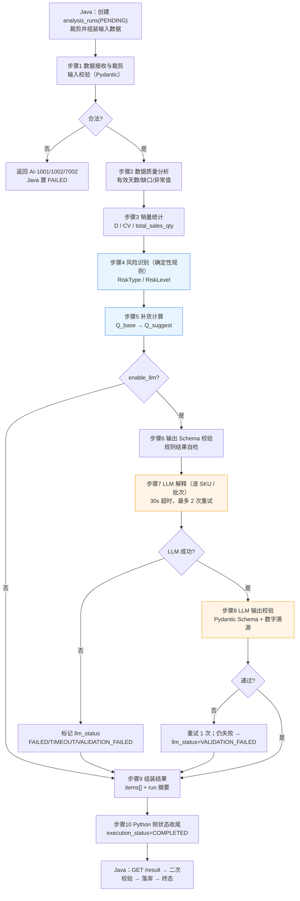

# ShopPilot AI 的 AI 应用架构（AI_ARCHITECTURE）

## 文档元信息

| 项 | 内容 |
| --- | --- |
| 文档名称 | AI 应用架构设计 |
| 文档路径 | `docs/04-ai/AI_ARCHITECTURE.md` |
| 文档优先级 | P3（见 `DESIGN_BASIS.md §1.1`） |
| 所属阶段 | M0 设计阶段 |
| 版本 | v1.0（M0 定稿） |
| 上游权威来源 | `docs/DESIGN_BASIS.md §3.1`、`§7.2`、`§8.1`、`§10`、`§11`、`§13`；`docs/01-architecture/SYSTEM_ARCHITECTURE.md` |
| 主要读者 | AI 工程、后端、测试、架构评审 |

### 本文档负责什么

- 定义 **Python `service-ai` 的职责边界与设计原则**（确定性优先、LLM 只做语言任务）。
- 给出**判断框架**（普通函数 / 规则引擎 / Workflow / LLM 的选型决策表）。
- 定义**首期分析执行流程（10 步 Workflow）**并用 Mermaid 表达。
- 解释**为何首期不用 LangGraph**及**自然演进路径**。
- 定义**步骤状态与可恢复性**、**并发与资源控制**、**Trace 与可观测性**。
- 明确**首期不做什么**。

### 本文档不负责什么

- **不定义**公式与阈值（`DESIGN_BASIS.md §10`、`§11`）。
- **不定义**输入/输出数据结构（`ANALYSIS_CONTRACT.md`）。
- **不定义**内部接口 HTTP 契约（`AI_SERVICE_CONTRACT.md`）。
- **不定义** Prompt 文本（`PROMPT_DESIGN.md`）。
- **不定义**表结构（`DATABASE_DESIGN.md`）。

---

## 1. 职责划分原则

> 引用 `DESIGN_BASIS.md §3.1`、`§7.2`、`§8.1`，并展开。

| # | 原则 | 说明 | 违反后果 |
| --- | --- | --- | --- |
| 1 | **确定性计算优先** | 能用确定性算法（统计、规则、公式）算出的，**绝不交给 LLM**。`D`、`SS`、`Q_base`、`Q_suggest`、`RiskType`、`RiskLevel` 全部由 Python 规则/统计模块产出（`DESIGN_BASIS §10`、`§11`）。 | LLM 幻觉渗入补货数量 → 采购金额错误，不可追责 |
| 2 | **LLM 只做语言任务** | LLM 的输入是**已算好的结构化结果**，输出是**自然语言解释**。LLM **不参与任何判定**（`DESIGN_BASIS §11`）。 | 判定不可复现、不可测试 |
| 3 | **所有外部输入与模型输出必须校验** | 入站数据用 Pydantic 校验（`AI_SERVICE_CONTRACT.md §3`）；LLM 输出用 Pydantic Schema 校验（`PROMPT_DESIGN.md §输出 Schema 校验`）。 | 脏数据/幻觉进入业务库 |
| 4 | **AI 分析与采购执行分离** | Python 只**计算与解释**；采购执行（建单/确认/入库/审批）全部在 Java（`SYSTEM_ARCHITECTURE.md §5` 边界 9）。 | LLM 越权触发资金动作 |
| 5 | **关键业务动作由 Java 校验** | 落库前 Java 二次校验 18 项（`AI_SERVICE_CONTRACT.md §7`）。 | Python 缺陷直接污染业务库 |
| 6 | **Python 不能绕过 Java 的业务约束** | Python **不写业务库**、**不感知权限**、**不直接读采购表**（在途量由 Java 算好传入）。 | 双源状态、隔离失效 |

### 1.1 判定链与职责归属（引用 `DESIGN_BASIS §13.2`）

```
Java（业务权威）                      Python（计算与解释）
  ├ 权限 / 团队隔离 / 幂等 / 并发       ├ 数据质量校验
  ├ 生成 analysis_run_id               ├ 销量统计（D、CV、异常）
  ├ 组装并裁剪输入数据                  ├ 风险规则（RiskType / RiskLevel）
  ├ 调用 Python                        ├ 补货计算（Q_base → Q_suggest）
  ├ 二次校验结果（18 项）               ├ LLM 解释（可降级）
  ├ 落库 analysis_items /             └ 返回结构化 JSON（不落库、不回调）
  │   replenishment_items
  └ 维护 AnalysisRunStatus（权威）
```

---

## 2. 判断框架：问题类型 → 适用手段

> 目标：**避免"什么都说成 AI"**。下表是选型的唯一决策依据。

| 问题类型 | 特征 | 适用手段 | 本项目采用 | 典型例子 |
| --- | --- | --- | --- | --- |
| **纯计算/变换** | 输入确定、输出确定、无状态、可单元测试 | **普通 Python 函数** | ✅ | `D = sum(qty)/n`、`IP = on_hand + eff_in_transit − committed`、`Q_base = max(0, D×(L+R)+SS−IP)` |
| **带阈值的条件判断** | 多条 if-then-else，输出有限枚举 | **规则引擎（函数集合）** | ✅ | `R-STOCKOUT`/`R-LOWSTOCK`/`R-OVERSTOCK`/`R-SLOWMOVING`/`R-SALESANOMALY`/`R-DATAINSUFFICIENT`（`DESIGN_BASIS §11`） |
| **多步骤、有顺序依赖** | 步骤固定、线性、需进度与超时 | **有限状态 Workflow（显式顺序编排）** | ✅ | 本项目的 10 步分析流程（§3） |
| **自然语言生成/解释** | 输入是结构化数据，输出是语言 | **LLM 调用（受控、可降级）** | ✅ | `explain_risk`、`explain_replenishment`、`run_summary`（`PROMPT_DESIGN.md`） |
| **需要条件分支回退/循环** | 步骤依赖运行期判断、可能重走 | 状态机 / 工作流引擎 | ❌ 首期不需要（见 §4） | 无 |
| **多角色协作 / 自主规划** | Agent 互相调用、自主决定下一步 | Multi-Agent / ReAct | ❌ **首期明确不做** | 无 |
| **工具调用循环** | 模型自主选择工具并迭代 | Tool Calling Loop | ❌ **首期明确不做** | 无 |
| **含混文本语义理解** | 输入非结构化、语义模糊 | RAG / 向量检索 | ❌ 首期不需要（见 §9） | 无 |
| **定制领域模型** | 通用模型不足，需领域语料 | 微调 | ❌ **首期明确不做** | 无 |

**决策口诀**：**能算的算，能判的判，只把"说人话"交给模型。**

---

## 3. 首期执行流程（Workflow）

### 3.1 总览（Mermaid flowchart）



> 蓝色 = 确定性计算（**LLM 不参与**）；橙色 = LLM 环节（**可降级**）。

### 3.2 逐步说明

> 列含义：**执行方**（Java/Python）、**确定性**、**可用 LLM**、**失败可重试**、**记录位置**、**降级方式**。

| 步骤 | 执行方 | 确定性 | 可用 LLM | 失败可重试 | 记录位置 | 缺数/失败降级 |
| --- | --- | --- | --- | --- | --- | --- |
| **1 数据接收与裁剪** | Java 组装 → Python 接收 | ✅ | ❌ | 否（Schema 错误不重试） | Python 日志（内存步骤表） | 输入不合法 → `AI-1001`/`AI-1002`/`AI-7002`，Java 置 `FAILED` |
| **2 数据质量分析** | Python | ✅ | ❌ | 否 | Python 步骤表 | 缺销售数据 → `data_quality=INSUFFICIENT`（`DATA_INSUFFICIENT`），继续处理其余 SKU |
| **3 销量统计** | Python | ✅ | ❌ | 否 | Python 步骤表 | `n < min_days` → `D=null`，继续 |
| **4 风险识别** | Python（规则引擎） | ✅ | ❌ | 否（纯函数） | Python 步骤表 | 数据不足 → `RiskLevel=UNKNOWN` + `DATA_INSUFFICIENT` |
| **5 补货计算** | Python | ✅ | ❌ | 否（纯函数） | Python 步骤表 | `Q_base<=0` 或 `D=null` → `q_suggest=null`（不出建议），继续 |
| **6 输出 Schema 校验（规则结果自检）** | Python | ✅ | ❌ | 否 | Python 步骤表 | 自检失败 → `AI-3001`/`AI-4001`，执行 `FAILED`（Java 置 run `FAILED`） |
| **7 LLM 解释** | Python → LLM | ❌ | ✅ | **是**（最多 2 次，指数退避） | Python 日志（token/latency/status） | 失败/超时 → 该 item `llm_explanation=null`，`llm_status` 记 `FAILED`/`TIMEOUT`；**规则结果保留** |
| **8 LLM 输出校验** | Python | ✅ | ❌ | **是**（重试 1 次） | Python 日志 | 校验失败 → `llm_status=VALIDATION_FAILED`；**规则结果保留** |
| **9 组装结果** | Python | ✅ | ❌ | 否 | Python 步骤表 | 组装失败 → `AI-9001`，执行 `FAILED` |
| **10 Python 侧状态收尾** | Python | ✅ | ❌ | 否 | Python 内存状态表 | 置 `execution_status=COMPLETED`（**不代表业务成功**） |

**关键约定**：

- **步骤 1–6 与 9–10 全部是确定性**，可用 `enable_llm=false` 做**全量 golden case 验证**（`ANALYSIS_CONTRACT.md §确定性测试要求`）。
- **只有 7、8 步涉及 LLM**，且**必须可降级**；**LLM 失败不得导致步骤 2–5 的规则结果丢失**（`DESIGN_BASIS §9.7` `DEGRADED`）。
- **Python 不写业务库**：所有步骤状态只记 Python 自身日志/内存（见 §5）；对外可见状态由 Java 依据接口回报更新。

---

## 4. 为何首期不用 LangGraph

> `DESIGN_BASIS §2.1` Out of Scope 明确排除 Multi-Agent；`DESIGN_BASIS §7.2` 明确"首期不引入 LangGraph，改用显式顺序编排"。

### 4.1 六条理由

| # | 理由 | 说明 |
| --- | --- | --- |
| 1 | **步骤固定且线性** | 10 个步骤顺序确定（§3.1），无运行期拓扑变化。用 `for step in STEPS: step.run()` 即可，图的表达能力是**冗余**的。 |
| 2 | **无循环分支** | 唯一分支是"LLM 成功/失败"和"是否启用 LLM"，均可由 `if/else` 表达；无"回到某步重跑"的需求（重跑 = 新 run）。 |
| 3 | **无多 Agent 协作** | 无 Planner/Executor/Critic 分工；LLM 只是流程末端的**单一解释节点**。 |
| 4 | **无持久化图状态需求** | 首期不要求"跨进程恢复执行到某节点"。Java 侧用 `timeout_at` 兜底（§5），无需图检查点（checkpoint）。 |
| 5 | **框架成本 > 收益** | 引入 LangGraph 增加依赖、版本漂移、调试黑盒、学习成本；本项目 8 个 Python 模块（`DESIGN_BASIS §7.2`）已是清晰分层。 |
| 6 | **纯函数更易测试** | 步骤写成**纯函数**（输入→输出），可直接用 fixture 做确定性测试；框架的隐式状态会削弱可测性。 |
| 7 | **可观测性可控** | 显式步骤可精确记录 `duration_ms`/`retry_count`/`llm_tokens`，而框架封装会隐藏这些细节。 |
| 8 | **与"确定性优先"一致** | 架构原则要求确定性可复现；框架的编排语义不确定性会与 SSOT 的可测试要求冲突。 |

### 4.2 自然演进路径（何时应重新评估）

> **不是"永远不用"，而是"没到时不用"**。满足以下**任一**条件时应**重新评估**引入工作流引擎/LangGraph：

| 触发条件 | 说明 |
| --- | --- |
| **出现条件分支回退** | 某步骤失败后需**回到**前一步重算（如"数据不足→放宽窗口→重算"），形成**环**。 |
| **需要人工介入节点** | 分析中途需人工确认/补充数据后再继续（Human-in-the-loop），需要**暂停/恢复**。 |
| **需要跨请求恢复执行** | 服务重启后要**从某步骤继续**（需要持久化图状态/检查点）。 |
| **步骤数量或分支显著增长** | 步骤数 > ~15 或出现多层嵌套条件，`if/else` 维护成本超过框架成本。 |
| **需要并行子图** | 如"按类目并行跑多组 SKU 再合并"，需要图级并发原语。 |
| **引入多 Agent** | 若未来确需 Planner/Critic 协作（当前 Out of Scope），则需图编排。 |

**演进代价控制**：因契约固定为"202 + 轮询 + 结构化结果"（`AI_SERVICE_CONTRACT.md`），无论内部是否引入框架，**Java 侧与对外语义不变**，迁移成本受控。

---

## 5. 步骤状态与可恢复性

### 5.1 Python 侧步骤模型（**仅存 Python 侧**）

> Python **不写业务库**（`DESIGN_BASIS §13.2`），因此步骤状态只存在于 Python 内存 + 其自身日志。

```
StepRecord:
  step_name    : str     # VALIDATING | STATS | RISK_RULES | REPLENISHMENT | LLM_EXPLAIN | DONE
  status       : str     # PENDING | RUNNING | SUCCEEDED | FAILED | SKIPPED
  started_at   : datetime(UTC, ms)
  ended_at     : datetime(UTC, ms) | None
  duration_ms  : int | None
  error        : { code, message, detail } | None
```

- 每个 `analysis_run_id` 维护一条 `RunExecution`：`execution_status`、`progress`、`current_step`、`steps: [StepRecord]`、`llm_status`、`items`（结果）、`accepted_at`、`finished_at`、`cancel_flag`。
- 存储在**进程内存**（`dict[run_id] -> RunExecution`）；进程重启后丢失 → 该 run 由 Java `timeout_at` 兜底为 `TIMEOUT`（见 §5.4）。
- **不对外暴露步骤明细**（步骤详情是内部细节）；对外仅暴露 `progress`/`current_step`（由 Java 映射到 `analysis_runs`）。

### 5.2 `execution_status`（Python）与 `AnalysisRunStatus`（Java 权威）的映射

| Python `execution_status` | Java `analysis_runs.status` | 说明 |
| --- | --- | --- |
| `ACCEPTED` | `PENDING` | 已受理，未开始 |
| `RUNNING` | `RUNNING` | 执行中 |
| `COMPLETED` | `SUCCEEDED`（`llm_status=SUCCEEDED`/`SKIPPED`/`NOT_REQUESTED`）或 `DEGRADED`（`llm_status=FAILED`/`TIMEOUT`/`VALIDATION_FAILED`） | **Java 依 `llm_status` 决定** |
| `FAILED` | `FAILED` | 规则阶段失败 |
| `CANCELLED` | `CANCELLED` | 取消 |

> **注意**：`COMPLETED` ≠ 业务成功。业务终态由 **Java** 依据结果与 `llm_status` 判定（`AI_SERVICE_CONTRACT.md §8`）。

### 5.3 Java 侧如何通过轮询感知

```
Java 轮询循环（前端轮询触发，2s→10s 指数退避）：
  1. GET /internal/v1/analysis/runs/{id}
  2. 映射 execution_status/progress/current_step/llm_status 到 analysis_runs
  3. 若 execution_status == COMPLETED：
       GET /internal/v1/analysis/runs/{id}/result
       二次校验（18 项）→ 落库 → 终态（SUCCEEDED/DEGRADED）
  4. 若 execution_status == FAILED：
       run 置 FAILED（error_code 映射，见 ERROR_CODES §2.11）
  5. 若 now > timeout_at 且 status == RUNNING：
       run 置 TIMEOUT（见 §5.4）
```

- 前端轮询节奏见 `SYSTEM_ARCHITECTURE.md §7.5`（2s → 4s → 8s → 10s 封顶）。
- **页面卸载必须停止轮询**。

### 5.4 Java 判断超时的依据是 `analysis_runs.timeout_at`（**关键设计**）

> **Java 判断超时的依据是数据库中的 `analysis_runs.timeout_at`，而不是 Python 回报的状态。**

**为何关键**：若 Python 进程**卡死/无响应**，它的 `execution_status` 会**永远停在 `RUNNING`**。若 Java 只信 Python 状态，任务将**永久 RUNNING**，用户永远等不到结果。

**规则**：

1. Java 创建 run 时写入 `timeout_at = now + 300s`（默认，`DESIGN_BASIS §13.4`；`analysis_runs.timeout_at` **不可变**）。
2. 任何一次状态查询/轮询中，若 `now > timeout_at` 且 `analysis_runs.status == RUNNING`，Java **无条件**将 run 推进为 `TIMEOUT`（终态）。
3. `TIMEOUT` 后**不自动重试**；用户可发起新 run（新 `run_no`）。
4. 之后若 Python 迟到返回结果，Java **丢弃**（run 已终态）。
5. 该设计对应 `SYSTEM_ARCHITECTURE.md §7.3` 与风险 `R-3`（无 MQ 的可靠性缺口）。

**伪代码**：

```
if run.status == RUNNING and now() > run.timeout_at:
    run.status = TIMEOUT
    run.error_code = "ANL-7003"   # 或 TIMEOUT 专用说明
    run.finished_at = now()
    audit(ANALYSIS_RUN_FINISH, result=FAILURE)
    discardLateResult(run.id)
```

### 5.5 取消的可恢复性

| 阶段 | 取消行为 |
| --- | --- |
| `ACCEPTED` | Python 直接不启动执行；Java 置 `CANCELLED` |
| `RUNNING` | Python 在**步骤边界**检查 `cancel_flag`；Java **立即**置 `CANCELLED`（不等 Python）；迟到结果丢弃 |
| 终态 | 取消返回 `ANL-7010`（已终态） |

---

## 6. 并发与资源控制

| 控制项 | 取值 | 依据 / 理由 |
| --- | --- | --- |
| **单实例并发运行上限** | 默认 `MAX_CONCURRENT_RUNS = 4` | 单机 Docker 部署（`SYSTEM_ARCHITECTURE.md §8`），CPU/内存有限；超限返回 `AI-7001`（`429`），Java 映射 `COM-0011`/`ANL-7001` |
| **单次运行 SKU 上限** | `MAX_ANALYSIS_SKUS = 2000` | 引自 `DESIGN_BASIS §10.6`；超限 `AI-7002`（`400`），Java 置 `FAILED`（对外 `ANL-7007`） |
| **单次 LLM 调用并发** | 同一 run 内**串行**（逐 SKU）或**小批量**（并发 2） | 降低限流（429）风险；首期 SKU 规模下串行可接受；批量大小可配置 |
| **同一团队同时运行数** | **限制为 1**（同团队不允许并发 run） | **理由**：① 同一团队并跑多 run 会**争抢库存/销售快照**，导致结果口径不一致；② 避免"两轮建议同时落库、互相取代"的 `SUPERSEDED` 竞态；③ 中小团队无并发分析需求。**实现**：Java 在创建时检查同团队是否存在 `PENDING`/`RUNNING` 的 run，命中则 `ANL-7001`（`409`） |
| **限流** | 对外接口按团队限流（`COM-0011`） | 防止误操作/脚本刷接口 |
| **整体超时预算** | 300s（`timeout_at`） | `DESIGN_BASIS §13.4` |

**超限返回**：并发/SKU 超限的对外表现为 `ANL-7001`（并发冲突，`409`）或 `ANL-7007`（SKU 超上限，`400`），内部 `AI-7001`/`AI-7002`（`ERROR_CODES.md §2.11`）。

> **注**：`DESIGN_BASIS §12.3` 的 `ANL-7001` 原文为"同一 SKU 范围已有运行中的分析任务"。本文档将"同团队同时运行数 = 1"作为其**更强约束**：即不仅同 SKU 范围，**同团队任意范围**也不允许并发。**⚠️ 该加强超出 `§12.3` 字面表述，建议在 `DESIGN_BASIS §15`/`§12.3` 明确**（见 §10 差异）。

---

## 7. Trace 与可观测性

### 7.1 Trace 字段（贯穿 Python 日志与返回结果）

| 字段 | 来源 | 说明 |
| --- | --- | --- |
| `analysis_run_id` | Java 传入 | 业务主键，贯穿全链 |
| `request_id` | Java `X-Request-Id` | 链路追踪（`API_CONTRACT.md §7`） |
| `step` | Python 步骤名 | `VALIDATING`…`DONE` |
| `duration_ms` | Python 计时 | 每步耗时 |
| `llm_tokens` | LLM 响应 | `{ "in": n, "out": m }` |
| `llm_model` | 请求 `model_name` | 模型标识 |
| `retry_count` | Python 计数 | 该步/该 LLM 调用的重试次数 |
| `retries` | LLM 环节 | 明细（每 item 的重试次数） |

### 7.2 日志格式（结构化 JSON，单行）

```
{
  "ts": "2026-10-14T08:00:01.230Z",
  "level": "INFO",
  "service": "service-ai",
  "analysis_run_id": 30001,
  "request_id": "req_anl_001",
  "step": "STATS",
  "duration_ms": 120,
  "llm_tokens": null,
  "llm_model": null,
  "retry_count": 0,
  "message": "sales stats computed"
}
```

```
{
  "ts": "2026-10-14T08:00:09.500Z",
  "level": "WARN",
  "service": "service-ai",
  "analysis_run_id": 30001,
  "request_id": "req_anl_001",
  "step": "LLM_EXPLAIN",
  "sku_id": 5001,
  "llm_model": "gpt-4o-mini",
  "llm_tokens": { "in": 812, "out": 236 },
  "retry_count": 2,
  "message": "llm timeout after retries, degrade item"
}
```

- **不得**在日志中打印完整 Prompt 正文（体积 + 敏感），见 `PROMPT_DESIGN.md §版本记录与调用日志`。
- **不得**在日志中打印 API Key（仅前 4 + 后 4 位）。
- Python 日志中的敏感文本字段（商品名等）按 `PROMPT_DESIGN.md §敏感数据` 白名单处理。

### 7.3 三方边界表：技术日志 / AI Trace / 业务审计

> 三者**目的不同、存储不同、保留策略不同**，**不得互相替代**（引用 `SYSTEM_ARCHITECTURE.md §5.1`、`DATABASE_DESIGN.md §6-J`）。

| 维度 | **技术日志（Tech Log）** | **AI Trace** | **业务审计（Audit）** |
| --- | --- | --- | --- |
| 目的 | 排障、性能、错误定位 | 复盘 AI 执行过程与成本 | 治理、追责、合规 |
| 生产者 | Java 日志、Python 日志 | Python（LLM 环节） | **Java**（`audit` 模块，`AuditAppender`） |
| 存储位置 | 容器 stdout / 日志文件 | Python 日志 + 回传 Java 的 run 摘要 | **`audit_logs` 表**（仅追加） |
| 典型字段 | `request_id`、`uri`、`duration_ms`、异常堆栈 | `analysis_run_id`、`step`、`llm_tokens`、`llm_model`、`retry_count` | `action`（27 个常量）、`operator_id`、`before_json`/`after_json`、`result` |
| 是否入库 | 否（文件/采集） | 否（Python 侧）+ 摘要入 `analysis_runs.summary_json` | **是**（`audit_logs`） |
| 是否面向用户 | 否 | 否 | 是（审计页面，OWNER/ADMIN） |
| 是否含敏感数据 | 脱敏后有限 | 不含密钥、不含价格 | **必须脱敏**（`AuditSanitizer`） |
| 保留策略 | 滚动（按天/大小） | 滚动 | **长期保留**（追溯优先，`D-15`） |
| 谁负责写入 | 各服务自身 | Python | **仅 Java `audit` 模块** |
| 对应 `DESIGN_BASIS §13.3` | `X-Request-Id` 贯穿日志 | Java↔Python 调用带 `X-Request-Id` | `analysis_runs.request_id` / `replenishment_reviews.request_id` |

**边界规则**：

1. **审计必须由 Java 写**（Python 不写 `audit_logs`）；Python 只把必要摘要（token/模型/状态/重试）**回传**，Java 决定是否落审计或 `summary_json`。
2. **Trace 不替代审计**：Trace 是技术过程，审计是业务动作（谁在何时对什么做了什么）。
3. **API Key / Prompt 正文不进任何一方**。

---

## 8. LLM 调用的工程约束（摘要，详见 `PROMPT_DESIGN.md`）

| 约束 | 取值 |
| --- | --- |
| 单次调用超时 | 30s（默认，`DESIGN_BASIS §13.4`） |
| 单次调用重试 | 最多 2 次，指数退避（1s、2s），仅网络/5xx/429 |
| `temperature` | 0.2（低随机性，解释需稳定） |
| `max_tokens` | 按 Prompt 设上限（`explain_risk`：512；`run_summary`：1024） |
| 输出格式 | 强制 JSON，Pydantic 校验 |
| 失败降级 | item 级 `llm_explanation=null` + `llm_status`，run 级 `DEGRADED`（**规则结果保留**） |

---

## 9. 首期不做什么（明确排除）

| 排除项 | 说明 | 为何不需要（首期） |
| --- | --- | --- |
| **多 Agent 协作** | Planner/Critic/Executor 互调 | 流程线性单一，无协作需求；`DESIGN_BASIS §2.1` Out of Scope |
| **自主规划（Autonomous Planning）** | 模型自行决定分析步骤 | 步骤固定（§3），自主规划会破坏可复现性与可测试性 |
| **工具调用循环（Tool Calling 自主迭代）** | 模型自主选工具并多轮调用 | 数据在调用前已由 Java 备齐；不需要模型"探索"数据 |
| **模型微调（Fine-tuning）** | 用团队语料训练 | 首期数据量与成本不匹配；通用模型 + Prompt 已足够 |
| **向量检索 / RAG** | 把文档向量化后检索注入 | **本项目数据是结构化的**：`D`、`IP`、`Q_base` 等已是**确定数值**，直接给模型即可，无需检索。RAG 适合"知识库问答"，本项目不是；引入向量库还会增加依赖与不确定性 |
| **LLM 参与判定** | 让模型判断风险等级/补货量 | 违反原则 1/2（`DESIGN_BASIS §11`：LLM 不参与任何判定） |
| **LLM 直接写库/执行采购** | 模型触发写操作 | 违反边界 9（`SYSTEM_ARCHITECTURE.md §5`） |

---

## 10. 与其它文档的不一致与待决策

| # | 现象 | 建议 |
| --- | --- | --- |
| 1 | `DESIGN_BASIS §12.3` 的 `ANL-7001` 表述为"**同一 SKU 范围**已有运行中任务"，本文档 §6 加强为"**同团队**不允许并发 run" | 加强会改变并发语义。**推荐**在 `DESIGN_BASIS §15` 明确"同团队同时运行数 ≤ 1"（**建议 `D-24`**），或收敛为 `§12.3` 原义。**未改动他人文档**。 |
| 2 | `DESIGN_BASIS §13.1` 未列内部"取结果"接口（见 `AI_SERVICE_CONTRACT.md §11.1`） | 建议固化（`D-20`） |
| 3 | ~~`analysis_items` 无 `llm_status` 列（见 `AI_SERVICE_CONTRACT.md §11.2`）~~ | ✅ **已解决**：已新增独立列 `analysis_items.llm_detail_json`（`DESIGN_BASIS §8`）；`AI_SERVICE_CONTRACT.md §11.2` 已同步（`D-21` 采纳"增列"方案） |
| 4 | Python 步骤状态是否需持久化 | **首期不持久化**（内存 + `timeout_at` 兜底）；若引入跨请求恢复（§4.2）再评估（**建议记录为评审项**） |

**新增待决策（本文档发现）**：

| 编号（建议） | 问题 | 推荐方案 | 影响 |
| --- | --- | --- | --- |
| **D-24（建议）** | 同团队是否允许多个分析 run 并发 | **不允许**（运行数 ≤ 1，返回 `ANL-7001`） | 影响并发语义与 `§12.3` 表述 |
| **D-25（建议）** | Python 侧 `MAX_CONCURRENT_RUNS` 默认值与是否可配置 | **默认 4**，通过环境变量可配 | 影响单机资源与限流策略 |
| **D-26（建议）** | LLM 解释是"逐 SKU"还是"批次摘要"为主 | 首期**逐 SKU 解释（`explain_risk.v1`）为主**，`run_summary.v1` 可选启用（见 `PROMPT_DESIGN.md`） | 影响 token 成本与 Prompt 设计 |

---

## 11. 变更记录

| 版本 | 日期 | 变更 | 作者 |
| --- | --- | --- | --- |
| v1.0 | 2026-10-14 | M0 初稿：职责原则、判断框架决策表、10 步 Workflow（Mermaid）、不用 LangGraph 的理由与演进路径、步骤状态与 `timeout_at` 兜底、并发控制、Trace 三方边界、首期不做清单 | AI 架构 |
