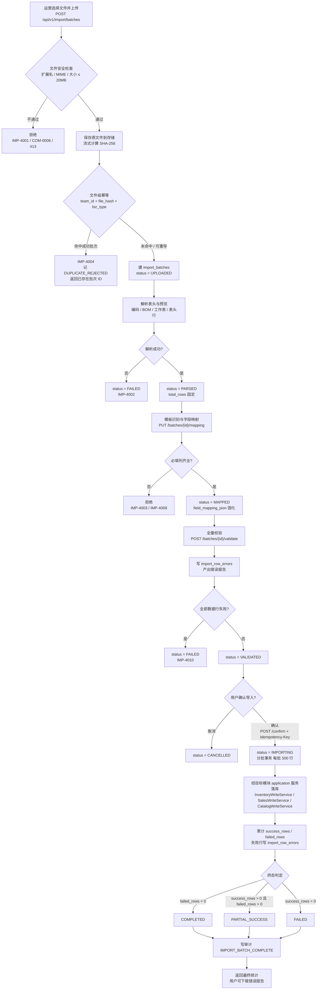
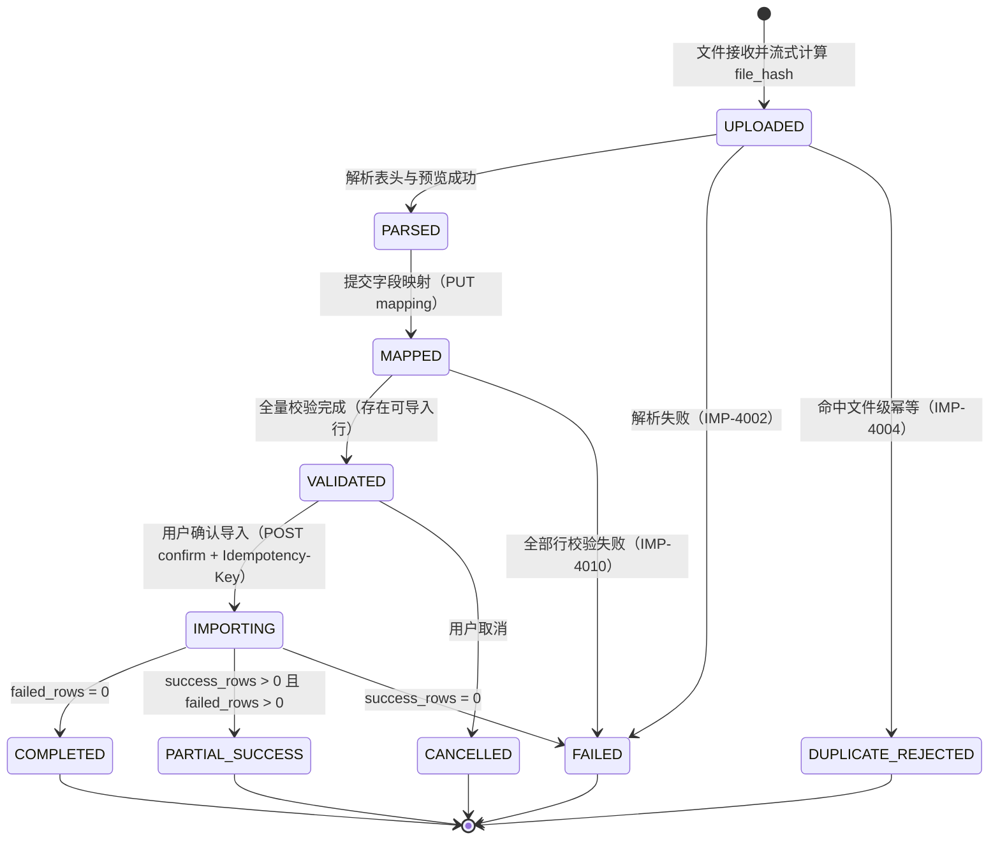

# ShopPilot AI 数据导入流程（IMPORT_WORKFLOW）

> **文档路径**：`docs/05-workflows/IMPORT_WORKFLOW.md`
> **文档优先级**：P4（见 `DESIGN_BASIS.md §1.1`）
> **上游权威来源（SSOT）**：`docs/DESIGN_BASIS.md`（术语 §3、团队隔离 §6、模块 §7、表 §8、状态枚举 §9、错误码 §12、精度 §14）
> **同级引用**：`docs/02-database/DATABASE_DESIGN.md`（表结构权威，尤其 §5.12 / §5.13 / §6-D / §6-E / §7.3）、`docs/03-api/API_CONTRACT.md`（接口路径权威 §9.3 / §10.6 / §11.3）、`docs/03-api/ERROR_CODES.md`、`docs/01-architecture/MODULE_BOUNDARIES.md`（§2.4）、`docs/01-architecture/SYSTEM_ARCHITECTURE.md`（§4.1）
> **阶段**：M0 设计阶段

---

## 1. 文档职责与范围

| 本文档负责 | 本文档不负责 |
| --- | --- |
| 数据导入的**端到端流程**：上传 → 安全检查 → 模板识别/字段映射 → 预览 → 校验 → 错误报告 → 确认导入 → 落库 → 结果统计 | 表字段/索引的逐列定义（见 `DATABASE_DESIGN.md §5.12`、`§5.13`） |
| 六种 `ImportBizType` 的模板字段清单、落库目标表、唯一键冲突策略、幂等策略 | 接口的完整请求/响应结构（见 `API_CONTRACT.md §11.3`） |
| 导入异常场景的检测方式、系统行为、错误码、可恢复性 | 完整错误码表（见 `ERROR_CODES.md`；本文档只做映射） |
| 导入的事务边界与状态机 | 前端页面视觉规范（见 `PRD.md`） |

**SSOT 引用声明**：本文档**不重新定义**任何状态枚举、错误码、表名、公式或精度。`ImportBatchStatus`（`§9.5`）、`ImportBizType`（`§9.15`）、`InventoryTxnType`（`§9.6`）、错误码（`§12`）一律**引用** `DESIGN_BASIS.md`。

---

## 2. 参与角色

| 角色 | 在导入流程中的能力 | 依据 |
| --- | --- | --- |
| `OWNER` / `ADMIN` | 全部导入能力 | `USER_ROLES.md §2.2` #1 |
| `OPERATOR` | 全部导入能力（上传 / 映射 / 校验 / 确认 / 重导） | `USER_ROLES.md §2.2` #1 |
| `APPROVER` | 全部导入能力 | `USER_ROLES.md §2.2` #1 |
| `VIEWER` | **禁止**导入（任何写操作）→ `TEAM-2003` | `USER_ROLES.md §2.2` #1 |

---

## 3. 涉及表与接口

### 3.1 涉及表（`importdata` 模块拥有）

| 表名 | 用途 | 权威定义 |
| --- | --- | --- |
| `import_batches` | 一次导入上传的执行实例；承载文件级幂等、状态机、进度与统计 | `DATABASE_DESIGN.md §5.12` |
| `import_row_errors` | 失败/警告行的逐行明细（**仅追加**） | `DATABASE_DESIGN.md §5.13` |

> **间接落库目标表**（由 `importdata` 调用目标模块的 `application` 层服务进行写入，**不直写**）：`products`、`skus`、`suppliers`、`warehouses`（经 `CatalogWriteService`）、`inventory_balances` + `inventory_transactions`（经 `InventoryWriteService`）、`sales_daily`（经 `SalesWriteService`）。见 `MODULE_BOUNDARIES.md §2.4`。

### 3.2 涉及接口（路径权威见 `API_CONTRACT.md §10.6`）

| 步骤 | 方法 | 路径 |
| --- | --- | --- |
| 模板下载 | GET | `/api/v1/import/templates` |
| 上传文件 | POST | `/api/v1/import/batches` |
| 批次列表 | GET | `/api/v1/import/batches` |
| 批次详情 | GET | `/api/v1/import/batches/{id}` |
| 提交字段映射 | PUT | `/api/v1/import/batches/{id}/mapping` |
| 预览 | GET | `/api/v1/import/batches/{id}/preview` |
| 全量校验 | POST | `/api/v1/import/batches/{id}/validate` |
| 确认导入 | POST | `/api/v1/import/batches/{id}/confirm` |
| 错误/警告行列表 | GET | `/api/v1/import/batches/{id}/errors` |
| 错误报告导出（CSV） | GET | `/api/v1/import/batches/{id}/errors/export` |
| 强制重导 | POST | `/api/v1/import/batches/{id}/reimport` |

> **接口路径口径**：统一使用 `/api/v1/import/batches*`。`SYSTEM_ARCHITECTURE.md §4.1` 与 `PRD.md §10.1` 中原有的 `/api/v1/imports*`（含 `.../execute`）写法**已在 M0 一致性审查中修正为权威路径**；本文档以 `API_CONTRACT.md` 为唯一路径口径，详见 `docs/06-development/DESIGN_REVIEW.md` 检查项 14 与 §16。

---

## 4. 执行方结论（重要）

> **本项目结论：数据导入的全流程（含解析、映射、校验、落库）全部由 Java（`importdata` 模块）执行，Python AI 服务（`service-ai`）不参与导入的任何环节。**

依据：
1. `MODULE_BOUNDARIES.md §2.4`：`importdata` 负责"解析、字段映射、全量校验、错误报告、按 `ImportBizType` 分派落库"。
2. `SYSTEM_ARCHITECTURE.md §5` 边界 4：Python **不直接修改** Java 管理的业务表，Python 只做"计算与解释"。
3. `DESIGN_BASIS.md §7.2`：Python 8 个模块（`api`/`schemas`/`orchestration`/`validation`/`analytics`/`rules`/`llm`/`core`）**没有任何导入相关职责**。
4. 导入落库必须经 `InventoryWriteService`、`SalesWriteService`、`CatalogWriteService`（`MODULE_BOUNDARIES.md §5.3` 例外表），这些服务均由 Java 持有。

因此本文档每一步骤的"执行方"列均为 **Java**。

---

## 5. 主流程



> 状态取值与合法转换见 `DESIGN_BASIS.md §9.5`。`DUPLICATE_REJECTED` 批次不占用 `dedupe_hash` 槽位（`DATABASE_DESIGN.md §6-E.4`）。

---

## 6. 逐步说明表

> **"执行方"列全部为 Java**（结论见 §4）。**"状态变化"列引用 `DESIGN_BASIS.md §9.5` 的 `ImportBatchStatus`。**
> **事务边界**列：`无业务事务` = 仅批次状态更新/错误行写入；`分批事务` = 见 §12。

| 步骤 | 步骤名 | 执行方 | 输入 | 输出 | 状态变化（§9.5） | 事务边界 | 失败处理 | 对应接口 |
| --- | --- | --- | --- | --- | --- | --- | --- | --- |
| 0 | 模板下载 | Java | `bizType` | 模板文件与列清单 | — | 无事务 | `COM-0001` | GET `/api/v1/import/templates` |
| 1 | 文件上传 | Java | `multipart`：`file`、`bizType`、`templateVersion`、`parseOptions` | 批次 ID、`file_hash`、预览 | （建批次）`UPLOADED` | 无业务事务 | `IMP-4001` / `COM-0006` | POST `/api/v1/import/batches` |
| 2 | 文件安全检查 | Java | 文件字节流 | 通过/拒绝 | 拒绝时不建批次 | 无事务 | 扩展名/MIME/大小不合法 → `IMP-4001` | （内置于步骤 1） |
| 3 | 哈希与幂等判定 | Java | 文件内容（流式） | `file_hash`（SHA-256 小写十六进制） | 命中 → `DUPLICATE_REJECTED` | 单事务（幂等记录写入） | `IMP-4004`（返回已存在批次） | （内置于步骤 1） |
| 4 | 解析与预览 | Java | 原文件 + `parse_options` | 表头、列清单、前 N 行预览、`total_rows` | `UPLOADED` → `PARSED`（失败 → `FAILED`） | 单事务（状态 + `parse_options_json`） | `IMP-4002`（编码/格式） | （内置于步骤 1，或 `GET /preview` 重看） |
| 5 | 模板识别与字段映射 | Java | 源列名 + 目标字段 | `field_mapping_json` | `PARSED` → `MAPPED` | 单事务 | 必填列缺失 → `IMP-4003`；映射非法 → `IMP-4008`；状态不符 → `IMP-4005` | PUT `/api/v1/import/batches/{id}/mapping` |
| 6 | 全量校验 | Java | 全量数据行 + 映射 | 错误/警告行、统计 | `MAPPED` → `VALIDATED`（全失败 → `FAILED`） | 无业务事务（写 `import_row_errors`） | `IMP-4010`（全部行失败）；`IMP-4009`（确认时仍有 ERROR 行） | POST `/api/v1/import/batches/{id}/validate` |
| 7 | 错误报告产出 | Java | 错误行 | `import_row_errors` 记录 | 同步骤 6 | 无业务事务 | — | GET `/batches/{id}/errors`、`.../errors/export` |
| 8 | 用户确认 | Java | 用户确认 + `Idempotency-Key` + `expected_total_rows` | 落库启动 | `VALIDATED` → `IMPORTING` | 单事务（状态守卫） | 状态不符 → `IMP-4005`；仍有 ERROR 行 → `IMP-4009`；幂等体不一致 → `COM-0009` | POST `/api/v1/import/batches/{id}/confirm` |
| 9 | 数据落库 | Java | 有效行（按 500 行分批） | 目标表写入 | `IMPORTING` 期间累加计数 | **分批事务**（每 500 行一个本地事务） | 单批失败不影响已成功批次；行级错误写 `import_row_errors` | （confirm 内部） |
| 10 | 结果统计与终态 | Java | 累计计数 | `success_rows`/`failed_rows`、终态 | `IMPORTING` → `COMPLETED` / `PARTIAL_SUCCESS` / `FAILED` | 单事务（终态 + 审计） | 不变式 `success_rows + failed_rows = total_rows` 断言 | （confirm 返回） |
| 11 | 强制重导 | Java | 同一文件 + 用户显式确认 | 新批次、旧批次被取代 | 新批次 `UPLOADED`；旧批次 `superseded_by_batch_id` | **三步同一事务**（§8.10） | `IMP-4004`（未确认时） | POST `/api/v1/import/batches/{id}/reimport` |

**逐步说明补充（每条流程必须明确 5 要素）**

| 要素 | 说明 |
| --- | --- |
| **输入来源** | 步骤 1–4：用户上传的文件字节流 + 团队上下文（`TeamContext` 注入 `team_id`，`§6` 规则 3）；步骤 5：`import_batches.parse_options_json` 与源列名；步骤 6：全量数据行 + `field_mapping_json`；步骤 8–10：`VALIDATED` 批次 + 用户确认。 |
| **输出** | 批次记录、预览、`field_mapping_json`、`import_row_errors`、目标业务表数据、终态统计、审计记录。 |
| **状态变化** | 严格按 §9.5 单向流转（见 §13 状态机图）。 |
| **异常处理** | 见 §8 异常场景专章（逐条给出检测方式/系统行为/错误码/可恢复性）。 |
| **事务边界** | 上传/解析/校验：无业务事务（仅批次状态与错误行写入）；确认导入：**分批事务，每批 500 行，批间独立提交**（见 §12）。 |

---

## 7. 分批导入的六种业务类型

> `ImportBizType`（`DESIGN_BASIS.md §9.15`）：`PRODUCT` / `SKU` / `SUPPLIER` / `WAREHOUSE` / `INVENTORY_SNAPSHOT` / `SALES_DAILY`。

### 7.1 `PRODUCT`（商品）

| 字段名 | 中文 | 必填 | 类型 | 校验规则 | 示例值 |
| --- | --- | --- | --- | --- | --- |
| `product_code` | 商品编码 | 是 | string(64) | 非空；`^[A-Z0-9_-]{1,64}$`；团队内唯一 | `P-BAG-001` |
| `name` | 商品名称 | 是 | string(200) | 非空，≤200 | `轻旅行双肩包` |
| `category` | 类目 | 否 | string(64) | ≤64 | `箱包` |
| `brand` | 品牌 | 否 | string(64) | ≤64 | `UPack` |
| `unit` | 单位 | 否 | string(16) | ≤16 | `个` |
| `default_supplier_code` | 默认供应商编码 | 否 | string(32) | 若填，须在团队内存在（`CAT-3001`）且同团队（`CAT-3005`） | `SUP-001` |
| `spec_summary` | 规格摘要 | 否 | string(255) | ≤255 | `多色可选` |
| `status` | 状态 | 否 | enum | ∈ `MasterDataStatus`（`ACTIVE`/`INACTIVE`），缺省 `ACTIVE` | `ACTIVE` |

- **落库目标表**：`products`（经 `CatalogWriteService.upsertProduct`）。
- **唯一键**：`uk_prod_team_code (team_id, product_code)`（`§8`）。
- **冲突策略**：**upsert 更新**（已存在则更新非键字段；`product_code` 为业务键不可改）。**跨团队同编码互不影响**（`§6` 规则 2）。
- **幂等策略**：文件级 `(team_id, file_hash, biz_type)` + 行级 `uk_prod_team_code` 的 upsert 语义（重复导入结果一致）。

### 7.2 `SKU`

| 字段名 | 中文 | 必填 | 类型 | 校验规则 | 示例值 |
| --- | --- | --- | --- | --- | --- |
| `sku_code` | SKU 编码 | 是 | string(64) | 非空；团队内唯一 | `SKU-BAG-001-BLK` |
| `product_code` | 所属商品编码 | 是 | string(64) | **必须已存在**且同团队（否则 `CAT-3001`/`CAT-3005`） | `P-BAG-001` |
| `name` | 展示名 | 否 | string(200) | ≤200 | `轻旅行双肩包 黑色` |
| `barcode` | 条码 | 否 | string(64) | ≤64 | `6901234567890` |
| `spec_json` | 规格键值 | 否 | JSON 字符串 | 合法 JSON 对象 | `{"color":"黑色"}` |
| `supplier_code` | 供应商编码 | 否 | string(32) | 若填须存在且同团队 | `SUP-001` |
| `default_lead_time_days` | SKU 级交期 `L` | 否 | int(≥0) | ≥0 或空；**空 = 未配置（触发回退）**，禁止用 0 表示未配置 | `7` |
| `moq` | 最小起订量 | 否 | decimal(18,3) | ≥0 或空 | `50.000` |
| `order_multiple` | 采购倍数 | 否 | decimal(18,3) | >0 或空 | `10.000` |
| `qty_step` | 最小起订精度 | 否 | decimal(18,3) | >0 或空 | `1.000` |
| `purchase_price` | 参考采购单价 | 否 | decimal(18,4) | ≥0，≤4 位小数 | `35.5000` |
| `sale_price` | 参考售价 | 否 | decimal(18,4) | ≥0，≤4 位小数 | `89.0000` |
| `listed_date` | 上架日期 | 否 | date | `YYYY-MM-DD`，≤ 今天 | `2026-09-01` |
| `status` | 状态 | 否 | enum | ∈ `MasterDataStatus`，缺省 `ACTIVE` | `ACTIVE` |

- **落库目标表**：`skus`（经 `CatalogWriteService.upsertSku`）；`product_id` 由 `product_code` 解析（`skus.product_id` **不可变**，`§5.7`）。
- **唯一键**：`uk_sku_team_code (team_id, sku_code)`。
- **冲突策略**：**upsert 更新**；`product_id` 不可变——若同编码指向不同 `product_code` → **报错**（视为编码被占用，`CAT-3002`），不做静默改挂。
- **幂等策略**：同文件级幂等 + `uk_sku_team_code` upsert。

### 7.3 `SUPPLIER`

| 字段名 | 中文 | 必填 | 类型 | 校验规则 | 示例值 |
| --- | --- | --- | --- | --- | --- |
| `code` | 供应商编码 | 是 | string(32) | 非空；团队内唯一 | `SUP-001` |
| `name` | 供应商名称 | 是 | string(128) | 非空 | `星海供应链` |
| `contact_name` | 联系人 | 否 | string(64) | ≤64 | `张经理` |
| `contact_phone` | 联系电话 | 否 | string(32) | ≤32 | `13800000000` |
| `email` | 邮箱 | 否 | string(128) | 合法邮箱 | `a@b.com` |
| `address` | 地址 | 否 | string(255) | ≤255 | `广东省深圳市…` |
| `lead_time_days` | 供应商级交期 | 否 | int(≥0) | ≥0 或空 | `7` |
| `moq` | 供应商级 MOQ | 否 | decimal(18,3) | ≥0 或空 | `50.000` |
| `order_multiple` | 供应商级倍数 | 否 | decimal(18,3) | >0 或空 | `10.000` |
| `status` | 状态 | 否 | enum | ∈ `MasterDataStatus` | `ACTIVE` |

- **落库目标表**：`suppliers`（经 `CatalogWriteService.upsertSupplier`）。
- **唯一键**：`uk_sup_team_code (team_id, code)`。
- **冲突策略**：**upsert 更新**。
- **幂等策略**：文件级幂等 + `uk_sup_team_code` upsert。

### 7.4 `WAREHOUSE`

| 字段名 | 中文 | 必填 | 类型 | 校验规则 | 示例值 |
| --- | --- | --- | --- | --- | --- |
| `code` | 仓库编码 | 是 | string(32) | 非空；团队内唯一 | `WH-MAIN` |
| `name` | 仓库名称 | 是 | string(128) | 非空 | `主仓` |
| `is_default` | 是否默认仓 | 否 | bool | 缺省 `0`；同团队至多一行为 1（服务层保证，`§5.4`） | `1` |
| `address` | 地址 | 否 | string(255) | ≤255 | `深圳市宝安区…` |
| `status` | 状态 | 否 | enum | ∈ `MasterDataStatus` | `ACTIVE` |

- **落库目标表**：`warehouses`（经 `CatalogWriteService.upsertWarehouse`）。
- **唯一键**：`uk_wh_team_code (team_id, code)`。
- **冲突策略**：**upsert 更新**；`is_default=1` 时服务层在事务内先清零再置一（否则 `CAT-3008`）。
- **幂等策略**：文件级幂等 + `uk_wh_team_code` upsert。

### 7.5 `INVENTORY_SNAPSHOT`（库存快照）

| 字段名 | 中文 | 必填 | 类型 | 校验规则 | 示例值 |
| --- | --- | --- | --- | --- | --- |
| `sku_code` | SKU 编码 | 是 | string(64) | **必须已存在**且同团队（否则 `CAT-3001`） | `SKU-BAG-001-BLK` |
| `warehouse_code` | 仓库编码 | 是 | string(32) | **必须已存在**且同团队（否则 `CAT-3003`） | `WH-MAIN` |
| `qty` | 快照数量 | 是 | decimal(18,3) | ≥0，≤3 位小数 | `120.000` |
| `snapshot_date` | 快照日期 | 否 | date | `YYYY-MM-DD`，≤ 今天 | `2026-10-13` |
| `remark` | 备注 | 否 | string(255) | ≤255 | `期初导入` |

- **落库目标表**：`inventory_balances`（首行插入或增量累加）+ `inventory_transactions`（`txn_type = INIT_IMPORT`，`§9.6`）。
- **唯一键**：`uk_invbal_team_wh_sku (team_id, warehouse_id, sku_id)`；流水 `uk_invtxn_team_idem (team_id, idempotency_key)`。
- **冲突策略（结论）**：**默认增量（追加一条 `INIT_IMPORT` 流水），并对"该 `(warehouse, sku)` 已存在余额行"的行在 `VALIDATED` 阶段产生 `WARNING`**（提示"将按增量累加，如需覆盖请使用盘点调整"）。**不采用直接覆盖**，理由：`inventory_balances` 是**可推导物化状态**，只能由流水驱动（`DATABASE_DESIGN.md §5.9` 设计要点 2），直接覆盖会隐藏历史并破坏"余额可由流水推导"（`§3.1` 第 4 条）。覆盖口径请走 `COUNT_ADJUST`。详见 `INVENTORY_WORKFLOW.md §4.1`。
- **幂等策略**：文件级幂等 + 流水幂等键 `<txn_type>:<biz_type>:<biz_ref_id>:<sku_id>[:<suffix>]`（`biz_type = IMPORT`，`biz_ref_id = batch_id`，`DATABASE_DESIGN.md §5.10` 设计要点 4），保证同一批次重复确认不重复累加。
  - ★ **`INIT_IMPORT` 的后缀是必填**：键必须写成 `INIT_IMPORT:IMPORT:<batch_id>:<sku_id>:<warehouse_id>`。余额与流水都是 `(team_id, warehouse_id, sku_id)` **三键**维度，而本模板 `warehouse_code` 为必填列 ⇒「同一批次内同一 SKU 出现在多个仓库」是**常规合法输入**；缺 `:<warehouse_id>` 会让第二个仓库的行命中同一幂等键，被 `replayIfIdempotent` 的 `sameContent` 判为「内容不一致」并报 `INV-5003`（`R80`，`M3-B10.6` 修复）。判定口径见 `DATABASE_DESIGN.md §5.10` 要点 4「若不加后缀会导致两条合法业务行同键，则该后缀是必填而非可选」。

### 7.6 `SALES_DAILY`（日销售）

| 字段名 | 中文 | 必填 | 类型 | 校验规则 | 示例值 |
| --- | --- | --- | --- | --- | --- |
| `sku_code` | SKU 编码 | 是 | string(64) | 必须存在且同团队 | `SKU-BAG-001-BLK` |
| `warehouse_code` | 仓库编码 | 是 | string(32) | 必须存在且同团队 | `WH-MAIN` |
| `sale_date` | 销售日期 | 是 | date | `YYYY-MM-DD`，**不得为未来日期**（`SAL-6003`） | `2026-10-13` |
| `qty` | 净销量 | 是 | decimal(18,3) | **≥0**（`SAL-6002`）；退货写 `return_qty` | `12.000` |
| `return_qty` | 退货量 | 否 | decimal(18,3) | ≥0，缺省 `0` | `0.000` |
| `sales_amount` | 销售金额 | 否 | decimal(18,2) | ≥0，≤2 位小数 | `1068.00` |
| `order_count` | 订单数 | 否 | int | ≥0 | `9` |

- **落库目标表**：`sales_daily`（经 `SalesWriteService.batchUpsert`）。
- **唯一键**：`uk_sales_team_wh_sku_date (team_id, warehouse_id, sku_id, sale_date)`。
- **冲突策略（结论）**：**覆盖（upsert），不是累加**（`DATABASE_DESIGN.md §6-D.2`）。命中已存在行时在 `VALIDATED` 阶段产生 `WARNING`（`IMP-4006`，见 `D-12`），提示"将覆盖 N 行已有数据"。
- **幂等策略**：`uk_sales_team_wh_sku_date` 的 upsert 语义天然幂等（重传同文件结果一致）；落库写审计 `SALES_DAILY_UPSERT`（含被覆盖行数，`DATABASE_DESIGN.md §6-J.1` #17）。

### 7.7 六种类型汇总

| `ImportBizType` | 落库目标 | 唯一键 | 冲突策略 | 幂等机制 |
| --- | --- | --- | --- | --- |
| `PRODUCT` | `products` | `uk_prod_team_code` | upsert 更新 | 文件哈希 + 唯一键 upsert |
| `SKU` | `skus` | `uk_sku_team_code` | upsert 更新（`product_id` 不可变，冲突报错） | 文件哈希 + 唯一键 upsert |
| `SUPPLIER` | `suppliers` | `uk_sup_team_code` | upsert 更新 | 文件哈希 + 唯一键 upsert |
| `WAREHOUSE` | `warehouses` | `uk_wh_team_code` | upsert 更新（`is_default` 服务层保证唯一） | 文件哈希 + 唯一键 upsert |
| `INVENTORY_SNAPSHOT` | `inventory_balances` + `inventory_transactions` | `uk_invbal_team_wh_sku` / `uk_invtxn_team_idem` | **增量 + WARNING**（不覆盖） | 文件哈希 + 流水幂等键 |
| `SALES_DAILY` | `sales_daily` | `uk_sales_team_wh_sku_date` | **覆盖（upsert）+ WARNING** | 文件哈希 + 唯一键 upsert |

---

## 8. 异常场景专章

> 每条格式：**场景 / 检测方式 / 系统行为 / 用户可见提示 / 错误码 / 是否可恢复**。

### 8.1 文件类型与大小限制

| 项 | 内容 |
| --- | --- |
| 场景 | 上传非 `.csv/.xlsx/.xls` 文件，或文件 > 20MB |
| 检测方式 | 步骤 2：校验扩展名白名单 + `Content-Type`/MIME + `file_size`（`API_CONTRACT.md §9.3`：`.csv`/`.xlsx`/`.xls`，最大 20MB） |
| 系统行为 | **不建批次**（或建批次即 `FAILED`，不占用幂等槽位），原文件不落存储 |
| 用户可见提示 | "仅支持 CSV 或 Excel 文件，且不超过 20MB" |
| 错误码 | `IMP-4001`（HTTP 400/413）；`Content-Type` 不支持 → `COM-0006`（415） |
| 是否可恢复 | 可恢复（用户转换/压缩后重传） |

### 8.2 CSV 编码问题

| 项 | 内容 |
| --- | --- |
| 场景 | CSV 编码为 GBK/GB18030，或含/不含 UTF-8 BOM，或编码非法 |
| 检测方式 | 步骤 4：读取前若干字节探测 BOM（`EF BB BF` → UTF-8 BOM）；无 BOM 时依次按 UTF-8 → GB18030 尝试解码并校验成功率 |
| 系统行为 | 探测到 BOM 则剥离；识别为 GBK/GB18030 的**按已识别编码解码**（首期允许），并在 `parse_options_json.encoding` 记录实际编码；**无法识别或解码失败** → 批次 `FAILED` |
| 用户可见提示 | "文件无法解析，请检查格式与编码"/"文件编码不受支持，请转为 UTF-8" |
| 错误码 | `IMP-4002`（解析失败）；编码不在支持列表 → `IMP-4012` |
| 是否可恢复 | 可恢复（另存为 UTF-8 后重传） |

### 8.3 Excel 多工作表选择

| 项 | 内容 |
| --- | --- |
| 场景 | `.xlsx/.xls` 含多个工作表 |
| 检测方式 | 步骤 4：读取工作簿的**可见** Sheet 列表 |
| 系统行为 | **默认取第一个可见 Sheet**；`parse_options_json.sheet_name` 可指定；若指定 Sheet 不存在 → 解析失败 |
| **交互点** | 上传响应返回 `sheet` 列表与**当前选用 Sheet**；前端在 **预处理阶段**（步骤 4 与步骤 5 之间）提供"选择工作表"下拉，用户确认后随 `parse_options` 提交（`PUT /batches/{id}/mapping` 或重新解析）。 |
| 用户可见提示 | "检测到多个工作表，已默认选择第一个可见工作表，可手动切换" |
| 错误码 | 指定 Sheet 缺失 → `IMP-4002` |
| 是否可恢复 | 可恢复（重新选择 Sheet） |

### 8.4 空文件与异常格式

| 子场景 | 检测方式 | 系统行为 | 错误码 | 可恢复 |
| --- | --- | --- | --- | --- |
| 0 行（仅表头） | `total_rows = 0` | 批次 `FAILED`，不进入映射 | `IMP-4002`（视为无可解析数据） | 是 |
| 仅表头且无数据行 | 同上 | 同上 | `IMP-4002` | 是 |
| 列数不一致（某行多/少列） | 逐行与表头列数比对 | 该行记 `ERROR`（`COM-0001`），其余行继续；全部行失败 → `IMP-4010` | `COM-0001` / `IMP-4010` | 是（修正后重导） |
| 单元格含公式（Excel） | 读取"计算值"（cached value）；无法取值时按空处理 | 若必需字段按空 → 该行 `ERROR`；非必需字段按空并记 `WARNING` | `COM-0001` | 是（另存为值后重传） |
| 行数超上限 | `total_rows` > 服务上限（建议 20 万行/批） | 批次 `FAILED`，提示拆分 | `IMP-4013` | 是（拆分文件） |

### 8.5 大文件处理

| 项 | 内容 |
| --- | --- |
| 场景 | 大行数文件（如 5 万行） |
| 检测方式 | 步骤 4 统计 `total_rows`；步骤 9 按批切分 |
| 系统行为 | **流式解析**（不将整文件读入内存）；落库**分批事务 + 每批 500 行**（`DATABASE_DESIGN.md §7.3`），并**按 `sku_id` 排序**处理以减少同一热点 SKU 的行锁碰撞（`DATABASE_DESIGN.md §10` R1 缓解措施）。 |
| **内存与事务权衡** | 内存：流式 + 批量 500 行，峰值可控（不随文件线性增长）；事务：批越大吞吐越高但锁持有越久、失败影响面越大——**500 行为平衡点**（`§7.3`：事务时长可控 + 失败影响面 ≤ 500 行 + 支持 `PARTIAL_SUCCESS`）。 |
| **首期不做异步导入任务的结论与上限** | **结论：首期导入确认接口同步完成落库**（HTTP 请求内），**不引入异步导入任务**（不新增导入任务表、不引入 MQ/线程池任务）。理由：① `DESIGN_BASIS.md §2.1` 首期不做 MQ，且导入是运营主动触发的低频操作；② 异步会引入"任务状态与 `import_batches.status` 双真相"的问题；③ 20 万行上限下，流式 + 分批 500 行的同步耗时可控（参考 `PRD.md §6.1` NFR-PERF-02：1 万行 < 60s）。**上限：单批 `total_rows ≤ 200,000`（`IMP-4013`）**；超出请拆分文件。若未来需要更大规模，应作为独立 ADR 引入异步导入任务。 |
| 错误码 | `IMP-4013` |
| 可恢复 | 是 |

### 8.6 重复数据

| 子场景 | 检测方式 | 系统行为 | 错误码 | 可恢复 |
| --- | --- | --- | --- | --- |
| **文件内重复**（同一文件内两行键相同，如同一 `(wh, sku, date)`） | 校验阶段对业务键做集合去重 | `SALES_DAILY`：同一 `(wh, sku, date)` 出现多行 → 记 `ERROR`（不聚合，要求用户先聚合）；主数据：同一编码出现多行 → 后行记 `ERROR`（`CAT-3002` 的"文件内重复"语义）；`INVENTORY_SNAPSHOT`：同一 `(wh, sku)` 出现多行 → 后行记 `ERROR`（`R83` 口径，✅ 已实现于 `M3-B10.7`，大小写语义待 `R85` 裁定） | `SAL-6004` / `CAT-3002` / `COM-0001` | 是 |
| **文件内重复——`INVENTORY_SNAPSHOT`（`R83`，`M3-B10.7` 已实现）** | 校验阶段对 `(warehouse_code, sku_code)`（各自 `trim`）做集合去重 | **口径**：同一 `(wh, sku)` 多行 → **后行 `ERROR`**（`COM-0001`，文案「同一仓库、同一 SKU 在文件内重复」），**不聚合、不自动相加、不降级为 `WARNING`**；任一字段为空则不参与判定（必填校验已另行报错）。⚠️ 键按**大小写敏感**比较，而引用解析走 DB 的 `utf8mb4_0900_ai_ci`（大小写不敏感）——混用大小写时判不出重复、会穿透到 `confirm` 阶段（`R85`，`B10.8` 前置必修） | `COM-0001` | 是 |
| **与库内重复——`SALES_DAILY`** | 命中 `uk_sales_team_wh_sku_date` | **upsert 覆盖**，`WARNING`（`IMP-4006`），确认后可导入 | `IMP-4006`（WARNING 级） | 是 |
| **与库内重复——主数据** | 命中 `uk_*_team_code` | **upsert 更新**，不报错 | — | 是 |
| **与库内重复——`INVENTORY_SNAPSHOT`** | 命中 `uk_invbal_team_wh_sku` | **增量累加** + `WARNING`（提示将累加/建议走盘点覆盖） | `IMP-4006`（WARNING 级） | 是 |
| **整文件重复** | 命中 `uk_imp_team_hash_biz` | 见 §8.10 | `IMP-4004` | 是（强制重导） |

### 8.7 部分成功（`PARTIAL_SUCCESS` 判定）

> **结论：只要有失败行即为 `PARTIAL_SUCCESS`（失败行比例阈值设置为"存在即触发"）；全部失败为 `FAILED`；无失败为 `COMPLETED`。不引入比例阈值。**

| 终态 | 判定条件（`DATABASE_DESIGN.md §6-E.3`） |
| --- | --- |
| `COMPLETED` | `failed_rows = 0` |
| `PARTIAL_SUCCESS` | `success_rows > 0 且 failed_rows > 0` |
| `FAILED` | `success_rows = 0`（含批次级异常） |

- **为什么不设比例阈值**：失败行对用户而言都是需要处理的数据；按比例"容忍"会导致"99% 成功率下的 1% 数据静默丢失"，与"失败可诊断"（`DATABASE_DESIGN.md` P11）冲突。用户下载错误报告后修正重导即可。
- **前提**：`success_rows + failed_rows = total_rows` 的不变式在终态前由应用层断言（`§6-E.3`）。

### 8.8 导入失败恢复（是否回滚）

> **结论：已成功落库的批次内数据不回滚。** 理由：① 落库采用**批次内分批事务、批间独立提交**（`§12`）；② 业务上允许部分导入（`PARTIAL_SUCCESS` 是显式终态，`DESIGN_BASIS.md §9.5`）；③ 用户可下载错误报告后修正重导（步骤 7 → 步骤 11）。**回滚已成功批次会撤销用户已获得的正确数据，且与 `PARTIAL_SUCCESS` 语义矛盾。**

- 例外：**单个 500 行批次内部**若发生异常，该批整体回滚（批内原子），下一批继续。

### 8.9 用户重复提交（幂等）

| 项 | 内容 |
| --- | --- |
| 场景 | 用户重复上传同一文件；或重复点击确认导入 |
| 检测方式 | ① 上传：`(team_id, file_hash, biz_type)`；② 确认：请求头 `Idempotency-Key` |
| 系统行为 | ① 命中已存在**成功批次** → 记 `DUPLICATE_REJECTED`（`dedupe_hash = NULL` 不占槽位），返回已存在批次 ID 与信息，允许 `/reimport` 强制重导；② 确认导入：同 `Idempotency-Key` + 请求体一致 → **返回首次结果**（`Idempotent-Replayed: true`）；请求体不一致 → `COM-0009` |
| 用户可见提示 | "该文件已导入过，如需重新导入请使用强制重导"/"该操作已提交过，但本次内容与上次不一致" |
| 错误码 | `IMP-4004`（409）；`COM-0009`（409） |
| 是否可恢复 | 是 |

**为什么不用文件名做幂等（结论）**（`DATABASE_DESIGN.md §6-E.5`）：

1. 文件名**不是内容**：同名可被编辑后重传，同名不同内容是常态。
2. **同名不同内容必须允许**：用户修正错误后重传通常文件名不变；以文件名做幂等会把"修正后的正确数据"拒之门外。
3. **同内容不同名必须视为重复**：`清单 (1).xlsx`、`清单 - 副本.xlsx` 内容一致，以文件名为依据会绕过保护。
4. 文件名**可被客户端伪造**，属不可信输入。
5. **结论**：幂等依据 = `SHA-256(文件内容)`（`file_hash`）；文件名仅作展示（`file_name`）。

### 8.10 强制重导（`FORCE_REIMPORT`）三步同事务

```
① 先插入新批次（dedupe_hash = NULL，status = UPLOADED，attempt_no = 原 + 1）取得 new_id
② 释放旧槽位：UPDATE import_batches SET dedupe_hash = NULL, superseded_by_batch_id = :new_id WHERE id = :old_id
③ 占用新槽位：UPDATE import_batches SET dedupe_hash = :file_hash WHERE id = :new_id
```

三步在**同一事务**内，避免中间态被并发判定为"可用槽位"（`DATABASE_DESIGN.md §6-E.4`）。

---

## 9. 字段映射（mapping）设计

### 9.1 自动映射规则（按优先级短路）

```
目标字段 → 源列：
1. 列名精确匹配（大小写/全半角规范化后）   命中即用
2. 别名匹配（内置别名表，如 sku_code ← {SKU编码, SKU, sku, 商品规格编码}）   命中即用
3. 无法自动匹配 → 标记"待指定"，交用户手工指定
```

- 别名表在**单一模块维护**（`importdata` 的模板定义处），禁止各处散落；模板版本记录在 `import_batches.template_version`（`§5.12`），用于诊断"为什么昨天能导入今天不行"。

### 9.2 mapping JSON 结构示例

> 与 `API_CONTRACT.md §11.3` 步骤 2 的请求体保持一致；键 = 目标字段名（与 `DATA_DICTIONARY.md` 字段名严格一致），值 = 源列名。

```json
{
  "field_mapping_json": {
    "sku_code": "SKU编码",
    "warehouse_code": "仓库编码",
    "sale_date": "销售日期",
    "qty": "净销量",
    "return_qty": "退货量",
    "sales_amount": "销售金额"
  },
  "parse_options_json": {
    "sheet_name": "Sheet1",
    "header_row": 1,
    "encoding": "UTF-8",
    "date_format": "yyyy-MM-dd"
  }
}
```

### 9.3 未映射列的忽略策略

- **未出现在 mapping 中的源列一律忽略**（不进入校验、不落库），并在预览中以"未映射"标识提示（避免用户误以为已导入）。
- `raw_data`（仅失败行）**保留原始行全列**（含未映射列），便于用户对照修正（`§6-E.2`）。

### 9.4 必填列未映射

> **结论：必填列未映射时，`PUT /mapping` 直接拒绝，批次停留 `PARSED`，禁止进入 `validate`。**

- 错误码：`IMP-4003`（必填列缺失）；映射字段名不在模板列内或缺失必填 → `IMP-4008`。
- 依据：`API_CONTRACT.md §11.3` 步骤 2 失败响应 1（`IMP-4003`）；状态守卫：`validate` 要求 `status = MAPPED`，否则 `IMP-4005`。

---

## 10. 校验规则总表

### 10.1 通用校验（所有业务类型）

| 类别 | 规则 | 错误码 | 级别 |
| --- | --- | --- | --- |
| 非空 | 必填字段非空/非空白 | `COM-0001` | ERROR |
| 类型 | 数值可解析、日期符合 `date_format`、JSON 合法 | `COM-0001` | ERROR |
| 范围 | 数值区间（如 `qty ≥ 0`、`lead_time_days ≥ 0`） | `COM-0001` / `SAL-6002` | ERROR |
| 枚举 | 状态类字段 ∈ 对应枚举（`MasterDataStatus` 等） | `COM-0001` | ERROR |
| 精度 | 数量 ≤ 3 位小数；单价 ≤ 4 位；金额 ≤ 2 位（`§14.2`） | `COM-0001` | ERROR |
| 日期 | 业务日期 `YYYY-MM-DD`；`≤ 今天`（团队时区，`§14.1`） | `SAL-6003` | ERROR |
| 长度 | 各字段 `VARCHAR` 上限 | `COM-0001` | ERROR |
| 团队隔离 | 所有引用对象（sku/warehouse/supplier/product）必须 `team_id == team_id` | `CAT-3005` / `SAL-6005` | ERROR |

### 10.2 各业务类型特有校验

| `ImportBizType` | 特有校验 | 错误码 | 级别 |
| --- | --- | --- | --- |
| `PRODUCT` | `default_supplier_code` 存在且同团队 | `CAT-3001` / `CAT-3005` | ERROR |
| `PRODUCT` | `product_code` **文件内重复** → 后行 `ERROR`；**库内已存在 → 不报错**（`§7.1` upsert 更新非键字段） | `CAT-3002` | ERROR（**仅限文件内重复**） |
| `SKU` | `sku_code` **文件内重复** → 后行 `ERROR`；**库内已存在 → 不报错**（`§7.2` upsert） | `CAT-3002` | ERROR（**仅限文件内重复**） |
| `SKU` | **`product_code` 必须已存在** | `CAT-3001` | ERROR |
| `SKU` | `supplier_code` 存在且同团队 | `CAT-3001` / `CAT-3005` | ERROR |
| `SKU` | `product_id` 不可变（同编码不得改挂商品） | `CAT-3002` | ERROR |
| `SKU` | `listed_date` ≤ 今天 | `COM-0001` | ERROR |
| `SUPPLIER` | `code` **文件内重复** → 后行 `ERROR`；**库内已存在 → 不报错**（`§7.3` upsert） | `CAT-3002` | ERROR（**仅限文件内重复**） |
| `SUPPLIER` | `order_multiple > 0`（若填）、`lead_time_days ≥ 0` | `CAT-3011` | ERROR |
| `WAREHOUSE` | `code` **文件内重复** → 后行 `ERROR`；**库内已存在 → 不报错**（`§7.4` upsert） | `CAT-3002` | ERROR（**仅限文件内重复**） |
| `WAREHOUSE` | `is_default` 同团队至多一行 | `CAT-3008` | ERROR |
| `INVENTORY_SNAPSHOT` | **`sku_code` 必须存在**且同团队 | `CAT-3001` / `CAT-3005` | ERROR |
| `INVENTORY_SNAPSHOT` | 同一 `(warehouse_code, sku_code)` 在**文件内重复** → 后行 `ERROR`（要求用户先自行聚合，**不自动相加**；口径见 `§8.6`，`R83`）✅ 已实现（`M3-B10.7`）。⚠️ 键按**大小写敏感**比较，而引用解析走 DB 排序规则（`utf8mb4_0900_ai_ci`，大小写不敏感）⇒ 混用大小写时判不出重复，见 `DESIGN_REVIEW` `R85`（`B10.8` 前置必修） | `COM-0001` | ERROR |
| `INVENTORY_SNAPSHOT` | **仓库必须存在**且同团队 | `CAT-3003` | ERROR |
| `INVENTORY_SNAPSHOT` | `qty ≥ 0`；累加后不得为负（本类型不会为负） | `COM-0001` | ERROR |
| `INVENTORY_SNAPSHOT` | 目标 `(wh, sku)` 已存在余额 → 提示将增量累加 | `IMP-4006` | WARNING |
| `SALES_DAILY` | `qty ≥ 0`（**销售额/销量不能为负**） | `SAL-6002` | ERROR |
| `SALES_DAILY` | `sale_date` **不得为未来日期** | `SAL-6003` | ERROR |
| `SALES_DAILY` | 同一 `(wh, sku, date)` 文件内唯一 | `SAL-6004` | ERROR |
| `SALES_DAILY` | 命中库内已有行 → 提示将覆盖 | `IMP-4006` | WARNING |
| `SALES_DAILY` | 日期缺口（同 SKU 区间内缺失 > 30%） | `IMP-4014` | WARNING |

> **主数据「库内已存在」的统一口径（2026-10-17 澄清，`DESIGN_REVIEW R38`）**：四类主数据（`PRODUCT` / `SKU` / `SUPPLIER` / `WAREHOUSE`）命中 `uk_*_team_code` 一律 **upsert 更新、不报错**（`§7.1`–`§7.4`、`§8.6`）；**只有"文件内重复"记 `ERROR`**（后行）。此口径是本表早期表述（"文件内 + 库内"）的澄清，不改变 `§7` / `§8.6` 的既有语义。`INVENTORY_SNAPSHOT` / `SALES_DAILY` 的库内命中分别见 `§7.5`（累加 + `IMP-4006` WARNING）与 `§7.6`（覆盖 + `IMP-4006` WARNING）。

> **数据质量与 `D` 的关系**：`SALES_DAILY` 的日期缺口检查是保证 `§10.1` 的 `n`（有效天数）口径可信的关键（`DATABASE_DESIGN.md §6-E.6`）。`IMP-4014` 为 `WARNING`，不阻断导入但提示用户补齐零销量日。

---

## 11. 错误报告结构

### 11.1 `import_row_errors` 字段（`DATABASE_DESIGN.md §5.13`）

| 字段 | 说明 |
| --- | --- |
| `batch_id` | 所属批次 |
| `row_no` | 数据行号（1 起，**不含表头**） |
| `error_level` | `ERROR`（阻断该行）/ `WARNING`（仅提示） |
| `error_code` | 错误码常量 |
| `error_field` | 出错字段名（多字段错误取首个） |
| `error_message` | 中文可读说明 |
| `raw_data` | **仅失败行**的原始行数据（JSON） |

> **仅追加、永不 UPDATE/DELETE**（`§5.13` 更新规则）；`raw_data` **只存失败行**（`§6-E.2`），成功行不冗余存原文（原文可从 `storage_path` 重新下载）。

### 11.2 错误码映射表（≥ 20 条）

| # | 错误码 | 级别 | 触发场景 | 用户可见提示 |
| --- | --- | --- | --- | --- |
| 1 | `COM-0001` | ERROR | 必填缺失 / 类型错 / 范围越界 / 枚举非法 / 精度超限 | 提交的信息有误，请检查标红的字段后重试 |
| 2 | `IMP-4001` | 批次级 | 文件类型或大小不合法 | 仅支持 CSV 或 Excel 文件，且不超过 20MB |
| 3 | `IMP-4002` | 批次级 | 文件解析失败（编码/格式/工作表缺失） | 文件无法解析，请检查格式与编码 |
| 4 | `IMP-4003` | 批次级 | 必填列缺失 | 缺少必填列，请补全字段映射 |
| 5 | `IMP-4004` | 批次级 | 重复导入（同团队+同哈希+同类型） | 该文件已导入过，如需重新导入请使用强制重导 |
| 6 | `IMP-4005` | 批次级 | 批次状态不允许该操作 | 当前批次状态不允许该操作 |
| 7 | `IMP-4006` | WARNING | 将覆盖/累加已有数据（`SALES_DAILY` 覆盖 / `INVENTORY_SNAPSHOT` 累加） | 本次导入将影响 N 行已有数据，请确认 |
| 8 | `IMP-4014` | WARNING | 销售日期缺口 > 30% | 数据存在日期缺口，可能影响日均销量估算 |
| 9 | `IMP-4008` | 批次级 | 字段映射不完整或非法 | 字段映射不完整或存在非法项 |
| 10 | `IMP-4009` | 批次级 | 存在 ERROR 行未处理即确认导入 | 存在错误行，请先修正或跳过后再导入 |
| 11 | `IMP-4010` | 批次级 | 全部数据行校验失败 | 所有数据行均未通过校验，请检查模板与数据 |
| 12 | `IMP-4012` | 批次级 | 不支持的编码 | 文件编码不受支持，请转为 UTF-8 |
| 13 | `IMP-4013` | 批次级 | 行数超过上限 | 单次导入行数过多，请拆分文件 |
| 14 | `CAT-3001` | ERROR | 引用的商品/SKU/供应商不存在 | 查询的对象不存在或已被移除 |
| 15 | `CAT-3002` | ERROR | 编码在团队内重复（含文件内重复） | 该编码已存在，请更换 |
| 16 | `CAT-3003` | ERROR | 仓库不存在 | 仓库不存在 |
| 17 | `CAT-3005` | ERROR | 关联对象不属于当前团队 | 关联对象不属于当前团队 |
| 18 | `CAT-3006` | ERROR | 主数据已停用而该操作需启用 | 该对象已停用，无法参与该操作 |
| 19 | `CAT-3008` | ERROR | 默认仓库必须唯一 | 每个团队只能有一个默认仓库 |
| 20 | `CAT-3011` | ERROR | 供应商交期/MOQ 配置非法 | 供应商配置不合法 |
| 21 | `SAL-6002` | ERROR | 销售数量为负 | 销售数量不能为负数 |
| 22 | `SAL-6003` | ERROR | 销售日期超出允许范围（未来日期） | 销售日期不合法 |
| 23 | `SAL-6004` | ERROR | 同一 SKU 同一天存在重复记录 | 同一 SKU 同一天存在重复记录 |
| 24 | `SAL-6005` | ERROR | SKU/仓库不属于当前团队 | 所选 SKU 或仓库不属于当前团队 |
| 25 | `INV-5006` | ERROR | 库存变更将导致负库存（理论上本类型不触发，兜底） | 调整后 `on_hand_qty < 0` |
| 26 | `INV-5004` | ERROR | 指定 `(wh, sku)` 无余额行（手工调整场景） | 未找到对应库存记录 |

### 11.3 错误报告导出格式（CSV）

- 接口：`GET /api/v1/import/batches/{id}/errors/export`，`Content-Type: text/csv; charset=utf-8`，`Content-Disposition: attachment; filename="<资源>-<yyyyMMddHHmmss>.csv"`（`API_CONTRACT.md §9.2`）。
- 列：`row_no`、`error_level`、`error_code`、`error_field`、`error_message`、`原始值`（由 `raw_data` 展开，含未映射列）。
- 编码：UTF-8（**带 BOM**，便于 Excel 直接打开中文）。
- 导出写审计（`AUDIT_LOG_EXPORT`，P1，`API_CONTRACT.md §9.2`）。

---

## 12. 事务边界

| 阶段 | 事务范围 | 说明 |
| --- | --- | --- |
| 上传 / 解析 / 校验 | **无业务事务**（仅批次状态更新 + `import_row_errors` 写入） | 不触碰业务表；状态推进用状态守卫（条件 UPDATE） |
| 确认导入——状态推进 | 单事务 | `VALIDATED → IMPORTING` 状态守卫（`UPDATE ... WHERE status = 'VALIDATED'`，影响行数 = 0 → `IMP-4005`） |
| 确认导入——落库 | **分批事务，每批 500 行，批间独立提交** | 每批成功即提交并累加 `success_rows`；失败行写 `import_row_errors` 不阻断其他批 |
| 确认导入——终态 | 单事务 | 终态 + `finished_at` + 审计 `IMPORT_BATCH_COMPLETE`；断言 `success_rows + failed_rows = total_rows` |
| 强制重导 | 单事务（三步） | 见 §8.10 |

### 12.1 为什么不用单个大事务（结论）

采用**单事务全量导入**的代价（`DATABASE_DESIGN.md §7.3`）：

1. 10 万行单事务 = 长事务 + 巨大 undo log + 锁持有时间长，热点 SKU 行被长期占用。
2. **一行错误导致全部回滚**，用户体验差。
3. **无法支持 `PARTIAL_SUCCESS`**（`§9.5` 明确要求该终态）。

对比方案：每行一事务 = 性能灾难（10 万次提交）；**每 500 行一事务 = 平衡点**：事务时长可控、失败影响面 ≤ 500 行、支持部分成功、行级错误可在事务内捕获并记录。

### 12.2 跨模块写入的事务传播

- `importdata` 调用 `InventoryWriteService` / `SalesWriteService` / `CatalogWriteService` 时，被调用方使用 `REQUIRED`（加入调用方事务），**不自行提交/回滚**（`DATABASE_DESIGN.md §7.1`；`MODULE_BOUNDARIES.md §4.1` 硬规则 3）。
- 所有库存写入**必须经 `InventoryWriteService`**，`importdata` **不得**直接 `UPDATE inventory_balances`（`MODULE_BOUNDARIES.md §9` 检查项 6）。

---

## 13. 状态机图



> **合法转换来源**：`DESIGN_BASIS.md §9.5`。**终态不可再变**。`DUPLICATE_REJECTED` 用户显式确认后走 `/reimport` 生成**新批次**（新批次从 `UPLOADED` 开始），旧批次保持 `DUPLICATE_REJECTED` 或被置 `superseded_by_batch_id`。
> **`FORCE_REIMPORT` 说明**：`DESIGN_BASIS.md §9.5` 在 `DUPLICATE_REJECTED` 行以"→ `FORCE_REIMPORT`"描述该动作，但 `FORCE_REIMPORT` **未作为 `ImportBatchStatus` 枚举值定义**（`USER_ROLES.md §7.3` 第 2 条亦指出该点）。本文档按"动作"理解（对应 `POST /api/v1/import/batches/{id}/reimport`），**不视为独立状态**；建议在 `§9.5` 补充说明（见 §16）。

---

## 14. 前端交互与状态展示

> 页面归属见 `PRD.md`（导入功能 `F-IMP-01`~`F-IMP-06`，`PRD.md §4.2`/§4.3）。

| 页面 / 步骤 | 加载中 | 空数据 | 失败 | 权限不足 |
| --- | --- | --- | --- | --- |
| 导入向导·上传 | 上传进度条 + 禁用重复提交按钮 | 未选择文件时"请选择 CSV/Excel 文件"引导 | `IMP-4001`/`IMP-4002` 顶部红条 + 原因；`IMP-4004` 弹窗展示已存在批次并提供"强制重导" | `VIEWER` 隐藏入口；若直连接口 → `TEAM-2003` 提示"当前角色无权执行该操作" |
| 导入向导·工作表/字段映射 | 骨架屏 + "解析中" | 无待映射列时提示"未检测到列，请检查表头行" | `IMP-4003`/`IMP-4008` 在必填映射行红字 | 同上传 |
| 导入向导·预览 | 分页表格骨架 | "文件中暂无数据行" | `IMP-4002`（工作表缺失） | 同上传 |
| 导入向导·校验结果 | 校验进度（按行推进） | "校验通过，无错误行" | 错误/警告分 tab 展示；`IMP-4010` 全失败页 | 同上传 |
| 批次列表（`F-IMP-04`） | 列表骨架屏 | "暂无导入批次" | 请求失败 → 重试按钮 | 列表接口 `OPERATOR+`；`VIEWER` 隐藏 |
| 批次详情 | 详情骨架 + 状态徽标（按 `ImportBatchStatus` 上色） | — | — | 同上传 |
| 错误报告下载 | 下载中按钮态 | "无错误行可导出" | 文件已被清理 → `IMP-4011`（410）"原始文件已不可用" | 同上传 |

- **状态徽标语义色**（后台系统语义色，与行情语义无关）：`UPLOADED`/`PARSED`/`MAPPED` 蓝、`VALIDATED` 青、`IMPORTING` 橙（进行中）、`COMPLETED` 绿、`PARTIAL_SUCCESS` 黄、`FAILED` 红、`CANCELLED` 灰、`DUPLICATE_REJECTED` 紫/灰。
- **状态轮询**：导入确认为**同步**接口（§8.5 结论），前端无需轮询，采用提交按钮 loading + 结果一次性渲染。
- **错误行前端展示**：区分 `ERROR`（红，阻断）与 `WARNING`（黄，仅提示）；展示 `row_no`、字段、原因，并提供"导出 CSV 修正后重导"入口。

---

## 15. 流程风险与待决策

> 仅引用 `DESIGN_BASIS.md §15` 与其它文档已登记的待决策编号，**不自造编号**。

| 关系 | 编号 | 与导入的关系 |
| --- | --- | --- |
| `DESIGN_BASIS.md §15` | `D-05` | 审计日志是否使用独立 DB 账号（仅 INSERT）；影响导入审计写入的强制手段 |
| `DESIGN_BASIS.md §15` | `D-07` | 是否引入 Redis；若不在首期，导入幂等与并发控制不能依赖分布式锁 |
| `DESIGN_BASIS.md §15` | `D-08` ✅ **已裁定：不允许负库存** | ~~库存余额是否允许负数~~；影响 `INVENTORY_SNAPSHOT` 的边界（首期不允许负库存） |
| `DATABASE_DESIGN.md §11.2` | `D-09` | `import_batches` 文件级幂等的物理实现（可空槽位列 `dedupe_hash`）；**与本文档 §8.9/§8.10 直接相关** |
| `DATABASE_DESIGN.md §11.2` / `ERROR_CODES.md §5` | `D-12` | 需补充导入类 WARNING 错误码（`IMP-4006` 覆盖告警、`IMP-4014` 缺口告警）；`§12.3` 已固化 |
| `DATABASE_DESIGN.md §11.2` | `D-15` | 只增表（含 `import_row_errors`）的保留期与归档策略；影响错误报告的历史可查性 |
| `DATABASE_DESIGN.md §11.2` | `D-16` | 业务编号（`batch_no`）生成策略；影响多实例并发下编号冲突与重试 |

---

## 16. 与 SSOT / 其它文档的不一致与新增待决策

> 按任务书要求：发现不一致**不修改他人文档**，仅在本节标注"与 DESIGN_BASIS §x 不一致，建议修订"。

| # | 位置 | 现象 | 处理 / 建议 |
| --- | --- | --- | --- |
| 1 | ~~`SYSTEM_ARCHITECTURE.md §4.1` / `PRD.md §10.1` vs `API_CONTRACT.md §10.6`~~ | 前者曾使用 `/api/v1/imports`、`.../execute`；权威为 `/api/v1/import/batches*`、`.../confirm` | **已解决**：M0 审查中已把前者修正为权威路径，本条关闭（详见 `DESIGN_REVIEW.md` 检查项 14）。 |
| 2 | `DESIGN_BASIS.md §9.5` | `DUPLICATE_REJECTED` 行描述"→ `FORCE_REIMPORT`"，但 `FORCE_REIMPORT` 未作为枚举值定义（`USER_ROLES.md §7.3` 第 2 条同样指出） | **与 `DESIGN_BASIS.md §9.5` 表述不完整，建议修订**：明确 `FORCE_REIMPORT` 为"动作"（对应 `/reimport`），而非 `ImportBatchStatus` 取值。本文档按"动作"处理。 |
| 3 | ~~`DESIGN_BASIS.md §8` vs `§9.5`~~ | 原写 `uk_imp_team_hash_biz (team_id, file_hash, biz_type)`，与 `DUPLICATE_REJECTED` / `FORCE_REIMPORT` 物理上不可同时满足 | ✅ **已解决**：`DESIGN_BASIS §8` 表行已订正为 `(team_id, dedupe_hash, biz_type)`（M3 前置订正批，登记 `DESIGN_REVIEW R31`）；`DATABASE_DESIGN.md §11.1` INC-1 同步标注已闭环。本文档沿用约束名与业务语义，物理列按 `dedupe_hash` 槽位方案。 |
| 4 | 待决策编号冲突 | `DATABASE_DESIGN.md §11.2` 用 `D-09` 表示"导入幂等槽位列"；`USER_ROLES.md §7.2` / `API_CONTRACT.md §11.7` / `ERROR_CODES.md` 用 `D-09` 表示"四眼原则" | **跨文档编号冲突**：两个互不相关的决策占用了同一编号。**建议**：为一者改号并统一登记到 `DESIGN_BASIS.md §15`。本文档引用 `D-09` 时**明确标注语义**（导入幂等槽位列）。 |
| 5 | 导入 WARNING 码 | `IMP-4006`/`IMP-4014` 已存在于 `ERROR_CODES.md §2.5`，并已固化于 `DESIGN_BASIS.md §12.3` | **已解决**：`DESIGN_BASIS.md §12.3` 已覆盖 `IMP-4006`/`IMP-4014`（登记 `D-12`）。本文档按 `ERROR_CODES.md` 使用。 |
| 6 | 异步导入 | SSOT 未定义"异步导入任务" | 本文档明确**首期不做异步导入任务**（§8.5），属**新增设计结论**，建议在 `DESIGN_BASIS.md §15` 或 ADR 备案。 |

---

## 17. 变更记录

| 日期 | 变更 | 依据 |
| --- | --- | --- |
| M0 | 初版创建：主流程、逐步说明、六种 `ImportBizType`、异常场景专章、字段映射、校验总表、错误码映射（26 条）、事务边界、状态机、前端交互、不一致与待决策 | `DESIGN_BASIS.md`、`DATABASE_DESIGN.md §5.12/§5.13/§6-D/§6-E/§7.3`、`API_CONTRACT.md §9.3/§10.6/§11.3`、`ERROR_CODES.md`、`MODULE_BOUNDARIES.md §2.4` |
