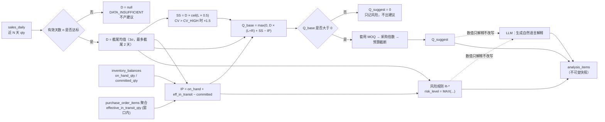

# 库存规则与补货逻辑说明（业务逻辑核心）

> 文档编号：05-workflows / INVENTORY_RULES
> 版本：v1.0（M0 设计阶段）
> 权威来源：`docs/DESIGN_BASIS.md`（SSOT，P0）
> 上游依赖：
> - `docs/DESIGN_BASIS.md §10`（补货公式与默认参数，**权威**）
> - `docs/DESIGN_BASIS.md §11`（库存风险规则，**权威**）
> - `docs/04-ai/ANALYSIS_CONTRACT.md`（输入输出契约、18 个 golden cases、数据质量分级）
> - `docs/04-ai/PROMPT_DESIGN.md`（Prompt、输出 Schema、注入防护、数值溯源）
> - `docs/03-api/AI_SERVICE_CONTRACT.md`（降级契约、数值一致性）
> - `docs/02-database/DATABASE_DESIGN.md §5.15`（`analysis_items` 字段清单）

---

## 0. 本文档的定位（**必读**）

### 0.1 本文档**不重新定义**任何阈值与公式

> **权威定义在 `DESIGN_BASIS.md §10`（补货公式）与 `§11`（风险规则）。**
>
> 本文档只做三件事：
> 1. **业务解释**：把公式翻译成运营能理解的语言、说明边界与直觉；
> 2. **字段映射**：把每个符号落到具体 `表.字段`，并明确回退顺序与"禁止重复计数"；
> 3. **测试用例**：为每条规则补齐"命中边界 / 未命中 / 数据不足"三类用例，作为 M4 验收基线。

**若本文档与 `DESIGN_BASIS §10/§11` 冲突，以 SSOT 为准。** 发现冲突时本文档只标注、不修改 SSOT（见 §13）。

### 0.2 一条铁律

> **LLM 不参与任何数值判定。** 所有 `D` / `SS` / `IP` / `Q_base` / `Q_suggest` / `risk_level` 都由**确定性规则引擎**计算；LLM 只把确定的结果**翻译成人话**。

---

## 1. 补货公式（业务解释）

### 1.1 完整公式（引用 `§10.1`–`§10.5`）

```
① 日均销量：     D  = 截尾移动平均(近 N 天 qty)          // 见 §10.1，N 默认 28
                 （n < MIN_DAYS 时 D = null → 数据不足）

② 安全库存：     SS = D × SS_FACTOR                       // 见 §10.3
                 SS_FACTOR = ceil(L × SAFETY_RATIO)        // SAFETY_RATIO 默认 0.5
                 CV > CV_HIGH 时 SS_FACTOR × 1.5（volatility_adjusted = true）
                 可被 policies.safety_stock_qty 绝对量覆盖

③ 库存位置：     IP = on_hand_qty + effective_in_transit_qty − committed_qty   // §3

④ 基础需求：     Q_base = max(0, D × (L + R) + SS − IP)   // 见 §10.2

⑤ 建议量：       Q_suggest = 套用 MOQ / 采购倍数 / 预算     // 见 §10.5
```

### 1.1.1 计算链路（确定性，LLM 不参与）



### 1.2 符号表与字段映射（**禁止重复计数**）

> 依据 `§10.2`。**每个符号必须落到唯一数据源**，回退顺序不可颠倒。

| 符号 | 含义 | 数据源（按回退顺序） | 回退说明 |
| --- | --- | --- | --- |
| `D` | 日均销量 | 计算值（`§10.1` ← `sales_daily`） | 数据不足时 `null` |
| `L` | 采购交期（天） | ① `replenishment_policies.lead_time_days` → ② `skus.default_lead_time_days` → ③ `suppliers.lead_time_days` → ④ 全局默认 `DEFAULT_LEAD_TIME_DAYS = 7` | 取**第一个非空**；来源写入 `lead_time_source` |
| `R` | 覆盖天数 | `replenishment_policies.coverage_days`，默认 `DEFAULT_COVERAGE_DAYS = 7` | — |
| `SS` | 安全库存 | 计算值（`§10.3`） | 可被 `policies.safety_stock_qty` 覆盖 |
| `on_hand_qty` | 现有库存 | `inventory_balances.on_hand_qty` | 只取**当前仓库**行 |
| `effective_in_transit_qty` | 有效在途 | 由 `purchase_order_items` 聚合（`§10.4`） | **非** `inventory_balances.in_transit_qty`（见 §1.5） |
| `committed_qty` | 已承诺库存 | `inventory_balances.committed_qty` | 首期默认 0 |
| `IP` | 库存位置 | 由上式合成 | **补货只看 `IP`** |
| `MOQ` | 最小起订量 | ① `policies` → ② `skus` → ③ `suppliers` → ④ 默认 1 | 三级来源（`§10.5`） |
| `order_multiple` | 采购倍数 | ① `policies` → ② `skus` → ③ `suppliers` → ④ 默认 1 | 三级来源（`§10.5`） |

**禁止重复计数（`§3.1` 第 2 条）**：`on_hand_qty`、`effective_in_transit_qty`、`committed_qty` **互斥**。同一批货**不得**同时出现在 `on_hand_qty` 与在途里。特别是：

> **已确认到货的货物必须已从在途移出**：在途按 `ordered_qty − received_qty` **派生**，`PURCHASE_INBOUND` 累加 `received_qty` 时在途**自动**减少，无需（也**不得**）去扣 `inventory_balances.in_transit_qty`——该列自 `M6-T10` 起**废弃**（零写零读，见 `DESIGN_REVIEW R178`）。否则同一批货会被 `on_hand_qty` 与在途**各计一次**，导致 `IP` 虚高、补货不足。

### 1.3 `effective_in_transit_qty` 的口径（`§10.4`）

```
effective_in_transit_qty = Σ(poi.ordered_qty − poi.received_qty)
    条件：po.status ∈ {PENDING, ORDERED, PARTIALLY_RECEIVED}
         且 (po.expected_arrival_date IS NULL OR po.expected_arrival_date ≤ today + L + R)
```

**业务直觉**：只把"**预计赶得上这波覆盖窗口**"的在途计入。远期在途（到货日超出 `L + R`）**不计入**，否则会让运营误以为库存充足而少补货。

`expected_arrival_date` 为空 → **保守计入**（视作窗口内）。

### 1.4 安全库存 `SS` 的业务解释（`§10.3`）

```
SS = D × ceil(L × 0.5)      // 约"半个交期"的需求量
CV > 1.0 时 × 1.5（波动越大，缓冲越厚）
policies.safety_stock_qty 若配置 → 直接覆盖（绝对量优先）
```

| 配置 | 含义 | 示例 |
| --- | --- | --- |
| `L = 7` | `SS_FACTOR = ceil(3.5) = 4` | `D = 10` → `SS = 40` |
| `L = 10` | `SS_FACTOR = ceil(5) = 5` | `D = 3` → `SS = 15` |
| 高波动 `CV = 1.5` | `SS_FACTOR = 4 × 1.5 = 6` | `D = 10` → `SS = 60`，`volatility_adjusted = true` |

> ⚠️ 首期为**简化服务水平法**（可直接解释、可测试）。更严谨的 `Z × σ × sqrt(L)` 属待决策 `D-04`。

### 1.5 【重要】原始在途（展示）vs `effective_in_transit_qty`（计算）—— ★ 两口径均派生

> ★ `M6-T10` 裁定（`DESIGN_REVIEW §5.78`）：`inventory_balances.in_transit_qty` 物化列**已废弃**（零写零读）。
> 下表两个口径都由 `purchase_order_items` **派生**，区别只在**是否应用窗口**。

| 维度 | 原始在途（展示口径） | `effective_in_transit_qty`（计算口径） |
| --- | --- | --- |
| 是否落库 | ❌ 查询侧派生（`batchGetInTransit`） | ❌ 查询侧派生（`batchGetEffectiveInTransit`） |
| 是否窗口过滤 | ❌ 不含 | ✅ 含（`§10.4`） |
| 用途 | **展示**（列表页显示"在途 N 件"） | **补货计算**（进入 `IP`） |
| 状态集合 | `{PENDING, ORDERED, PARTIALLY_RECEIVED}` | `{PENDING, ORDERED, PARTIALLY_RECEIVED}` |
| 数据源 | `purchase_order_items`（经 `InTransitFactProvider`） | 同左 |

> **结论**：**补货计算必须用 `effective_in_transit_qty`**，**禁止**用原始在途参与 `IP`（会含远期在途 ⇒ `IP` 虚高 ⇒ 少补货）。
> `INC-P1` / `INC-P2`（`PURCHASING_WORKFLOW.md §10`）已随本裁定关闭：不再有"物化列 vs 派生公式"之争，物化列退役。

---

## 2. `IP` vs `available_qty`（`§3.1` 第 3 条）

| 口径 | 公式 | 是否含在途 | 用途 |
| --- | --- | --- | --- |
| `IP`（Inventory Position） | `on_hand_qty + effective_in_transit_qty − committed_qty` | ✅ 含 | **补货判断** |
| `available_qty` | `on_hand_qty − committed_qty` | ❌ 不含 | **前端展示** |

**业务差异举例**：

> 现有库存 10，在途 8（下周到），承诺 0。
> - `IP = 18` → 补货看的是 18（在途也算可支配）；
> - `available_qty = 10` → 页面显示"可用 10"（顾客马上能买到的）。

**铁律**：**前端禁止用 `available_qty` 参与补货判断**（SSOT `§3.1` 明确）。若误用，会出现"一边显示在途、一边又按现货补货"的双重订货。

---

## 3. 完整计算示例（**可复算，作为 M4 验收样例**）

> 以下示例均为**文档样例，不是可执行数据**（本任务禁止创建数据文件）。所有数值按 `DECIMAL(18,3)`、`ROUND_HALF_UP`。

### 3.1 示例 A：正常情况（不触发 MOQ / 倍数 / 预算）

| 输入 | 值 | 来源 |
| --- | --- | --- |
| `D` | `10.000` | 近 28 天截尾均值 |
| `L` | `7` | `policies.lead_time_days`（`lead_time_source = POLICY`） |
| `R` | `7` | `policies.coverage_days` |
| `on_hand_qty` | `25.000` | `inventory_balances` |
| `effective_in_transit_qty` | `0.000` | 无在途 |
| `committed_qty` | `0.000` | 首期默认 |
| `MOQ` / `order_multiple` | `1` / `1` | 默认 |
| 预算 | 未启用 | — |

**逐步代入**：

```
SS       = D × ceil(L × 0.5) = 10 × ceil(3.5) = 10 × 4 = 40.000
CV       = 0.5  (≤ CV_HIGH 1.0，不上浮)
IP       = 25 + 0 − 0 = 25.000
Q_base   = max(0, 10 × (7+7) + 40 − 25)
         = max(0, 140 + 40 − 25)
         = 155.000
Q_suggest= max(155, 1) = 155；order_multiple = 1 → ceil(155) = 155.000
```

**结果**：`Q_suggest = 155.000`（**未触发任何约束**）。

**风险判定**：
- `R-STOCKOUT`：`on_hand/D = 2.5`，`≤2`? 否；`≤ L(7)`? 是 → **MEDIUM**；
- `R-LOWSTOCK`：`IP 25 < D×(L+R)=140` → **MEDIUM**；
- `risk_level = MAX(MEDIUM, MEDIUM) = MEDIUM`。

---

### 3.2 示例 B：触发 MOQ（`§10.5`）

| 输入 | 值 |
| --- | --- |
| `D` | `3.000` |
| `L` / `R` | `10` / `7` |
| `on_hand_qty` | `5.000` |
| 在途 / 承诺 | `0` / `0` |
| `MOQ` | `100`（来自 `suppliers.lead_time` 同级配置的 MOQ） |
| `order_multiple` | `1` |

**逐步代入**：

```
SS       = 3 × ceil(10 × 0.5) = 3 × 5 = 15.000
IP       = 5.000
Q_base   = max(0, 3 × (10+7) + 15 − 5) = 51 + 15 − 5 = 61.000
基础量   = max(Q_base, MOQ) = max(61, 100) = 100
order_multiple = 1 → Q_suggest = ceil(100) = 100.000
moq_applied = 100.000
```

**结果**：`Q_suggest = 100.000`，**MOQ 放大了 64%**（61 → 100）。

> **业务提示**：当建议量被 MOQ 大幅放大时，前端应显示"MOQ 放大"标签，提示运营"这是供应商起订量所致，不是真实需求"。见 §6.2。

**风险判定**：`on_hand/D = 5/3 = 1.67 ≤ 2` → `R-STOCKOUT` **HIGH** → `risk_level = HIGH`。

---

### 3.3 示例 C：触发采购倍数 + 预算截断（`§10.5`）

| 输入 | 值 |
| --- | --- |
| `D` | `7.000` |
| `L` / `R` | `5` / `7` |
| `on_hand_qty` | `10.000` |
| 在途 / 承诺 | `0` / `0` |
| `MOQ` | `20` |
| `order_multiple` | `10` |
| `budget_limit` | `60` |

**逐步代入**：

```
SS       = 7 × ceil(5 × 0.5) = 7 × 3 = 21.000
IP       = 10.000
Q_base   = max(0, 7 × (5+7) + 21 − 10) = 84 + 21 − 10 = 95.000
基础量   = max(95, 20) = 95
order_multiple = 10 → ceil(95/10) × 10 = 10 × 10 = 100.000
预算检查 : 100 > budget_limit(60) → 截断为 60.000，truncated_by_budget = true
```

**结果**：`Q_suggest = 60.000`，`order_multiple_applied = 10.000`，`truncated_by_budget = true`。

> ⚠️ **业务张力（需产品确认）**：截断后的 60 **不是 10 的整数倍**，破坏了采购倍数约束。首期按 SSOT 公式执行（先套倍数、后截断），但**建议**在 UI 提示"预算截断后不满足采购倍数，请人工调整"，并登记待决策（见 §13.2 `建议新增 D-44`）。

**风险判定**：`on_hand/D = 10/7 = 1.43 ≤ 2` → `R-STOCKOUT` **HIGH** → `risk_level = HIGH`。

---

## 4. MOQ 与采购倍数的转换（`§10.5`）

### 4.1 转换逻辑

```
输入：Q_base、MOQ、order_multiple、qty_step（可选）、budget_limit_remaining（可选）

若 Q_base <= 0:
    Q_suggest = 0            // 不生成建议，仅记录风险
否则:
    基础量 = max(Q_base, MOQ)
    若 order_multiple > 1:
        Q_suggest = ceil(基础量 / order_multiple) × order_multiple
    否则:
        Q_suggest = ceil(基础量)          // 取整到 1 个单位（精度见 qty_step）

    若 Q_suggest > budget_limit_remaining:
        Q_suggest = budget_limit_remaining
        truncated_by_budget = true
```

### 4.2 边界：`Q_base` 很小但 MOQ 很大

**结论**：**仍然生成建议**，但必须**标注"MOQ 放大"**。

| 场景 | 处理 |
| --- | --- |
| `Q_base = 2`，`MOQ = 100` | `Q_suggest = 100`，`moq_applied = 100`，前端标"MOQ 放大（真实需求 2，起订 100）" |
| `Q_base = 0`（`IP` 充足） | **不生成建议**（即使 MOQ 存在） |
| `MOQ` 三级都为空 | 默认 `1`（不放大） |

> **理由**：MOQ 是供应商硬约束，不能因为"需求小于 MOQ"就放弃补货；但也不能让运营误判需求，所以**标注**而非**隐藏**。

### 4.3 倍数与取整

| 场景 | 处理 |
| --- | --- |
| `order_multiple = 1` | 向上取整到 1 个单位 |
| `order_multiple = 10`，`基础量 = 95` | `Q_suggest = 100` |
| 有 `qty_step`（如 0.5 拆零 SKU） | 取整到 `qty_step` 的整数倍（`§10.5` 注释） |
| 预算截断后 | **可能不满足倍数**（见 §3.3 张力） |

---

## 5. 业务问题处理手册（13 个场景）

> 本节回答任务书 §7.2 的 13 个业务问题。每项给出：**是否支持首期 / 系统行为 / 输出标记 / 未来扩展**。

| # | 业务问题 | 首期是否支持 | 系统行为 | 输出标记 | 未来扩展 |
| --- | :-: | --- | --- | --- | --- |
| 1 | **历史数据不足** | ✅（降级） | `n < MIN_DAYS(7)` → `D = null`，不产建议 | `DATA_INSUFFICIENT`、`risk_level = UNKNOWN`、`data_quality = INSUFFICIENT` | 冷启动模型 |
| 2 | **高销量波动** | ✅ | `CV > CV_HIGH(1.0)` → `SS` 上浮 50% | `volatility_adjusted = true` | 改用 `Z×σ×√L`（`D-04`） |
| 3 | **近期突增/突降** | ⚠️ 仅提示 | `R-SALESANOMALY` 命中 → 仅提示，**不做修正** | `SALES_ANOMALY`、`risk_level ≥ LOW` | 趋势外推（`D-03`） |
| 4 | **促销异常** | ❌ 不修正 | 同 #3，只提示；**不识别促销、不剔除** | `SALES_ANOMALY` | 促销日历（`§11.2`） |
| 5 | **无历史记录的新品** | ✅（降级） | `n = 0` → 同 #1 | `DATA_INSUFFICIENT`、`UNKNOWN` | 同类目迁移学习 |
| 6 | **SKU 已停用** | ✅（排除） | `skus.status = INACTIVE`（`MasterDataStatus`，见 `DESIGN_BASIS.md §9.4`）**不纳入分析** | 无（不产生 `analysis_items`） | 历史归档分析 |
| 7 | **零库存** | ✅ | `D > 0` 且 `on_hand ≤ 0` → `R-STOCKOUT` **HIGH** | `STOCKOUT`、`HIGH` | — |
| 8 | **在途采购** | ✅ | `effective_in_transit_qty` 计入 `IP`（窗口过滤） | `in_transit_qty` / `effective_in_transit_qty` 快照 | 多供应商在途 |
| 9 | **已有未完成补货建议** | ⚠️ 见 §5.1 | **不在公式中扣减**，靠 `SUPERSEDED` 去重 | — | 见 §5.1 / `D-43` |
| 10 | **供应商交期未知** | ✅ | `L` 回退到 `DEFAULT_LEAD_TIME_DAYS = 7` | `lead_time_source = DEFAULT` | 交期自学习 |
| 11 | **MOQ** | ✅ | `基础量 = max(Q_base, MOQ)` | `moq_applied` + "MOQ 放大"标签 | 分供应商 MOQ |
| 12 | **采购倍数** | ✅ | 向上取整到倍数 | `order_multiple_applied` | — |
| 13 | **采购预算限制** | ✅（可选） | 默认不启用；启用后截断 | `truncated_by_budget = true` | 多周期预算分配 |

### 5.1 【重点问题】已有未完成补货建议，是否要扣减以避免重复补货？

> **这是 13 个问题中最容易实现错误、也最容易造成"重复补货"资金损失的一个。**

**结论**：**首期不在公式中扣减"已有未完成建议"的数量。** 理由与风险如下。

#### 5.1.1 现状拆解（关键：分清"已转采购"与"未转采购"）

| 建议状态 | 是否已变库存 | 是否已进 `effective_in_transit_qty` | 是否会重复补货 |
| --- | --- | --- | --- |
| `SUGGESTED` | ❌ | ❌ | 会被新一轮分析置 `SUPERSEDED`，**不重复** |
| `PENDING_REVIEW` | ❌ | ❌ | 会被新一轮分析置 `SUPERSEDED`，**不重复** |
| `APPROVED`（未转采购） | ❌ | ❌ | ⚠️ **不会被取代**（`§9.11` 禁止 `APPROVED → SUPERSEDED`），**存在重复风险** |
| `CONVERTED` | ❌（尚未到货） | ✅ 已计入在途 | `IP` 已含，**不重复** |

#### 5.1.2 为什么首期不扣减

1. **`CONVERTED` 已在 `IP` 中**：已转采购的建议对应 `purchase_order_items`，其 `ordered − received` 已通过 `effective_in_transit_qty` 进入 `IP`，**天然去重**，无需再扣；
2. **`SUGGESTED`/`PENDING_REVIEW` 由 `SUPERSEDED` 去重**：新一轮分析会把它们作废并回填 `superseded_by_item_id`（`REPLENISHMENT_WORKFLOW.md §6.4.1`），**天然去重**；
3. **扣减会引入"建议量"作为公式输入**：而建议量是**人工可改**的（`replenishment_items.qty`），把它作为 `IP` 的减项会让"分析结果依赖人工数据"，破坏 `analysis_items` 的**不可变快照**语义与可复现性（P10/P12）；
4. **首期团队 SKU 量有限**（`MAX_ANALYSIS_SKUS = 2000`），运营可在建议列表**按 SKU 聚合**发现重复，人工合并到同一张采购单（`DATABASE_DESIGN.md §6-G` 场景②：多建议合并成一张采购单**天然支持**）。

#### 5.1.3 风险与缓解

| 风险 | 说明 | 缓解 | 待决策 |
| --- | --- | --- | --- |
| `APPROVED` 未转采购期间又生成新建议 | 两条建议指向同一 SKU，若都被转采购 → 重复采购 | ① 建议列表**按 SKU 聚合**展示并高亮"存在其他未完成建议"；② 转采购时若发现同 SKU 有 `APPROVED` 建议未转，**提示**（未来可强校验） | **建议新增 `D-43`** |

> **若未来要扣减**，正确做法是：在**分析输入组装阶段**（Java 侧）计算 `pending_replenishment_qty = Σ(APPROVED 未转采购的建议量)`，并作为 `IP` 的额外减项传入 Python（**不污染 `inventory_balances`**）。这需要先明确"建议量是否属于可利用库存"的产品定义。

---

## 6. 风险识别规则（`§11`，**权威在 SSOT**）

> 规则引擎为**确定性**计算，输出写入 `analysis_items`。**LLM 不参与任何判定**。
> 每条规则至少 3 个测试用例：**命中边界 / 未命中 / 数据不足**。以下用例与 `ANALYSIS_CONTRACT.md` 的 golden cases（GC-01…GC-18）互为补充。

### 6.1 规则明细

#### 6.1.1 `R-STOCKOUT` 缺货风险

| 项 | 内容 |
| --- | --- |
| 业务意图 | 现货撑不过交期，随时断货 |
| 输入 | `on_hand_qty`、`D`、`L` |
| 判定 | `D > 0 AND on_hand <= 0` → `HIGH`；`on_hand / D <= 2` → `HIGH`；`on_hand / D <= L` → `MEDIUM` |
| 输出 | `risk_types += STOCKOUT` |

**伪代码**：

```
if D is null:                          → 数据不足，跳过（由 R-DATAINSUFFICIENT 处理）
elif D > 0 and on_hand <= 0:           → STOCKOUT, HIGH
elif on_hand / D <= 2:                 → STOCKOUT, HIGH
elif on_hand / D <= L:                 → STOCKOUT, MEDIUM
else:                                  → 未命中
```

**测试用例**：

| # | 类型 | 输入 | 期望 | 对应 golden |
| --- | --- | --- | --- | --- |
| T1 | 命中边界 | `D=5.000`, `on_hand=10.000`（`/D=2.000`） | `STOCKOUT` **HIGH** | GC-03 |
| T2 | 未命中 | `D=2.000`, `on_hand=100.000`（`/D=50 > L`） | 未命中 | — |
| T3 | 数据不足 | `D=null`（`n=6`） | 跳过 | GC-09 |

---

#### 6.1.2 `R-LOWSTOCK` 低库存

| 项 | 内容 |
| --- | --- |
| 业务意图 | 总可支配量（含在途）不足以覆盖交期 + 覆盖期 |
| 输入 | `IP`、`D`、`L`、`R` |
| 判定 | `IP < D × (L + R)` → `MEDIUM`（**与 `R-STOCKOUT` 可同时命中**，见本节末尾裁定说明） |
| 输出 | `risk_types += LOW_STOCK` |

**伪代码**：

```
if D is null:                          → 跳过
elif IP < D * (L + R):                 → LOW_STOCK, MEDIUM
else:                                  → 未命中
```

**测试用例**：

| # | 类型 | 输入 | 期望 | 对应 golden |
| --- | --- | --- | --- | --- |
| T1 | 命中边界 | `D=2.000`, `L=R=7`, `IP < 28`（如 `IP=20`） | `LOW_STOCK` **MEDIUM** | GC-04 |
| T2 | 未命中 | `IP=100 ≥ D×(L+R)=28` | 未命中 | GC-01 |
| T3 | 数据不足 | `D=null` | 跳过 | GC-09 |

> ✅ **已裁定（M0 审查）**：`R-LOWSTOCK` 与 `R-STOCKOUT` **可以同时命中**——`risk_types` 是数组而非单值，同时命中时 `risk_level` 取较高者。SSOT `§11` 中原有的「且不满足 `R-STOCKOUT`」表述**已删除**。本档与 golden case **GC-02** 的呈现即为最终口径。

---

#### 6.1.3 `R-OVERSTOCK` 库存过高

| 项 | 内容 |
| --- | --- |
| 业务意图 | 库存可卖天数远超合理范围，占用资金 |
| 输入 | `on_hand_qty`、`D`、`OVERSTOCK_DAYS` |
| 判定 | `D > 0 AND on_hand / D > OVERSTOCK_DAYS` → `MEDIUM`；`> 2 × OVERSTOCK_DAYS` → `HIGH` |
| 输出 | `risk_types += OVERSTOCK` |

**测试用例**：

| # | 类型 | 输入 | 期望 | 对应 golden |
| --- | --- | --- | --- | --- |
| T1 | 命中边界（MEDIUM） | `D=1.000`, `on_hand=95.000`（`/D=95 > 90`） | `OVERSTOCK` **MEDIUM** | GC-05 |
| T2 | 命中边界（HIGH） | `D=1.000`, `on_hand=181.000`（`/D=181 > 180`） | `OVERSTOCK` **HIGH** | GC-06 |
| T3 | 未命中 | `D=1.000`, `on_hand=30.000`（`/D=30 ≤ 90`） | 未命中 | — |
| T4 | 数据不足 | `D=null` | 跳过 | — |

---

#### 6.1.4 `R-SLOWMOVING` 滞销

| 项 | 内容 |
| --- | --- |
| 业务意图 | 有库存但近期几乎不动 |
| 输入 | 近 `SLOW_MOVING_DAYS` 天总销量、`on_hand_qty` |
| 判定 | 近 30 天总销量 = 0 **且** `on_hand_qty > 0` → `MEDIUM` |
| 输出 | `risk_types += SLOW_MOVING` |

**测试用例**：

| # | 类型 | 输入 | 期望 | 对应 golden |
| --- | --- | --- | --- | --- |
| T1 | 命中 | 近 30 天销量 = 0，`on_hand = 50` | `SLOW_MOVING` **MEDIUM** | GC-07 |
| T2 | 未命中 | 近 30 天销量 = 3（>0） | 未命中 | — |
| T3 | 边界（无库存） | 近 30 天销量 = 0，`on_hand = 0` | 未命中（`on_hand > 0` 不满足） | — |

---

#### 6.1.5 `R-SALESANOMALY` 销量异常

| 项 | 内容 |
| --- | --- |
| 业务意图 | 近期销量相对历史显著波动（可能促销/断货），提醒人工关注 |
| 输入 | 近 7 天日均 vs 前 21 天日均与标准差 |
| 判定 | `|近7天日均 − 前21天日均| > ANOMALY_SIGMA × 前21天标准差` **且** 变化率 > 50% → `LOW`（**仅提示**） |
| 输出 | `risk_types += SALES_ANOMALY` |

**测试用例**：

| # | 类型 | 输入 | 期望 | 对应 golden |
| --- | --- | --- | --- | --- |
| T1 | 命中 | 近 7 天日均 10，前 21 天日均 2，std 1，变化率 > 50% | `SALES_ANOMALY`，`risk_level ≥ LOW` | GC-08 |
| T2 | 未命中 | 近 7 天日均 2.5，前 21 天日均 2，std 4 | 未命中 | — |
| T3 | 数据不足 | 前 21 天无数据（`n < 21`） | 跳过 | 见 §6.3 |

---

#### 6.1.6 `R-DATAINSUFFICIENT` 数据不足

| 项 | 内容 |
| --- | --- |
| 业务意图 | 数据太少，任何结论都不可靠，**宁可不建议** |
| 输入 | 有效天数 `n`、`MIN_DAYS` |
| 判定 | `n < MIN_DAYS(7)` → `UNKNOWN`，`D = null`，**不生成补货建议**，仅记录 |
| 输出 | `risk_types += DATA_INSUFFICIENT` |

**测试用例**：

| # | 类型 | 输入 | 期望 | 对应 golden |
| --- | --- | --- | --- | --- |
| T1 | 命中（`n<7`） | 窗口内 6 天有数据 | `UNKNOWN`，`DATA_INSUFFICIENT`，`D=null`，`q_suggest=null` | GC-09 |
| T2 | 命中边界（`n=0`） | 无销售数据 | 同 T1 | GC-10 |
| T3 | 未命中边界 | `n=7`（恰好等于 `MIN_DAYS`） | **不出** `DATA_INSUFFICIENT`，正常计算 | — |

---

### 6.2 风险等级合并与前端展示

**合并规则**（`§11.1`）：

```
risk_level = MAX(各规则命中等级)          // NONE < LOW < MEDIUM < HIGH
UNKNOWN 仅当【所有】规则都因数据不足无法判定时使用
```

> **注意**：`UNKNOWN` **不是** `MAX` 能产生的值，它在**全部规则都无法判定**时兜底。

**前端展示映射**（后端语义色，与股票涨跌色**无关**）：

| `risk_level` | 语义 | 建议展示色 | 文案 |
| --- | --- | --- | --- |
| `HIGH` | 高风险 | 🔴 红 | "缺货/积压风险高" |
| `MEDIUM` | 中风险 | 🟠 橙 | "需要关注" |
| `LOW` | 低风险（仅提示） | 🔵 蓝 | "仅供提示" |
| `UNKNOWN` | 数据不足 | ⚪ 灰 | "历史数据不足，暂不建议" |
| `NONE` | 无风险 | ⚪ 无 | 不显示标签 |

> ⚠️ 前端**不得**把 `UNKNOWN` 显示为"无风险"或绿色 —— 它的语义是"无法判断"，误显示会导致运营以为库存健康。

**多条规则命中时的详请**：`analysis_items.risk_detail_json` 记录"规则代码 → 判定值"，用于结果页展开解释与测试断言。

### 6.3 首期不支持的业务场景（明确提示，不猜测）（`§11.2`）

| 场景 | 处理 |
| --- | --- |
| 新商品无历史销量 | 提示 `DATA_INSUFFICIENT`，不建议 |
| 供应商交期未知 | 用默认值并标注 `lead_time_source = DEFAULT` |
| 促销期销量异常 | 只提示 `SALES_ANOMALY`，**不做促销修正** |
| 跨仓调拨建议 | 不支持 |
| 多供应商比价 | 不支持 |

---

## 7. LLM 职责边界

> LLM 是**解释器**，不是**决策器**。以下为**硬边界**（对应 `PROMPT_DESIGN.md` 的约束）。

| # | LLM **禁止**做的事 | 说明 |
| --- | --- | --- |
| 1 | **编造数字** | 解释文本中出现的任何数字必须来自输入契约，否则 `VALIDATION_FAILED` |
| 2 | **修改确定性结果** | 不得改写 `D` / `Q_base` / `Q_suggest` / `risk_level` |
| 3 | **越权审批** | 不得输出"建议批准/驳回"等决策语；审核权在 `APPROVER` |
| 4 | **变更库存** | 不得触发任何库存写操作（LLM 无写通道） |
| 5 | **创建采购单** | 不得触发转采购 |
| 6 | **把缺失数据伪装成真实数据** | 数据不足时必须如实说明，不得补全 |
| 7 | **引入外部知识** | 不得引用未提供的市场/竞品信息作为判断依据 |

**LLM 允许做的事**：
- 把已算好的风险等级、建议量、命中规则**翻译成运营能懂的中文**；
- 指出"为什么这样建议"（引用 `risk_detail_json` 中的判定值）；
- 给出**不改变数值**的操作提示（如"可考虑与供应商确认交期"）。

### 7.1 结构化输出 Schema

- 输出必须是**结构化 JSON**，字段与 `analysis_items` / 输出契约一一对应；
- 完整 Schema、字段约束、注入防护、数值溯源校验规则见 **`PROMPT_DESIGN.md`** 与 **`ANALYSIS_CONTRACT.md §输出契约`**；
- **数值一致性**：Java↔Python 间小数以**字符串**传输（`AI_SERVICE_CONTRACT.md §数值一致性`），避免浮点误差。

---

## 8. 降级方案

> 完整降级矩阵见 `AI_SERVICE_CONTRACT.md §8`。此处给出业务视角。

| 失败点 | 系统行为 | 业务影响 | 前端文案 |
| --- | --- | --- | --- |
| 规则计算成功 + LLM 成功 | `SUCCEEDED` | 结果 + 解释齐全 | 正常展示 |
| 规则计算成功 + LLM 失败/超时/校验失败 | `DEGRADED` | **计算结果有效**，仅缺解释 | "解释生成失败，计算结果有效，可重试解释" |
| 规则计算成功 + 全部 SKU 数据不足 | `SUCCEEDED` + `llm_status = SKIPPED` | 无建议，仅风险记录 | "所选数据不满足分析条件" |
| 全局数据质量预检未过 | **不创建 run** → `ANL-7008` | 无结果 | "所选数据不满足分析条件：有效数据不足" |
| 规则计算失败 | `FAILED` | 无结果 | "分析失败，请重试" |
| 超时 | `TIMEOUT` | 无结果，可发新 run | "分析超时，请重试" |

**核心约定**：**`DEGRADED` 是"业务可用"的状态**，前端**禁止**显示"分析失败"（否则用户会误弃结果）。

---

## 9. 阈值配置边界（可配置 vs 硬编码）

> 依据 `§10.6`。原则：**影响业务策略的 → 可配置；影响算法正确性的 → 硬编码写死**，避免过度配置导致不可复现。

| 参数 | 默认值 | 可配置位置 | 是否可配置 | 理由 |
| --- | --- | --- | --- | --- |
| `N`（统计窗口） | 28 | 分析请求 `params.window_days` | ✅ | 业务策略 |
| `MIN_DAYS` | 7 | 分析请求 / 服务默认 | ✅ | 业务策略 |
| `DEFAULT_LEAD_TIME_DAYS` | 7 | 服务默认（M1 起配置项） | ✅（M1） | 缺省值 |
| `DEFAULT_COVERAGE_DAYS`（`R`） | 7 | 分析请求 / 策略表 | ✅ | 业务策略 |
| `SAFETY_RATIO` | 0.5 | 服务默认 | ⚠️ | 影响 `SS` 正确性，**首期固定**，变更需回归 golden cases |
| `CV_HIGH` | 1.0 | 服务默认 | ⚠️ | 同上 |
| `SLOW_MOVING_DAYS` | 30 | 服务默认 | ✅（M1） | 业务策略 |
| `OVERSTOCK_DAYS` | 90 | 服务默认 | ✅（M1） | 业务策略 |
| `ANOMALY_SIGMA` | 2.0 | 服务默认 | ⚠️ | 算法参数，固定 |
| `MAX_ANALYSIS_SKUS` | 2000 | 服务默认 | ❌ | **硬编码**（防资源耗尽，`ANL-7007`） |
| 3σ 截尾上限（最多截尾 2 天） | 2 | 服务默认 | ❌ | **硬编码**（算法定义的一部分，`§10.1`） |
| `ROUND_HALF_UP` / `DECIMAL(18,3)` | — | 全局 | ❌ | **硬编码**（精度一致性，`§14`） |
| 分析超时 | 300s | 服务默认 | ⚠️ | 可调但需与 `timeout_at` 一致 |

**禁止**：把这些参数做成"每个团队随意改"的开箱配置——会导致同一数据在不同团队得到不同结果，破坏可复现性与跨团队对账。

---

## 10. 规则版本控制与可复现性

### 10.1 版本标识

| 标识 | 位置 | 说明 |
| --- | --- | --- |
| 算法版本 `algorithm_version` | `analysis_runs.algorithm_version` | 如 `avg-ma-3sigma-v1`（`§10.1`） |
| 规则集版本 | 建议随 `analysis_runs` 记录（**建议新增字段，见 §13.2 `D-45`**） | 如 `risk-rules-v1` |
| Prompt 版本 | `PROMPT_DESIGN.md` 定义 | 解释文本版本 |

### 10.2 可复现性要求（P12）

1. **相同输入 ⇒ 相同输出**：同一 `sales_daily` + 余额 + 策略 + 参数 + `algorithm_version` → 必得相同的 `analysis_items`（**LLM 关闭时逐字段一致**）；
2. **快照不可变**：`analysis_items` 写入后不可改（无 `updated_at` 列），要"重算"必须发**新 run**；
3. **输入可追溯**：`analysis_items` 保存了 `on_hand_qty` / `in_transit_qty` / `D` / `L` / `R` / `SS` / `IP` / `cv` 等**全部输入与中间量快照**，可离线复算；
4. **规则明细可追溯**：`risk_detail_json` 保存每条规则的判定值。

### 10.3 验收用例清单

| 来源 | 数量 | 用途 |
| --- | --- | --- |
| `ANALYSIS_CONTRACT.md` golden cases | 18（GC-01…GC-18） | **固定输入 → 固定输出，逐字段断言**（`enable_llm=false` 时 `llm_*` 恒空/`SKIPPED`） |
| 本文档 §3 计算示例 | 3（A/B/C） | 公式代入基线 |
| 本文档 §6 规则用例 | 20 | 每条规则"命中边界 / 未命中 / 数据不足" |
| 本文档 §11 小样本 | 5 SKU | M4 端到端验收基线 |

### 10.4 额外业务验收用例（建议补充，超出 18 个 golden cases）

| 编号 | 场景 | 期望 |
| --- | --- | --- |
| BA-01 | 已有 `CONVERTED` 建议（在途 20），再次分析 | `IP` 含在途，**不重复建议** |
| BA-02 | 已有 `APPROVED` 未转采购建议，再次分析 | 生成新建议（首期行为），**列表按 SKU 聚合提示** |
| BA-03 | SKU 停用 | 不产生 `analysis_items` |
| BA-04 | 跨仓同一 SKU | 每个仓库独立一条 `analysis_items` |
| BA-05 | 预算截断后不满足倍数 | `truncated_by_budget = true`，UI 提示（`D-44`） |

---

## 11. 附录：完整工作示例（5-SKU 小样本）

> **仅文档表格，不创建任何数据文件**（本任务硬性约束）。作为 M4 验收基线：给定下表输入，应得下表输出。

### 11.1 统一参数

```
N = 28, MIN_DAYS = 7, L = 7, R = 7, SAFETY_RATIO = 0.5
→ SS_FACTOR = ceil(7 × 0.5) = 4
CV 均 ≤ 1.0（不上浮）, committed_qty = 0, 无在途
预算：仅 SKU-05 启用（budget_limit = 60）
```

### 11.2 输入与预期输出

| SKU | 场景 | `D` | `on_hand` | `IP` | `SS` | `Q_base` | `MOQ` | `order_multiple` | `Q_suggest` | `truncated` | `risk_types` | `risk_level` |
| --- | --- | --: | --: | --: | --: | --: | --: | --: | --: | :-: | --- | --- |
| SKU-01 | 热销充足 | 6.250 | 200.000 | 200.000 | 25.000 | 0.000 | 1 | 1 | **null（不出建议）** | false | — | `NONE` |
| SKU-02 | 缺货高风险 | 6.250 | 8.000 | 8.000 | 25.000 | 104.500 | 1 | 1 | **104.500** | false | `STOCKOUT`, `LOW_STOCK` | `HIGH` |
| SKU-03 | 数据不足 | `null` | 40.000 | 40.000 | — | `null` | — | — | **`null`（不出建议）** | false | `DATA_INSUFFICIENT` | `UNKNOWN` |
| SKU-04 | MOQ 放大 | 3.000 | 5.000 | 5.000 | 12.000 | 49.000 | 100 | 1 | **100.000** | false | `STOCKOUT` | `HIGH` |
| SKU-05 | 倍数 + 预算截断 | 7.000 | 10.000 | 10.000 | 28.000 | 116.000 | 20 | 10 | **60.000** | **true** | `STOCKOUT` | `HIGH` |

### 11.3 关键复算（供验收断言）

```
SKU-01: SS=6.25×4=25 ; Q_base = max(0, 6.25×14 + 25 − 200) = max(0, −87.5) = 0     → 不建议
SKU-02: Q_base = 6.25×14 + 25 − 8 = 87.5 + 17 = 104.5                              → 104.5（无 MOQ/倍数）
SKU-03: n=5 < 7 → D=null → 不建议，仅记 UNKNOWN
SKU-04: SS=3×4=12 ; Q_base = 3×14 + 12 − 5 = 42 + 7 = 49 → max(49,100)=100         → 100（MOQ 放大）
SKU-05: SS=7×4=28 ; Q_base = 7×14 + 28 − 10 = 98 + 18 = 116
        → ceil(116/10)×10 = 120 → 预算 60 < 120 → 60，truncated_by_budget = true
```

### 11.4 预期聚合

| 指标 | 值 |
| --- | --- |
| 分析 SKU 数 | 5 |
| 产生建议数 | 3（SKU-02 / 04 / 05） |
| 无建议数 | 2（SKU-01 需求为 0；SKU-03 数据不足） |
| 高风险数 | 3（SKU-02 / 04 / 05） |
| 数据不足数 | 1（SKU-03） |
| 预计采购总量 | `104.500 + 100.000 + 60.000 = 264.500` |

---

## 12. 变更日志

| 版本 | 日期 | 变更 | 作者 |
| --- | --- | --- | --- |
| v1.0 | 2026-10-14 | 首版：公式业务解释与字段映射、3 个计算示例、`IP` vs `available_qty`、13 个业务问题处理手册（含"是否扣减未完成建议"结论）、6 条风险规则与 20 个测试用例、LLM 边界、降级、阈值配置边界、版本控制与 5-SKU 验收基线 | 业务分析师 / 流程设计负责人 |

---

## 13. 一致性标注（**不改 SSOT**）

### 13.1 发现的不一致

| # | 不一致 | 涉及文档 | 建议 |
| --- | --- | --- | --- |
| ~~INC-R1~~ | **已解决**：`R-LOWSTOCK` 与 `R-STOCKOUT` 是否互斥 | **裁定为可共存**（与 GC-02 一致）；SSOT `§11` 已删除「且不满足 `R-STOCKOUT`」条件 | 已落实于 `DESIGN_BASIS §11` |
| INC-R2 | **`in_transit_qty` 派生 vs 物化**（同 `PURCHASING_WORKFLOW §12.1 INC-P1`），且口径状态集 `§3`(`ORDERED/PENDING`) ≠ `§10.4`(`PENDING/ORDERED/PARTIALLY_RECEIVED`) | `DESIGN_BASIS §3` vs `§10.4` vs `DATABASE_DESIGN §5.9` | 统一口径，并明确"补货只用 `§10.4`" |
| INC-R3 | ✅ **已闭环**：`DataQualityGrade`（`GOOD`/`FAIR`/`POOR`/`INSUFFICIENT`）已由 `DESIGN_BASIS §9.17` 定义 | `ANALYSIS_CONTRACT.md` vs `DESIGN_BASIS §9.17` | 已固化于 `§9.17`（旧编号 `D-14` 作废） |
| INC-R4 | ✅ **已闭环**：`LeadTimeSource`（`POLICY`/`SKU`/`SUPPLIER`/`DEFAULT`）已由 `DESIGN_BASIS §9.17` 定义 | `DESIGN_BASIS §10.2`/`§11.2` vs `§9.17` | 已固化于 `§9.17`（旧编号 `D-14` 作废） |
| INC-R5 | **预算截断破坏采购倍数约束**：`§10.5` 先套倍数再截断，截断后 `Q_suggest` 可能非 `order_multiple` 整数倍 | `DESIGN_BASIS §10.5` 内部 | 明确"截断优先于倍数"或"截断后回退到最近的倍数"，见 `D-44` |
| INC-R6 | **`SS` 采用值字段名**：`analysis_items` 用 `safety_stock_qty`，`§10.3` 用 `SS`，`policies.safety_stock_qty` 为覆盖项，三者同名易混 | `DATABASE_DESIGN §5.15` vs `DESIGN_BASIS §10.3` | 文档中明确"`analysis_items.safety_stock_qty` = 采用的 `SS`，与 `policies.safety_stock_qty` 语义不同" |

### 13.2 建议新增待决策项

| 建议编号 | 议题 | 可选方案 | 影响 |
| --- | --- | --- | --- |
| **建议新增 `D-43`** | 是否在补货公式中扣减"已 `APPROVED` 未 `CONVERTED` 的建议量" | ① 首期不扣减，靠列表聚合提示（本文档默认）；② 作为 `IP` 额外减项（需先定义"建议量属不属于可利用库存"） | 影响重复采购风险与公式输入纯净度 |
| **建议新增 `D-44`** | 预算截断与采购倍数的优先级 | ① 截断优先，破坏倍数（现状）；② 截断后回退到最近倍数（`floor` 到倍数）；③ 预算与倍数冲突时**不截断**并提示 | 影响采购可执行性 |
| **建议新增 `D-45`** | 是否在 `analysis_runs` 增加 `rules_version` 字段 | ① 新增（推荐，规则集单独版本化）；② 复用 `algorithm_version` | 影响可复现性与回归定位 |
| ~~建议新增 `D-46`~~ | `R-LOWSTOCK` 与 `R-STOCKOUT` 的互斥关系 | **已在 M0 审查中裁定，不作为待决策**：可共存（`risk_types` 为数组，`risk_level` 取较高者） | 已落实于 `DESIGN_BASIS §11` |
