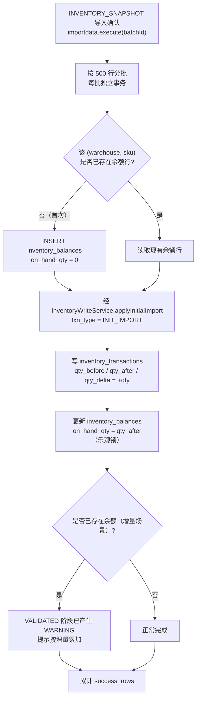
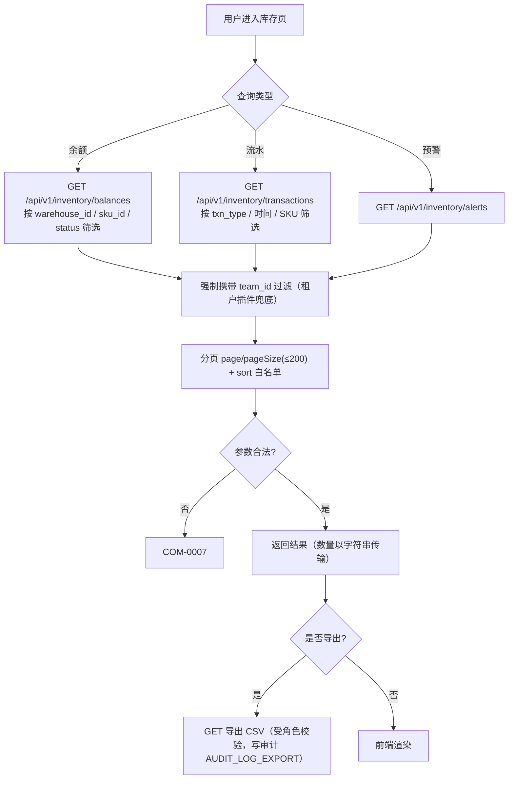
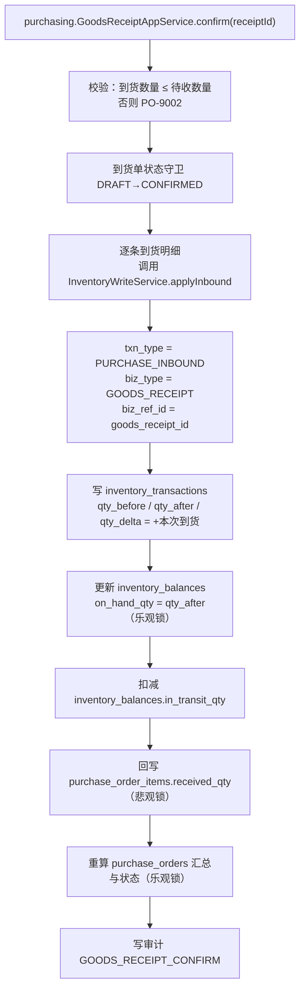
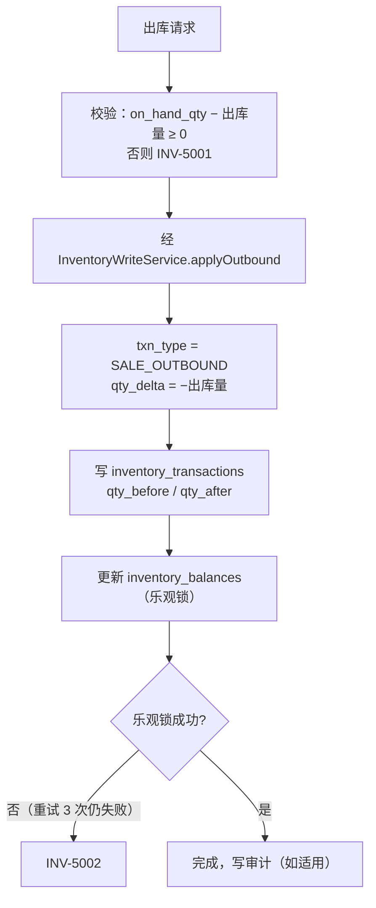
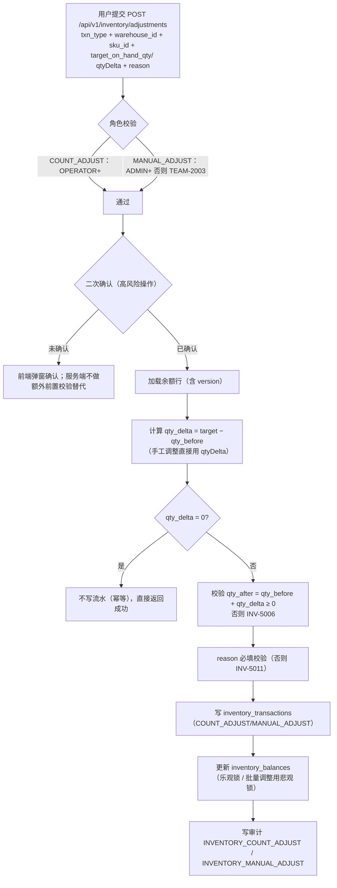
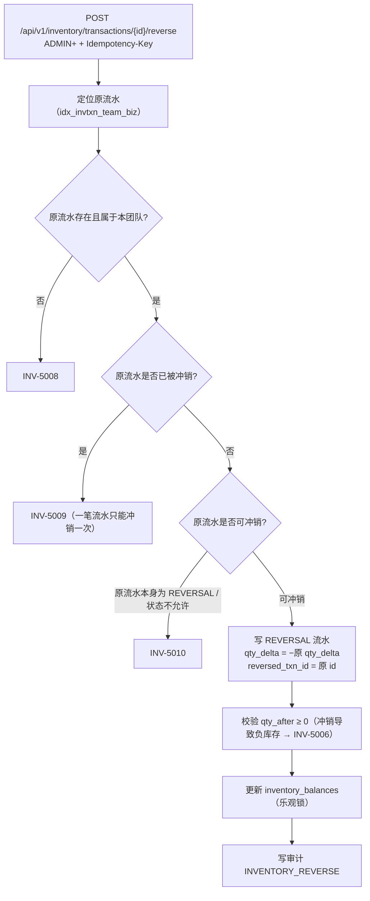
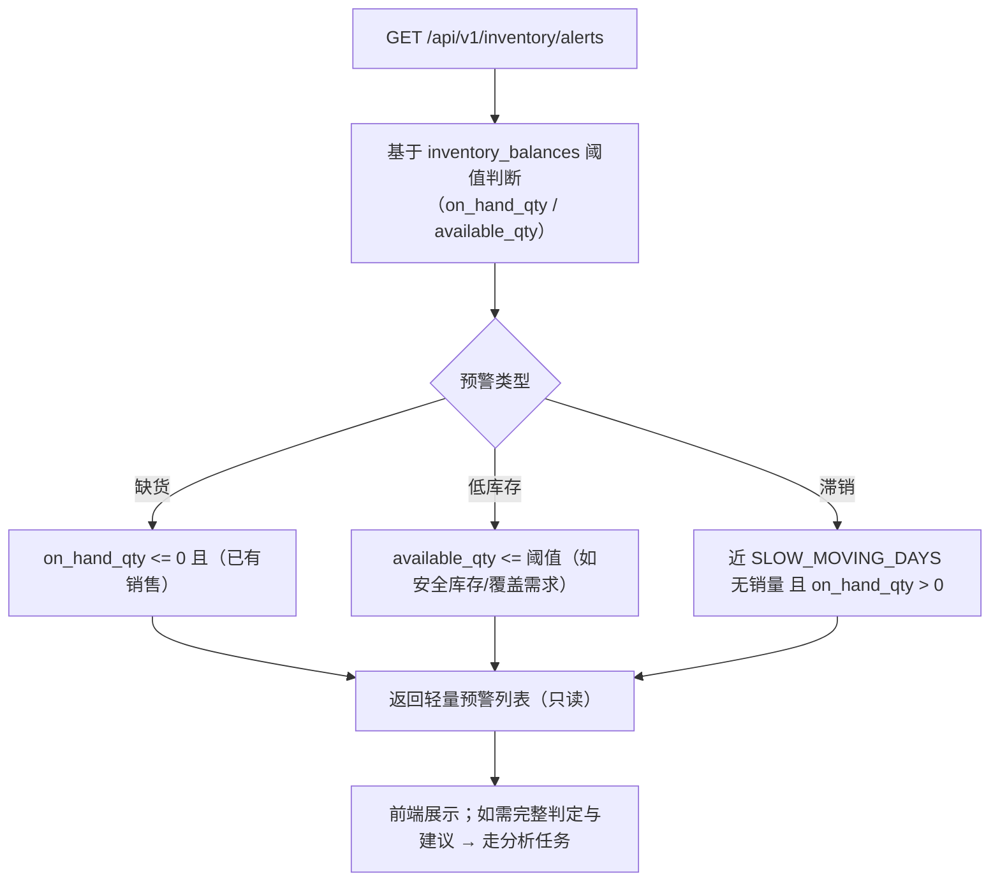
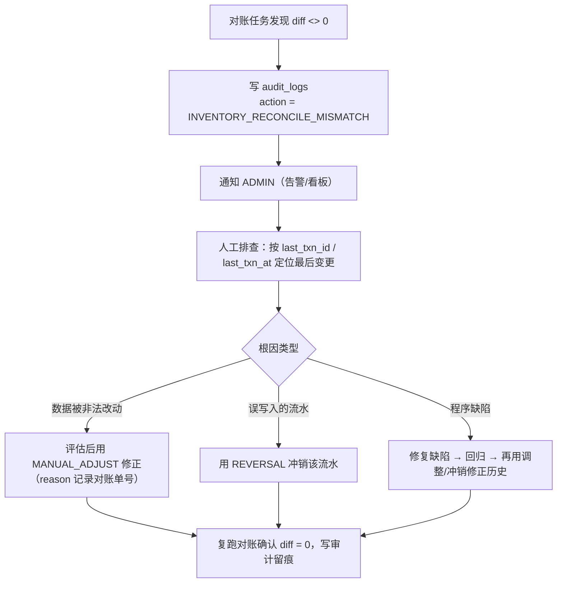

# ShopPilot AI 库存管理流程（INVENTORY_WORKFLOW）

> **文档路径**：`docs/05-workflows/INVENTORY_WORKFLOW.md`
> **文档优先级**：P4（见 `DESIGN_BASIS.md §1.1`）
> **上游权威来源（SSOT）**：`docs/DESIGN_BASIS.md`（术语 §3、团队隔离 §6、模块 §7、表 §8、状态枚举 §9、错误码 §12、精度 §14）
> **同级引用**：`docs/02-database/DATABASE_DESIGN.md`（§5.9 / §5.10 / §5.8 / §6-C / §7.2）、`docs/03-api/API_CONTRACT.md`（§10.4 / §11.4）、`docs/03-api/ERROR_CODES.md`、`docs/00-product/USER_ROLES.md`（§2.2 / §2.3 / §4.4）、`docs/01-architecture/MODULE_BOUNDARIES.md`（§2.5 / §5）
> **阶段**：M0 设计阶段

---

## 1. 文档职责与范围

| 本文档负责 | 本文档不负责 |
| --- | --- |
| 库存的**业务子流程**：初始导入、查询、入库、出库、盘点/调整、冲销、预警 | 补货公式与风险规则（见 `INVENTORY_RULES.md`） |
| 库存**变更的权限与二次确认**、**一致性保障**、**并发方案**、**事务边界** | 采购到货的业务编排（见 `PURCHASING_WORKFLOW.md`） |
| 与导入、采购两个上游/下游流程的衔接点 | 表字段逐列定义（见 `DATABASE_DESIGN.md §5.9`/`§5.10`） |

**SSOT 引用声明**：本文档**不重新定义** `InventoryTxnType`（`§9.6`）、库存量术语（`§3`）、错误码（`§12`）。术语权威定义见 `DESIGN_BASIS.md §3`，本文档只做**展示口径与更新时机**的补充说明。

---

## 2. 参与角色

| 角色 | 库存能力 | 依据 |
| --- | --- | --- |
| `OWNER` / `ADMIN` | 全部（含手工调整 `MANUAL_ADJUST`、冲销 `REVERSAL`） | `USER_ROLES.md §2.3` |
| `APPROVER` | 查看 + 盘点调整（`COUNT_ADJUST`）；**不可**手工调整/冲销 | `USER_ROLES.md §2.3` |
| `OPERATOR` | 查看 + 盘点调整（`COUNT_ADJUST`）；**不可**手工调整/冲销 | `USER_ROLES.md §2.3` |
| `VIEWER` | 只读查看 | `USER_ROLES.md §2.2` #5 |

> **权限收窄（重要例外）**：`DESIGN_BASIS.md §9.6` 规定 `MANUAL_ADJUST` **需 `ADMIN`+**；`USER_ROLES.md §2.3` 进一步规定 `REVERSAL` 亦需 `ADMIN`+。本文档 §6 给出完整矩阵。

---

## 3. 涉及表与接口

### 3.1 涉及表（`inventory` 模块拥有，`DESIGN_BASIS.md §7.1`）

| 表名 | 用途 |
| --- | --- |
| `inventory_balances` | SKU×仓库的当前库存状态（现有 / 在途 / 已承诺 / 可用） |
| `inventory_transactions` | 库存变更的**不可变账本**，仅 INSERT |
| `replenishment_policies` | SKU×仓库补货参数（`L`/`R`/`SS`/MOQ/倍数/窗口） |

### 3.2 涉及接口（路径权威见 `API_CONTRACT.md §10.4`）

| 方法 | 路径 | 说明 |
| --- | --- | --- |
| GET | `/api/v1/inventory/balances` | 库存余额列表 |
| GET | `/api/v1/inventory/transactions` | 库存流水列表 |
| GET | `/api/v1/inventory/transactions/{id}` | 单笔流水详情 |
| POST | `/api/v1/inventory/transactions/{id}/reverse` | 冲销某笔流水（`REVERSAL`，`ADMIN`+） |
| POST | `/api/v1/inventory/adjustments` | 盘点调整（`COUNT_ADJUST`）/ 手工调整（`MANUAL_ADJUST`），按 `txn_type` 区分 |
| GET | `/api/v1/inventory/alerts` | 库存预警列表 |
| PUT | `/api/v1/replenishment-policies` | 补货策略全量 upsert（关联本流程参数） |

### 3.3 唯一写入口（硬约束）

> **所有库存变更必须经 `InventoryWriteService`**（`MODULE_BOUNDARIES.md §9` 检查项 6；`SYSTEM_ARCHITECTURE.md §5` 边界 8）。**任何模块不得直接 `UPDATE inventory_balances`**。

`InventoryWriteService`（`MODULE_BOUNDARIES.md §2.5`）方法：

| 方法 | 对应 `InventoryTxnType` |
| --- | --- |
| `applyInitialImport(...)` | `INIT_IMPORT` |
| `applyInbound(...)` | `PURCHASE_INBOUND` |
| `applyOutbound(...)` | `SALE_OUTBOUND` |
| `applyCountAdjust(...)` | `COUNT_ADJUST` |
| `applyManualAdjust(...)` | `MANUAL_ADJUST` |
| `applyReversal(...)` | `REVERSAL` |

---

## 4. 库存核心模型说明

> **术语定义只引用不复述**：`on_hand_qty` / `in_transit_qty` / `committed_qty` / `available_qty` / `effective_in_transit_qty` / `IP` 的**定义**见 `DESIGN_BASIS.md §3` 与 `§3.1`。下表只说明**展示口径**与**更新时机**。

| 量 | 字段 / 计算 | 是否落库 | 前端展示口径 | 更新时机 | 是否参与补货 |
| --- | --- | --- | --- | --- | --- |
| 现有库存 | `on_hand_qty` | 落库（`§5.9`） | 直接展示 | **只能由流水驱动**（同事务写 `inventory_transactions` + 更新余额） | 参与（经 `IP`） |
| 在途库存 | `in_transit_qty` | 落库 | 展示"在途" | **由采购单驱动**（创建/确认收货/取消时增减），**不产生库存流水** | 不直接参与；经 `effective_in_transit_qty` |
| 已承诺库存 | `committed_qty` | 落库（首期默认 0） | 展示"已承诺" | 由业务占用/释放驱动（首期仅保留通道） | 参与（经 `IP` 扣减） |
| 可用库存 | `available_qty = on_hand − committed` | **`STORED` 生成列** | 展示"可用" | 随 `on_hand_qty`/`committed_qty` 自动维护 | **禁止参与补货判断**（`§3.1` 第 3 条） |
| 有效在途 | `effective_in_transit_qty` | **不落库**（快照进 `analysis_items`） | 不直接展示（可在分析明细中查看） | 查询侧按 `§10.4` 窗口过滤计算 | 参与（经 `IP`） |
| 库存位置 | `IP = on_hand + eff_in_transit − committed` | **不落库**（快照进 `analysis_items.inventory_position_qty`） | 不直接展示 | 分析时计算并快照固化 | **补货判断唯一口径** |

> **铁律**（`§3.1`）：① 三量含义互斥，任何公式不得重复计入同一批货；② 前端禁止用 `available_qty` 参与补货判断。详见 `INVENTORY_RULES.md §3.3`。

---

## 5. 子流程

### 5.1 子流程一：初始库存导入

**入口**：`INVENTORY_SNAPSHOT` 导入（`IMPORT_WORKFLOW.md §7.5`）→ 数据落库时调用 `InventoryWriteService.applyInitialImport(...)`。



| 步骤 | 执行方 | 输入 | 输出 | 状态变化 | 事务边界 | 失败处理 | 接口/入口 |
| --- | --- | --- | --- | --- | --- | --- | --- |
| 1 | Java | 已 `VALIDATED` 的 `INVENTORY_SNAPSHOT` 批次 | 待落库行 | 批次 `IMPORTING` | 单事务（状态守卫） | 状态不符 → `IMP-4005` | `POST /api/v1/import/batches/{id}/confirm` |
| 2 | Java | 单批 500 行 | 余额行 + 流水 | — | **分批事务** | 单批失败不影响其他批 | 内部 |
| 3 | Java | `applyInitialImport(skuId, warehouseId, qty, batchId, idempotencyKey)` | `INIT_IMPORT` 流水 + 余额更新 | — | 同步骤 2 事务 | 幂等冲突 → `INV-5003`；并发 → `INV-5002`；缺失引用 → `CAT-3001`/`CAT-3003` | 内部 |

**首次导入 vs 重复导入（结论）**

> **结论：默认按增量处理（追加一条 `INIT_IMPORT` 流水），不覆盖已有余额；需要"以本次快照为准"时走盘点调整（`COUNT_ADJUST`）。**

- **理由**：`inventory_balances` 是**可推导物化状态**，只能由流水驱动（`DATABASE_DESIGN.md §5.9` 设计要点 2）；若直接覆盖 `on_hand_qty` 而不写流水，将破坏"余额可由流水推导"（`§3.1` 第 4 条）与对账能力。
- **对重复导入的处理**：`INVENTORY_SNAPSHOT` 命中已存在余额行 → 在 `VALIDATED` 阶段产生 **`WARNING`（`IMP-4006`）**"该 `(仓库, SKU)` 已有库存记录，本次将**按数量增量累加**；如需以快照为准请使用盘点调整"。
- **幂等**：流水幂等键 `<txn_type>:<biz_type>:<biz_ref_id>:<sku_id>`（`biz_type = IMPORT`，`biz_ref_id = batch_id`），同一批次重复确认不重复累加；冲突且内容不一致 → `INV-5003`。
- **负库存**：`INIT_IMPORT` 只会增加，不会触发 `INV-5006`。

---

### 5.2 子流程二：库存查询



| 步骤 | 输入 | 输出 | 状态变化 | 事务边界 | 失败处理 | 接口 |
| --- | --- | --- | --- | --- | --- | --- |
| 1 | 筛选条件（`warehouse_id`/`sku_id`/`txn_type`/`dateFrom`/`dateTo`） | 分页 `list` + `total` | 无 | **只读事务**（`readOnly=true`） | `COM-0007`（分页/排序/日期非法）；跨团队 → `TEAM-2001` | `GET /balances`、`GET /transactions`、`GET /alerts` |
| 2 | 流水 ID | 单笔流水详情 | 无 | 只读事务 | `INV-5008`（不存在） | `GET /transactions/{id}` |
| 3 | 筛选条件 | CSV 文件 | 无 | 只读事务 | 同步骤 1 | 导出接口（P1） |

**查询规范**

- **分页**：`page ≥ 1`，`pageSize ∈ 1..200`（超 → `COM-0007`）；`sort` 字段白名单外 → `COM-0007`（`API_CONTRACT.md §2.2`）。
- **展示字段**：`balances` 返回 `on_hand_qty` / `in_transit_qty` / `committed_qty` / `available_qty` / `last_txn_at` / `version`；`sku_code` 为 JOIN 展示字段（非余额表列）。
- **`GET` 绝不产生副作用**（不写库、不写审计、不触发分析，`API_CONTRACT.md §1.2`）。
- **导出**：`GET`，`text/csv; charset=utf-8`；导出行为写审计（`DATABASE_DESIGN.md §6-J`，P1）。

---

### 5.3 子流程三：入库（`PURCHASE_INBOUND`）

> **边界声明（重要）**：本流程**只提供写入口** `InventoryWriteService.applyInbound(...)`；**业务触发方是 `purchasing`**（确认到货），方向为 `purchasing → inventory`，**不可反向**（`DESIGN_BASIS.md §7.1`；`MODULE_BOUNDARIES.md §1.3`）。



| 步骤 | 执行方 | 输入 | 输出 | 状态变化 | 事务边界 | 失败处理 |
| --- | --- | --- | --- | --- | --- | --- |
| 1 | Java（`purchasing`） | 到货单 `DRAFT` + 明细 | 校验结果 | 到货单 `DRAFT→CONFIRMED` | **单事务**（含库存写入） | 超额 → `PO-9002`；状态不许 → `PO-9003` |
| 2 | Java（`inventory`） | `applyInbound(skuId, warehouseId, qty, GOODS_RECEIPT, receiptId, idempotencyKey)` | `PURCHASE_INBOUND` 流水 + 余额 | — | 复用步骤 1 事务（`REQUIRED`） | 并发 → `INV-5002`；重复 → `INV-5003` |
| 3 | Java（`purchasing`） | 本次到货量 | `received_qty` 累加、采购单状态重算 | 采购单 `ORDERED/PARTIALLY_RECEIVED→PARTIALLY_RECEIVED/RECEIVED` | 同事务 | 见 `PURCHASING_WORKFLOW.md §8` |

- **幂等键**：`PURCHASE_INBOUND:GOODS_RECEIPT:<receipt_id>:<sku_id>`（`DATABASE_DESIGN.md §6-I.2`）；粒度按 SKU，一项到货明细对应一条流水。
- **在途扣减**：确认到货时同步减少 `in_transit_qty`（`in_transit_qty` 由采购单驱动，但**不在本流程产生流水**，见 §4）。

---

### 5.4 子流程四：出库（`SALE_OUTBOUND`）



| 步骤 | 输入 | 输出 | 状态变化 | 事务边界 | 失败处理 | 接口 |
| --- | --- | --- | --- | --- | --- | --- |
| 1 | `sku_id`、`warehouse_id`、出库量 | 出库结果 | — | **单事务** | 库存不足 → `INV-5001`；并发 → `INV-5002`；重复 → `INV-5003` | `InventoryWriteService.applyOutbound(...)`（首期无独立对外出库接口） |

**首期出库的触发方式（结论）**

> **结论：首期不提供独立的"销售出库"对外接口；`SALE_OUTBOUND` 作为受控写入口预留，由 `inventory` 的写服务暴露，首期仅用于内部/演示与测试路径。** 依据：

1. `DESIGN_BASIS.md §2.1` Out of Scope：首期**不做真实电商平台 API 对接**；销售数据以**日粒度导入**（`sales_daily`），不产生订单级出库事件。
2. `DATABASE_DESIGN.md §7.2` #2 将"库存出库"标注为"**销售出库，预留**"。
3. 库存实际减少首期主要来自**盘点调整**与**冲销**；`SALE_OUTBOUND` 保留完整实现与校验（`INV-5001`），以便未来接入订单流时无需改模型。
4. **不允许负库存**（`D-08`）：出库路径在应用层先校验，DB 层 `CHECK (on_hand_qty >= 0)` 兜底。

---

### 5.5 子流程五：盘点与库存调整（`COUNT_ADJUST` / `MANUAL_ADJUST`）



| 步骤 | 输入 | 输出 | 状态变化 | 事务边界 | 失败处理 | 接口 |
| --- | --- | --- | --- | --- | --- | --- |
| 1 | 调整单（`txn_type`/`warehouse_id`/`sku_id`/`target_on_hand_qty`/`reason`） + `Idempotency-Key` | 流水 ID、`qty_before`/`qty_after`、`balance_version` | 无（库存流水为新增） | **单事务** | `INV-5002`/`INV-5003`/`INV-5005`/`INV-5006`/`INV-5011`、`TEAM-2003` | `POST /api/v1/inventory/adjustments` |

**调整单结构**（与 `API_CONTRACT.md §11.4` 请求 B 一致）：

| 字段 | 说明 |
| --- | --- |
| `warehouse_id` / `sku_id` | 目标（须同团队） |
| `txn_type` | `COUNT_ADJUST` / `MANUAL_ADJUST` |
| `target_on_hand_qty` | 盘点后的目标现有库存（`COUNT_ADJUST`） |
| `expected_version` | 期望余额版本（乐观锁；不一致 → `INV-5002`） |
| `reason` | 调整原因，**必填**（否则 `INV-5011`） |
| `occurred_at` | 业务发生时间 |

**审批要求**

- **盘点调整（`COUNT_ADJUST`）**：`OPERATOR`+ 可执行，**需二次确认**（前端弹确认框；服务端做前置校验）。对应 `USER_ROLES.md §2.3` 与 §4.4。
- **手工调整（`MANUAL_ADJUST`）**：**`ADMIN`+**（`DESIGN_BASIS.md §9.6`），否则 `TEAM-2003`（`ERROR_CODES.md` 亦提供 `INV-5007` 语义）；**需二次确认**；`reason` 必填。
- **差异记录**：`qty_delta`、`qty_before`、`qty_after`、`reason` 全部落 `inventory_transactions`（不可变）；`MANUAL_ADJUST` 与 `COUNT_ADJUST` 分别写审计 `INVENTORY_MANUAL_ADJUST` / `INVENTORY_COUNT_ADJUST`（`DATABASE_DESIGN.md §6-J.1` #11/#12）。
- **批量调整**（同一 SKU 多行）：**悲观锁** `SELECT ... FOR UPDATE`（见 §8.2），跨 SKU 按 `sku_id` 升序加锁**防死锁**（`DATABASE_DESIGN.md §7.2` #3）。

---

### 5.6 子流程六：库存流水查询与冲销（`REVERSAL`）



| 步骤 | 输入 | 输出 | 状态变化 | 事务边界 | 失败处理 | 接口 |
| --- | --- | --- | --- | --- | --- | --- |
| 1 | 原流水 ID + `reason` + `Idempotency-Key` | 新 `REVERSAL` 流水 ID | — | **单事务** | `INV-5008`/`INV-5009`/`INV-5010`/`INV-5006`、`TEAM-2003` | `POST /api/v1/inventory/transactions/{id}/reverse` |

**一笔流水只能冲销一次的约束**

- **应用层**：冲销前校验不存在 `reversed_txn_id = 原 id` 的流水（`SELECT` 或唯一约束冲突捕获）。
- **DB 层（建议新增）**：`uk_invtxn_team_reversed (team_id, reversed_txn_id)`（可空列上的唯一索引允许多行 `NULL`）——该索引**未在 `DESIGN_BASIS.md §8` 列出**，属 `DATABASE_DESIGN.md §7.2` #10 新增建议，登记 `D-13`。并发双冲销由该唯一索引兜底 → 重复冲销返回 `INV-5009`（`ERROR_CODES.md §2.6`）。
- **原流水保持不动**：纠错只写反向流水（`inventory_transactions` 永不 UPDATE/DELETE，`§5.10`）。

---

### 5.7 子流程七：库存预警



| 步骤 | 输入 | 输出 | 状态变化 | 事务边界 | 失败处理 | 接口 |
| --- | --- | --- | --- | --- | --- | --- |
| 1 | 筛选条件 | 预警列表 | 无 | **只读事务** | 无 | `GET /api/v1/inventory/alerts` |

**预警 vs 风险规则（`§11`）的区分（避免功能重叠）**

| 维度 | 库存预警（本子流程） | 风险规则（`DESIGN_BASIS.md §11`） |
| --- | --- | --- |
| 定位 | **基于库存阈值的轻量判断**，即时可见 | **分析任务的完整判定**（含 `D`、`IP`、`L`、`R`、波动、异常） |
| 数据依赖 | 仅 `inventory_balances`（当前值） | 销售序列 + 库存口径 + 策略参数（`D`/`IP`/`L`/`R`/`SS`） |
| 产出 | 预警条目（无状态、不落库） | `analysis_items.risk_types` / `risk_level`（**落库快照，不可变**） |
| 触发方式 | 用户打开页面即查询（按需） | 用户创建 `analysis_runs` → Java→Python 计算 |
| 是否影响补货 | **不影响**（不参与补货计算） | 风险与 `Q_suggest` 同源产出 |
| 关系 | 预警是"快速提示"，风险规则是"完整判定"；**两者不共用代码路径，预警不得替代风险判定** | — |

> 预警/风险展示应避免对同一 SKU 给出矛盾结论：预警面向"当前量"，风险规则面向"含预测窗口的可支配量"（`IP`）。前端应明确标注口径来源。

---

## 6. 权限与确认矩阵

> 引用 `USER_ROLES.md §2.2` 与 `§2.3`（库存调整按 `InventoryTxnType` 细分）。

| 库存操作 | `InventoryTxnType` | `OWNER` | `ADMIN` | `OPERATOR` | `APPROVER` | `VIEWER` | 是否二次确认 |
| --- | --- | --- | --- | --- | --- | --- | --- |
| 查看余额 / 流水 / 预警 | — | ✅ | ✅ | ✅ | ✅ | ✅ | 否 |
| 初始库存导入 | `INIT_IMPORT` | ✅ | ✅ | ✅ | ✅ | ❌ | 否（导入确认本身有序） |
| 采购入库 | `PURCHASE_INBOUND` | ✅ | ✅ | ✅ | ✅ | ❌ | 由到货单确认承担 |
| 销售出库 | `SALE_OUTBOUND` | ✅ | ✅ | ✅ | ✅ | ❌ | 首期无独立接口（见 §5.4） |
| 盘点调整 | `COUNT_ADJUST` | ⚠️ | ⚠️ | ⚠️ | ⚠️ | ❌ | **是** |
| 手工调整 | `MANUAL_ADJUST` | ⚠️ | ⚠️ | ❌ | ❌ | ❌ | **是**（且需 `ADMIN`+） |
| 冲销 | `REVERSAL` | ⚠️ | ⚠️ | ❌ | ❌ | ❌ | **是**（且需 `ADMIN`+） |
| 补货策略 upsert | — | ✅ | ✅ | ✅ | ✅ | ❌ | 否 |

- ⚠️ = 可执行但为**高风险操作**，服务端必须做额外前置校验（`USER_ROLES.md §4.4`）。
- 「❌ → `TEAM-2003`」；跨团队 → `TEAM-2001`（**先于角色判定**，`USER_ROLES.md §4.1`）。
- **库存调整必须 `ADMIN`+ 的场合**：`MANUAL_ADJUST` 与 `REVERSAL`（`DESIGN_BASIS.md §9.6` 备注 + `USER_ROLES.md §2.3`）。

---

## 7. 库存一致性保障

### 7.1 三重保障（`DATABASE_DESIGN.md §6-C.4`）

| 保障 | 手段 | 时机 |
| --- | --- | --- |
| ① 同事务写入 | 流水 INSERT 与余额 UPDATE 在**同一本地事务**（`REQUIRED`、`READ COMMITTED`），无跨服务调用 | 每次变更 |
| ② DB 自证约束 | `CHECK (qty_after = qty_before + qty_delta)`、`CHECK (qty_after >= 0)`、`CHECK (on_hand_qty >= 0)` | 每次写入 |
| ③ 定期对账任务 | 每日低峰跑对账 SQL，比对余额快照与流水累加，不一致告警并写 `audit_logs`（`action = 'INVENTORY_RECONCILE_MISMATCH'`） | 定时 |

### 7.2 `qty_before` / `qty_after` 的写入时机

统一由 `InventoryWriteService.applyTransaction(...)` 完成，步骤固定（`DATABASE_DESIGN.md §6-C.2`）：

1. 定位余额行（`team_id + warehouse_id + sku_id`）。
2. **乐观锁**读取（`version`）。
3. 校验 `qty_after = qty_before + qty_delta >= 0`（否则出库 `INV-5001` / 调整·冲销 `INV-5006`）。
4. **写流水**：`qty_before = 余额当前 on_hand_qty`、`qty_after = qty_before + qty_delta`。
5. `UPDATE inventory_balances SET on_hand_qty = qty_after, last_txn_id = ?, last_txn_at = ?, version = version + 1 WHERE id = ? AND version = ?`。
6. 检查影响行数 = 1；否则抛 `INV-5002` 并由调用方重试（最多 3 次，指数退避）。

> **即 `qty_before`/`qty_after` 在"持有余额行锁或乐观锁成功之后"写入**，用余额当值作为 `qty_before`，保证 `txn.qty_after == balance.on_hand_qty`。

### 7.3 对账校验思路

> ⚠️ **以下 SQL 为示例片段，未在 MySQL 中执行验证**（与 `DATABASE_DESIGN.md §6-C.4` 一致）。

```sql
-- ⚠️ 示例片段，未在 MySQL 中执行验证
-- 目的：找出「余额快照」与「流水累加」不一致的 (team_id, warehouse_id, sku_id)
SELECT b.team_id, b.warehouse_id, b.sku_id,
       b.on_hand_qty                      AS balance_qty,
       COALESCE(SUM(t.qty_delta), 0)      AS txn_sum,
       b.on_hand_qty - COALESCE(SUM(t.qty_delta), 0) AS diff
FROM inventory_balances b
LEFT JOIN inventory_transactions t
       ON t.team_id      = b.team_id
      AND t.warehouse_id = b.warehouse_id
      AND t.sku_id       = b.sku_id
WHERE b.on_hand_qty <> 0 OR t.id IS NOT NULL
GROUP BY b.team_id, b.warehouse_id, b.sku_id, b.on_hand_qty
HAVING diff <> 0;
```

- **只报告、不自动修复**：自动修复会掩盖 bug。修复必须人工确认后走 `MANUAL_ADJUST` / `REVERSAL` 流水（保留证据）。
- 辅助定位：`inventory_balances.last_txn_id` / `last_txn_at` 让差异能立刻定位到"最后一次变更"。

### 7.4 发现不一致时的人工处置流程



---

## 8. 并发方案

### 8.1 乐观锁 `version` 重试（主路径，本项目结论）

- **重试策略**：冲突 → 重试 **3 次**，**指数退避 20ms / 50ms / 120ms**；仍失败 → 返回 **`INV-5002`**（HTTP 409），前端提示刷新后重试（`DATABASE_DESIGN.md §7.1`、`§6-C.5`）。
- **适用**：单笔库存变更（入库、出库、单条调整）。理由：库存写入是**短事务 + 低冲突概率但高热点可能性**，乐观锁平均延迟与吞吐更优。
- **前端**：对 `INV-5002` 提供"重试"按钮（`DATABASE_DESIGN.md §10` R1）。

### 8.2 何时用 `SELECT ... FOR UPDATE`（本项目结论）

> **结论："以乐观锁为主、悲观锁为例外、唯一约束兜底幂等"。**

悲观锁**仅用于必须串行化的场景**（`DATABASE_DESIGN.md §6-C.5`）：

| 场景 | 锁方案 | 理由 |
| --- | --- | --- |
| 盘点批量调整同一 SKU 的多行 | **悲观锁** `SELECT ... FOR UPDATE`（跨 SKU 按 `sku_id` 升序加锁防死锁） | 逐行乐观锁重试会被放大（N 行 × 3 次） |
| `purchase_order_items.received_qty` 累加（见 `PURCHASING_WORKFLOW.md`） | **悲观锁** | "读-改-写累加"，批量收货下乐观锁失败率极高 |
| 其余单笔变更 | **乐观锁** | 无长事务、无行锁等待、重试粒度小 |

> **为何不全面悲观锁**：持有行锁到事务结束；导入/批量入库会长时间锁定热点 SKU；首期未引入 Redis（`D-07`），应用层扩缩容下锁竞争更差。

### 8.3 幂等键使用

- 表：`inventory_transactions`；约束：`uk_invtxn_team_idem (team_id, idempotency_key)`（`§8`）。
- **构造规则**：`<txn_type>:<biz_type>:<biz_ref_id>:<sku_id>[:<suffix>]`（`DATABASE_DESIGN.md §5.10` 设计要点 4）；对盘点/手工调整追加操作人 + 时间戳。
- **禁止**用 `UUID` 作为业务幂等键（那样永不冲突，等于没有幂等）。
- **命中行为**：内容一致 → 返回原流水并视为成功（HTTP 200）；内容不一致 → **`INV-5003`**（409）。
- **对外接口**：客户端可传任意随机 `Idempotency-Key`，服务端映射为该业务构造键（`API_CONTRACT.md §6.1`）。
- **并发首次建行**：两个请求同时插入同一 `(team_id, wh, sku)` 余额行 → 一个成功、一个撞 `uk_invbal_team_wh_sku` → **捕获后改为读取再走乐观锁路径**（不报错，`§6-C.6`）。

---

## 9. 事务边界表

> 来源：`DATABASE_DESIGN.md §7.2`。所有事务边界落在 `application` 层的 `*AppService`（`§4.2`、`§7.1`）。

| # | 操作 | 事务边界 | 主要步骤（同一本地事务） | 锁策略 | 回滚条件 / 冲突行为 |
| --- | --- | --- | --- | --- | --- |
| 1 | 初始库存导入（分批） | `ImportBatchAppService.importData()` 每批 | 首行插入 + `INIT_IMPORT` 流水 + 余额更新 | 唯一约束 + 乐观锁 | 单批失败回滚该批，不影响其他批 |
| 2 | 采购入库 | `GoodsReceiptAppService.confirm()` | 到货单状态守卫 + 每条：流水 INSERT + 余额 UPDATE + `in_transit_qty` 扣减 + `poi.received_qty` + 采购单汇总与状态 | 状态守卫 + 悲观锁（`poi`）+ 余额乐观锁 | 超额 `PO-9002`；余额冲突 `INV-5002`（重试 3 次） |
| 3 | 销售出库 | `InventoryWriteService.applyOutbound()` | 校验 `on_hand − qty ≥ 0` + `SALE_OUTBOUND` 流水 + 余额 UPDATE | 余额乐观锁 | 库存不足 `INV-5001`；并发 `INV-5002` |
| 4 | 盘点调整 | `InventoryCountAppService.adjust()` | 批量读目标余额 + 逐行差额 + `COUNT_ADJUST` 流水 + 余额 UPDATE | 同一 SKU 多行：悲观锁；跨 SKU 升序加锁 | 差额 0 → 不写流水（幂等）；冲突 `INV-5002` |
| 5 | 手工调整 | `InventoryWriteService.applyManualAdjust()` | 权限（`ADMIN`+）+ `reason` 必填 + `MANUAL_ADJUST` 流水 + 余额 UPDATE + 审计 | 余额乐观锁 | 原因缺失 `COM-0001`/`INV-5011`；无权限 `TEAM-2003` |
| 6 | 库存冲销 | `InventoryReversalAppService.reverse()` | 定位原流水 + 校验未冲销 + `REVERSAL` 流水 + 余额 UPDATE | 余额乐观锁 + 原流水唯一性（`reversed_txn_id` 唯一索引） | 重复冲销 `INV-5009`；导致负库存 `INV-5006` |
| 7 | 策略 upsert | `ReplenishmentPolicyAppService.upsert()` | 同团队校验 + `INSERT ... ON DUPLICATE KEY UPDATE` + 审计 | 唯一约束 `uk_pol_team_sku_wh` | 冲突被 upsert 吸收（无错误） |

- **隔离级别**：`READ COMMITTED`（`§7.1`；避免 `REPEATABLE READ` 的间隙锁在"按 team_id 范围查询 + 插入"路径上死锁）。
- **事务时长**：单事务 ≤ 500 行 / 100ms 量级（`§7.1`）。
- **跨模块传播**：`InventoryWriteService` 用 `REQUIRED`，**不自行提交/回滚外层事务**（`§7.1`）。

---

## 10. 与 SSOT / 其它文档的不一致与待决策

| # | 位置 | 现象 | 处理 / 建议 |
| --- | --- | --- | --- |
| 1 | `DESIGN_BASIS.md §5` vs `§9.6` | `§5` 将"库存调整"整体列入 `OPERATOR` 权限概述，而 `§9.6` 规定 `MANUAL_ADJUST` 需 `ADMIN`+ | **与 `DESIGN_BASIS.md §5` 表述未尽一致，建议修订**（`USER_ROLES.md §7.3` 第 1 条已登记）。本文档 §6 按 `§9.6` 细化。 |
| 2 | `DATABASE_DESIGN.md §7.2` #10 | "一笔流水只能冲销一次"的 DB 级唯一约束 `uk_invtxn_team_reversed` 未在 `§8` 列出 | **属 `§8` 之外新增约束建议**，登记 `D-13`。本文档 §5.6 引用。 |
| 3 | `DESIGN_BASIS.md §9.6` | `inventory_transactions.biz_type` 取值（`GOODS_RECEIPT`/`COUNT`/`MANUAL`/`IMPORT`/`SALE`/`REVERSAL`）未在 `§9` 定义 | **与 `DESIGN_BASIS.md §9` 未覆盖，建议补充 `InventoryBizType`**，登记 `D-14`（`DATABASE_DESIGN.md §8` #20）。 |
| 4 | `DESIGN_BASIS.md §9` | `LeadTimeSource`（`POLICY`/`SKU`/`SUPPLIER`/`DEFAULT`）未定义 | 建议补充，登记 `D-14`。 |
| 5 | 待决策编号冲突 | `DATABASE_DESIGN.md §11.2` 的 `D-09`（导入幂等槽位列）与 `USER_ROLES.md §7.2` 的 `D-09`（四眼原则）冲突 | **跨文档编号冲突**，建议改号并统一登记到 `DESIGN_BASIS.md §15`。 |
| 6 | 出库触发方式 | SSOT 未定义首期出库的对外入口 | 本文档明确"首期无独立出库接口、`SALE_OUTBOUND` 为预留写入口"（§5.4），属**新增设计结论**，建议在 `DESIGN_BASIS.md §15` 或 ADR 备案。 |

### 10.1 引用的既有待决策

| 编号 | 出处 | 与本文档的关系 |
| --- | --- | --- |
| `D-02` | `DESIGN_BASIS.md §15` | 多仓库（同团队多仓）：数据模型支持但 UI 只暴露默认仓；影响本流程的 `warehouse_id` 必填策略 |
| `D-05` | `DESIGN_BASIS.md §15` | 审计日志独立 DB 账号；影响库存变更审计的强制手段 |
| `D-07` | `DESIGN_BASIS.md §15` | 是否引入 Redis；决定库存并发方案能否使用分布式锁 |
| `D-08` ✅ **已裁定** | `DESIGN_BASIS.md §15` / §15.1 | **不允许负库存**（`on_hand_qty >= 0` 约束 + 各写路径应用层校验 + DB `CHECK` 兜底）；本文档 §5.4/§7 直接依赖 |
| `D-13` | `DATABASE_DESIGN.md §11.2` | `uk_invtxn_team_reversed` 唯一索引；§5.6 冲销唯一性 |
| `D-14` | `DATABASE_DESIGN.md §11.2` | `InventoryBizType` / `LeadTimeSource` 等枚举补充 |
| `D-15` | `DATABASE_DESIGN.md §11.2` | `inventory_transactions` 保留期与归档策略 |
| `D-16` | `DATABASE_DESIGN.md §11.2` | 业务编号生成策略（不影响本流程的幂等键构造） |

---

## 11. 变更记录

| 日期 | 变更 | 依据 |
| --- | --- | --- |
| M0 | 初版创建：核心模型口径表、7 个子流程（含 Mermaid 与步骤表）、权限与确认矩阵、一致性保障（含对账 SQL 示例）、并发方案、事务边界表、不一致与待决策 | `DESIGN_BASIS.md`、`DATABASE_DESIGN.md §5.8/§5.9/§5.10/§6-C/§7.2`、`API_CONTRACT.md §10.4/§11.4`、`USER_ROLES.md §2.2/§2.3/§4.4` |
