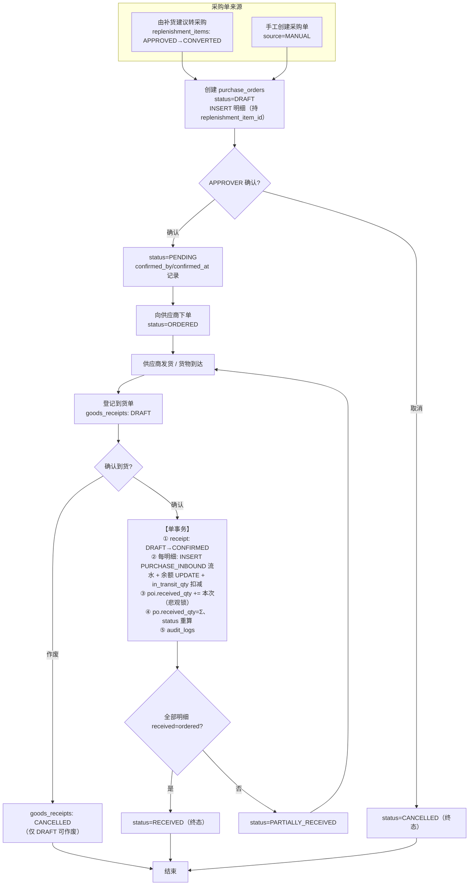
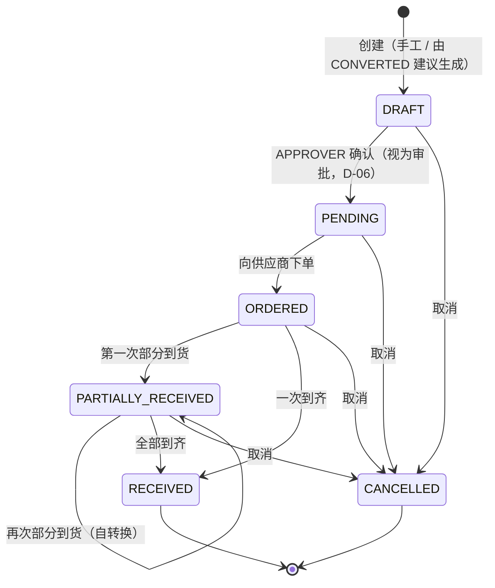
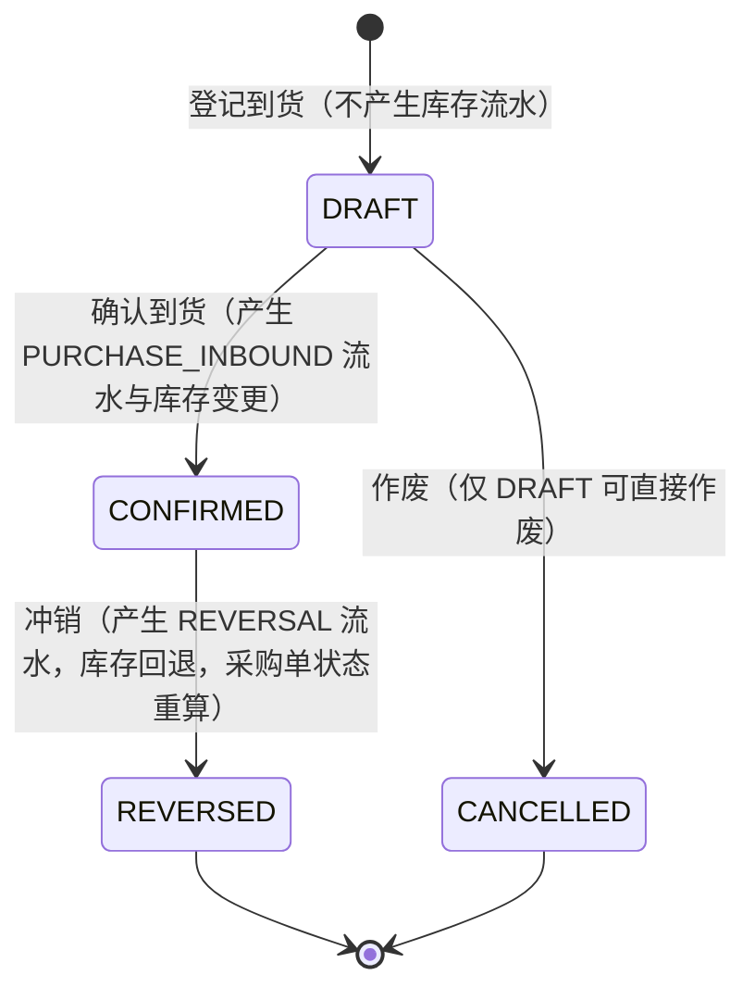

# 采购工作流（采购单与到货入库）

> 文档编号：05-workflows / PURCHASING_WORKFLOW
> 版本：v1.0（M0 设计阶段）
> 权威来源：`docs/DESIGN_BASIS.md`（SSOT，P0）
> 上游依赖：
> - `docs/02-database/DATABASE_DESIGN.md`（§5.18–§5.21、§6-G、§6-H、§6-I、§7.2 #1、§6-J）
> - `docs/03-api/API_CONTRACT.md`（§1.1 路径规范、采购/到货接口）
> - `docs/03-api/ERROR_CODES.md`（PO-9xxx）
> - `docs/01-architecture/MODULE_BOUNDARIES.md`（`purchasing` 模块边界、`InventoryWriteService`）
> - `docs/01-architecture/SYSTEM_ARCHITECTURE.md`（模块依赖方向）
> - `docs/00-product/USER_ROLES.md`（权限矩阵、审批隔离）
> - `docs/05-workflows/REPLENISHMENT_WORKFLOW.md`（上游：建议转采购）
> - `docs/05-workflows/INVENTORY_WORKFLOW.md`（下游：库存流水写入口）

---

## 1. 文档职责与范围

### 1.1 本文档负责

采购全链路：**采购单创建 → 确认（审批）→ 下单 → 到货登记 → 确认到货入库 → 采购状态更新 → 审计轨迹**。

| 阶段 | 承载模块 | 关键表 |
| --- | --- | --- |
| 采购单起草 / 确认 / 下单 / 取消 | `purchasing` | `purchase_orders`、`purchase_order_items` |
| 到货登记 / 确认入库 / 作废 | `purchasing`（调 `inventory`） | `goods_receipts`、`goods_receipt_items` |
| 库存变更 | `inventory` | `inventory_transactions`、`inventory_balances` |

### 1.2 本文档不负责

| 内容 | 权威文件 |
| --- | --- |
| 补货建议的审核与 `APPROVED → CONVERTED` | `REPLENISHMENT_WORKFLOW.md`（本文档从"采购单已创建"开始） |
| 库存流水结构与余额更新细节 | `INVENTORY_WORKFLOW.md` |
| 在途量如何进入补货公式 | `DESIGN_BASIS §10.4` + `REPLENISHMENT_WORKFLOW.md §5.3.1` |
| 表字段级定义 | `DATABASE_DESIGN.md §5` / `DATA_DICTIONARY.md` |

### 1.3 一句话定位

> **采购单是"承诺"，到货单是"兑现"。承诺不动库存，兑现才动库存。**

---

## 2. 参与角色与权限

| 操作 | OWNER | ADMIN | APPROVER | OPERATOR | VIEWER | 依据 |
| --- | :-: | :-: | :-: | :-: | :-: | --- |
| 查看采购单 / 到货单 | ✅ | ✅ | ✅ | ✅ | ✅ | 只读 |
| 创建采购单（手工） | ✅ | ✅ | ✅ | ✅ | ❌ | `TEAM-2003` |
| 由补货建议转采购 | ✅ | ✅ | ✅ | ✅ | ❌ | 见 `REPLENISHMENT_WORKFLOW.md §6.2` |
| 编辑采购单（`DRAFT` 内改明细） | ✅ | ✅ | ✅ | ✅ | ❌ | 仅 `DRAFT` |
| **确认采购单**（`DRAFT → PENDING`） | ✅ | ✅ | ✅ | ❌ | ❌ | **需 `APPROVER`+**（视为审批，`D-06`） |
| 标记已下单（`PENDING → ORDERED`） | ✅ | ✅ | ✅ | ✅ | ❌ | — |
| 取消采购单 | ✅ | ✅ | ✅ | ✅ | ❌ | 见 §8.5，`DRAFT`/`PENDING` 放宽，其余受限 |
| 登记到货单（录入草稿） | ✅ | ✅ | ✅ | ✅ | ❌ | — |
| **确认到货**（`DRAFT → CONFIRMED`） | ✅ | ✅ | ✅ | ✅ | ❌ | 见 §8。⚠️ 需二次确认（`USER_ROLES.md §4.4`）；`PO-9010` 为角色不足兜底 |
| 冲销已确认到货 | ✅ | ✅ | ✅ | ❌ | ❌ | 高风险，建议 `ADMIN`+（见 §8.6） |

> **审批与执行分离**（`DESIGN_BASIS §5.1` 硬规则 2）：`DRAFT → PENDING` 必须由 `APPROVER` 执行，`OPERATOR` 执行则返回 `TEAM-2003`。这是"创建采购单需要审批"的落地形式。

---

## 3. 涉及的表与接口

### 3.1 数据表

| 表名 | 作用 | 关键写入规则 |
| --- | --- | --- |
| `purchase_orders` | 采购单主体（状态机 `§9.13`、汇总量） | 汇总列只由系统同事务重算，不接受客户端直接改 |
| `purchase_order_items` | 采购明细（`ordered_qty` / `received_qty`） | `received_qty` **只增不减**（除冲销）；`pending_qty` **不落库** |
| `goods_receipts` | 到货单（状态机 `§9.14`） | `idempotency_key` **`NOT NULL`**；`CONFIRMED` 后全字段冻结 |
| `goods_receipt_items` | 到货明细（**本次**到货数量） | `CONFIRMED` 后不可变 |
| `inventory_transactions` | 入库流水（`PURCHASE_INBOUND`） | **仅 INSERT** |
| `inventory_balances` | 余额（含 `in_transit_qty`） | 由 `inventory` 模块的 `InventoryWriteService` 写 |
| `audit_logs` | 审计 | **仅 INSERT** |

### 3.2 接口清单

> 路径遵循 `API_CONTRACT.md §1.1`（家族：`/api/v1/purchasing/orders*`、`/api/v1/purchasing/receipts*`）。**具体子路径名以 `API_CONTRACT.md` 为准**，本文档标注的是设计意图。

| 方法 | 路径 | 用途 |
| --- | --- | --- |
| `POST` | `/api/v1/purchasing/orders` | 创建采购单（手工或由建议转采购） |
| `GET` | `/api/v1/purchasing/orders` | 采购单列表（按状态/供应商/期望到货筛选） |
| `GET` | `/api/v1/purchasing/orders/{id}` | 采购单详情（含明细与到货记录） |
| `PATCH` | `/api/v1/purchasing/orders/{id}` | 编辑 `DRAFT` 采购单 |
| `POST` | `/api/v1/purchasing/orders/{id}/confirm` | 确认（`DRAFT → PENDING`，需 `APPROVER`） |
| `POST` | `/api/v1/purchasing/orders/{id}/order` | 标记已下单（`PENDING → ORDERED`） |
| `POST` | `/api/v1/purchasing/orders/{id}/cancel` | 取消采购单 |
| `POST` | `/api/v1/purchasing/receipts` | 登记到货单（草稿） |
| `GET` | `/api/v1/purchasing/receipts/{id}` | 到货单详情 |
| `PATCH` | `/api/v1/purchasing/receipts/{id}` | 编辑 `DRAFT` 到货单 |
| `POST` | `/api/v1/purchasing/receipts/{id}/confirm` | **确认到货**（触发 `PURCHASE_INBOUND` 入库） |
| `POST` | `/api/v1/purchasing/receipts/{id}/cancel` | 作废 `DRAFT` 到货单 |
| `POST` | `/api/v1/purchasing/receipts/{id}/reverse` | 冲销已 `CONFIRMED` 到货（发起 `REVERSAL` 流水） |

**跨模块内部依赖**（方向**不可逆**）：

```
purchasing → inventory.InventoryWriteService.applyTransaction(InventoryTxnType.PURCHASE_INBOUND, ...)
                     ↑
        inventory 模块【绝不】反向依赖 purchasing
```

---

## 4. 主流程



---

## 5. 采购单状态机（`§9.13`）



**禁止的转换**（`DATABASE_DESIGN.md §6-H.3`）：

| # | 禁止项 | 原因 |
| --- | --- | --- |
| 1 | `DRAFT → ORDERED`（跳过 `PENDING`） | 绕过 `APPROVER` 审批隔离 |
| 2 | `RECEIVED → *` / `CANCELLED → *` | 终态；已全部到货的更正必须走库存冲销 |
| 3 | 用一个字段表达"建议状态 + 采购状态" | 违反 `§3.1`，会产生 `7 × 6 = 42` 种无意义组合 |

**状态守卫实现**（`§6-H.4`）：

```sql
-- 必须带前置状态条件，影响行数 = 0 即状态不匹配 → PO-9003
UPDATE purchase_orders SET status='PENDING', confirmed_by=?, confirmed_at=?
 WHERE id=? AND team_id=? AND status='DRAFT';
```

---

## 6. 到货单状态机（`§9.14`）



> **关键**：`CONFIRMED` **不是**可直接作废的状态。库存已变动，撤销必须走 `REVERSAL` 冲销，保留完整证据链（`§9.14` + `§5.20` 设计要点）。冲销成功后到货单置为 **`REVERSED`**（终态），**不得**回退为 `CANCELLED` 或 `DRAFT`。
>
> **到货单无"部分确认"状态**：一次确认即全量生效；如需分批到货，应**登记多张到货单**（每张对应采购明细的一个 `purchase_order_item_id`，且同单内不重复——`uk_gri_receipt_poi`）。

---

## 7. 步骤说明表

| # | 步骤 | 执行方 | 输入 | 输出 | 状态变化 | 事务边界 | 幂等键 / 防重 | 失败处理 | 接口 |
| --- | --- | --- | --- | --- | --- | --- | --- | --- | --- |
| 1 | 由建议创建采购单 | Java（`purchasing`） | `replenishment_item_id[]`、供应商、仓库 | `purchase_orders(DRAFT)` + 明细 | 建议 `APPROVED → CONVERTED`；采购单 `→ DRAFT` | **单事务**（含建议状态流转） | 建议乐观锁 + 状态守卫；`uk_po_team_idem` | 建议已转 → `PO-9001`；状态非法 → `RPL-8001` | `POST /orders` |
| 2 | 手工创建采购单 | Java | 供应商、仓库、明细 | `purchase_orders(DRAFT)` | `→ DRAFT` | 单事务 | `uk_po_team_idem` | 明细为空 → `PO-9006`；供应商跨团队 → `PO-9007` | `POST /orders` |
| 3 | 编辑草稿 | Java | 明细、期望到货日 | 采购单更新 | 不变 | 单事务 + 乐观锁 | `version` | 非 `DRAFT` → `PO-9003` | `PATCH /orders/{id}` |
| 4 | 确认采购单 | Java | — | `confirmed_by/at` | `DRAFT → PENDING` | 单事务 | 状态守卫 | 非 `APPROVER` → `TEAM-2003`；状态非法 → `PO-9003` | `POST /orders/{id}/confirm` |
| 5 | 标记已下单 | Java | — | `ordered_at` | `PENDING → ORDERED` | 单事务 | 状态守卫 | 状态非法 → `PO-9003` | `POST /orders/{id}/order` |
| 6 | 登记到货单 | Java | 采购单、到货明细、到货日期 | `goods_receipts(DRAFT)` | `→ DRAFT` | 单事务 | `uk_gr_team_idem`（**`NOT NULL`**） | 数量 ≤ 0 → `PO-9012`；超额 → `PO-9002` | `POST /receipts` |
| 7 | 编辑到货草稿 | Java | 明细 | 到货单更新 | 不变 | 单事务 + 乐观锁 | `version` | 非 `DRAFT` → `PO-9008` | `PATCH /receipts/{id}` |
| 8 | **确认到货入库** | Java | — | 库存流水 + 余额更新 + 采购汇总 | 到货单 `DRAFT → CONFIRMED`；采购单 `→ PARTIALLY_RECEIVED`/`RECEIVED` | **单事务（§9.1）** | `uk_gr_team_idem` + 状态守卫 | 超额 → `PO-9002`；余额冲突 → `INV-5002` | `POST /receipts/{id}/confirm` |
| 9 | 作废到货草稿 | Java | — | `cancelled_at` | `DRAFT → CANCELLED` | 单事务 | 状态守卫 | 非 `DRAFT` → `PO-9008` | `POST /receipts/{id}/cancel` |
| 10 | 冲销已确认到货 | Java（`inventory` 写） | 到货单 | `REVERSAL` 流水 + 余额回退 + 采购汇总重算 + 到货单置 `REVERSED` | 到货单 `CONFIRMED → REVERSED`；采购单状态回退/保持 | **单事务** | 原流水唯一性（`uk_invtxn_team_reversed`，`D-13`） | 重复冲销 → `INV-5009`；导致负库存 → `INV-5006` | `POST /receipts/{id}/reverse` |
| 11 | 取消采购单 | Java | 取消原因 | `cancelled_at/reason` | `→ CANCELLED` | 单事务 | 状态守卫 | 已 `RECEIVED` → `PO-9009`；状态非法 → `PO-9003` | `POST /orders/{id}/cancel` |
| 12 | 审计 | Java | — | 审计记录 | — | 同业务事务/独立事务 | — | — | — |

### 7.1 采集输入来源

| 数据 | 来源 |
| --- | --- |
| 采购需求 | `replenishment_items`（`APPROVED`，含 `supplier_id` / `purchase_price` / `expected_arrival_date`）或人工录入 |
| 供应商 | `suppliers`（团队内） |
| 到货仓库 | `warehouses`（团队内） |
| SKU | `skus`（团队内） |

### 7.2 输出

| 输出 | 位置 |
| --- | --- |
| 采购单及明细 | `purchase_orders` / `purchase_order_items` |
| 到货单及明细 | `goods_receipts` / `goods_receipt_items` |
| 库存变更 | `inventory_transactions`（`PURCHASE_INBOUND` / `REVERSAL`）+ `inventory_balances` |
| 在途变化 | `inventory_balances.in_transit_qty`（见 §8.3） |
| 审计 | `audit_logs` |

---

## 8. 关键设计原则（含结论与理由）

### 8.1 【原则一】创建采购单**不得**增加库存

**结论**：创建采购单（含由建议转采购）**只写采购单与明细**，**不写任何库存流水、不改 `inventory_balances.on_hand_qty`**。

理由：
1. **采购单是承诺，不是事实**。货物未到，`on_hand_qty` 不应变化（否则会导致超卖）；
2. 库存的唯一写入口是 `InventoryWriteService`，且**只有到货确认**才有对应的 `PURCHASE_INBOUND` 流入账；
3. 在途量通过 `in_transit_qty` / `effective_in_transit_qty` 表达，与 `on_hand_qty` 是**互斥**概念（`§3.1` 第 2 条：任何公式不得重复计入同一批货）。

**反例（禁止）**：在创建采购单时预增 `on_hand_qty`，到货时再改。这会让"在途"与"在库"混淆，直接破坏补货 `IP` 的计算。

### 8.2 【原则二】`in_transit_qty` 的语义与"派生 vs 物化"（**重要不一致，见 §10**）

**SSOT 定义**（`DESIGN_BASIS §3`）：

> 在途库存 `in_transit_qty` = 已下采购单但尚未确认到货的数量；口径 = `Σ(采购明细 ordered_qty − received_qty)` 中处于在途状态的部分。

**设计要求（本文档立场）**：

| 用途 | 用哪个值 | 说明 |
| --- | --- | --- |
| **补货计算**（进入 `IP`） | `effective_in_transit_qty`（`§10.4`） | **必须**按窗口过滤：`po.status ∈ {PENDING, ORDERED, PARTIALLY_RECEIVED}` 且 `expected_arrival_date ≤ today + L + R` |
| **展示/运营参考** | `inventory_balances.in_transit_qty` | 物化列，供列表页快速展示 |

**结论**：`in_transit_qty` **在语义上是派生值**（由采购明细聚合），**不得作为补货计算的输入**；补货的权威输入是 `effective_in_transit_qty`。二者差异：

```
in_transit_qty            = Σ(ordered − received)  [全部在途状态]
effective_in_transit_qty  = Σ(ordered − received)  [窗口内，§10.4]
                              ↑ 本补货计算只用这个
```

对补货 `IP` 的影响（`§10.4`）：
- 若**误用** `in_transit_qty`（含远期在途）→ `IP` 虚高 → 补货不足 → **缺货风险**；
- 因此 SSOT 明确"只在覆盖窗口内计入在途"。

> ⚠️ **发现的不一致**（详见 §10.1）：`DESIGN_BASIS §3` 把 `in_transit_qty` 定义为**派生公式**，而 `DATABASE_DESIGN.md §5.9` 把它**物化为 `inventory_balances` 的一列**并"由采购单状态变更驱动"。两者在"是否落库"上冲突；且 §3 的在途状态集合为 `{ORDERED, PENDING}`，而 §10.4 为 `{PENDING, ORDERED, PARTIALLY_RECEIVED}`。**本文档不修改 SSOT**，按"补货用 §10.4，展示用物化列"执行，并建议统一。

### 8.3 【原则三】`in_transit_qty` 的增减时机

| 事件 | `inventory_balances.in_transit_qty`（物化列） | 是否写流水 |
| --- | --- | --- |
| 采购单确认 / 下单 | 按设计"由采购单状态驱动"增加 | ❌ **无流水**（在途不是实物移动） |
| 确认到货 | **扣减**本次到货数量 | ✅ `PURCHASE_INBOUND` |
| 取消采购单（未收货部分） | 回退未收部分的在途 | ❌ 无流水 |
| 冲销已确认到货 | 反向恢复在途 | ✅ `REVERSAL` |

> **为何在途没有流水**（`DATABASE_DESIGN.md §5.9` 设计要点 3）：在途是"计划"而非"移动"。若为在途也建流水，会让库存账本混入非实物事件，破坏"余额 = 流水累加"的可推导性（P5）。

### 8.4 【原则四】`DRAFT → PENDING` 由 `APPROVER` 确认（`D-06`）

**结论**：**不引入独立采购审批流**。`APPROVER` 执行 `DRAFT → PENDING` 即视为审批，`confirmed_by` / `confirmed_at` 记录审批人与时间。

理由：保持 `PurchaseOrderStatus` **6 个值**，避免状态爆炸（若加 `PENDING_APPROVAL` / `APPROVED` 等会引入与建议侧审批重复的概念）。
→ 该设计对应待决策 `D-06`（`DESIGN_BASIS §15`）：是否认可"确认即审批"的简化。

### 8.5 【原则五】部分到货设计

| 量 | 计算 | 是否落库 |
| --- | --- | --- |
| `ordered_qty` | 用户下单值 | ✅ `purchase_order_items` |
| `received_qty` | `Σ goods_receipt_items.received_qty`（**仅 `CONFIRMED` 到货单**） | ✅ **累加写库**（`purchase_order_items.received_qty`） |
| `pending_qty` | `ordered_qty − received_qty` | ❌ **派生，不落库** |

**行状态（不落库，纯派生）**：

| 条件 | 行状态 |
| --- | --- |
| `received_qty = 0` | 未收 |
| `0 < received_qty < ordered_qty` | 部分收 |
| `received_qty = ordered_qty` | 已收 |

**单据状态（派生结论）**：

```
MIN(received_qty / ordered_qty) = 1  →  RECEIVED
否则                                  →  PARTIALLY_RECEIVED
```

即 **"行状态是量，单据状态是派生结论"**（`§6-I.1`）。

**到货单与库存流水的关联**（`§6-I.2`）：

| 项 | 值 |
| --- | --- |
| `txn_type` | `PURCHASE_INBOUND`（`§9.6`） |
| `biz_type` | `GOODS_RECEIPT` |
| `biz_ref_id` | `goods_receipts.id` |
| `biz_ref_no` | `goods_receipts.receipt_no`（冗余，免 JOIN） |
| 幂等键 | `PURCHASE_INBOUND:GOODS_RECEIPT:<receipt_id>:<sku_id>` |
| 粒度 | **一项到货明细 → 一条流水**（按 SKU 拆，`goods_receipt_items` 与 `inventory_transactions` **1:1**） |

> **为何按 SKU 拆流水**：流水是 `SKU×仓库` 的账本，`qty_before`/`qty_after` 必须对应单一 SKU 的余额行。合并成"一张到货单一条流水"会让前后余额无意义。

### 8.6 【原则六】取消采购单的影响面

| 采购单状态 | 是否可取消 | 已收货部分 | 未收部分 | 是否产生流水 |
| --- | :-: | --- | --- | --- |
| `DRAFT` | ✅ | 无 | 直接作废 | ❌ |
| `PENDING` | ✅ | 无 | 回退在途 | ❌ |
| `ORDERED` | ✅ | 无 | 回退在途 | ❌ |
| `PARTIALLY_RECEIVED` | ⚠️ 谨慎 | **保留**（已入账，不可撤） | 回退未收部分在途 | ❌（撤销已收部分需**单独冲销到货单**） |
| `RECEIVED` | ❌ → `PO-9009` | 全部 | 无 | 需走冲销 |

**结论**：
1. 取消**不写库存流水**（`on_hand_qty` 不变，因为在途本来就不在 `on_hand_qty` 里）；
2. 取消**不把建议状态改回 `APPROVED`**（`§6-H.3` 禁止项 4）：建议的 `CONVERTED` 事实不变，业务影响由采购单状态表达；
3. `PARTIALLY_RECEIVED` 取消时，**已收部分必须已确认入库且保留**；若需退货，走**冲销对应到货单**（§8.7），不能靠"取消采购单"抹去已入库事实。

### 8.7 【原则七】已确认到货的冲销

**结论**：`CONFIRMED` 到货单**不可作废**，只能**冲销**。

| 步骤 | 行为 |
| --- | --- |
| ① 定位原流水 | `idx_invtxn_team_biz (team_id, biz_type='GOODS_RECEIPT', biz_ref_id=receipt_id)` |
| ② 校验未冲销 | 不存在 `reversed_txn_id = 原流水.id` 的记录 |
| ③ 写反向流水 | `REVERSAL`，`qty_delta = −原 qty_delta`，`reversed_txn_id = 原流水.id` |
| ④ 余额回退 | `inventory_balances` 乐观锁 UPDATE |
| ⑤ 采购汇总回退 | `poi.received_qty −= 本次冲销量`；`po.received_qty = Σ`；**采购单状态重算** |
| ⑥ 到货单标记 | 建议置 `CANCELLED`（业务动作）或保留并标记"已冲销"（**建议新增字段/标记，见 §10.3 `建议新增 D-38`**） |
| ⑦ 审计 | 两条：`GOODS_RECEIPT_REVERSE`（业务侧，`biz_type=GOODS_RECEIPT`）+ `INVENTORY_REVERSE`（库存侧，`biz_type=INVENTORY_TRANSACTION`，由 `inventory` 模块写入） |

**约束**：
- **一笔流水只能冲销一次**：由 `uk_invtxn_team_reversed (team_id, reversed_txn_id)` 保证（⚠️ 该索引不在 `§8`，登记 `D-13`）；重复 → `INV-5009`；
- 冲销导致负库存 → 拒绝（`INV-5006`）；
- 冲销**不修改** `goods_receipt_items`（`CONFIRMED` 后不可变），修正靠新增反向证据链；
- 冲销后采购单状态：若回退到部分收货前则 `→ PARTIALLY_RECEIVED`；若全部冲销则 `→ ORDERED`（**建议在 `§9.13` 明确"状态回退"是否合法，见 §10.3 `建议新增 D-39`**）。

---

## 9. 异常场景专章

### 9.1 确认到货的完整事务（单事务，无跨服务）

> 依据 `DATABASE_DESIGN.md §6-I.3`、`§7.2 #1`。

```
BEGIN;
  ① UPDATE goods_receipts SET status='CONFIRMED', confirmed_by=?, confirmed_at=?
        WHERE id=? AND team_id=? AND status='DRAFT';   -- 状态守卫，影响行数=0 → 幂等返回
  ② 校验并固化 goods_receipt_items（超额校验：received_qty + 本次 ≤ ordered_qty，否则 PO-9002）
  ③ FOR EACH 明细:
        INSERT inventory_transactions (txn_type=PURCHASE_INBOUND, biz_type=GOODS_RECEIPT,
                                       biz_ref_id=receipt_id, idem_key=...);
        UPDATE inventory_balances SET on_hand_qty=on_hand_qty+?, version=version+1
             WHERE ... AND version=?;                    -- 乐观锁，冲突 → INV-5002（重试 3 次）
        UPDATE inventory_balances SET in_transit_qty=in_transit_qty-? WHERE ...;  -- 扣减在途
  ④ SELECT ... FOR UPDATE purchase_order_items 行;        -- 悲观锁（读-改-写累加）
        UPDATE purchase_order_items SET received_qty=received_qty+? WHERE id=?;
  ⑤ UPDATE purchase_orders SET received_qty=Σ, status=重算 WHERE id=? AND version=?;  -- 乐观锁
  ⑥ INSERT audit_logs (action='GOODS_RECEIPT_CONFIRM', ...);
COMMIT;
```

**为什么安全**：全流程**无跨服务调用**（Python AI 与采购完全无关，`§13.2`），因此**要么全成、要么全回滚**，DB 不会留下中间态。

### 9.2 重复提交收货

| 检测 | 行为 |
| --- | --- |
| 同 `X-Idempotency-Key` 第二次提交 | 撞 `uk_gr_team_idem` → 返回**原到货单**（内容一致）或 `COM-0009`（内容不一致） |
| 已 `CONFIRMED` 再次确认 | 状态守卫 `WHERE status='DRAFT'` 影响行数 = 0 → **幂等返回已确认结果**，不报错 |
| 真正重复请求（不同 key） | 若到货单已 `CONFIRMED` → `PO-9008` |

> **为何 `goods_receipts.idempotency_key` 为 `NOT NULL`**（与 `purchase_orders.idempotency_key` 可空不同）：确认到货产生**不可逆的库存变更**，必须强制幂等保护。

### 9.3 并发收货（同一采购单两条明细同时确认）

| 冲突点 | 策略 |
| --- | --- |
| `purchase_order_items.received_qty` 累加（读-改-写） | **悲观锁** `SELECT ... FOR UPDATE`（`§6-C` 的例外场景） |
| `purchase_orders.received_qty` 汇总与状态 | **乐观锁 `version`** + 状态守卫 |
| `inventory_balances` | **乐观锁 `version`**，冲突重试 3 次（20/50/120ms）→ `INV-5002` |

**为何这里用悲观锁**（`§6-I.3`）：收货是人工操作、低频、单团队串行（一天几次），锁竞争概率极低；而乐观锁在此路径需"读快照→校验超额→写"，重试要**重复校验超额**，逻辑更复杂。判定标准（`§7.4`）：**"读-改-写累加 + 低频" → 悲观锁**。

### 9.4 超量收货

**结论：首期不允许超额收货。**

| 层 | 措施 |
| --- | --- |
| 服务层 | `received_qty + 本次 ≤ ordered_qty`，否则 → `PO-9002`（409） |
| DB 层兜底 | `CHECK (received_qty <= ordered_qty)` |
| 未来扩展 | "超收挂账"属首期不支持场景（`§11.2` 精神），不实现 |

### 9.5 到货数量非法

| 场景 | 错误码 |
| --- | --- |
| `received_qty <= 0` | `PO-9012`（400） |
| 单价 < 0 或小数位 > 4 | `PO-9011`（400） |
| 采购明细为空 | `PO-9006`（400） |
| 供应商跨团队 | `PO-9007`（403） |
| 到货单不存在 / 跨团队 | `PO-9005`（404） |
| 采购单不存在 / 跨团队 | `PO-9004`（404） |

### 9.6 部分失败与并发边界汇总

| 场景 | 系统行为 | 错误码 |
| --- | --- | --- |
| 收货后事务失败 | **整体回滚**，DB 无中间态 | — |
| 余额乐观锁冲突（3 次后） | 返回失败，用户重试 | `INV-5002` |
| 重复冲销 | 拒绝（唯一性） | `INV-5009` |
| 冲销导致负库存 | 拒绝 | `INV-5006` |
| 已 `RECEIVED` 采购单取消 | 拒绝 | `PO-9009` |
| 对 `CONFIRMED` 到货单再编辑 | 拒绝 | `PO-9008` |

---

## 10. 事务边界汇总

> 依据 `DESIGN_BASIS §7`、`DATABASE_DESIGN.md §7.2`。

| # | 事务单元 | 涉及表 | 锁策略 | 失败影响 | 幂等/防重 |
| --- | --- | --- | --- | --- | --- |
| 1 | 创建采购单（由建议） | `purchase_orders` + `purchase_order_items` + `replenishment_items`（状态）+ `audit_logs` | 建议乐观锁 + 状态守卫 | 整体回滚，建议仍 `APPROVED` | `uk_po_team_idem` + 状态守卫 |
| 2 | 创建采购单（手工） | `purchase_orders` + `purchase_order_items` + `audit_logs` | 唯一约束 | 整体回滚 | `uk_po_team_idem` |
| 3 | 编辑草稿 | `purchase_orders` / `purchase_order_items` + `audit_logs` | 乐观锁 `version` | 回滚 | `version` |
| 4 | 确认采购单 | `purchase_orders` + `audit_logs` | 状态守卫 | 无副作用（状态不匹配） | 状态守卫 |
| 5 | 标记已下单 | 同上 | 状态守卫 | 同上 | 状态守卫 |
| 6 | 登记到货单 | `goods_receipts` + `goods_receipt_items` + `audit_logs` | 唯一约束 | 回滚 | `uk_gr_team_idem` |
| 7 | **确认到货入库** | `goods_receipts` + `goods_receipt_items` + `inventory_transactions` + `inventory_balances` + `purchase_order_items` + `purchase_orders` + `audit_logs` | 状态守卫 + 悲观锁（`poi`）+ 乐观锁（余额、`po`） | **整体回滚** | `uk_gr_team_idem` + 状态守卫 + `uk_invtxn_team_idem` |
| 8 | 作废到货草稿 | `goods_receipts` + `audit_logs` | 状态守卫 | 无副作用 | 状态守卫 |
| 9 | 冲销已确认到货 | `inventory_transactions` + `inventory_balances` + `purchase_order_items` + `purchase_orders` + `goods_receipts`（标记）+ `audit_logs` | 乐观锁 + 原流水唯一性 | 整体回滚 | `uk_invtxn_team_reversed`（`D-13`） |
| 10 | 取消采购单 | `purchase_orders`（+ 在途回退）+ `audit_logs` | 状态守卫 | 无副作用 | 状态守卫 |

**关键取舍**：

| 判断 | 结论 | 理由 |
| --- | --- | --- |
| 确认到货是否单事务？ | ✅ 是 | 6 张表同生共死，无跨服务；拆分会造成"入库了但采购单没收货"的脏状态 |
| 在途是否需要独立事务？ | ❌ 否 | 在途随采购单状态在同一事务内增减，无独立生命周期 |
| 转采购是否单事务？ | ✅ 是 | 建议状态与采购单明细必须同生共死（见 `REPLENISHMENT_WORKFLOW.md §7.2`） |

---

## 11. 审计记录点

> `action` 常量的**成员资格见 `DESIGN_BASIS §9.17`（`AuditAction`，35 条）**，语义见 `DATABASE_DESIGN.md §6-J.1`。本文档**引用不重定义**；下表 `#` 为 `§6-J.1` 的稳定编号。

| # | 操作 | `action` | `biz_type` | `result` |
| --- | --- | --- | --- | --- |
| 22 | 建议转采购（上游） | `REPLENISHMENT_CONVERT` | `REPLENISHMENT_ITEM` | SUCCESS |
| 23 | 采购单创建 | `PURCHASE_ORDER_CREATE` | `PURCHASE_ORDER` | SUCCESS |
| 24 | 采购单确认（审批） | `PURCHASE_ORDER_CONFIRM` | `PURCHASE_ORDER` | SUCCESS |
| 32 | 采购单标记已下单 | `PURCHASE_ORDER_ORDERED` | `PURCHASE_ORDER` | SUCCESS |
| 25 | 采购单取消 | `PURCHASE_ORDER_CANCEL` | `PURCHASE_ORDER` | SUCCESS |
| 26 | 到货单确认（入库） | `GOODS_RECEIPT_CONFIRM` | `GOODS_RECEIPT` | SUCCESS |
| 33 | 到货单冲销（业务侧） | `GOODS_RECEIPT_REVERSE` | `GOODS_RECEIPT` | SUCCESS |
| 13 | 库存流水冲销（库存侧） | `INVENTORY_REVERSE` | `INVENTORY_TRANSACTION` | SUCCESS |
| 27 | 到货单作废 | `GOODS_RECEIPT_CANCEL` | `GOODS_RECEIPT` | SUCCESS |

> ✅ **原「缺失的审计点」已闭环**（`D-40` 已裁定为"新增"）：`PENDING → ORDERED` 用 `#32 PURCHASE_ORDER_ORDERED`；到货冲销**业务侧**用 `#33 GOODS_RECEIPT_REVERSE`，与库存侧 `#13 INVENTORY_REVERSE` **分两条记录**（前者 `biz_type = GOODS_RECEIPT`，后者 `biz_type = INVENTORY_TRANSACTION`），避免"库存冲销"与"到货冲销"语义混用。

---

## 12. 与其他文档的不一致 / 待决策

### 12.1 已有待决策项

| 编号 | 内容 | 对本文档影响 |
| --- | --- | --- |
| `D-06` | `DRAFT → PENDING` 确认角色 / 是否"确认即审批" | §8.4 的实现前提 |
| `D-09` | 四眼原则 | 影响由建议转采购时"审批人 ≠ 创建人"是否校验 |
| `D-13` | `uk_invtxn_team_reversed` 唯一约束是否新增 | §8.7 冲销幂等强度 |
| ~~`D-14`~~（旧编号，已作废） | ✅ 已裁定：`InventoryBizType`（含 `GOODS_RECEIPT`）等已统一补入 `DESIGN_BASIS §9.17`（裁定见 `§15.2`） | §8.5 流水 `biz_type` 取值来源已明 |
| `D-15` | 只增表保留期/归档 | 长期存储 |

### 12.2 发现的不一致（**不改 SSOT**，仅标注）

| # | 不一致 | 涉及文档 | 建议 |
| --- | --- | --- | --- |
| INC-P1 | **`in_transit_qty` 派生 vs 物化冲突**：`§3` 定义为派生公式，`DATABASE_DESIGN.md §5.9` 物化为 `inventory_balances` 列（"由采购单状态驱动"） | `DESIGN_BASIS §3` vs `DATABASE_DESIGN.md §5.9` | 明确：物化列仅用于**展示**，补货**必须**用 `§10.4` 的 `effective_in_transit_qty`；或在 `§3` 补充"物化用于查询、计算口径见 §10.4" |
| INC-P2 | **在途状态集合不一致**：`§3` 用 `{ORDERED, PENDING}`，`§10.4` 用 `{PENDING, ORDERED, PARTIALLY_RECEIVED}` | `DESIGN_BASIS §3` vs `§10.4` | 统一为 `{PENDING, ORDERED, PARTIALLY_RECEIVED}`（部分收货的剩余未收部分仍在途） |
| INC-P3 | **`§9.13` 未定义"冲销后采购单状态回退"**：`PARTIALLY_RECEIVED` / `RECEIVED` 冲销后如何回退无明文 | `DESIGN_BASIS §9.13` | 补充状态回退规则（或明确"冲销只减 `received_qty`，状态由派生重算"） |
| INC-P4 | **`goods_receipts` 无"已冲销"标记**：`§9.14` 只有 `DRAFT/CONFIRMED/CANCELLED`，冲销后到货单状态语义不明 | `DESIGN_BASIS §9.14` vs `INVENTORY_WORKFLOW.md §5.6` | 明确"冲销后到货单置 `CANCELLED`"或新增标记 |
| INC-P5 | ✅ **已闭环**（F-28）：下单用 `PURCHASE_ORDER_ORDERED`；到货冲销业务侧用 `GOODS_RECEIPT_REVERSE`，与库存侧 `INVENTORY_REVERSE` 分列 | `DESIGN_BASIS §9.17`（`AuditAction` 35 条） | 已固化于 `§9.17` #32 / #33，语义见 `DATABASE_DESIGN.md §6-J.1`，见 §11 |
| INC-P6 | **`purchase_orders.idempotency_key` 可空**，但到货单强制 `NOT NULL` | `DATABASE_DESIGN.md §5.18` vs `§5.20` | 属**有意差异**（到货不可逆），建议在 `§5.18` 附近补一句说明理由，避免被误读为遗漏 |

### 12.3 建议新增待决策项

| 建议编号 | 议题 | 可选方案 | 影响 |
| --- | --- | --- | --- |
| **建议新增 `D-38`**（✅ **已裁定**） | 已冲销到货单的状态与标记方式 | ③ 新增 `REVERSED` 枚举值（`DESIGN_BASIS §9.14` 已定义；`DESIGN_REVIEW.md`：已裁定）；① 复用 `CANCELLED` **否决**（`CONFIRMED` 后不可直接作废）；② 仅作为 ③ 的**补充标记**（是否新增 `reversed_at`/`reversed_by` 见 `DATABASE_DESIGN.md §5.20`） | 影响到货单查询与审计 |
| **建议新增 `D-39`** | 冲销后采购单状态是否允许"回退" | ① 允许按派生重算（`RECEIVED → PARTIALLY_RECEIVED → ORDERED`，**与 `§9.13`"终态不可变"张力大**）；② 维护独立 `reversed` 汇总，**状态保持终态不变**（推荐，与 `§9.13` 兼容） | 影响两个状态机的兼容性 |
| **建议新增 `D-40`**（✅ **已裁定：① 新增**；✅ **已固化**） | 是否新增审计常量 `PURCHASE_ORDER_ORDERED` / `GOODS_RECEIPT_REVERSE` | ① 新增（推荐，审计完整）；② 复用 `PURCHASE_ORDER_CONFIRM` / `INVENTORY_REVERSE`（会丢失语义） | 影响审计可读性。已落地：`DESIGN_BASIS §9.17` #32 / #33 |
| **建议新增 `D-41`** | 手工创建采购单是否也需要 `APPROVER` 确认？ | ① 需要（与建议转采购一致，**推荐**）；② 手工单可由 `OPERATOR` 直接 `PENDING` | 影响权限矩阵与审批隔离 |
| **建议新增 `D-42`** | `PARTIALLY_RECEIVED` 采购单取消时，未收部分是否需在途回退审计？ | ① 是（推荐）；② 否 | 影响审计完整性 |

---

## 13. 前端交互要点

| 场景 | 交互要求 |
| --- | --- |
| 确认采购单 | 二次确认弹窗（需 `APPROVER`）；非该角色时按钮置灰并提示 |
| 标记已下单 | 轻确认；提示"在途将进入补货覆盖窗口" |
| 登记到货 | 默认带出采购明细的 `pending_qty`；输入超过 `pending_qty` 时**即时拦截**并提示 `PO-9002` |
| 确认到货 | **强二次确认**（不可逆，影响库存）；展示"本次将入库 N 个 SKU，共 M 件" |
| 已 `CONFIRMED` 到货单 | 全部字段只读；仅显示"冲销"入口（高权限） |
| 冲销 | 强二次确认 + 必填原因；提示"将产生反向库存流水" |
| 采购单列表 | 默认按 `status` 与 `expected_arrival_date` 排序；`RECEIVED`/`CANCELLED` 默认折叠 |
| 加载/空/失败 | 统一骨架屏 + 空态引导 + 失败重试（幂等安全，因确认类操作有状态守卫） |
| 权限不足 | 隐藏或置灰操作按钮（`USER_ROLES.md §4.4`） |

---

## 14. 变更日志

| 版本 | 日期 | 变更 | 作者 |
| --- | --- | --- | --- |
| v1.0 | 2026-10-14 | 首版：采购单状态机与到货单状态机、确认到货单事务、部分到货设计、在途量语义澄清、冲销设计、异常场景、事务边界与一致性标注 | 业务分析师 / 流程设计负责人 |
