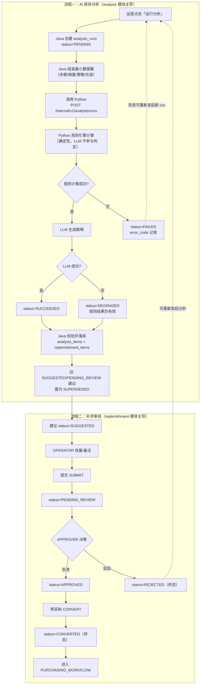
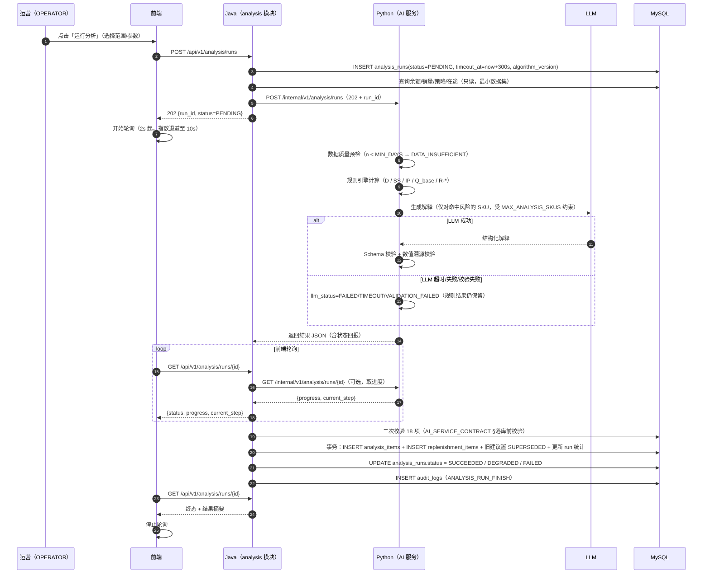
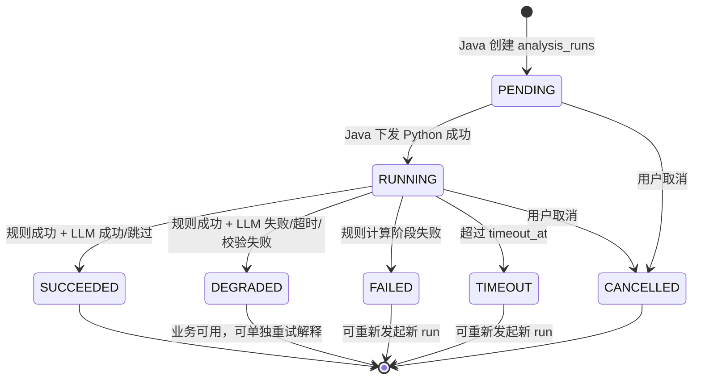
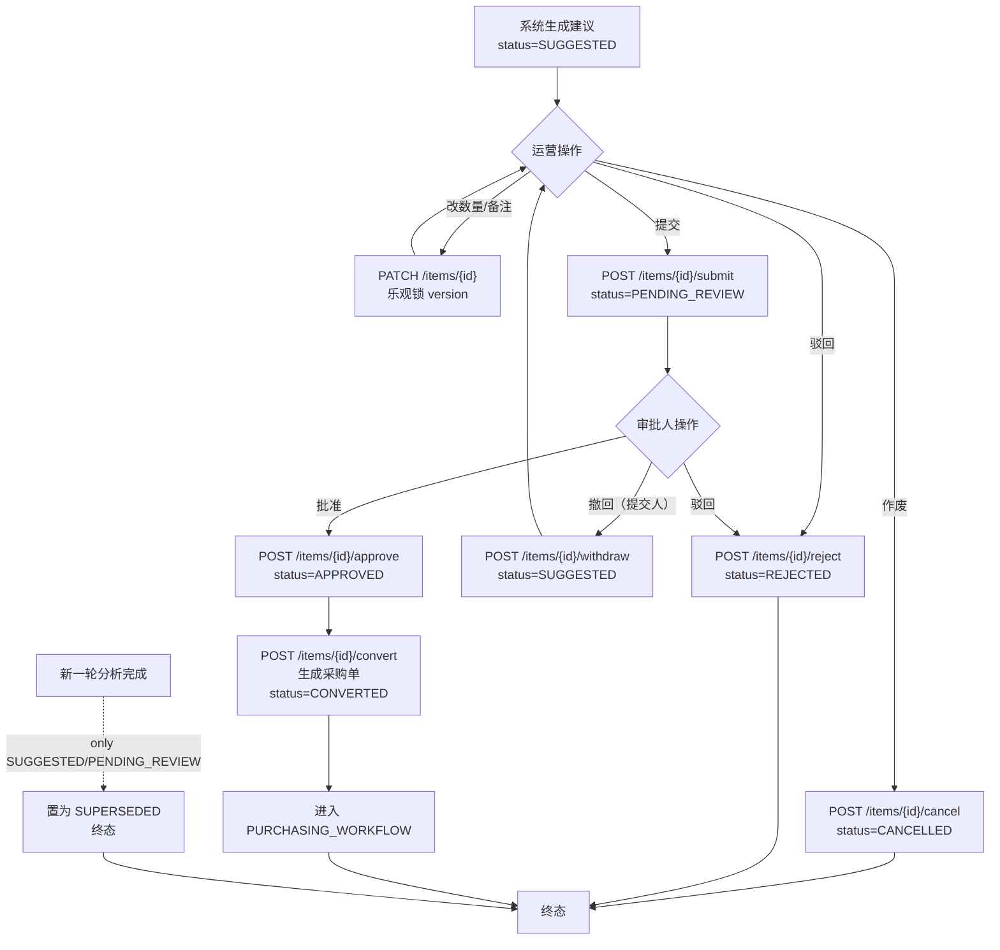
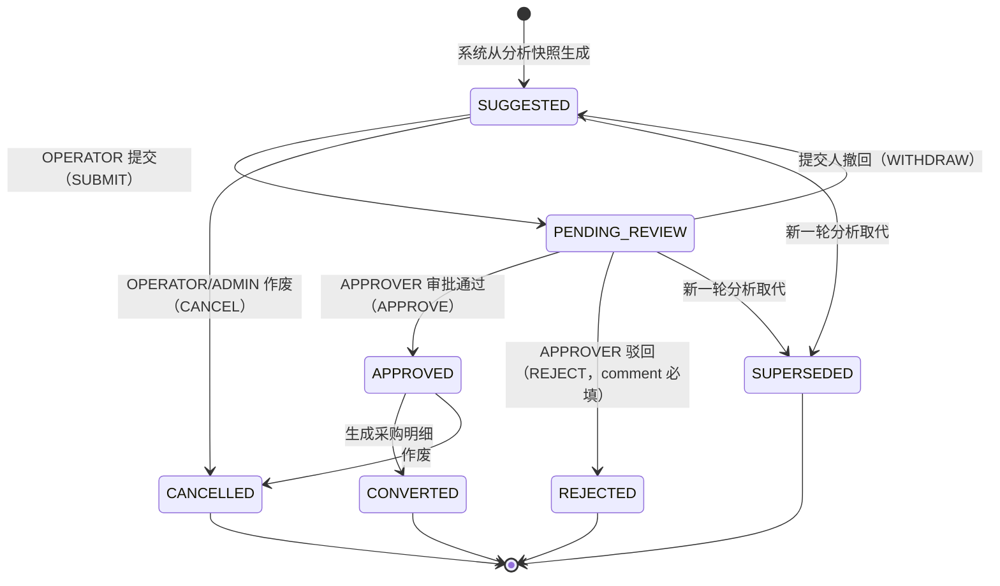

# 补货工作流（AI 分析与补货审核）

> 文档编号：05-workflows / REPLENISHMENT_WORKFLOW
> 版本：v1.0（M0 设计阶段）
> 权威来源：`docs/DESIGN_BASIS.md`（SSOT，P0）
> 上游依赖：
> - `docs/02-database/DATABASE_DESIGN.md`（§5.14–§5.17、§6-F、§6-G、§6-H、§7、§11）
> - `docs/03-api/API_CONTRACT.md`（§1.1 路径规范、分析/补货/采购接口）
> - `docs/03-api/AI_SERVICE_CONTRACT.md`（Java↔Python 契约、降级契约）
> - `docs/03-api/ERROR_CODES.md`（ANL / RPL / PO 错误码）
> - `docs/04-ai/ANALYSIS_CONTRACT.md`（18 个黄金用例、数据质量分级）
> - `docs/04-ai/PROMPT_DESIGN.md`（Prompt 与输出 Schema）
> - `docs/01-architecture/MODULE_BOUNDARIES.md`（analysis / replenishment 模块边界）
> - `docs/01-architecture/SYSTEM_ARCHITECTURE.md`（同步 vs 异步、轮询机制）
> - `docs/00-product/USER_ROLES.md`（权限矩阵、D-09 四眼原则）

---

## 1. 文档职责与范围

### 1.1 本文档负责

本文档覆盖**两个相邻但独立的流程**：

| 编号 | 流程 | 主要承载模块 | 关键表 |
| --- | --- | --- | --- |
| 流程一 | **AI 库存分析流程**（创建分析任务 → 规则计算 → LLM 解释 → 结果落库） | `analysis` | `analysis_runs`、`analysis_items` |
| 流程二 | **补货审核流程**（建议生成 → 人工改量 → 提交审核 → 审批/驳回 → 转采购） | `replenishment` | `replenishment_items`、`replenishment_reviews` |

### 1.2 本文档不负责（避免重复定义）

| 内容 | 权威文件 | 本文档的角色 |
| --- | --- | --- |
| 补货公式 `D` / `Q_base` / `SS` / `IP` / `Q_suggest` 的**定义与阈值** | `DESIGN_BASIS §10` | 本文档**只写流程**：何时调用、谁调用、失败怎么办，不重述公式 |
| 风险规则 `R-*` 的**判定逻辑** | `DESIGN_BASIS §11` | 本文档**只写流程**：规则结果如何流入建议、如何降级 |
| 表结构、字段、索引、约束 | `DATABASE_DESIGN.md §5` / `DATA_DICTIONARY.md` | 本文档只引用表名与关键字段名 |
| 接口的完整请求/响应 Schema | `API_CONTRACT.md` | 本文档只标注**路径与方法**，不重写参数 |
| Java↔Python 的完整契约 | `AI_SERVICE_CONTRACT.md` | 本文档只引用契约要点（超时、重试、降级） |
| 采购单执行、到货入库 | `PURCHASING_WORKFLOW.md` | 本文档在"转采购"处**止步于创建采购单** |
| 库存余额与流水的写入口 | `INVENTORY_WORKFLOW.md` | 本文档**不直接改库存**（分析只读） |

### 1.3 一句话定位

> **流程一只读业务数据、只写分析结果；流程二只写建议状态，不改库存、不直接写采购单明细以外的东西。**

---

## 2. 参与角色与权限

角色定义采用 `DESIGN_BASIS §9.4 TeamRole`：`OWNER` / `ADMIN` / `APPROVER` / `OPERATOR` / `VIEWER`。

| 操作 | OWNER | ADMIN | APPROVER | OPERATOR | VIEWER | 依据 |
| --- | :-: | :-: | :-: | :-: | :-: | --- |
| 创建分析任务 | ✅ | ✅ | ✅ | ✅ | ❌ | `TEAM-2003`（无权限） |
| 查看分析运行与结果 | ✅ | ✅ | ✅ | ✅ | ✅ | 只读 |
| 取消分析运行 | ✅ | ✅ | ✅ | ✅ | ❌ | 创建者可取消自己的运行 |
| 重试 LLM 解释 | ✅ | ✅ | ✅ | ✅ | ❌ | 见 §5.3.3 |
| 查看补货建议列表/详情 | ✅ | ✅ | ✅ | ✅ | ✅ | 只读 |
| 修改建议数量 `qty` | ✅ | ✅ | ✅ | ✅ | ❌ | 仅 `SUGGESTED`/`PENDING_REVIEW` |
| 提交审核（`SUBMIT`） | ✅ | ✅ | ✅ | ✅ | ❌ | `TEAM-2003` |
| 撤回（`WITHDRAW`） | ✅ | ✅ | ✅ | ✅ | ❌ | 仅提交人可撤回 |
| 审批通过（`APPROVE`） | ✅ | ✅ | ✅ | ❌ | ❌ | 需 `APPROVER`+ |
| 驳回（`REJECT`） | ✅ | ✅ | ✅ | ❌ | ❌ | 需 `APPROVER`+，`comment` 必填 |
| 作废建议（`CANCEL`） | ✅ | ✅ | ✅ | ✅ | ❌ | 见 §6.5 |
| 转采购（生成采购单） | ✅ | ✅ | ✅ | ✅ | ❌ | 建议须为 `APPROVED` |

> **高风险操作提示**（`USER_ROLES.md §2.3`）：审批与转采购是**影响资金与采购流程**的操作，均需二次确认弹窗，且**必须写审计**（见 §8）。
>
> **四眼原则**：`D-09` 提议"提交人与审批人不得为同一人"。该决策**尚未定稿**（见 §9.3），首期**按宽松实现**（允许同一人），但代码预留校验位，决策定稿后可一行开关切换。

---

## 3. 涉及的表与接口

### 3.1 数据表

| 表名 | 所属模块 | 作用 | 写入规则 |
| --- | --- | --- | --- |
| `analysis_runs` | `analysis` | 一次分析任务的**运行实例**（状态、进度、参数、LLM 状态、算法版本） | 状态机单向流转（`§9.7`） |
| `analysis_items` | `analysis` | 单个 SKU×仓库的**计算事实快照**（不可变） | **仅 INSERT**，永不 UPDATE/DELETE |
| `replenishment_items` | `replenishment` | 从快照派生的**有状态业务对象**（可改量、可审核、可采购） | 状态机 + 乐观锁 `version` |
| `replenishment_reviews` | `replenishment` | 审核轨迹（**追加式**） | **仅 INSERT**，永不 UPDATE/DELETE |
| `replenishment_policies` | `inventory` | 补货策略（`lead_time_days`、`coverage_days`、`safety_stock_qty`、`MOQ` 等） | 分析阶段**只读** |
| `inventory_balances` | `inventory` | `IP` 与 `on_hand_qty` 的来源 | 分析阶段**只读** |
| `sales_daily` | `sales` | `D` 的计算来源 | 分析阶段**只读** |
| `purchase_orders` / `purchase_order_items` | `purchasing` | `effective_in_transit_qty` 的来源 | 分析阶段**只读**；转采购时由 `purchasing` 写入 |

> **重要**：`analysis_items` 无 `updated_at` 列（物理上不存在"更新"语义）。同一 SKU 的"重新分析"**必然产生新的 `run_id` 与新快照**，旧快照原样保留，用于追溯"当时为什么这么算"。

### 3.2 接口清单

> 路径遵循 `API_CONTRACT.md §1.1`，**不得自创**。

| 方法 | 路径 | 用途 | 调用方 |
| --- | --- | --- | --- |
| `POST` | `/api/v1/analysis/runs` | 创建分析任务（同步返回 202 + `run_id`） | 前端 |
| `GET` | `/api/v1/analysis/runs` | 分页查询运行列表 | 前端 |
| `GET` | `/api/v1/analysis/runs/{id}` | 查询运行详情（状态/进度/统计） | 前端轮询 |
| `POST` | `/api/v1/analysis/runs/{id}/cancel` | 取消运行 | 前端 |
| `GET` | `/api/v1/analysis/runs/{id}/items` | 查询某运行的明细（风险/建议基础量） | 前端 |
| `POST` | `/api/v1/analysis/runs/{id}/explain` | **重试 LLM 解释**（`DEGRADED` → 生成新解释） | 前端 |
| `GET` | `/api/v1/replenishment/items` | 补货建议列表（按状态/风险筛选） | 前端 |
| `GET` | `/api/v1/replenishment/items/{id}` | 建议详情（含来源快照、审核时间线） | 前端 |
| `PATCH` | `/api/v1/replenishment/items/{id}` | 修改建议（数量 / 备注 / 供应商 / 期望到货日） | 前端 |
| `POST` | `/api/v1/replenishment/items/{id}/submit` | 提交审核（`SUGGESTED → PENDING_REVIEW`） | 前端 |
| `POST` | `/api/v1/replenishment/items/{id}/withdraw` | 撤回（`PENDING_REVIEW → SUGGESTED`） | 前端 |
| `POST` | `/api/v1/replenishment/items/{id}/approve` | 审批通过（`PENDING_REVIEW → APPROVED`） | 前端 |
| `POST` | `/api/v1/replenishment/items/{id}/reject` | 驳回（`PENDING_REVIEW → REJECTED`） | 前端 |
| `POST` | `/api/v1/replenishment/items/{id}/cancel` | 作废（`→ CANCELLED`） | 前端 |
| `POST` | `/api/v1/replenishment/items/{id}/convert` | 转采购（生成采购单，`APPROVED → CONVERTED`） | 前端 |
| `GET` | `/api/v1/replenishment/items/{id}/reviews` | 审核轨迹时间线 | 前端 |
| `GET` / `PUT` | `/api/v1/replenishment-policies` | 补货策略查询 / 更新 | 前端 |

**内部接口（Java → Python，不进公网）**（`DESIGN_BASIS §13.1`、`AI_SERVICE_CONTRACT.md`）：

| 方法 | 路径 | 用途 | 超时 | 重试 |
| --- | --- | --- | --- | --- |
| `POST` | `/internal/v1/analysis:validate` | 轻量数据质量预检（同步） | 5s | 0（快速失败） |
| `POST` | `/internal/v1/analysis/runs` | 创建并**同步返回 202 + run_id**（实际执行异步） | 10s | 1（仅网络错误） |
| `GET` | `/internal/v1/analysis/runs/{analysis_run_id}` | 查询执行进度 | 3s | 1 |
| `POST` | `/internal/v1/analysis/runs/{analysis_run_id}:cancel` | 取消执行 | 3s | 0 |

---

## 4. 流程总览（两条流程的关系）

**两条流程的解耦点**：
- 流程一只写 `analysis_runs` / `analysis_items`，并在落库时**附带**生成/更新 `replenishment_items`。
- 流程二只改 `replenishment_items.status` 与追加 `replenishment_reviews`，**不改库存、不改采购明细**。
- 二者的唯一"电流方向"是 `replenishment_items`（由流程一创建，由流程二推进）。

---

## 5. 流程一：AI 库存分析

### 5.1 执行方归属（关键，禁止双写状态）

> 依据 `DESIGN_BASIS §13.2`。此表是理解整个流程的钥匙。

| 职责 | 归属 | 说明 |
| --- | --- | --- |
| 生成 `analysis_run_id` | **Java** | Java 先建 `analysis_runs`（`PENDING`），再把 ID 传给 Python |
| 组装输入数据 | **Java** | Python **不直连业务库**，数据由 Java 按最小数据原则推送 |
| 规则计算（`D` / `Q_base` / 风险规则） | **Python** | 确定性计算，**LLM 不参与任何判定** |
| LLM 生成解释 | **Python** | 仅解释，不改数字 |
| 分析任务业务状态 `AnalysisRunStatus` | **Java 权威** | Java 依据 Python 回报更新；Python 侧状态只是执行细节 |
| 结果落库（`analysis_items` / `replenishment_items`） | **Java** | Python 只返回 JSON，Java 校验后落库 |
| 权限与业务校验 | **Java** | Python **不感知权限** |
| 审计 | **Java** | Python 不写审计 |

**状态/错误码速查**（供本文档后续引用，均来自 `ERROR_CODES.md §2.8/§2.9`）：

| 错误码 | HTTP | 含义 |
| --- | --- | --- |
| `TEAM-2001` | 403 | 跨团队越权（**先于角色判定**） |
| `TEAM-2003` | 403 | 当前角色无权执行该操作 |
| `RPL-8001` | 422 | 当前状态不允许该操作 |
| `RPL-8002` | 409 | 重复提交 / 重复审批 |
| `RPL-8003` | 409 | 建议已被修改（乐观锁） |
| `RPL-8004` | 404 | 补货建议不存在（含跨团队不泄露存在性场景） |
| `RPL-8005` | 400 | 驳回必须填写意见 |
| `RPL-8006` | 400 | 建议数量非法 |
| `RPL-8007` | 403 | 审批人不能与提交人相同（四眼原则，`D-09`） |
| `RPL-8008` | 409 | 来源分析快照缺失 |
| `RPL-8009` | 403 | 指定供应商不属于该团队 |
| `ANL-7001` | 409 | 同范围已有运行中的分析任务 |
| `ANL-7002` | 502 | AI 服务不可用 |
| `ANL-7003` | 504 | AI 服务超时 |
| `ANL-7004` | 422 | AI 返回结果未通过 Schema 校验 |
| `ANL-7005` | 404 | 分析任务不存在 |
| `ANL-7006` | 422 | 运行状态不允许该操作 |
| `ANL-7007` | 400 | SKU 数量超过上限（`MAX_ANALYSIS_SKUS`） |
| `ANL-7008` | 422 | 数据质量预检未通过 |
| `ANL-7009` | 400 | 分析参数非法 |
| `ANL-7012` | 409 | 结果尚未就绪 |

**禁止**：Python 直接写 `analysis_runs.status`；Java 代 Python 执行规则计算。

### 5.2 主流程时序图

### 5.3 步骤说明表

| # | 步骤 | 执行方 | 是否确定性 | 是否允许调 LLM | 可重试 | 记录位置 | 输入 | 输出 |
| --- | --- | --- | :-: | :-: | :-: | --- | --- | --- |
| 1 | 接收创建请求、权限校验 | Java | ✅ | ❌ | — | `audit_logs`（`ANALYSIS_RUN_CREATE`） | 范围 `scope_type`、参数 `params` | 校验通过 / `TEAM-2003` |
| 2 | 幂等性检查（`uk_run_team_idem`） | Java | ✅ | ❌ | — | — | `Idempotency-Key` | 命中则返回既有 `run_id` |
| 3 | 并发检查（同范围已有 `RUNNING`） | Java | ✅ | ❌ | — | — | 进行中运行 | 冲突 → `ANL-7001` |
| 3b | SKU 数量上限校验 | Java | ✅ | ❌ | — | — | `len(items)` | 超限 → `ANL-7007` |
| 4 | 创建运行记录 | Java | ✅ | ❌ | — | `analysis_runs` | 团队/范围/参数 | `status=PENDING`、`timeout_at` |
| 5 | 数据质量预检 | Python | ✅ | ❌ | 1 | 运行详情（`data_quality`） | 各 SKU 有效天数 `n` | `GOOD`/`FAIR`/`POOR`/`INSUFFICIENT` |
| 6 | 计算 `D`（截尾均值 + 3σ） | Python | ✅ | ❌ | 0 | — | `sales_daily` 窗口 | `D` 或 `null` |
| 7 | 计算 `SS` / `IP` / `Q_base` | Python | ✅ | ❌ | 0 | — | 余额/策略/在途 | 数值中间量 |
| 8 | 计算 `Q_suggest`（MOQ/倍数/预算） | Python | ✅ | ❌ | 0 | — | 策略约束 | `Q_suggest`、`truncated_by_budget` |
| 9 | 规则引擎判定 `R-*` | Python | ✅ | ❌ | 0 | — | 各规则输入 | `risk_types`、`risk_level` |
| 10 | 合成风险等级 | Python | ✅ | ❌ | 0 | — | 各规则命中 | `risk_level = MAX(...)` |
| 11 | 生成解释（LLM） | Python→LLM | ❌ | ✅ | ≤2 | `llm_status` | 脱敏后的输入摘要 | 自然语言解释 |
| 12 | 输出 Schema 校验 | Python | ✅ | ❌ | 0 | — | LLM 输出 | 通过 / `VALIDATION_FAILED` |
| 13 | 回传结果 JSON | Python | ✅ | ❌ | 1 | — | 全部结果 | JSON（**小数用字符串**） |
| 14 | 落库前二次校验（18 项） | Java | ✅ | ❌ | 0 | 日志 | 回传 JSON | 通过 / 丢弃并 `FAILED` |
| 15 | 结果落库（单事务） | Java | ✅ | ❌ | 0 | `analysis_items`、`replenishment_items` | 校验后数据 | 批量 INSERT + 状态流转 |
| 16 | 旧建议 `SUPERSEDED` 处理 | Java | ✅ | ❌ | 0 | `replenishment_items` | 新 `run_id` | 旧 `SUGGESTED`/`PENDING_REVIEW` → `SUPERSEDED` |
| 17 | 更新运行统计与终态 | Java | ✅ | ❌ | 0 | `analysis_runs` | 落库结果 | `SUCCEEDED`/`DEGRADED`/`FAILED` |
| 18 | 审计 | Java | ✅ | ❌ | 0 | `audit_logs` | 结果摘要 | `ANALYSIS_RUN_FINISH` |

#### 5.3.1 输入来源（数据从哪来）

> **原则**：Java 推送**最小数据集**给 Python（`AI_SERVICE_CONTRACT.md §最小数据原则`），Python **不直连业务库**。

| 数据 | 来源表.字段 | 用途 |
| --- | --- | --- |
| 库存位置量 | `inventory_balances.on_hand_qty` | `IP` 的加项、`R-STOCKOUT` |
| 承诺量 | `inventory_balances.committed_qty` | `IP` 的减项 |
| 在途量 | `purchase_order_items.ordered_qty − received_qty`（状态过滤） | `effective_in_transit_qty`（`§10.4`） |
| 销量 | `sales_daily.qty`（窗口 `N` 天） | `D`、`R-SALESANOMALY`、`R-SLOWMOVING` |
| 策略 | `replenishment_policies.*` → `skus.*` → `suppliers.*` | `L` / `R` / `SS` / `MOQ` / `order_multiple` |
| SKU 主数据 | `skus.status` | 过滤停用 SKU（`MasterDataStatus.INACTIVE` 不分析，见 `DESIGN_BASIS.md §9.4`） |

#### 5.3.2 输出

| 输出 | 位置 | 说明 |
| --- | --- | --- |
| 运行记录 | `analysis_runs` | 状态、进度、`llm_status`、`algorithm_version`、统计列 |
| 计算快照 | `analysis_items` | 每 SKU×仓库一条，**不可变** |
| 补货建议 | `replenishment_items` | 仅当 `Q_base > 0` 时生成，初始 `SUGGESTED` |
| 风险记录 | `analysis_items.risk_level` / `risk_types` | 数据不足的 SKU 也记录（`DATA_INSUFFICIENT`） |
| 审计 | `audit_logs` | `ANALYSIS_RUN_CREATE` / `ANALYSIS_RUN_FINISH` |

#### 5.3.3 状态变化与冲突处理汇总

| 场景 | 系统行为 | 错误码 / 状态 |
| --- | --- | --- |
| 同 `Idempotency-Key` 重复创建 | 返回既有 `run_id`，不新建 | — |
| 同 SKU 范围已有 `RUNNING` | 拒绝 | `ANL-7001`（409） |
| SKU 数量超 `MAX_ANALYSIS_SKUS` | 拒绝，提示缩小范围 | `ANL-7007`（400） |
| 请求体参数越界（`window_days` 等） | 拒绝 | `ANL-7009`（400） |
| 全局数据质量预检未通过（全部 SKU 不足） | 拒绝创建（**不落库**） | `ANL-7008`（422） |
| Python 服务不可用 | 运行置 `FAILED` | `ANL-7002`（502） |
| Python 执行超时 | 运行置 `TIMEOUT`（可发新 run） | `ANL-7003`（504） |
| LLM 输出未过 Schema 校验 | `llm_status=VALIDATION_FAILED`，运行 `DEGRADED` | `ANL-7004`（422） |
| 规则阶段异常 | 运行 `FAILED`，附 `error_code` | — |
| 对终态运行再操作 | 拒绝 | `ANL-7006`（422）/ `ANL-7010`（409） |
| 结果未就绪即拉取明细 | 拒绝，提示继续轮询 | `ANL-7012`（409） |
| 用户主动取消 | 运行 `CANCELLED` | — |
| 取消终态运行 | 拒绝 | `ANL-7011`（422） |
| 跨团队访问运行 | 拒绝（不泄露存在性） | `ANL-7005`（404） |

---

### 5.4 异常与降级设计

#### 5.4.1 数据不足（`DATA_INSUFFICIENT`）——**最重要的降级**

> 这是**最容易被误实现**的地方。结论必须先明确：

**结论**：`DATA_INSUFFICIENT` **不是失败**。

| 维度 | 行为 |
| --- | --- |
| 对单个 SKU | `n < MIN_DAYS(7)` → `D = null`、`risk_level = UNKNOWN`、`risk_types += DATA_INSUFFICIENT`、**不生成 `replenishment_items`**、仅记录 `analysis_items` |
| 对整次运行 | **仍然 `SUCCEEDED`**（规则计算成功，只是该 SKU 无建议） |
| 对 LLM 步骤 | 若**全部** SKU 都数据不足（无可解释内容）→ `llm_status = SKIPPED`，运行仍 `SUCCEEDED` |
| 前端展示 | 该 SKU 显示灰色 `UNKNOWN` 标签 + "历史数据不足（<7 天），暂不补货建议" |
| 后续动作 | 用户可补充历史销售数据后重新发起新 run |

> **为什么运行不置 `FAILED`**：一次分析通常覆盖上百个 SKU，个别新品数据不足是**常态**而非异常。若因此整批失败，会使得"只要有一个新品就永远分析不出结果"。
>
> **两种"数据不足"必须区分**：
> - **部分不足**（个别 SKU `n < 7`）：运行照常 `SUCCEEDED`，该 SKU 记 `DATA_INSUFFICIENT`；
> - **全局不足**（**全部** SKU `n < min_days`，预检 `analyzable=false`）：**拒绝创建**，返回 `ANL-7008`（422），**不产生 run**（对应内部 `AI-2002`）。

#### 5.4.2 LLM 失败 → `DEGRADED`

**结论**：LLM 是**解释器**，不是**决策器**。规则结果不因 LLM 失败而作废。

| `llm_status` | 含义 | `analysis_runs.status` | 规则结果 |
| --- | --- | --- | --- |
| `SUCCEEDED` | 解释生成成功 | `SUCCEEDED` | ✅ 已落库 |
| `FAILED` | LLM 调用失败 | **`DEGRADED`** | ✅ 已落库 |
| `TIMEOUT` | LLM 超时 | **`DEGRADED`** | ✅ 已落库 |
| `VALIDATION_FAILED` | 输出未过 Schema / 数值溯源 | **`DEGRADED`** | ✅ 已落库 |
| `SKIPPED` | 配置关闭解释 / 无内容可解释 | `SUCCEEDED` | ✅ 已落库 |
| `NOT_REQUESTED` | 请求未开启解释 | `SUCCEEDED` | ✅ 已落库 |

| 场景 | 系统行为 |
| --- | --- |
| LLM 超时 | `llm_status=TIMEOUT`；运行 `DEGRADED`；**不自动重试整次运行**（`§13.4`） |
| LLM 输出含未溯源数字 | `VALIDATION_FAILED`；解释丢弃；规则结果保留 |
| 用户点「重试解释」 | 调 `POST /api/v1/analysis/runs/{id}/explain`，**生成新解释**，幂等键复用；仅更新解释字段，**不改任何数值** |

**前端文案约定**（必须与后端语义一致）：

> 「⚠️ 解释生成失败，**计算结果有效**。可点击"重试解释"。」

> **禁止**在 `DEGRADED` 时显示"分析失败"——那会让用户误以为结果不可用。

#### 5.4.3 超时与轮询

| 项 | 约定 |
| --- | --- |
| 整体执行超时 | 默认 `300s`（写入 `analysis_runs.timeout_at`） |
| 超时后 | 运行置 `TIMEOUT`，**不自动重试**；用户可发起**新的 run**（新 `run_id`） |
| 轮询起始间隔 | 2s |
| 轮询退避 | 指数退避至 10s 上限 |
| 页面卸载 | **必须停止轮询**（避免泄漏） |
| 超过 15 分钟 | 前端提示"任务仍在运行，可稍后在运行列表查看结果"，**不继续强轮询** |
| 静态结果页 | 轮询仅在"运行中"页面进行；列表页不轮询 |

#### 5.4.4 落库前二次校验（Java 侧，18 项）

Java **绝不信任** Python 回传值，落库前必须校验（完整清单见 `AI_SERVICE_CONTRACT.md §落库前校验`）：

- 团队归属：所有 `sku_id` / `warehouse_id` 属于当前 `team_id`；
- 引用完整性：`run_id` 存在且为 `RUNNING`；
- 数值合法性：数量非负、精度为 `DECIMAL(18,3)`、无 `NaN`/`Infinity`；
- 枚举合法性：`risk_level` ∈ `§9.9`、`risk_types` ⊆ `§9.10`；
- 建议一致性：`Q_suggest > 0` 才生成建议；`Q_suggest <= 0` 仅记录风险；
- **任何一项不通过 → 整次落库拒绝，运行置 `FAILED`**（宁可不落脏数据）。

---

### 5.5 分析运行状态机

> 状态取值与合法转换**严格遵循** `DESIGN_BASIS §9.7`：`PENDING → RUNNING → {SUCCEEDED | DEGRADED | FAILED | TIMEOUT | CANCELLED}`，**终态不可再变**。
>
> **注意**：`DEGRADED` 是**终态**。"重试解释"**不改变** `analysis_runs.status`，只更新解释字段与 `llm_status`（若产品希望可视，建议新增独立字段而非复用 `status`——见 §9.3 `D-33`）。

---

## 6. 流程二：补货建议审核

### 6.1 主流程

### 6.2 步骤说明表

| # | 步骤 | 执行方 | 触发接口 | 前置状态 | 后置状态 | 事务边界 |
| --- | --- | --- | --- | --- | --- | --- |
| 1 | 系统生成建议 | Java（分析落库） | 内部 | — | `SUGGESTED` | 与分析落库**同一事务** |
| 2 | 查看建议列表/详情 | Java | `GET /items`、`GET /items/{id}` | 任意 | 不变 | 只读 |
| 3 | 修改数量/备注 | Java | `PATCH /items/{id}` | `SUGGESTED`/`PENDING_REVIEW` | 不变（仅改字段） | 单事务 + 乐观锁 |
| 4 | 提交审核 | Java | `POST .../submit` | `SUGGESTED` | `PENDING_REVIEW` | 状态守卫 + 追加 review |
| 5 | 撤回 | Java | `POST .../withdraw` | `PENDING_REVIEW` | `SUGGESTED` | 状态守卫 + 追加 review |
| 6 | 审批通过 | Java | `POST .../approve` | `PENDING_REVIEW` | `APPROVED` | 状态守卫 + 追加 review |
| 7 | 驳回 | Java | `POST .../reject` | `PENDING_REVIEW` | `REJECTED` | 状态守卫 + 追加 review（`comment` 必填） |
| 8 | 作废 | Java | `POST .../cancel` | `SUGGESTED`/`PENDING_REVIEW`/`APPROVED` | `CANCELLED` | 状态守卫 + 追加 review |
| 9 | 转采购 | Java | `POST .../convert` | `APPROVED` | `CONVERTED` | **单事务**：建议状态 + 采购单创建 |
| 10 | 新一轮分析取代 | Java（分析落库） | 内部 | `SUGGESTED`/`PENDING_REVIEW` | `SUPERSEDED` | 与分析落库**同一事务**（条件 UPDATE） |

### 6.3 建议状态机

> **严格遵循** `DESIGN_BASIS §9.11`。特别强调：`APPROVED` 的合法转换**只有** `CONVERTED` / `CANCELLED`，**不含 `SUPERSEDED`** —— 这是从状态机层面阻断"新一轮分析作废已审批建议"这条危险路径。

### 6.4 关键边界情况

| # | 场景 | 检测方式 | 系统行为 | 错误码 |
| --- | --- | --- | --- | --- |
| 1 | **审核期间建议被他人修改** | `replenishment_items.version` 不匹配 | 拒绝本次操作，提示刷新后重试 | `RPL-8003`（409） |
| 2 | **重复提交/重复审批** | 状态守卫发现当前状态非预期 | 拒绝（第二次请求不产生副作用） | `RPL-8002`（409） |
| 3 | **双击提交并发** | 两次请求同时到达 | 状态守卫使**只有一次**成功；另一次 `RPL-8002` | `RPL-8002` |
| 4 | **已审批建议再次转采购** | 建议已 `CONVERTED` | 拒绝（`CONVERTED` 为终态） | `PO-9001`（409） |
| 5 | **转采购时建议非 `APPROVED`** | 状态守卫 | 拒绝；必须先审批 | `RPL-8001`（422） |
| 6 | **新一轮分析产生同一 SKU 建议** | 旧建议 `status ∈ {SUGGESTED, PENDING_REVIEW}` | 置 `SUPERSEDED`，回填 `superseded_by_item_id` | — |
| 7 | **旧建议已 `APPROVED`/`CONVERTED`/`REJECTED`/`CANCELLED`** | 状态不属于可取代集合 | **原样保留，不动** | — |
| 8 | **已被采购引用的建议被作废** | 存在 `purchase_order_items.replenishment_item_id = item.id` | **拒绝作废**（否则采购失去依据） | `RPL-8001` |
| 9 | **驳回未填意见** | `comment` 为空 | 拒绝，强制填写（命中 `ck_rr_comment_required`） | `RPL-8005`（400） |
| 10 | **非提交人撤回** | 提交人 ≠ 当前用户 | 拒绝（首期仅提交人可撤回） | `TEAM-2003` |
| 11 | **跨团队访问建议** | `item.team_id ≠ 当前 team_id` | 拒绝（**先于角色判定**；不泄露存在性） | `TEAM-2001`（403） |
| 12 | **无 `APPROVER` 权限审批** | 角色校验 | 拒绝 | `TEAM-2003`（403） |
| 13 | **同一人提交并审批**（四眼原则） | 首期**不校验**（`D-09` 未定稿） | 允许，但**预留校验位**；启用后返回 `RPL-8007` | `RPL-8007`（启用后） |
| 14 | **修改数量非法** | `qty <= 0` / 超上限 / 精度 > 3 位 | 拒绝 | `RPL-8006`（400）/ `RPL-8011` |
| 15 | **指定跨团队供应商** | `supplier_id` 归属校验 | 拒绝 | `RPL-8009`（403） |
| 16 | **来源快照缺失** | `source_analysis_item_id` 查不到 | 拒绝操作，提示重新生成分析 | `RPL-8008`（409） |
| 17 | **期望到货日早于今天** | `expected_arrival_date < today` | 拒绝 | `RPL-8010`（400） |
| 18 | **访问不存在/跨团队的建议** | ID 无效 | 返回"不存在"语义 | `RPL-8004`（404） |
| 19 | **转采购时同口径存在其它未转 `APPROVED` 建议**（`F-03`） | 同 `team_id`×`warehouse_id`×`sku_id` 下有其它 `APPROVED` 且未生成采购明细的建议 | 未确认 → **拒绝**并返回冲突项清单；用户显式确认后重发 → 放行并写审计 `PURCHASE_ORDER_CONFLICT_ACK` | `RPL-8012`（409） |

> **#19 与 #4 的区别（易混，务必分清）**：
> - **#4** 防的是「**同一条**建议被转两次」（该建议自身已 `CONVERTED`，靠建议状态守卫 + `version`）；
> - **#19** 防的是「同口径下的**另一条** `APPROVED` 建议被**静默**重复采购」（两条建议都合法，靠跨模块锚点锁 + 冲突检测）。
> 二者职责正交，#19 **不阻止**合法的分批下单，也不保证同口径最终只有一张采购单（残余竞态见
> `DATABASE_CONSTRAINTS.md §7.1 P-33`）。完整步骤序见 `DATABASE_DESIGN.md §7.2 #8`，流程侧说明见
> `PURCHASING_WORKFLOW.md §7.3`。

#### 6.4.1 场景 6 / 7 的详细理由（核心设计）

> 问题：新一轮分析跑完后，同一个 SKU 又生成了建议，旧建议怎么办？

**结论**（依据 `DATABASE_DESIGN.md §6-F`、`§6-G`）：

| 旧建议状态 | 是否被取代 | 理由 |
| --- | --- | --- |
| `SUGGESTED` | ✅ → `SUPERSEDED` | 尚未进入任何人工/采购流程，可安全作废 |
| `PENDING_REVIEW` | ✅ → `SUPERSEDED` | 尚未审批，采购未启动 |
| `APPROVED` | ❌ 保留 | **已审批 = 已承诺**。作废会让已启动的采购流程失去依据（`§9.11` 也从状态机层面禁止） |
| `CONVERTED` | ❌ 保留 | 已生成采购明细，是终态 |
| `REJECTED` / `CANCELLED` | ❌ 保留 | 终态，保留用于追溯 |

**实现**：条件 UPDATE `WHERE team_id=? AND sku_id=? AND warehouse_id=? AND status IN ('SUGGESTED','PENDING_REVIEW')`，并回填 `superseded_by_item_id = 新建议.id`。

#### 6.4.2 场景 8 的详细理由

> 问题：已被采购引用的建议，还能作废吗？

**结论：不能**（`RPL-8001`）。

理由：
1. `purchase_order_items.replenishment_item_id` 指向该建议；作废会让采购明细的追溯链断裂；
2. `replenishment_items` 仅允许**状态流转**，不允许物理删除；`CANCELLED` 是"未进入采购"的作废动作；
3. 若确实要终止采购，应由 `purchasing` 侧执行"取消采购单"（见 `PURCHASING_WORKFLOW.md §8.5`），建议保持 `CONVERTED` 不变。

### 6.5 审批意见与轨迹

所有状态流转**必须**追加 `replenishment_reviews`（**仅 INSERT**，无唯一约束——同一建议会被多次操作，每一步都要留痕）：

| 字段 | 来源 |
| --- | --- |
| `action` | `§9.12` `ReviewAction`：`SUBMIT`/`WITHDRAW`/`APPROVE`/`REJECT`/`CANCEL` |
| `from_status` / `to_status` | 流转前后状态 |
| `comment` | 用户意见（`REJECT` **必填**） |
| `qty_before` / `qty_after` | 若本次操作改了数量则记录，否则 `NULL` |
| `reviewer_id` / `reviewer_role` | 操作人 + **角色快照**（角色可能变更，审计需"当时的角色"） |
| `request_id` | 链路追踪 |

> **驳回意见不允许为空**：这是产品硬约束，对应 `§9.11` 中 `REJECTED` 的"需填 `review_comment`"。

### 6.6 角色权限与越权场景

| # | 越权场景 | 期望结果 | 错误码 |
| --- | --- | --- | --- |
| 1 | `OPERATOR` 直接审批建议 | 拒绝（需 `APPROVER`+） | `TEAM-2003` |
| 2 | `VIEWER` 提交/改量/作废 | 拒绝（只读角色） | `TEAM-2003` |
| 3 | 用户访问**其他团队**建议 | 拒绝（**先于角色判定**，不泄露存在性） | `TEAM-2001` |
| 4 | 非 `APPROVER` 转采购 | 拒绝 | `TEAM-2003` |
| 5 | 提交人自己审批（四眼原则） | **首期允许**（`D-09` 未定稿），启用后拒绝 | `RPL-8007`（启用后） |
| 6 | `OPERATOR` 修改 `APPROVED` 建议的数量 | 拒绝（`APPROVED` 后业务字段冻结） | `RPL-8001` |

> 权限判定的完整 9 步流程见 `USER_ROLES.md §4.1`；高风险操作二次确认见 `USER_ROLES.md §4.4`。

---

## 7. 事务边界

> 依据 `DESIGN_BASIS §7`、`DATABASE_DESIGN.md §7`。**总原则**：跨模块的"组合动作"必须在**同一本地事务**内完成，或者通过状态机/幂等键保证可恢复。

| # | 事务单元 | 涉及表 | 隔离/锁 | 失败影响 | 幂等/防重机制 |
| --- | --- | --- | --- | --- | --- |
| 1 | 创建运行 | `analysis_runs` + `audit_logs` | 普通事务 | 返回错误，无中间态 | `uk_run_team_idem` |
| 2 | 分析结果落库 | `analysis_items` + `replenishment_items` + 旧建议 `SUPERSEDED` + `analysis_runs` 统计/终态 + `audit_logs` | 普通事务 | **整体回滚**，运行 `FAILED` | `uk_ai_run_sku_wh` / `uk_repl_run_sku_wh` 防重 |
| 3 | 修改建议 | `replenishment_items` + `replenishment_reviews`（若改量）+ `audit_logs` | 乐观锁 `version` | 回滚，返回 `RPL-8003` | 乐观锁 |
| 4 | 提交/撤回/审批/驳回/作废 | `replenishment_items`（状态守护 UPDATE）+ `replenishment_reviews`（INSERT）+ `audit_logs` | 乐观锁 + 状态守卫 | 回滚或无副作用（状态不匹配） | 状态守卫 |
| 5 | 转采购 | `replenishment_items`（`APPROVED → CONVERTED`）+ `purchase_orders` / `purchase_order_items` + `audit_logs` | **单事务**（`replenishment` 调用 `purchasing` 的 `@Transactional` 服务） | 整体回滚，建议仍 `APPROVED` | 状态守卫 + `replenishment_item_id` 追溯 |

### 7.1 为什么"分析落库"是**单事务**但"分析执行"不是

| 阶段 | 是否事务 | 理由 |
| --- | --- | --- |
| 规则计算 / LLM 调用 | ❌ 无 DB 事务 | 耗时长（秒~分钟），不能持有事务；结果只在内存 |
| 结果落库 | ✅ **单事务** | 快照（`analysis_items`）、建议（`replenishment_items`）、旧建议取代、运行终态必须**同生共死**，否则会出现"有快照无建议"或"建议取代了但新快照没落"的脏状态 |

### 7.2 转采购为何必须单事务

`replenishment → purchasing` 是**跨模块调用**（`MODULE_BOUNDARIES.md` 允许 `purchasing → replenishment`，转采购由 `replenishment` 发起、`purchasing` 提供写服务）。若分成两步：
- 先置 `CONVERTED` 再建采购单 → 采购单创建失败则建议"假转采购"；
- 先建采购单再置 `CONVERTED` → 状态未流转则建议可被重复转采购。

因此**必须**在同一事务内完成，由 `purchasing` 暴露支持参与的写服务。

---

## 8. 审计记录点

> 审计 `action` 常量的**成员资格见 `DESIGN_BASIS §9.17`（`AuditAction`，35 条）**，语义见 `DATABASE_DESIGN.md §6-J.1`。本文档**引用不重定义**；下表 `#` 为 `§6-J.1` 的稳定编号。与补货相关的：

| # | 操作 | `action` | `biz_type` | `result` |
| --- | --- | --- | --- | --- |
| 15 | 分析任务创建 | `ANALYSIS_RUN_CREATE` | `ANALYSIS_RUN` | SUCCESS |
| 16 | 分析任务终态 | `ANALYSIS_RUN_FINISH` | `ANALYSIS_RUN` | SUCCESS（`FAILED`/`TIMEOUT` 记 FAILURE） |
| 7 | 补货策略变更 | `REPLENISHMENT_POLICY_UPSERT` | `REPLENISHMENT_POLICY` | SUCCESS |
| 18 | 建议数量修改 | `REPLENISHMENT_QTY_UPDATE` | `REPLENISHMENT_ITEM` | SUCCESS |
| 19 | 建议提交审核 | `REPLENISHMENT_SUBMIT` | `REPLENISHMENT_ITEM` | SUCCESS |
| 30 | 建议撤回（待审撤回） | `REPLENISHMENT_WITHDRAW` | `REPLENISHMENT_ITEM` | SUCCESS |
| 31 | 建议作废（审批前撤销） | `REPLENISHMENT_CANCEL` | `REPLENISHMENT_ITEM` | SUCCESS |
| 20 | 建议审批通过 | `REPLENISHMENT_APPROVE` | `REPLENISHMENT_ITEM` | SUCCESS |
| 21 | 建议驳回 | `REPLENISHMENT_REJECT` | `REPLENISHMENT_ITEM` | SUCCESS |
| 22 | 建议转采购 | `REPLENISHMENT_CONVERT` | `REPLENISHMENT_ITEM` | SUCCESS |

> ✅ `action` 常量**已由 `DESIGN_BASIS §9.17` `AuditAction`（35 条）统一定义**（原 `D-14` 该子项已注销）；本文档**引用而非重定义**。
>
> ✅ **撤回 / 作废已闭环**（原 INC-B）：`#30 REPLENISHMENT_WITHDRAW` / `#31 REPLENISHMENT_CANCEL` 已入 `§9.17`，与 `§9.12` `ReviewAction` 的 `WITHDRAW`/`CANCEL` 对应。

---

## 9. 与其他文档的不一致 / 待决策

### 9.1 本文档引用的既有待决策项

| 编号 | 内容 | 对本文档的影响 |
| --- | --- | --- |
| `D-03` | 首期不做季节性/促销/趋势外推 | §5.3 步骤 6 的算法边界 |
| `D-04` | 是否改用 `Z × σ × sqrt(L)` 标准安全库存 | 影响 `SS`，但不改流程 |
| `D-06` | 采购单 `DRAFT → PENDING` 的确认角色 | 影响 §6.6 转采购后的下一步（见 `PURCHASING_WORKFLOW.md`） |
| `D-09` | **四眼原则**（提交人与审批人不得同一人） | §6.6 场景 5 首期宽松实现 |
| `D-10`（数据库命名空间，**非** `TECH_STACK` 的 `D-10` Spring Boot 版本） | `uk_ai_run_sku_wh` / `uk_repl_run_sku_wh` 是否豁免 `team_id` 前缀 | 影响唯一约束定义，不改流程 | ✅ **已裁定**（`DESIGN_BASIS §6` 规则 2：派生业务键豁免 `team_id` 前缀；编号保留 `D-10`，无新权威号） |
| `D-14`（⚠️ **旧编号**，指"数据库文档侧的枚举/常量补充"；权威 `D-14` = 同团队并发分析运行数上限） | `LeadTimeSource` 等枚举与审计常量在 `§9` 未定义 | ✅ 已裁定：全部补入 `DESIGN_BASIS §9.17`（含审计常量 35 条），§8 审计常量来源已明；`lead_time_source` 取值见 `§9.17`（编号迁移待 `M1-T01` 统一） |
| `D-24`（原 `D-15`，单跳重映射至权威编号） | 只增表保留期与归档策略 | 首期全部保留；影响长期存储 | ✅ **已裁定**（权威编号 `D-24`，见 `DESIGN_REVIEW.md §3.3-A`） |

### 9.2 发现的不一致（本文档**不改 SSOT**，仅标注）

| # | 不一致 | 涉及文档 | 建议 |
| --- | --- | --- | --- |
| ~~INC-A~~ | **已解决**（M0 审查裁定）：`SUGGESTED → REJECTED` **不允许**，驳回必须经 `PENDING_REVIEW` | 曾与 `DESIGN_BASIS §9.11` 存在张力 | **裁定**：SSOT §9.11 已修正为 `SUGGESTED → {PENDING_REVIEW, SUPERSEDED, CANCELLED}`；同时 §5 规则 6 明确驳回权归 `APPROVER`。前端不暴露「直接驳回」按钮。状态机图已同步（见 §6.3 的注释） |
| INC-B | ✅ **已闭环**（F-28）：`§9.17` 已含 `REPLENISHMENT_WITHDRAW` / `REPLENISHMENT_CANCEL` 审计常量，与 `§9.12` `WITHDRAW`/`CANCEL` 对应 | `DESIGN_BASIS §9.12` vs `§9.17` | 已固化于 `§9.17` #30 / #31，语义见 `DATABASE_DESIGN.md §6-J.1`，见 §8 |
| INC-C | **`D-09` 编号被两处复用**：`DATABASE_DESIGN.md` 用 `D-09` 表示"导入幂等槽位"，`USER_ROLES.md` 用 `D-09` 表示"四眼原则" | `DATABASE_DESIGN.md §11` vs `USER_ROLES.md §7.2` | 编号冲突，需统一（本文档按"四眼原则"理解）；✅ **已闭环**（`DESIGN_REVIEW.md §3.3-D` 已分派：`USER_ROLES` 的 `D-09`=四眼原则为权威，`DATABASE_DESIGN` 的 `D-09`=导入幂等槽位为独立编号，跨域不同义） |
| INC-D | ✅ **已闭环**：`analysis_items.lead_time_source` 取值 `POLICY`/`SKU`/`SUPPLIER`/`DEFAULT` 已由 `LeadTimeSource`（`DESIGN_BASIS §9.17`）定义 | `DESIGN_BASIS §10.2` vs `§9.17` | 已固化于 `§9.17`（旧编号 `D-14` 作废） |
| INC-E | ✅ **已闭环**：`§5.3` 的 `data_quality` 分级（`GOOD`/`FAIR`/`POOR`/`INSUFFICIENT`）已由 `DataQualityGrade`（`DESIGN_BASIS §9.17`）定义 | `ANALYSIS_CONTRACT.md` vs `DESIGN_BASIS §9.17` | 已固化于 `§9.17`（旧编号 `D-14` 作废） |

### 9.3 建议新增待决策项（沿用 SSOT §15 编号风格）

| 建议编号 | 议题 | 可选方案 | 影响 |
| --- | --- | --- | --- |
| **建议新增 `D-33`**（✅ **已并入权威 `D-22`**） | 「重试 LLM 解释」后，`analysis_runs.status` 是否从 `DEGRADED` 回退/新增态？ | ① 不改 `status`，仅更新解释字段（本文档默认）；② 新增 `llm_status` 与解释重试计数列；③ 允许 `DEGRADED → SUCCEEDED`（**违反 §9.7"终态不可再变"**，不推荐） | 影响状态机一致性与前端展示 |
| ~~建议新增 `D-34`~~ | `SUGGESTED` 是否允许直接 `REJECT` | **已在 M0 审查中裁定，不作为待决策**：禁止，只能 `SUGGESTED → PENDING_REVIEW → REJECTED`（避免绕过审批） | 已落实于 `DESIGN_BASIS §5 规则 6`、`§9.11 补充规则` |
| **建议新增 `D-35`**（✅ **已并入权威 `D-21`**） | 分析超时后是否支持"续跑/恢复"而非仅"重新发起"？ | ① 首期不支持，只能发新 run（本文档默认）；② 支持从断点续跑（复杂度高） | 影响 `analysis_runs` 结构与 Python 侧设计 |
| **建议新增 `D-36`**（✅ **已定**：仅提交人） | 撤回（`WITHDRAW`）是否应限制为"仅提交人"？ | ① 仅提交人（本文档默认）；② 提交人或 `ADMIN`+ 均可 | 影响权限矩阵 |
| **建议新增 `D-37`**（✅ **已并入权威 `D-15`**） | `MAX_ANALYSIS_SKUS = 2000` 超限时的行为？ | ① 拒绝并提示缩小范围（推荐）；② 截断到 2000 并提示；③ 分片并行 | 影响 `§1.3` 与前端交互 |

---

## 10. 变更日志

| 版本 | 日期 | 变更 | 作者 |
| --- | --- | --- | --- |
| v1.0 | 2026-10-14 | 首版：覆盖 AI 分析流程（§5）与补货审核流程（§6），含执行方归属、时序图、状态机、异常降级、事务边界、审计点与一致性标注 | 业务分析师 / 流程设计负责人 |
