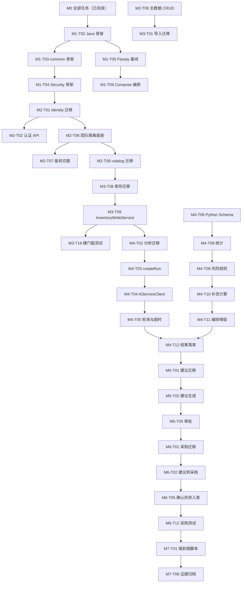

# ShopPilot AI 开发计划（DEVELOPMENT PLAN）

## 文档元信息

| 项 | 内容 |
| --- | --- |
| 文档名称 | ShopPilot AI 开发计划 |
| 文档路径 | `docs/06-development/DEVELOPMENT_PLAN.md` |
| 文档优先级 | P5（见 `DESIGN_BASIS.md §1.1`） |
| 所属阶段 | M0 设计阶段产出；M1 起作为执行依据 |
| 版本 | v1.0（M0 定稿） |
| 上游权威来源 | `DESIGN_BASIS.md`（SSOT，优先级 P0）、`docs/00-product/PRD.md §4.5`（里程碑建议划分）、`docs/01-architecture/PROJECT_STRUCTURE.md`、`docs/01-architecture/MODULE_BOUNDARIES.md`、`docs/decisions/ADR-001-ARCHITECTURE.md` |
| 主要读者 | 项目负责人、开发、测试、验收方 |

### 本文档负责什么

- 定义 **M0~M7 的里程碑划分**：目标 / 前置依赖 / 涉及模块 / 交付物 / 验收标准 / 状态。
- 把每个里程碑**拆解为带编号的小任务**：任务编号（`M<里程碑号>-T<两位序号>`）、任务名、依赖、输入、输出、验收标准、涉及模块、预估类型、状态。
- 给出**任务编号总表**、**依赖关系图（Mermaid）**、**关键路径分析**。
- 明确**里程碑验收的硬门槛**、**计划风险与应对**。
- 明确 **"每个里程碑完成后必须停止并等待确认"** 的执行纪律。

### 本文档不负责什么

- **不定义**术语、命名、枚举值、错误码、补货公式、风险规则阈值、角色代码（唯一权威处为 `DESIGN_BASIS.md`，本文档只引用）。
- **不定义**表结构（见 `docs/02-database/DATABASE_DESIGN.md`）、API 细节（见 `docs/03-api/API_CONTRACT.md`）、内部契约（见 `docs/03-api/AI_SERVICE_CONTRACT.md`）。
- **不定义**测试用例明细（见 `docs/06-development/TEST_STRATEGY.md`）与验收明细（见 `docs/06-development/ACCEPTANCE_CRITERIA.md`）。
- **不定义**技术版本（见 `docs/01-architecture/TECH_STACK.md`）。

### 待决策编号引用约定

本文档引用待决策时，**只引用 `DESIGN_BASIS.md §15` 的 `D-01`~`D-08`**。其他文档（`TECH_STACK.md`、`DATABASE_CONSTRAINTS.md`、`DATABASE_DESIGN.md`、`API_CONTRACT.md`、`IMPORT_WORKFLOW.md`、`INVENTORY_RULES.md` 等）出现的 `D-09` 及之后编号，均为各文档的**建议编号，存在跨文档冲突**；本文档一律不引用其编号，需要指向此类问题时统一写作"（编号待 SSOT 统一，见 `DESIGN_REVIEW.md`）"。

> **重要事实声明**：本项目当前处于 **M0（设计阶段）**。**M0 已完成**（产出设计文档，未写任何代码）。**M1~M7 全部为"未开始"**。本文档中所有"测试""部署""迁移""模型调用"相关描述**均为计划**，**没有任何测试、部署、数据库迁移或模型调用被执行过**。后续每个里程碑必须以**真实命令与真实输出**作为完成证据，**禁止虚构**（见 `ACCEPTANCE_CRITERIA.md §8`）。

---

## 1. 里程碑总览

| 里程碑 | 主题 | 目标（一句话） | 前置依赖 | 涉及模块 | 交付物 | 验收标准（摘要） | 状态 |
| --- | --- | --- | --- | --- | --- | --- | --- |
| **M0** | 设计基线 | 产出全套设计文档与 ADR，冻结 SSOT | — | 无（文档） | 设计文档 22 份 + ADR + 工程文档（见 §2.1） | 文档一致性核对通过；无未登记冲突 | ✅ **已完成** |
| **M1** | 工程骨架与本地运行 | 三端可启动、可连库、健康检查通过 | M0 | `common`（骨架）、`identity`（骨架） | 可运行的 Java/Python/前端骨架 + Compose 编排 + Flyway 基线 | 本地 `docker compose up` 后三服务健康；冒烟测试可运行 | ⬜ 未开始 |
| **M2** | 登录、团队与基础资料 | 认证、团队隔离底座、主数据 CRUD 可用 | M1 | `identity`、`catalog`、`audit`、`common` | 认证/团队/主数据 API + 前端页面 + 隔离测试 | 登录可用；跨团队请求返回 `TEAM-2001`；主数据 CRUD 可用 | ⬜ 未开始 |
| **M3** | 数据导入、销售与库存 | 数据进得来，库存成立且可对账 | M2 | `importdata`、`inventory`、`sales`、`audit` | 导入全流程 + 库存余额/流水 + 销售 + 预警 | 三类导入测试通过（重复/部分失败/一致性）；对账差异为 0 | ⬜ 未开始 |
| **M4** | Python 分析服务 | 确定性分析引擎跑通并落库 | M3 | `analysis`、`service-ai`（8 模块） | Java↔Python 异步分析 + 规则引擎 + 快照落库 | 18 个 golden cases 与 6 条规则用例通过；并发保护生效 | ⬜ 未开始 |
| **M5** | LLM 解释与补货审批 | 建议状态机与审核闭环可用 | M4 | `replenishment`、`service-ai`（`llm`） | 建议生成/审核 API + LLM 解释层 + 前端 | 状态机合法转换全通过；双审批并发仅 1 条成功 | ⬜ 未开始 |
| **M6** | 采购与到货闭环 | 建议转采购、到货入库、回写库存 | M5 | `purchasing`、`inventory`、`audit` | 采购单/到货单全流程 + 入库流水 + 审计查询 | 状态转换表驱动测试通过；超收/重复收货被拒 | ⬜ 未开始 |
| **M7** | 集成、部署与项目交付 | 端到端闭环可复现、可交付 | M6 | 全模块 | 端到端演示脚本 + 部署验证 + 验收证据 | 端到端脚本全通过；新环境部署可复现 | ⬜ 未开始 |

> 里程碑主题与 `PRD.md §4.5` 的建议划分一致。若本文档与 PRD 冲突，**以本文档为准**（`PRD.md §4.1` 已声明里程碑划分以本文档为准）。

---

## 2. M0 · 产品与架构设计（✅ 已完成）

### 2.1 目标

冻结 **SSOT 与全套设计文档**，为 M1 起的编码阶段提供不可随意变动的基线。M0 **只产出文档**，**不产出任何代码、SQL、配置文件**。

### 2.2 前置依赖

无（项目起点）。

### 2.3 涉及模块

无（不涉及代码模块；产出物为 `docs/`）。

### 2.4 M0 实际产出文档清单（26 份）

> **计数口径**：Part A 为 M0 已完成的设计文档（不含 SSOT）共 **21 份**；Part B 为本轮（M0 收口）产出的工程与决策文档共 **5 份**；合计 **26 份**。SSOT `DESIGN_BASIS.md` 作为 P0 基线文档单独列出，不计入 26。

**Part A · 设计文档（21 份，M0 已完成）**

| # | 文档路径 | 类别 |
| --- | --- | --- |
| 1 | `docs/00-product/PRD.md` | 产品 |
| 2 | `docs/00-product/USER_ROLES.md` | 产品 |
| 3 | `docs/01-architecture/SYSTEM_ARCHITECTURE.md` | 架构 |
| 4 | `docs/01-architecture/MODULE_BOUNDARIES.md` | 架构 |
| 5 | `docs/01-architecture/TECH_STACK.md` | 架构 |
| 6 | `docs/01-architecture/PROJECT_STRUCTURE.md` | 架构 |
| 7 | `docs/02-database/DATABASE_DESIGN.md` | 数据库 |
| 8 | `docs/02-database/DATA_DICTIONARY.md` | 数据库 |
| 9 | `docs/02-database/DATABASE_CONSTRAINTS.md` | 数据库 |
| 10 | `docs/02-database/ER_DIAGRAM.md` | 数据库 |
| 11 | `docs/03-api/API_CONTRACT.md` | 接口 |
| 12 | `docs/03-api/AI_SERVICE_CONTRACT.md` | 接口 |
| 13 | `docs/03-api/ERROR_CODES.md` | 接口 |
| 14 | `docs/04-ai/AI_ARCHITECTURE.md` | AI |
| 15 | `docs/04-ai/ANALYSIS_CONTRACT.md` | AI |
| 16 | `docs/04-ai/PROMPT_DESIGN.md` | AI |
| 17 | `docs/05-workflows/IMPORT_WORKFLOW.md` | 流程 |
| 18 | `docs/05-workflows/INVENTORY_WORKFLOW.md` | 流程 |
| 19 | `docs/05-workflows/REPLENISHMENT_WORKFLOW.md` | 流程 |
| 20 | `docs/05-workflows/PURCHASING_WORKFLOW.md` | 流程 |
| 21 | `docs/05-workflows/INVENTORY_RULES.md` | 流程 |

**Part B · 工程与决策文档（5 份，本轮 M0 收口产出）**

| # | 文档路径 | 类别 |
| --- | --- | --- |
| 22 | `docs/06-development/DEVELOPMENT_PLAN.md` | 工程（本文件） |
| 23 | `docs/06-development/CODING_STANDARDS.md` | 工程 |
| 24 | `docs/06-development/TEST_STRATEGY.md` | 工程 |
| 25 | `docs/06-development/ACCEPTANCE_CRITERIA.md` | 工程 |
| 26 | `docs/decisions/ADR-001-ARCHITECTURE.md` | 决策 |

**P0 基线（单独列出，不计入 26）**

| 文档路径 | 说明 |
| --- | --- |
| `docs/DESIGN_BASIS.md` | 单一事实来源（SSOT），全部命名/枚举/错误码/公式/角色的唯一定义处 |

**待补充（M1 起创建）**

| 文档路径 | 说明 | 计划阶段 |
| --- | --- | --- |
| `docs/06-development/DESIGN_REVIEW.md` | 记录所有跨文档不一致与冲突（`DESIGN_BASIS.md §1.2 第 4 条`），当前尚未创建 | M1-T01 |
| `AGENTS.md` | 协作方（人与 AI）行为规则，含文档同步责任（`DESIGN_BASIS.md §16`） | M1-T01 |
| `README.md`、`.gitignore`、`.editorconfig`、`.env.example` | 仓库级文件 | M1-T01 / M1-T10 |

### 2.5 M0 验收标准（已完成）

| # | 验收项 | 判定 |
| --- | --- | --- |
| 1 | SSOT `DESIGN_BASIS.md` 定稿，含 §1~§16 全部章节 | ✅ |
| 2 | 22 张表、10 个 Java 模块、8 个 Python 模块、状态枚举全集、错误码分段、补货公式、风险规则均已定义 | ✅ |
| 3 | ADR-001 覆盖 15 个关键决策，每个决策含可选方案与重评触发条件 | ✅ |
| 4 | 工程文档（开发计划/编码规范/测试策略/验收标准）齐备 | ✅ |
| 5 | 所有跨文档不一致已**识别并登记**（见 §8.2 与 `DESIGN_REVIEW.md`） | ✅（登记待落到 `DESIGN_REVIEW.md`） |

### 2.6 M0 · DO NOT 清单（本阶段明确未做且不允许做）

| # | DO NOT | 说明 |
| --- | --- | --- |
| 1 | 不创建任何代码文件 | 不写 `.java` / `.py` / `.vue` / `.ts`（`DESIGN_BASIS §2.1`：Out of Scope "正式 Flyway 迁移 SQL（M1 起才生成）"） |
| 2 | 不创建 Flyway 迁移 SQL | M1 起才生成（`§2.1`） |
| 3 | 不创建 `pom.xml` / `package.json` / `pyproject.toml` | M1 起 |
| 4 | 不创建 `docker-compose.yml` / `Dockerfile` | M1 起 |
| 5 | 不创建 `.env` / 不写入任何真实密钥 | 仅规划 `.env.example`（M1） |
| 6 | 不安装依赖、不运行构建、不运行测试 | M1 起 |
| 7 | 不初始化数据库、不执行任何 SQL | M1 起 |
| 8 | 不调用任何 LLM 或外部模型 API | M4/M5 起（且测试期必须 Mock） |
| 9 | 不在 `docs/` 之外创建文件 | 保持 M0 产出边界清晰 |

### 2.7 M0 子任务表

| 任务编号 | 任务名 | 依赖 | 输入 | 输出 | 验收标准 | 涉及模块 | 类型 | 状态 |
| --- | --- | --- | --- | --- | --- | --- | --- | --- |
| M0-T01 | 需求与范围冻结 | — | 任务书 | `PRD.md`、`USER_ROLES.md` | 功能清单与追踪矩阵齐备（F-xxx-nn） | 文档 | 文档 | ✅ 已完成 |
| M0-T02 | 架构与模块边界设计 | M0-T01 | PRD | `SYSTEM_ARCHITECTURE.md`、`MODULE_BOUNDARIES.md` | 依赖方向与边界检查清单齐备 | 文档 | 文档 | ✅ 已完成 |
| M0-T03 | 技术选型 | M0-T02 | 架构 | `TECH_STACK.md`、`PROJECT_STRUCTURE.md` | 版本基线与目录树齐备 | 文档 | 文档 | ✅ 已完成 |
| M0-T04 | 数据模型设计 | M0-T02 | 模块边界 | `DATABASE_DESIGN.md`、`DATA_DICTIONARY.md`、`DATABASE_CONSTRAINTS.md`、`ER_DIAGRAM.md` | 22 表 + 约束 + 索引 + 并发方案齐备 | 文档 | 文档 | ✅ 已完成 |
| M0-T05 | API 与内部契约设计 | M0-T04 | 数据模型 | `API_CONTRACT.md`、`AI_SERVICE_CONTRACT.md`、`ERROR_CODES.md` | 契约骨架与错误码齐备 | 文档 | 文档 | ✅ 已完成 |
| M0-T06 | AI 设计与规则说明 | M0-T03 | 技术选型 | `AI_ARCHITECTURE.md`、`ANALYSIS_CONTRACT.md`、`PROMPT_DESIGN.md`、`INVENTORY_RULES.md` | 18 golden cases 与规则用例齐备 | 文档 | 文档 | ✅ 已完成 |
| M0-T07 | 流程文档 | M0-T04 | 数据模型 | `IMPORT_WORKFLOW.md`、`INVENTORY_WORKFLOW.md`、`REPLENISHMENT_WORKFLOW.md`、`PURCHASING_WORKFLOW.md` | 各闭环流程可核对 | 文档 | 文档 | ✅ 已完成 |
| M0-T08 | ADR 决策 | M0-T02~M0-T06 | 全部设计 | `ADR-001-ARCHITECTURE.md` | 15 个决策含可选方案与重评触发 | 文档 | 文档 | ✅ 已完成 |
| M0-T09 | 工程文档 | M0-T08 | ADR | 本文件、`CODING_STANDARDS.md`、`TEST_STRATEGY.md`、`ACCEPTANCE_CRITERIA.md` | 计划/规范/测试/验收齐备 | 文档 | 文档 | ✅ 已完成 |
| M0-T10 | 一致性核对与冲突登记 | M0-T01~M0-T09 | 全部文档 | 一致性核对结论 + 冲突清单 | 所有已知不一致已登记（待落 `DESIGN_REVIEW.md`） | 文档 | 文档 | ✅ 已完成 |

---

## 3. M1 · 工程骨架与本地运行

### 3.1 目标

搭建 **Java（模块化单体 10 模块）+ Python（8 模块）+ 前端（Vue 3 SPA）** 三端工程骨架，落地本地 Docker Compose 编排、Flyway 基线与健康检查，使"三端可启动、可连库、能被健康检查"，并建立最小冒烟测试与 CI。

### 3.2 前置依赖

M0 全部完成。

### 3.3 涉及模块

`common`（基础设施骨架）、`identity`（仅 Maven 骨架与安全配置骨架）、`service-ai`（骨架）、`frontend-web`（骨架）、`deploy`（编排）。

### 3.4 交付物

- `backend-java/`：父 POM + 10 个 Maven 子模块；`common` 的 `ApiResponse` / `BizException` / `ErrorCodes` / `TeamContext` 骨架；Spring Security 基础过滤器链；Actuator 健康端点；Flyway 基线（含 `flyway_schema_history` 初始化，**不建业务表**）。
- `service-ai/`：FastAPI 应用入口 + `/internal/v1/health` + `X-Internal-Token` 校验骨架 + Pydantic 基类。
- `frontend-web/`：Vite + Vue 3 + TS（strict）+ Element Plus + Pinia + Vue Router 骨架，含 axios 实例（Token 与 `X-Request-Id` 拦截器骨架）。
- `deploy/`：`docker-compose.yml`（集成）+ `docker-compose.dev.yml`（开发）+ `nginx/nginx.conf`。
- 根级：`.env.example`、`.gitignore`、`.editorconfig`、`README.md`、`AGENTS.md`、`docs/06-development/DESIGN_REVIEW.md`（首建）。
- 冒烟测试：JUnit 5 冒烟（上下文加载 + 健康端点）、pytest 冒烟（`/health`）、前端 `npm ci && npm run build`。

### 3.5 验收标准

| # | 验收项 | 期望 |
| --- | --- | --- |
| 1 | `docker compose -f deploy/docker-compose.dev.yml up -d` 后，`mysql`/`backend-java`/`service-ai`/`nginx` 均 `healthy` | 全部健康 |
| 2 | `GET /actuator/health`（backend）返回 `UP` | HTTP 200 |
| 3 | `GET /internal/v1/health`（service-ai，**仅内网**）返回 `UP` | HTTP 200 |
| 4 | Flyway 迁移成功（仅基线，无业务表），`flyway_schema_history` 存在 | `Success` |
| 5 | 前端 `npm ci && npm run build` 成功产出 `dist/` | 构建成功 |
| 6 | `service-ai:8000` **未**从宿主机（非容器网络）可达 | 连接失败（符合 `§13.3`） |
| 7 | 冒烟测试可运行且通过 | JUnit / pytest / build 均通过 |
| 8 | `.env.example` 不含任何真实密钥 | 通过人工检查 |

### 3.6 自动化测试要求

- JUnit 5：上下文加载冒烟测试、`/actuator/health` 冒烟测试。
- pytest：`/internal/v1/health` 冒烟测试（`TestClient`）。
- 前端：无单元测试要求（首期仅构建验证 + 手工联调清单）。
- **Testcontainers 在 M1 引入**：至少一个"用真实 MySQL 容器跑 Flyway 基线"的集成测试（验证 `SELECT VERSION() >= 8.0.16`，`CHECK` 约束可用性前提）。

### 3.7 可能风险

| # | 风险 | 缓解 |
| --- | --- | --- |
| 1 | Spring Boot 基线版本（`TECH_STACK.md §1.2.1` 建议 `3.5.x`）与 Java 21 组合存在已过 OSS 支持窗口问题 | M1 前决策是否直接上 `4.x`（`TECH_STACK.md` 建议编号，**编号待 SSOT 统一，见 `DESIGN_REVIEW.md`**）；先锁 `3.5.x` 并在 M7 前评估 |
| 2 | MyBatis-Plus starter 必须用 `mybatis-plus-spring-boot3-starter`，选错 starter 导致启动失败 | M1-T02 明确依赖坐标并冒烟验证 |
| 3 | Testcontainers 需要 Docker 守护进程，CI 环境不支持会导致集成测试不可运行 | M1 明确 CI 前置条件；本地以 Docker Desktop 为准 |
| 4 | `service-ai` 误暴露端口 | Compose 中不写 `ports`，仅 `expose`（`PROJECT_STRUCTURE.md §7.1`） |
| 5 | Flyway 在 MySQL 8 上用 `CHECK` 约束需 ≥ 8.0.16 | 基线迁移脚本断言版本；镜像固定 `mysql:8.0.36` |

### 3.8 No-Go（不允许提前做的事情）

- ❌ 不创建任何**业务表**迁移（`users`/`skus` 等表属 M2/M3）。
- ❌ 不实现任何**业务 API**（登录、CRUD 等属 M2）。
- ❌ 不实现 JWT 的**签发与校验业务逻辑**（仅做 Security 过滤器链骨架与依赖引入；正式认证属 M2-T02）。
- ❌ 不接入任何 LLM（属 M4/M5）。
- ❌ 不实现库存/分析/采购的任何业务代码。

### 3.9 M1 子任务表

| 任务编号 | 任务名 | 依赖 | 输入 | 输出 | 验收标准 | 涉及模块 | 类型 | 状态 |
| --- | --- | --- | --- | --- | --- | --- | --- | --- |
| M1-T01 | 仓库初始化 | M0 | `PROJECT_STRUCTURE.md §1` | `AGENTS.md`、`.gitignore`、`.editorconfig`、`DESIGN_REVIEW.md` 首建 | 目录树与规范文件就位；`DESIGN_REVIEW.md` 已登记已知冲突 | 仓库 | 配置 | ⬜ 未开始 |
| M1-T02 | Java 多模块 Maven 工程骨架 | M1-T01 | `PROJECT_STRUCTURE.md §4.3` | 父 POM + 10 子模块 + `mvnw` | `mvn -q -DskipTests package` 成功；依赖方向在 POM 中体现 | `common` 及各模块 | 代码 | ⬜ 未开始 |
| M1-T03 | `common` 基础设施骨架 | M1-T02 | `MODULE_BOUNDARIES.md §3` | `ApiResponse` / `PageResult` / `BizException` / `GlobalExceptionHandler` / `ErrorCodes` / `TeamContext`（骨架） | `common` 内**无任何业务名词**（检查清单 §3.3） | `common` | 代码 | ⬜ 未开始 |
| M1-T04 | Spring Security 基础配置 | M1-T02 | `TECH_STACK.md §1.2`、`DESIGN_BASIS §5` | Security 过滤器链骨架 + 权限注解占位 | 未认证请求被拒（401 骨架）；框架可启动 | `common`、`identity` | 代码 | ⬜ 未开始 |
| M1-T05 | Flyway 基线与版本守卫 | M1-T02 | `DATABASE_CONSTRAINTS.md` | Flyway 配置 + 基线迁移（仅 schema history）+ MySQL 版本断言 | 迁移成功；`SELECT VERSION() >= 8.0.16` 断言成立 | `common` | 配置 | ⬜ 未开始 |
| M1-T06 | 健康检查与 Actuator | M1-T02/M1-T05 | `NFR-OBS` | `/actuator/health` 暴露 | 返回 `UP` | `common` | 代码 | ⬜ 未开始 |
| M1-T07 | Python 工程骨架 | M1-T01 | `PROJECT_STRUCTURE.md §5`、`§7.2` | FastAPI 入口 + `/internal/v1/health` + `X-Internal-Token` 骨架 + 配置/日志/trace 骨架 | 健康端点返回 `UP`；`core` 不含业务规则 | `service-ai` | 代码 | ⬜ 未开始 |
| M1-T08 | 前端工程骨架 | M1-T01 | `PROJECT_STRUCTURE.md §6` | Vite + Vue3 + TS(strict) + Element Plus + Pinia + Router + axios 实例（拦截器骨架） | `npm ci && npm run build` 成功；`views` 不直接 import axios | `frontend-web` | 代码 | ⬜ 未开始 |
| M1-T09 | Docker Compose 编排与 nginx | M1-T05/M1-T07/M1-T08 | `PROJECT_STRUCTURE.md §7` | `docker-compose.yml`、`docker-compose.dev.yml`、`nginx.conf` | 四服务健康；`service-ai` 绝不暴露 | `deploy` | 配置 | ⬜ 未开始 |
| M1-T10 | `.env.example` 与环境变量约定 | M1-T09 | `PROJECT_STRUCTURE.md §7.2` | `.env.example`（含 `AI_INTERNAL_TOKEN`、`LLM_*`、`JWT_*`、DB） | 不含真实密钥；变量名与文档一致 | 仓库 | 配置 | ⬜ 未开始 |
| M1-T11 | 冒烟测试与 CI | M1-T06/M1-T07/M1-T08 | — | JUnit 冒烟 + pytest 冒烟 + 前端 build 流水 | 三类冒烟均可运行并通过 | 全部 | 测试 | ⬜ 未开始 |
| M1-T12 | README 与本地启动文档 | M1-T09 | — | `README.md` | 按文档步骤可在新环境启动 | 仓库 | 文档 | ⬜ 未开始 |

---

## 4. M2 · 登录、团队与基础资料

### 4.1 目标

打通 **认证与授权、团队隔离底座、主数据（仓库/供应商/商品/SKU）CRUD、主数据启停、审计写入通道**，并交付对应前端页面。

### 4.2 前置依赖

M1 全部完成。

### 4.3 涉及模块

`identity`、`catalog`、`audit`、`common`。

### 4.4 交付物

- 认证：登录/登出/刷新 API（`F-AUTH-01/02/03`）、`UserStatus` 管控。
- 团队：成员与角色管理（`F-TEAM-01`）、团队配置（`F-TEAM-03`）、`TeamContext` 注入 + 租户插件 + `TeamScopeValidator`（`F-TEAM-02`）。
- 统一鉴权切面 + 权限矩阵（`USER_ROLES.md §2.2`）。
- 主数据：仓库/供应商/商品/SKU CRUD（`F-CAT-01~04`）、启停（`F-CAT-05`）。
- 审计写入通道 + `@Audited` 注解（`F-AUD-01` 骨架）。
- 前端：登录页、路由守卫、基础资料页面。
- 迁移：`users`、`teams`、`team_members`、`warehouses`、`suppliers`、`products`、`skus`、`audit_logs`。

### 4.5 验收标准

| # | 验收项 | 期望 |
| --- | --- | --- |
| 1 | 正确账号可登录并获取令牌；登录失败统一返回 `AUTH-1002`（不区分用户是否存在） | 通过 |
| 2 | 禁用用户登录返回 `AUTH-1003`；`DISABLED` 团队任意接口返回 `TEAM-2002` | 通过 |
| 3 | 用 B 团队 Token 访问 A 团队资源 → `TEAM-2001`（含 `OWNER`） | 通过 |
| 4 | 无权限角色操作 → `TEAM-2003`；`OPERATOR` 无法审批 | 通过 |
| 5 | 请求体显式传 `teamId` 被忽略，以 `TeamContext` 为准 | 通过 |
| 6 | 同团队编码重复 → `CAT-3002`；跨团队同编码可成功 | 通过 |
| 7 | 主数据停用后不参与新分析/采购，但历史数据仍可查 | 通过（M3 起可完整验证） |
| 8 | 关键写操作产生审计记录 | 通过 |

### 4.6 自动化测试要求

- 集成测试（`@SpringBootTest` + MockMvc + Testcontainers MySQL）：认证、团队隔离矩阵、跨团队越权（`TEAM-2001`）、编码唯一性（`CAT-3002`）、主数据 CRUD。
- 数据库约束测试：唯一约束（`uk_users_username`、`uk_tm_team_user`、`uk_sku_team_code` 等）、`CHECK` 约束（`ck_sku_status` 等）。
- 前端：登录流程手工联调清单（Vitest 组件测试从 M2 起引入，覆盖登录表单校验）。

### 4.7 可能风险

| # | 风险 | 缓解 |
| --- | --- | --- |
| 1 | `D-01`（JWT vs Session）尚未最终确认，可能影响 Refresh Token 存储位置（`DESIGN_BASIS §15 D-01`：M2 决定存储位置） | M2-T01 前先完成 `D-01` 存储位置决策并登记 ADR |
| 2 | 团队隔离最易出错（SSOT §6 特别警示） | `TeamScopeValidator` 显式校验 + 租户插件兜底双保险；越权测试矩阵必测 |
| 3 | 角色权限矩阵实现与 `USER_ROLES.md` 不一致 | 权限判定以 `USER_ROLES.md §2.2` 为唯一依据；测试覆盖矩阵关键格 |
| 4 | 主数据物理删除导致历史数据失真 | 主数据只软停用（`MasterDataStatus.INACTIVE`），不物理删除 |

### 4.8 No-Go

- ❌ 不实现导入（属 M3）。
- ❌ 不创建库存/销售表（属 M3）。
- ❌ 不实现分析/采购（属 M4/M6）。

### 4.9 M2 子任务表

| 任务编号 | 任务名 | 依赖 | 输入 | 输出 | 验收标准 | 涉及模块 | 类型 | 状态 |
| --- | --- | --- | --- | --- | --- | --- | --- | --- |
| M2-T01 | `identity` 数据模型与迁移 | M1-T05 | `DATABASE_DESIGN.md`、`DATA_DICTIONARY.md` | 迁移：`users`、`teams`、`team_members`（含约束/索引） | Flyway 成功；`CHECK`/唯一约束生效 | `identity` | 代码 | ⬜ 未开始 |
| M2-T02 | 登录 / 登出 / 刷新 API | M2-T01、M1-T04 | `API_CONTRACT.md` | `AuthController` + `AuthAppService`（JWT 签发/校验） | 登录成功发令牌；失败 `AUTH-1002` | `identity` | 代码 | ⬜ 未开始 |
| M2-T03 | 用户状态管控 | M2-T02 | `F-AUTH-03` | `PATCH /users/{id}/status` | 禁用后登录 `AUTH-1003` | `identity` | 代码 | ⬜ 未开始 |
| M2-T04 | 团队成员与角色管理 | M2-T01 | `USER_ROLES.md`、`F-TEAM-01` | 成员 CRUD API（禁止移除 `OWNER`） | 唯一约束 `uk_tm_team_user` 生效；移除 OWNER 被拒 | `identity` | 代码 | ⬜ 未开始 |
| M2-T05 | 团队配置 | M2-T01 | `F-TEAM-03` | `GET/PATCH /team`（时区、名称、`TeamStatus`） | 停用后接口 `TEAM-2002` | `identity` | 代码 | ⬜ 未开始 |
| M2-T06 | 团队隔离底座 | M2-T01 | `DESIGN_BASIS §6` | `TeamContext` + `TenantLineInnerInterceptor` + `TeamScopeValidator` | 6 条硬规则落地；越权 `TEAM-2001` | `common`、`identity` | 代码 | ⬜ 未开始 |
| M2-T07 | 统一鉴权切面与权限矩阵 | M2-T04/M2-T06 | `USER_ROLES.md §2.2` | `@RequireRole` + 切面 | 无权限 `TEAM-2003`（服务端校验） | `common` | 代码 | ⬜ 未开始 |
| M2-T08 | `catalog` 数据模型与迁移 | M2-T06 | `DATABASE_DESIGN.md` | 迁移：`warehouses`、`suppliers`、`products`、`skus` | 复合唯一约束与 `team_id` 最左索引生效 | `catalog` | 代码 | ⬜ 未开始 |
| M2-T09 | 主数据 CRUD API | M2-T08 | `F-CAT-01~04` | 四类资源 Controller + AppService + QueryService | CRUD 可用；跨团队 `TEAM-2001` | `catalog` | 代码 | ⬜ 未开始 |
| M2-T10 | 主数据启停 | M2-T09 | `F-CAT-05`、`Design §9.4` | 启停接口 | 停用后不参与新分析/采购；历史可查 | `catalog` | 代码 | ⬜ 未开始 |
| M2-T11 | 审计写入通道 | M2-T07 | `F-AUD-01`、`MODULE_BOUNDARIES §2.10` | `audit` 模块 + `@Audited` 注解 + `AuditWriteService.record` | 关键操作留痕；审计仅追加 | `audit` | 代码 | ⬜ 未开始 |
| M2-T12 | 前端：登录与基础资料页面 | M2-T02/M2-T09 | `PROJECT_STRUCTURE.md §6` | 登录页、路由守卫、主数据页面 + `api/catalog.ts`、`types/*` | 登录后可访问主数据页；越权由服务端拦截 | `frontend-web` | 代码 | ⬜ 未开始 |
| M2-T13 | 集成测试：认证 / 隔离 / 主数据 | M2-T02~M2-T12 | `DATABASE_CONSTRAINTS.md §8.4`、`TEST_STRATEGY.md` | 集成测试套件 | 越权矩阵、`CAT-3002`、`TEAM-2001/2002/2003` 全通过 | 全部 | 测试 | ⬜ 未开始 |
| M2-T14 | M2 验收与停止确认 | M2-T13 | `ACCEPTANCE_CRITERIA.md §3（M2）` | 验收记录（命令 + 输出） | 硬门槛全部满足；**停止并等待确认** | 全部 | 联调 | ⬜ 未开始 |

---

## 5. M3 · 数据导入、销售与库存

### 5.1 目标

打通 **CSV/Excel 导入全流程**、建立**库存余额与流水（可对账）**、落地**日销售数据**、**补货策略参数**、**库存预警**与**审计查询**。

### 5.2 前置依赖

M2 全部完成。

### 5.3 涉及模块

`importdata`、`inventory`、`sales`、`audit`、`catalog`（被调用）。

### 5.4 交付物

- 导入：批次全生命周期（`F-IMP-01~05`）、模板与字段映射、全量校验与错误报告、分批落库、批次查询。
- 库存：余额/流水（`F-INV-01/02`）、盘点调整（`F-INV-03`）、手工调整（`F-INV-04`）、预警（`F-INV-05`）、`InventoryWriteService`（唯一写入口，含幂等/乐观锁/非负守卫）、`InventoryInTransitQueryService`（在途口径服务）。
- 销售：`F-SAL-01/02`（经导入 + 查询聚合）。
- 策略：`F-CAT-06`（`replenishment_policies`）。
- 审计：`F-AUD-01` 覆盖关键操作。
- 前端：导入向导、库存总览/流水、销售列表。
- 迁移：`import_batches`、`import_row_errors`、`inventory_balances`、`inventory_transactions`、`replenishment_policies`、`sales_daily`。

### 5.5 验收标准（硬门槛见 §9）

| # | 验收项 | 期望 |
| --- | --- | --- |
| 1 | 重复导入同一文件（同 `team_id` + `file_hash` + `biz_type`）返回 `IMP-4004` | 通过 |
| 2 | 部分失败批次进入 `PARTIAL_SUCCESS`，错误报告可下载 | 通过 |
| 3 | 任意 SKU×仓库：`Σ inventory_transactions.qty_delta == inventory_balances.on_hand_qty`（对账差异 = 0） | 通过 |
| 4 | 出库导致负库存被拒 `INV-5001`；并发更新冲突 `INV-5002`；幂等键冲突 `INV-5003` | 通过 |
| 5 | 导入 1 万行完成 < 60s（`NFR-PERF-02`） | 通过 |
| 6 | 导入落库经 `InventoryWriteService` / `CatalogWriteService` / `SalesWriteService`，无直写对方表 | 通过 |
| 7 | 停用主数据不参与新导入校验/分析 | 通过 |

### 5.6 自动化测试要求

- **三类硬门槛测试**：重复导入、部分失败、库存一致性（见 §9）。
- 集成测试：导入幂等（`IMP-4004`）、批次状态守卫（`IMP-4005`）、余额与流水同事务、对账 SQL 校验。
- 并发测试：10 线程并发入库/出库（`P/test` 用例，见 `DATABASE_CONSTRAINTS.md §8.5`）。
- 约束测试：`ck_invbal_on_hand_non_negative`、`ck_invtxn_consistency`、`uk_invtxn_team_idem` 等。

### 5.7 可能风险

| # | 风险 | 缓解 |
| --- | --- | --- |
| 1 | 导入落库部分成功导致数据半成品 | 按批事务 + `PARTIAL_SUCCESS` + 错误报告可重导 |
| 2 | 余额与流水不一致（本项目最严重缺陷之一） | 同事务写 + `CHECK (qty_after = qty_before + qty_delta)` + 对账脚本 + 每日巡检 |
| 3 | 并发首次建余额行冲突 | 唯一约束 `uk_invbal_team_wh_sku` 捕获冲突后转读 + 乐观锁 |
| 4 | `FORCE_REIMPORT` 语义歧义（**编号待 SSOT 统一，见 `DESIGN_REVIEW.md`**） | M3-T02 前明确其是**请求参数**还是**枚举值**，登记 `DESIGN_REVIEW.md` |
| 5 | CSV/Excel 编码与格式差异导致解析失败 | 解析失败明确返回 `IMP-4002`；模板与字段映射降低人工错误 |

### 5.8 No-Go

- ❌ 不实现分析任务（属 M4）。
- ❌ 不实现建议/采购/到货（属 M5/M6）。
- ❌ 不导入 LLM（属 M5）。
- ❌ 不实现库存冲销 `REVERSAL` 的对外 API（属 M6-T08，P1）。

### 5.9 M3 子任务表

| 任务编号 | 任务名 | 依赖 | 输入 | 输出 | 验收标准 | 涉及模块 | 类型 | 状态 |
| --- | --- | --- | --- | --- | --- | --- | --- | --- |
| M3-T01 | 导入数据模型与迁移 | M2-T05 | `DATABASE_DESIGN.md` | 迁移：`import_batches`、`import_row_errors` | `uk_imp_team_hash_biz` 与 `dedupe_hash` 槽位生效 | `importdata` | 代码 | ⬜ 未开始 |
| M3-T02 | 文件上传、哈希与文件级幂等 | M3-T01 | `F-IMP-05`、`DESIGN_BASIS §9.5` | 上传端点 + SHA-256 流式哈希 + `IMP-4004` | 重复上传返回 `IMP-4004` 并写 `DUPLICATE_REJECTED`（槽位 `NULL`） | `importdata` | 代码 | ⬜ 未开始 |
| M3-T03 | 解析与导入模板 | M3-T01 | `F-IMP-01`、`IMPORT_WORKFLOW.md` | CSV/Excel 解析器 + 6 类 `ImportBizType` 模板 | 非法文件 `IMP-4001`；解析失败 `IMP-4002` | `importdata` | 代码 | ⬜ 未开始 |
| M3-T04 | 字段映射 | M3-T03 | `F-IMP-02` | 映射确认端点 + `MAPPED` 状态推进 | 缺列 `IMP-4003`；状态守卫生效 | `importdata` | 代码 | ⬜ 未开始 |
| M3-T05 | 全量校验与错误报告 | M3-T04 | `F-IMP-03` | `validate` + `import_row_errors` | 校验产出错误报告；进入 `VALIDATED` | `importdata` | 代码 | ⬜ 未开始 |
| M3-T06 | 分批落库执行 | M3-T05 | `MODULE_BOUNDARIES §2.4` | `execute`（按批发事务） | 支持 `COMPLETED`/`PARTIAL_SUCCESS`/`FAILED` | `importdata` | 代码 | ⬜ 未开始 |
| M3-T07 | 批次查询与错误下载 | M3-T06 | `F-IMP-04` | `GET /imports`、`/imports/{id}`、`/imports/{id}/errors` | 状态可跟踪；错误报告可下载 | `importdata` | 代码 | ⬜ 未开始 |
| M3-T08 | 库存数据模型与迁移 | M2-T08 | `DATABASE_DESIGN.md` | 迁移：`inventory_balances`、`inventory_transactions`、`replenishment_policies` | 约束/索引/生成列生效 | `inventory` | 代码 | ⬜ 未开始 |
| M3-T09 | `InventoryWriteService` | M3-T08、M2-T06 | `MODULE_BOUNDARIES §2.5` | 唯一写入口（初始导入/入库/出库/盘点/手工调整） | 幂等/乐观锁/非负/同事务全部生效 | `inventory` | 代码 | ⬜ 未开始 |
| M3-T10 | 库存查询 API | M3-T09 | `F-INV-01/02` | 余额/流水查询（键集分页） | 列表 p95 < 500ms（1 万 SKU） | `inventory` | 代码 | ⬜ 未开始 |
| M3-T11 | 盘点调整与手工调整 API | M3-T09 | `F-INV-03/04` | 两个端点（手工调整需 `ADMIN`+） | 差额为 0 不写流水；权限校验生效 | `inventory` | 代码 | ⬜ 未开始 |
| M3-T12 | 销售数据模型与 `SalesWriteService` | M2-T08 | `F-SAL-01` | 迁移：`sales_daily` + upsert 写服务 | 唯一约束 `uk_sales_team_wh_sku_date` upsert 语义生效 | `sales` | 代码 | ⬜ 未开始 |
| M3-T13 | 销售查询与聚合 API | M3-T12 | `F-SAL-02`、`MODULE_BOUNDARIES §2.6` | `SalesQueryService.getSeries`（供分析） | 按日期升序序列正确 | `sales` | 代码 | ⬜ 未开始 |
| M3-T14 | 库存预警 API | M3-T09 | `F-INV-05` | `GET /inventory/alerts` | 命中 `idx_invbal_team_available` | `inventory` | 代码 | ⬜ 未开始 |
| M3-T15 | 补货策略参数维护 | M3-T08 | `F-CAT-06` | 策略 upsert API | `uk_pol_team_sku_wh` upsert 吸收 | `inventory` | 代码 | ⬜ 未开始 |
| M3-T16 | 在途口径服务 | M3-T08 | `MODULE_BOUNDARIES §5.1` | `InventoryInTransitQueryService`（骨架） | 接口存在且为 M4 就绪 | `inventory` | 代码 | ⬜ 未开始 |
| M3-T17 | 审计覆盖关键操作 | M3-T09/M3-T11 | `F-AUD-01` | 各写操作埋点 | 高风险写操作必有审计 | `audit` | 代码 | ⬜ 未开始 |
| M3-T18 | 前端：导入向导 + 库存/销售页 | M3-T07/M3-T10/M3-T13 | `PROJECT_STRUCTURE.md §6` | 导入向导、库存总览、流水、销售列表 | 页面可用；`IP` 与 `available_qty` 口径区分展示 | `frontend-web` | 代码 | ⬜ 未开始 |
| M3-T19 | **硬门槛测试：重复导入/部分失败/库存一致性** | M3-T06/M3-T09 | `TEST_STRATEGY.md §8` | 三类测试套件 + 对账断言 | 三类全通过；对账差异 = 0 | 全部 | 测试 | ⬜ 未开始 |
| M3-T20 | M3 验收与停止确认 | M3-T19 | `ACCEPTANCE_CRITERIA.md §3（M3）` | 验收记录 | 硬门槛满足；**停止并等待确认** | 全部 | 联调 | ⬜ 未开始 |

---

## 6. M4 · Python 分析服务

### 6.1 目标

打通 **Java↔Python 异步分析链路**：Java 建 `analysis_runs`（`PENDING`）→ 同步预检 → 异步执行 → 状态轮询 → 结果落库（`analysis_items` 快照）→ 并发保护与超时兜底。Python 侧完成 **8 模块**与**确定性规则引擎**。

### 6.2 前置依赖

M3 全部完成。

### 6.3 涉及模块

`analysis`（Java）、`service-ai`（8 模块）、`inventory`/`sales`/`catalog`（被调用）。

### 6.4 交付物

- Java：`analysis_runs`/`analysis_items` 迁移、`AnalysisAppService.createRun`（幂等 + `ANL-7001`）、`AiServiceClient`（RestClient + `X-Internal-Token` + `X-Request-Id`）、状态轮询与 `timeout_at` 兜底、结果二次校验与落库（`ANL-7004`）、快照查询、取消。
- Python：`schemas`、`validation`（数据质量分级）、`analytics/sales_stats`（`D`/CV/3σ）、`rules/risk_rules`（6 规则）、`rules/replenishment`（`Q_base`→`Q_suggest`）、`orchestration`（顺序编排 + 进度 + 降级）、`core`（配置/日志/trace/http/异常）。
- 测试：18 个 golden cases、6 条规则 × 3 用例。
- 前端：分析任务创建与进度页面（2s→10s 指数退避轮询）。

### 6.5 验收标准

| # | 验收项 | 期望 |
| --- | --- | --- |
| 1 | 同团队已有进行中运行 → `ANL-7001` | 通过 |
| 2 | AI 服务不可用 → `ANL-7002`；超时 → `ANL-7003` | 通过 |
| 3 | Python 返回未过 Schema 校验 → `ANL-7004`，**不落库** | 通过 |
| 4 | `n < MIN_DAYS` → `DATA_INSUFFICIENT`、`D=null`、**不生成建议** | 通过 |
| 5 | 18 个 golden cases 逐字段断言通过（`enable_llm=false` 时 `llm_*` 为空/`SKIPPED`） | 通过 |
| 6 | 6 条规则各 ≥3 用例（命中边界/未命中/数据不足）通过 | 通过 |
| 7 | 单次分析 500 SKU < 60s（不含 LLM） | 通过 |
| 8 | Java 为状态唯一权威；Python 不写业务库 | 通过（代码评审 + 架构检查） |

### 6.6 自动化测试要求

- Python 单元：规则、统计、补货计算（pytest）。
- Python API：`TestClient` + 契约测试（响应符合 Pydantic Schema）。
- Java 集成：异步流程、并发保护、超时兜底、结果落库幂等（`uk_ai_run_sku_wh`）。
- golden cases 与规则用例作为**回归基线**。

### 6.7 可能风险

| # | 风险 | 缓解 |
| --- | --- | --- |
| 1 | Java 与 Python 数值精度不一致（`BigDecimal` vs `Decimal`） | 约定 `§14.2`；pandas 计算结果显式转 `Decimal`；契约测试逐字段比对 |
| 2 | 双写状态导致状态不一致 | `§13.2` 明确 Java 权威；Python 不写业务库 |
| 3 | 超时任务悬挂 | `timeout_at` 兜底 + 系统级扫描（`idx_run_timeout`） |
| 4 | ~~`R-LOWSTOCK` 与 `R-STOCKOUT` 互斥关系存在文档张力~~ | **已解决**（M0 审查裁定为可共存，SSOT `§11` 已同步）；无需在 M4-T09 前再确认，测试按 GC-02 断言 |
| 5 | `app/` 与包根 `shoppilot_ai` 关系未明确（`PROJECT_STRUCTURE.md §11.1 #1`） | M4-T01 前统一约定并登记 `DESIGN_REVIEW.md` |

### 6.8 No-Go

- ❌ 不接入 LLM（LLM 解释层属 M5；M4 的 `enable_llm=false`）。
- ❌ 不生成补货建议（属 M5）。
- ❌ 不在 Python 侧连接业务数据库。

### 6.9 M4 子任务表

| 任务编号 | 任务名 | 依赖 | 输入 | 输出 | 验收标准 | 涉及模块 | 类型 | 状态 |
| --- | --- | --- | --- | --- | --- | --- | --- | --- |
| M4-T01 | 内部契约落地与认证 | M3-T16、M1-T07 | `AI_SERVICE_CONTRACT.md`、`DESIGN_BASIS §13` | `X-Internal-Token` + `X-Request-Id` 贯通 | 内部接口鉴权与链路追踪生效 | `analysis`、`service-ai` | 代码 | ⬜ 未开始 |
| M4-T02 | 分析数据模型与迁移 | M3-T08 | `DATABASE_DESIGN.md` | 迁移：`analysis_runs`、`analysis_items` | `uk_run_team_idem`、`uk_ai_run_sku_wh` 生效 | `analysis` | 代码 | ⬜ 未开始 |
| M4-T03 | `createRun`（幂等 + 并发保护） | M4-T02 | `F-ANL-01`、`DESIGN_BASIS §9.7` | `AnalysisAppService.createRun` | 同键同体返回原 run；已有运行中 → `ANL-7001` | `analysis` | 代码 | ⬜ 未开始 |
| M4-T04 | `AiServiceClient`（预检 + 异步发起） | M4-T03 | `DESIGN_BASIS §13.1/§13.4` | RestClient（超时 5s/10s） | 预检 5s 快速失败；发起返回 202 | `analysis` | 代码 | ⬜ 未开始 |
| M4-T05 | 状态轮询与超时兜底 | M4-T04 | `F-ANL-02/07` | 轮询 + `timeout_at` 扫描 | `TIMEOUT` 可达；`RUNNING` 状态守卫 | `analysis` | 代码 | ⬜ 未开始 |
| M4-T06 | Python Schema 层 | M1-T07 | `§7.2`、`ANALYSIS_CONTRACT.md` | `AnalyzeRequest`/`AnalyzeResponse`（Pydantic v2） | 契约与 Java 侧一致 | `service-ai` | 代码 | ⬜ 未开始 |
| M4-T07 | Python 数据质量分级 | M4-T06 | `validation` 职责 | `data_quality.py` | 缺口/异常值/样本不足可分级 | `service-ai` | 代码 | ⬜ 未开始 |
| M4-T08 | Python 销量统计 | M4-T06 | `DESIGN_BASIS §10.1` | `sales_stats.py`（`D`/CV/3σ 截尾） | golden cases 中 `D` 断言通过 | `service-ai` | 代码 | ⬜ 未开始 |
| M4-T09 | Python 风险规则 | M4-T08 | `DESIGN_BASIS §11` | `risk_rules.py`（6 规则） | 6 规则各 ≥3 用例通过 | `service-ai` | 代码 | ⬜ 未开始 |
| M4-T10 | Python 补货计算 | M4-T09 | `DESIGN_BASIS §10.2~10.5` | `replenishment.py`（`Q_base`→`Q_suggest`） | MOQ/倍数/预算截断断言通过 | `service-ai` | 代码 | ⬜ 未开始 |
| M4-T11 | Python 编排与降级 | M4-T07~M4-T10 | `§7.2 orchestration` | `pipeline.py`/`progress.py`/`degradation.py` | 步骤状态可查；规则层不受 LLM 影响 | `service-ai` | 代码 | ⬜ 未开始 |
| M4-T12 | Java 结果二次校验与落库 | M4-T05/M4-T06 | `§13.2`、`F-ANL-06` | `handleCallback` + `AnalysisWriteService` | Schema 不符 → `ANL-7004` 且不落库 | `analysis` | 代码 | ⬜ 未开始 |
| M4-T13 | 快照查询 API | M4-T12 | `F-ANL-06` | `GET /analysis/runs/{id}/items` | 快照不可变可查 | `analysis` | 代码 | ⬜ 未开始 |
| M4-T14 | 任务取消 API | M4-T03 | `F-ANL-07` | `POST /analysis/runs/{id}:cancel` | `CANCELLED` 状态守卫生效 | `analysis` | 代码 | ⬜ 未开始 |
| M4-T15 | golden cases 与规则用例 | M4-T08~M4-T11 | `ANALYSIS_CONTRACT.md`、`INVENTORY_RULES.md §6` | 18 + 20 用例 | 逐字段断言通过 | `service-ai` | 测试 | ⬜ 未开始 |
| M4-T16 | 前端：分析创建与进度页 | M4-T03/M4-T13 | `NFR-PERF-05` | 创建/进度/结果页 + `usePolling` | 页面卸载停止轮询 | `frontend-web` | 代码 | ⬜ 未开始 |
| M4-T17 | M4 验收与停止确认 | M4-T15 | `ACCEPTANCE_CRITERIA.md §3（M4）` | 验收记录 | 硬门槛满足；**停止并等待确认** | 全部 | 联调 | ⬜ 未开始 |

---

## 7. M5 · LLM 解释与补货审批

### 7.1 目标

打通 **补货建议状态机 + 人工审核闭环**，并接入 **LLM 解释层（可降级）**与**结构化输出校验**。

### 7.2 前置依赖

M4 全部完成。

### 7.3 涉及模块

`replenishment`、`service-ai`（`llm`）、`analysis`/`inventory`/`catalog`（被调用）。

### 7.4 交付物

- `replenishment_items`/`replenishment_reviews` 迁移。
- `ReplenishmentGenerationService.generateFromRun`（编排入口，避免 `analysis → replenishment` 反向依赖）。
- 建议生成（`SUGGESTED`）、改量（乐观锁）、提交/撤回、审批/驳回（驳回必填意见）、作废/被取代、审核记录查询。
- Python `llm` 模块（Prompt 加载、OpenAI 兼容 client、输出 Schema 校验、降级）。
- LLM 降级链路（`FAILED`/`TIMEOUT`/`VALIDATION_FAILED` → `DEGRADED`）。
- 前端：建议列表与审核页面。
- 覆盖：`F-RPL-01~06`、`F-ANL-08`（LLM 解释层，P1）。

### 7.5 验收标准

| # | 验收项 | 期望 |
| --- | --- | --- |
| 1 | 状态机合法转换全通过；非法转换被拒 `RPL-8001` | 通过 |
| 2 | 重复提交/审批 → `RPL-8002`；改量并发冲突 → `RPL-8003` | 通过 |
| 3 | 2 线程同时审批 → 恰好 1 条成功 | 通过 |
| 4 | `OPERATOR` 无法审批 → `TEAM-2003` | 通过 |
| 5 | 驳回未填意见 → `CHECK`/应用层拒绝 | 通过 |
| 6 | LLM 关闭/故障 → 任务 `DEGRADED`，规则结果完整 | 通过 |
| 7 | LLM 输出含编造数字/非法枚举/超范围 SKU → Schema 校验失败 → `VALIDATION_FAILED` | 通过 |
| 8 | 已审批建议不被新一轮分析覆盖（转为 `SUPERSEDED` 规则明确） | 通过 |

### 7.6 自动化测试要求

- 状态机表驱动测试（合法全通过、非法全被拒）。
- 并发审批测试（CountDownLatch）。
- **模型调用测试必须使用 Mock/固定 fixture，禁止全部调用真实模型**（理由见 `TEST_STRATEGY.md §11`）。
- AI 输出结构校验测试（Schema、必填、精度、非法枚举、超范围 SKU）。
- 降级路径测试（模拟超时、非法 JSON、Schema 失败、编造数字）。

### 7.7 可能风险

| # | 风险 | 缓解 |
| --- | --- | --- |
| 1 | LLM 产生幻觉数字，误导审批 | LLM 不参与判定；输出必过 Schema 校验；失败即 `DEGRADED` |
| 2 | 真实模型调用成本与不稳定 | 测试全用 Mock/fixture；仅在人工演示时可选真实调用 |
| 3 | 建议算法派发入口归属歧义（`MODULE_BOUNDARIES §8.2 E-2`） | 以 `ReplenishmentGenerationService.generateFromRun` 为唯一入口；ADR 固化 |
| 4 | `SUPERSEDED` 与"已审批不被覆盖"语义冲突 | 明确规则：新 run 只取代未审批的建议（`SUGGESTED`/`PENDING_REVIEW`），已 `APPROVED`+ 不自动取代；登记 ADR/`DESIGN_REVIEW.md` |

### 7.8 No-Go

- ❌ 不实现采购单与到货（属 M6）。
- ❌ 不由 LLM 执行任何写操作或审批。
- ❌ 不在 Python 侧写业务库。

### 7.9 M5 子任务表

| 任务编号 | 任务名 | 依赖 | 输入 | 输出 | 验收标准 | 涉及模块 | 类型 | 状态 |
| --- | --- | --- | --- | --- | --- | --- | --- | --- |
| M5-T01 | 建议数据模型与迁移 | M4-T12 | `DATABASE_DESIGN.md` | 迁移：`replenishment_items`、`replenishment_reviews` | `uk_repl_run_sku_wh`、`ck_rr_comment_required` 生效 | `replenishment` | 代码 | ⬜ 未开始 |
| M5-T02 | 建议生成编排入口 | M5-T01、M4-T13 | `MODULE_BOUNDARIES §8.2 E-2` | `ReplenishmentGenerationService.generateFromRun` | 由分析明细派生 `SUGGESTED` 建议 | `replenishment` | 代码 | ⬜ 未开始 |
| M5-T03 | 建议数量人工修改 | M5-T02 | `F-RPL-02` | 改量 + 乐观锁 | 冲突返回 `RPL-8003` | `replenishment` | 代码 | ⬜ 未开始 |
| M5-T04 | 提交 / 撤回 | M5-T03 | `F-RPL-03` | `:submit` / `:withdraw` + 审核记录 | 同事务写状态与审核记录 | `replenishment` | 代码 | ⬜ 未开始 |
| M5-T05 | 审批通过 / 驳回 | M5-T04、M2-T07 | `F-RPL-04`、`DESIGN_BASIS §9.11` | `:approve` / `:reject`（驳回必填意见） | 双审批并发仅 1 条成功 | `replenishment` | 代码 | ⬜ 未开始 |
| M5-T06 | 作废与被取代 | M5-T05 | `F-RPL-05` | `:cancel` + `SUPERSEDED` 逻辑 | 新 run 取代未审批建议；已审批不自动覆盖 | `replenishment` | 代码 | ⬜ 未开始 |
| M5-T07 | 审核记录查询 | M5-T04 | `F-RPL-06` | 审核时间线查询 | 记录完整可追溯 | `replenishment` | 代码 | ⬜ 未开始 |
| M5-T08 | Python LLM 模块 | M4-T11 | `§7.2 llm`、`PROMPT_DESIGN.md` | prompt 加载 + client + validator | 输出经 Schema 校验才返回 | `service-ai` | 代码 | ⬜ 未开始 |
| M5-T09 | LLM 降级链路 | M5-T08、M4-T12 | `DESIGN_BASIS §9.7/§9.8` | 降级策略 + `DEGRADED` 回写 | 失败/超时/校验失败均不丢规则结果 | `service-ai`、`analysis` | 代码 | ⬜ 未开始 |
| M5-T10 | AI 输出结构校验测试 | M5-T09 | `TEST_STRATEGY.md §12` | 校验测试套件（Mock fixture） | 非法输出全部被拦截 | `service-ai` | 测试 | ⬜ 未开始 |
| M5-T11 | 前端：建议与审核页 | M5-T07 | `PROJECT_STRUCTURE.md §6` | 建议列表 + 审核页 | 审批入口按角色可见；服务端校验 | `frontend-web` | 代码 | ⬜ 未开始 |
| M5-T12 | 集成测试：状态机/权限/并发 | M5-T05 | `TEST_STRATEGY.md §9` | 表驱动 + 并发测试 | 全部通过 | 全部 | 测试 | ⬜ 未开始 |
| M5-T13 | M5 验收与停止确认 | M5-T12 | `ACCEPTANCE_CRITERIA.md §3（M5）` | 验收记录 | 硬门槛满足；**停止并等待确认** | 全部 | 联调 | ⬜ 未开始 |

---

## 8. M6 · 采购与到货闭环

### 8.1 目标

打通 **已审批建议 → 采购单 → 到货登记 → 确认入库 → 回写库存**的闭环，并交付审计查询、库存冲销（P1）与对应前端页面。

### 8.2 前置依赖

M5 全部完成。

### 8.3 涉及模块

`purchasing`、`inventory`、`replenishment`（被调用）、`audit`。

### 8.4 交付物

- `purchase_orders`/`purchase_order_items`/`goods_receipts`/`goods_receipt_items` 迁移。
- `createFromApprovedItems`（`PO-9001` 守卫 + `markConverted` 同事务）、确认/下单/取消。
- 到货登记草稿、确认到货（`PURCHASE_INBOUND` + PO 状态推导）、部分到货、超额收货守卫（`PO-9002`）、重复收货幂等。
- 库存冲销 `REVERSAL`（`F-INV-06`，P1）。
- 审计查询 `F-AUD-02`；审计权限方案（`D-05`）。
- 在途口径闭环（`MODULE_BOUNDARIES §8.2 E-1`：`purchasing` → `inventory` 只读投影）。
- 前端：采购单与到货页面。
- 覆盖：`F-PO-01~06`、`F-AUD-02`、`F-INV-06`、`F-PO-07`、`F-IMP-06`、`F-RPL-07`（P1）。

### 8.5 验收标准

| # | 验收项 | 期望 |
| --- | --- | --- |
| 1 | 同一建议重复转采购 → `PO-9001` | 通过 |
| 2 | 到货数量超待收 → `PO-9002` | 通过 |
| 3 | 采购单状态非法转换 → `PO-9003` | 通过 |
| 4 | 采购单创建**不改变库存** | 通过（余额与流水不变） |
| 5 | 只有**确认到货**才产生 `PURCHASE_INBOUND` 流水与库存变更 | 通过 |
| 6 | `received_qty ≤ ordered_qty`（DB `CHECK` + 应用层双保险） | 通过 |
| 7 | 部分到货 → `PARTIALLY_RECEIVED`；全部到货 → `RECEIVED` | 通过 |
| 8 | 重复确认同一到货单 → 幂等（只入库一次） | 通过 |
| 9 | 一次请求全链路 `requestId` 可查（含审计） | 通过 |

### 8.6 自动化测试要求

- 状态转换表驱动测试（合法全通过、非法全被拒、部分到货、超额收货、重复收货）。
- 事务与回滚测试（`DATABASE_CONSTRAINTS.md §8.6`：确认到货中途异常全回滚）。
- 并发测试（建议转采购、重复确认到货）。
- 端到端回归（为 M7 打基础）。

### 8.7 可能风险

| # | 风险 | 缓解 |
| --- | --- | --- |
| 1 | 跨模块事务一致性（`purchasing` 调用 `inventory` 写服务） | 同事务 + `REQUIRED` 传播；被调用方不提交/回滚外层事务 |
| 2 | 在途口径数据来源的实现路径未定（`E-1`） | 采用方案 A（`purchasing → inventory` 只读投影）；ADR 固化 |
| 3 | 审计事务策略未定（`D-05`） | 高风险操作与业务同事务或提交后立即写入并可补偿；ADR 固化 |
| 4 | 采购单状态推导错误（由明细到货情况推导） | 表驱动测试 + 状态守卫式 UPDATE |

### 8.8 No-Go

- ❌ 不实现 ML 预测、平台 API 对接、MQ、Redis（`§2.1` Out of Scope）。
- ❌ 不新增独立采购审批流（`D-06`：首期 `APPROVER` 直接确认即视为审批）。
- ❌ 不由 LLM 或 Python 直接写采购/库存数据。

### 8.9 M6 子任务表

| 任务编号 | 任务名 | 依赖 | 输入 | 输出 | 验收标准 | 涉及模块 | 类型 | 状态 |
| --- | --- | --- | --- | --- | --- | --- | --- | --- |
| M6-T01 | 采购数据模型与迁移 | M5-T01 | `DATABASE_DESIGN.md` | 迁移：`purchase_orders`、`purchase_order_items`、`goods_receipts`、`goods_receipt_items` | `uk_po_team_idem`、`uk_gr_team_idem`（`NOT NULL`）、`ck_poi_received_range` 生效 | `purchasing` | 代码 | ⬜ 未开始 |
| M6-T02 | 由已审批建议生成采购单 | M6-T01、M5-T05 | `F-PO-01`、`DESIGN_BASIS §12.3` | `createFromApprovedItems`（含 `markConverted` 同事务） | 重复转采购 → `PO-9001`；建议变 `CONVERTED` | `purchasing`、`replenishment` | 代码 | ⬜ 未开始 |
| M6-T03 | 采购单确认 / 下单 / 取消 | M6-T02 | `F-PO-02/03` | `:confirm`（仅 `APPROVER`+）/`:order`/`:cancel` | 状态守卫生效；取消含在途影响提示 | `purchasing` | 代码 | ⬜ 未开始 |
| M6-T04 | 到货登记草稿 | M6-T03 | `F-PO-04` | `createDraft` | 草稿不产生流水；幂等键 `NOT NULL` | `purchasing` | 代码 | ⬜ 未开始 |
| M6-T05 | 确认到货入库 | M6-T04、M3-T09 | `F-PO-05`、`DESIGN_BASIS §9.6/§9.13` | `confirm`→`InventoryWriteService.applyInbound` | 产生 `PURCHASE_INBOUND`；PO 状态正确推导 | `purchasing`、`inventory` | 代码 | ⬜ 未开始 |
| M6-T06 | 部分到货与超额收货守卫 | M6-T05 | `F-PO-04` | `PARTIALLY_RECEIVED` + `PO-9002` | 超收拒绝；`received_qty ≤ ordered_qty` | `purchasing` | 代码 | ⬜ 未开始 |
| M6-T07 | 采购单与到货单查询 | M6-T06 | `F-PO-06` | 列表与详情查询 | 分页正确；团队隔离生效 | `purchasing` | 代码 | ⬜ 未开始 |
| M6-T08 | 库存冲销 REVERSAL（P1） | M6-T05 | `F-INV-06` | `:reverse` + 唯一约束守卫 | 一笔流水只能冲销一次 | `inventory` | 代码 | ⬜ 未开始 |
| M6-T09 | 审计查询与审计权限方案 | M6-T05 | `F-AUD-02`、`D-05` | `GET /audit-logs` + 审计策略 | 仅追加；高风险同事务 | `audit` | 代码 | ⬜ 未开始 |
| M6-T10 | 在途口径闭环（E-1） | M6-T05 | `MODULE_BOUNDARIES §8.2 E-1` | 只读投影写入 `inventory` | 在途口径单点解释；方向合法 | `purchasing`、`inventory` | 代码 | ⬜ 未开始 |
| M6-T11 | 前端：采购单与到货页 | M6-T07 | `PROJECT_STRUCTURE.md §6` | 采购单/到货页面 | 闭环操作可用 | `frontend-web` | 代码 | ⬜ 未开始 |
| M6-T12 | 集成测试：状态/部分到货/重复收货 | M6-T06 | `TEST_STRATEGY.md §10` | 表驱动 + 并发 + 回滚测试 | 全部通过 | 全部 | 测试 | ⬜ 未开始 |
| M6-T13 | M6 验收与停止确认 | M6-T12 | `ACCEPTANCE_CRITERIA.md §3（M6）` | 验收记录 | 硬门槛满足；**停止并等待确认** | 全部 | 联调 | ⬜ 未开始 |

---

## 9. M7 · 集成、部署与项目交付

### 9.1 目标

完成 **端到端集成、性能/安全/可观测性验证、部署可复现、文档一致性复核、验收证据归档**，使项目达到可交付状态。

### 9.2 前置依赖

M6 全部完成。

### 9.3 涉及模块

全部模块。

### 9.4 交付物

- 端到端演示脚本（15~20 步完整闭环）。
- 性能验证报告（`NFR-PERF-01/02` + 单次分析 500 SKU < 60s）。
- 安全验证报告（无密钥入库、越权拦截、SQL 注入防护）。
- 可观测性验证（`requestId` 全链路贯通）。
- Docker Compose 部署验证清单 + 新环境部署步骤。
- 文档一致性复核 + `DESIGN_REVIEW.md` 闭环。
- 验收证据归档 + 遗留问题登记。
- Spring Boot 升级评估（`TECH_STACK.md §3.2` 强制评审项）。
- 审计 DB 级权限评估（`D-05`）。

### 9.5 验收标准

| # | 验收项 | 期望 |
| --- | --- | --- |
| 1 | 端到端脚本全通过（导入→分析→建议→审批→采购→到货→入库→对账） | 通过 |
| 2 | 列表接口 p95 < 500ms；1 万行导入 < 60s；500 SKU 分析 < 60s（不含 LLM） | 通过 |
| 3 | 仓库内无任何真实密钥；越权一律 403；SQL 注入无法通过 | 通过 |
| 4 | 任一次请求可用 `requestId` 查全链路日志（含审计） | 通过 |
| 5 | 新环境按文档部署可复现（三服务健康 + 迁移成功） | 通过 |
| 6 | 设计文档一致性核对通过（`DESIGN_REVIEW.md` 无未闭环冲突） | 通过 |

### 9.6 自动化测试要求

- 全量回归：单元 + 集成 + 规则引擎用例 + 端到端。
- 性能基准脚本（可复现命令）。
- 安全测试（越权矩阵、注入载荷）。

### 9.7 可能风险

| # | 风险 | 缓解 |
| --- | --- | --- |
| 1 | 端到端在某环节失败暴露跨模块集成缺陷 | 提前在 M6 做端到端回归演练 |
| 2 | 性能未达标（列表接口 / 导入 / 分析） | 提前用 `EXPLAIN` 验证索引命中；导入按 500 行分批 |
| 3 | Spring Boot `3.5.x` OSS 支持已结束的安全债 | M7-T09 完成升级评估或商业支持预案 |
| 4 | 遗留问题被隐瞒 | 强制登记到 `DESIGN_REVIEW.md` 或新 ADR（`ACCEPTANCE_CRITERIA.md §9`） |

### 9.8 No-Go

- ❌ 不引入 K8s / MQ / Redis（`§2.1`）。
- ❌ 不"声称通过但无证据"（见 `ACCEPTANCE_CRITERIA.md §8`）。

### 9.9 M7 子任务表

| 任务编号 | 任务名 | 依赖 | 输入 | 输出 | 验收标准 | 涉及模块 | 类型 | 状态 |
| --- | --- | --- | --- | --- | --- | --- | --- | --- |
| M7-T01 | 端到端演示脚本 | M6-T12 | `ACCEPTANCE_CRITERIA.md §7` | 15~20 步闭环脚本 | 全流程可在演示数据上跑通 | 全部 | 联调 | ⬜ 未开始 |
| M7-T02 | 性能验证 | M7-T01 | `NFR-PERF-01/02` | 性能报告（命令 + 实测） | 指标达标 | 全部 | 测试 | ⬜ 未开始 |
| M7-T03 | 安全验证 | M7-T01 | `NFR-SEC` | 安全报告 | 无密钥入库；越权 403；注入无效 | 全部 | 测试 | ⬜ 未开始 |
| M7-T04 | 可观测性验证 | M7-T01 | `NFR-OBS-01` | 链路追踪证据 | `requestId` 全链路贯通 | 全部 | 测试 | ⬜ 未开始 |
| M7-T05 | Docker Compose 部署验证 | M7-T01 | `PROJECT_STRUCTURE.md §7.1` | 部署验证清单 | 7 项清单全通过 | `deploy` | 配置 | ⬜ 未开始 |
| M7-T06 | 新环境部署可复现 | M7-T05 | `README.md` | 部署步骤记录 | 新环境按文档可复现 | 全部 | 联调 | ⬜ 未开始 |
| M7-T07 | 文档一致性复核 | M7-T01~M7-T06 | `DESIGN_REVIEW.md` | 一致性报告 | 无未闭环冲突 | 文档 | 文档 | ⬜ 未开始 |
| M7-T08 | 验收证据归档与遗留登记 | M7-T02~M7-T07 | `ACCEPTANCE_CRITERIA.md §8/§9` | 证据包 + 遗留清单 | 每条验收有命令+输出 | 全部 | 文档 | ⬜ 未开始 |
| M7-T09 | Spring Boot 升级评估 | M6-T13 | `TECH_STACK.md §3.2` | 评估结论（ADR 或修订） | 明确升级或商业支持预案 | 全部 | 文档 | ⬜ 未开始 |
| M7-T10 | 审计 DB 级权限评估（`D-05`） | M6-T09 | `DESIGN_BASIS §15 D-05` | 评估结论 | 按需加 DB 级权限或维持现状 | `audit` | 配置 | ⬜ 未开始 |

---

## 10. 任务编号总表

> 统计：**M0 10 个（已完成）**、M1 12 个、M2 14 个、M3 20 个、M4 17 个、M5 13 个、M6 13 个、M7 10 个；**合计 109 个任务**（其中 M1~M7 = 99 个待开始）。

### 10.1 M0（已完成）

| 编号 | 任务名 | 状态 |
| --- | --- | --- |
| M0-T01 | 需求与范围冻结 | ✅ |
| M0-T02 | 架构与模块边界设计 | ✅ |
| M0-T03 | 技术选型 | ✅ |
| M0-T04 | 数据模型设计 | ✅ |
| M0-T05 | API 与内部契约设计 | ✅ |
| M0-T06 | AI 设计与规则说明 | ✅ |
| M0-T07 | 流程文档 | ✅ |
| M0-T08 | ADR 决策 | ✅ |
| M0-T09 | 工程文档 | ✅ |
| M0-T10 | 一致性核对与冲突登记 | ✅ |

### 10.2 M1~M7（未开始）

| 里程碑 | 任务编号区间 | 数量 |
| --- | --- | --- |
| M1 | M1-T01 ~ M1-T12 | 12 |
| M2 | M2-T01 ~ M2-T14 | 14 |
| M3 | M3-T01 ~ M3-T20 | 20 |
| M4 | M4-T01 ~ M4-T17 | 17 |
| M5 | M5-T01 ~ M5-T13 | 13 |
| M6 | M6-T01 ~ M6-T13 | 13 |
| M7 | M7-T01 ~ M7-T10 | 10 |

> 各里程碑任务明细见 §3.9、§4.9、§5.9、§6.9、§7.9、§8.9、§9.9。

---

## 11. 依赖关系图

### 11.1 里程碑级依赖


### 11.2 任务级依赖（关键路径）



---

## 12. 关键路径分析

### 12.1 串行瓶颈（关键路径）

**主关键路径（决定总工期）**：

```
M0 完成
→ M1-T02（Java 骨架）→ M1-T03 → M1-T05
→ M2-T01（identity 迁移）→ M2-T06（团队隔离底座）
→ M2-T08（catalog）→ M3-T08（库存迁移）→ M3-T09（InventoryWriteService）
→ M4-T02（分析迁移）→ M4-T03（createRun）→ M4-T04（AiServiceClient）→ M4-T05（轮询/超时）
→ M4-T06（Python Schema）→ M4-T08 → M4-T09 → M4-T10 → M4-T11（编排）
→ M4-T12（结果落库）
→ M5-T01 → M5-T02（建议生成）→ M5-T05（审批）
→ M6-T01 → M6-T02（建议转采购）→ M6-T05（确认到货入库）
→ M7-T01（端到端脚本）→ M7-T08（证据归档）
```

**关键路径上的串行瓶颈（不可压缩）**：

| 瓶颈 | 为什么串行 | 影响 |
| --- | --- | --- |
| M2-T06 团队隔离底座 | 所有后续模块的写操作都依赖 `TeamContext` 与租户插件；隔离错误会污染全部数据 | 阻塞 M2-T08 起的全部任务 |
| M3-T09 `InventoryWriteService` | 库存是唯一写入口，`importdata`/`purchasing` 都必须经它 | 阻塞 M3-T19、M4、M6 |
| M4-T12 结果落库 | 建议生成依赖 `analysis_items` 快照 | 阻塞 M5、M6 |
| M5-T05 审批 | 采购单只能由 `APPROVED` 建议生成 | 阻塞 M6 |
| M6-T05 确认到货入库 | 闭环的最后一段，端到端依赖它 | 阻塞 M7 |

### 12.2 可并行的工作

| 可并行组 | 说明 |
| --- | --- |
| M1-T07（Python 骨架） ∥ M1-T08（前端骨架） | 两者只依赖 M1-T01，可并行 |
| M3-T10/M3-T11/M3-T14（库存查询/调整/预警） ∥ M3-T12/M3-T13（销售） | 都只依赖各自迁移，可并行 |
| M4-T07/M4-T08/M4-T09/M4-T10（Python 各模块） | Python 内部模块互不依赖，可由不同人并行，最后由 M4-T11 编排 |
| M4-T16（前端分析页） ∥ M4-T12（结果落库） | 前端可先对契约 Mock 开发 |
| M6-T08（冲销，P1） ∥ M6-T09（审计查询） | 均为 P1，可与 M6 主线并行或延后 |
| M7-T02/T03/T04（性能/安全/可观测） | 依赖 M7-T01 后可并行推进 |

### 12.3 P1/P2 功能的排期

- P1（`F-ANL-08` LLM 解释层、`F-INV-06` 冲销、`F-IMP-06` 修正重导、`F-RPL-07` 批量、`F-PO-07` 到货单作废、`F-AUD-03`/`F-TEAM-04`）安排在 M6~M7 尾部，**不影响 P0 闭环关键路径**。
- P2（`F-INV-07`、`F-ANL-10`、`F-PO-08`、`F-CAT-07`、`F-SAL-03`）安排在 M7，**若工期紧张可整体延后，不影响验收**。

---

## 13. 里程碑验收的硬门槛

> 硬门槛是"**不满足则该里程碑不得判定为完成**"的条件。硬门槛的验证必须提供**真实命令 + 真实输出**（见 `ACCEPTANCE_CRITERIA.md §8`）。

| 里程碑 | 硬门槛（必须全部满足） |
| --- | --- |
| M1 | ① `docker compose` 四服务 `healthy`；② `/actuator/health` 与 `/internal/v1/health` 均 `UP`；③ Flyway 基线迁移成功且 MySQL 版本 ≥ 8.0.16；④ `service-ai` 端口不可从宿主访问；⑤ 三类冒烟测试可运行且通过 |
| M2 | ① 登录成功/失败路径正确（`AUTH-1002/1003`）；② **跨团队访问一律 `TEAM-2001`（含 `OWNER`）**；③ 无权限 `TEAM-2003`；④ 团队停用 `TEAM-2002`；⑤ 请求体 `teamId` 被忽略；⑥ 同团队编码重复 `CAT-3002`、跨团队可重复；⑦ 关键写操作有审计 |
| M3 | ① **重复导入**返回 `IMP-4004`；② **部分失败**批次进入 `PARTIAL_SUCCESS` 且错误报告可下载；③ **库存一致性**：任意 SKU×仓库 `Σ流水 == 余额`，对账差异 = 0；④ 负库存（出库 `INV-5001` / 调整·冲销 `INV-5006`）、并发冲突 `INV-5002`、幂等冲突 `INV-5003` 均可达；⑤ 1 万行导入 < 60s |
| M4 | ① 18 个 golden cases 逐字段通过；② 6 条规则各 ≥3 用例通过；③ 并发保护 `ANL-7001`；④ `ANL-7002/7003/7004` 均可达且 `ANL-7004` 时**不落库**；⑤ 500 SKU 分析 < 60s（不含 LLM）；⑥ Python 不写业务库 |
| M5 | ① 状态机合法转换全通过、非法全被拒（`RPL-8001`）；② 重复操作 `RPL-8002`、并发改量 `RPL-8003`；③ 双审批并发仅 1 条成功；④ `OPERATOR` 审批 `TEAM-2003`；⑤ LLM 故障 → `DEGRADED` 且规则结果完整；⑥ 非法 LLM 输出被 Schema 拦截 |
| M6 | ① 重复转采购 `PO-9001`；② 超收 `PO-9002`；③ 非法状态转换 `PO-9003`；④ **采购单创建不改变库存**；⑤ **仅确认到货才入库**；⑥ `received_qty ≤ ordered_qty`；⑦ 状态由明细正确推导；⑧ 重复确认到货幂等 |
| M7 | ① 端到端脚本全通过；② 性能指标达标；③ 无密钥入库、越权 403、注入无效；④ `requestId` 全链路贯通；⑤ 新环境部署可复现；⑥ 文档一致性核对通过、无未闭环冲突 |

---

## 14. 计划风险与应对

| # | 风险 | 影响 | 概率 | 应对 |
| --- | --- | --- | --- | --- |
| 1 | **团队隔离被绕过**（SSOT §6 明确为最易出错点） | 数据泄露，产品信任崩塌 | 中 | 五层纵深防御（`DATABASE_CONSTRAINTS.md §6.2`）+ 越权测试矩阵为 M2 硬门槛 + 代码评审检查清单 |
| 2 | **库存余额与流水不一致** | 全部下游分析/采购决策失真 | 中 | 同事务写 + `CHECK (qty_after = qty_before + qty_delta)` + 对账脚本 + 每日巡检（M3 硬门槛） |
| 3 | **Java↔Python 数值精度不一致** | 补货量计算结果不可复现 | 中 | `BigDecimal`/`Decimal` 约定（`§14.2`）+ 契约测试逐字段比对 + pandas 显式转 `Decimal` |
| 4 | **Spring Boot 3.5.x OSS 支持已结束**（`TECH_STACK.md §1.2.1`） | 安全补丁缺失 | 高 | M1 前决策基线；M7-T09 强制完成升级评估或商业支持预案 |
| 5 | **Scope 蔓延**（引入 ML/MQ/Redis/K8s） | 工期与复杂度失控 | 中 | 严格以 `§2.1` In/Out of Scope 与里程碑 No-Go 清单为闸门；任何新增能力须走 ADR |
| 6 | **测试被"声称通过"而无证据** | 缺陷流入后续里程碑 | 中 | 强制证据形式（命令+输出+日志）；`ACCEPTANCE_CRITERIA.md §8` 明令禁止无证据声称 |
| 7 | **LLM 输出幻觉影响审批** | 误导人工决策 | 中 | LLM 不参与判定；Schema 校验；失败 `DEGRADED`；测试全用 Mock |
| 8 | **文档与代码失同步** | 设计基线腐化 | 中 | 执行 `DESIGN_BASIS.md §16` 同步责任表；每个里程碑停止点做一致性核对 |
| 9 | **团队人力不足导致关键路径拉长** | 交付延迟 | 中 | 关键路径任务优先、可并行任务尽早并行；P1/P2 可延后 |
| 10 | **单机 Docker Compose 部署在演示环境资源不足** | 演示失败 | 低 | M7-T05/T06 提前在目标环境验证；资源需求写入 `README.md` |

---

## 15. 每个里程碑完成后必须停止并等待确认

> 这是本项目的**执行纪律**，来源为 `AGENTS.md`（协作方行为规则）与 `DESIGN_BASIS.md §16`（文档与代码同步责任）。

1. **每个里程碑（M1~M7）完成后，必须停止，不得自动进入下一个里程碑**。开发者应提交：
   - 本里程碑的**验收记录**（命令原文 + 真实输出 + 日志片段，见 `ACCEPTANCE_CRITERIA.md §8`）；
   - 本里程碑涉及文档的**同步更新证明**（按 `DESIGN_BASIS.md §16` 责任表）；
   - **未达成项与遗留问题清单**（登记到 `DESIGN_REVIEW.md` 或新 ADR）。
2. 由**项目负责人确认**后，方可开始下一个里程碑。
3. 若发现本里程碑与 SSOT 不一致，**以 SSOT 为准**（`DESIGN_BASIS.md §1.2`），修正低优先级文档并登记到 `DESIGN_REVIEW.md`。
4. 每个里程碑的**硬门槛（§13）未全部满足时，该里程碑不得判定为完成**。
5. **禁止**"先跳过验证进入下一阶段，回头再补"。

---

## 16. 与 SSOT 的一致性声明

| 检查项 | 结论 |
| --- | --- |
| Java 10 模块与依赖方向 | 与 `DESIGN_BASIS.md §7.1`、`MODULE_BOUNDARIES.md` 一致 |
| Python 8 模块 | 与 `DESIGN_BASIS.md §7.2`、`PROJECT_STRUCTURE.md §5` 一致 |
| 22 张表 | 与 `DESIGN_BASIS.md §8` 一致（不在 M0 创建迁移） |
| 状态枚举 / 错误码 | 只引用，不复述定义（`§9`、`§12`） |
| 待决策引用 | 只引用 `D-01`~`D-08`；其他编号写作"（编号待 SSOT 统一，见 `DESIGN_REVIEW.md`）" |
| 测试/部署/迁移/模型调用状态 | 均声明为**计划**，未执行过 |

---

## 17. 变更记录

| 版本 | 日期 | 变更 | 作者 |
| --- | --- | --- | --- |
| v1.0 | 2026-10-14 | M0 定稿：里程碑总览、M0~M7 展开与任务拆解（109 任务）、依赖图、关键路径、硬门槛、风险、停止确认纪律 | 工程效能 |
